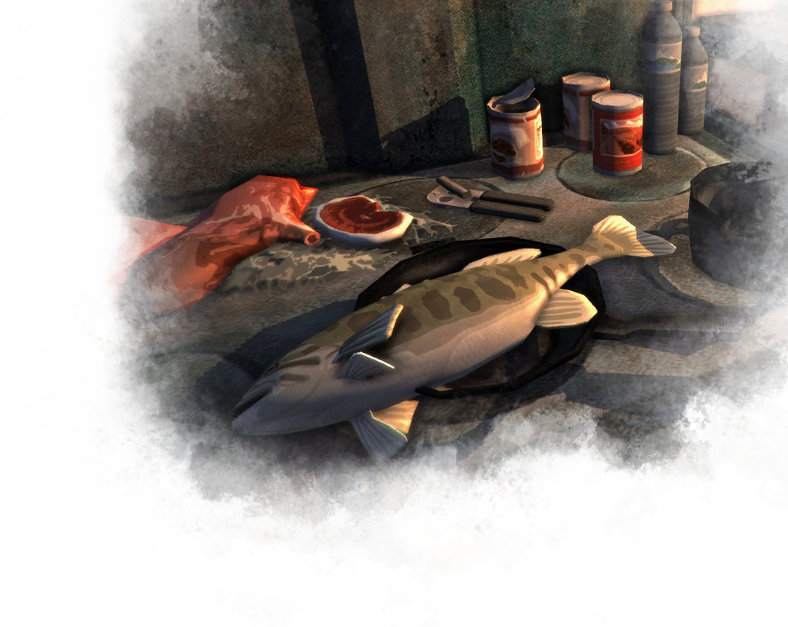
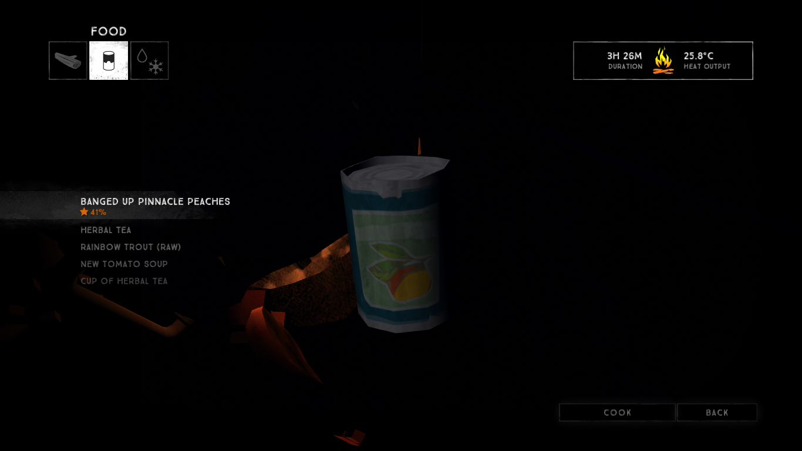
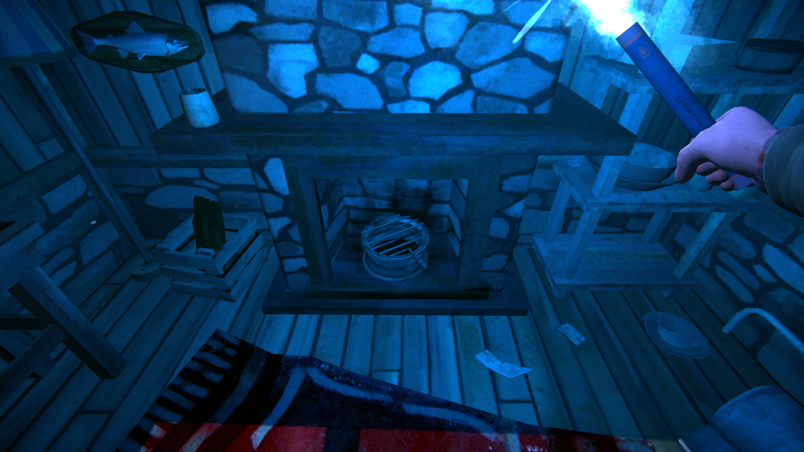
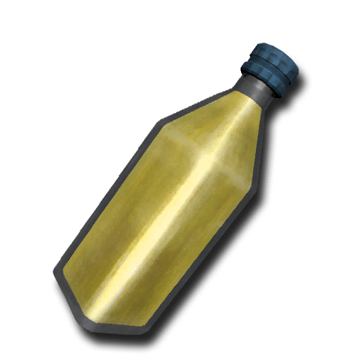
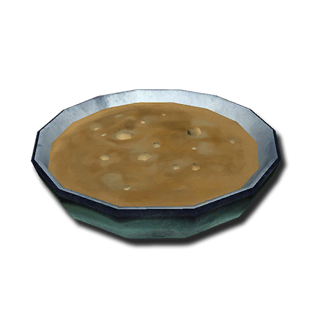
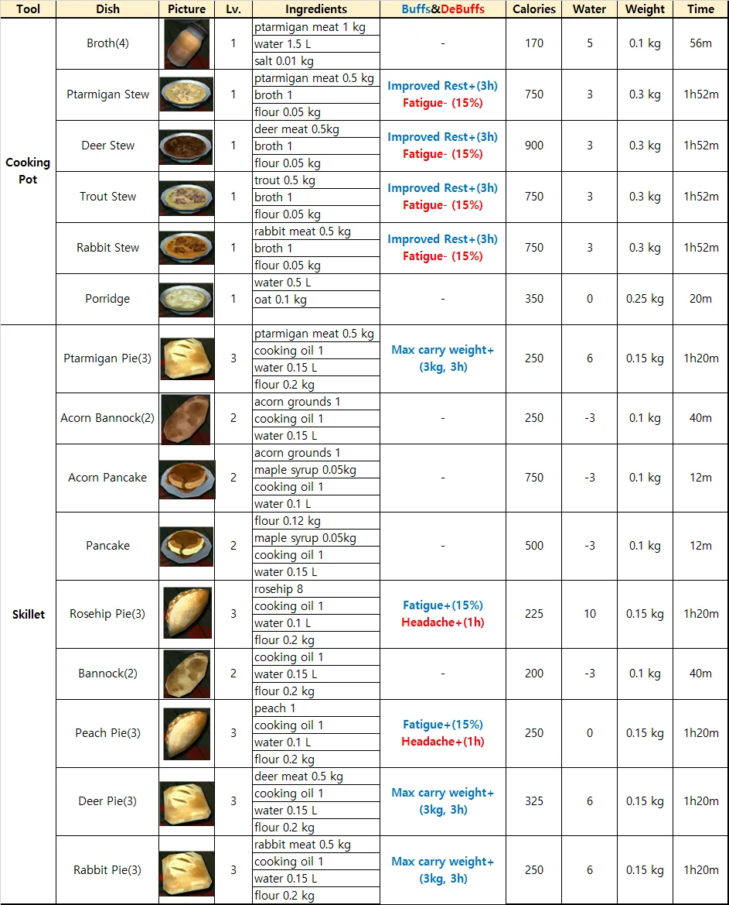
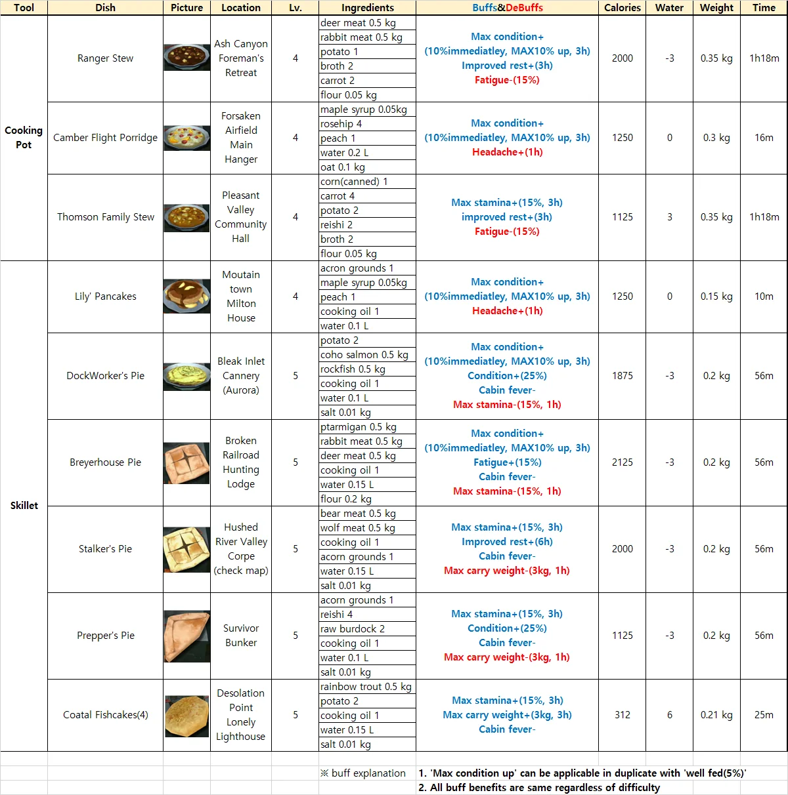
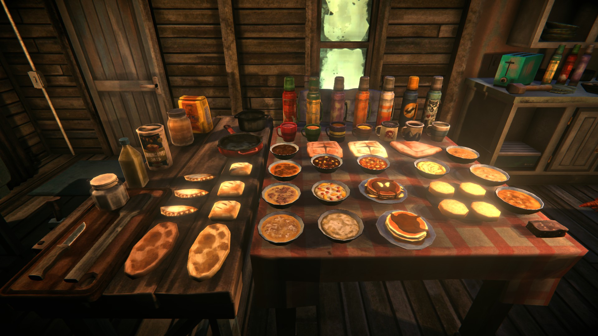
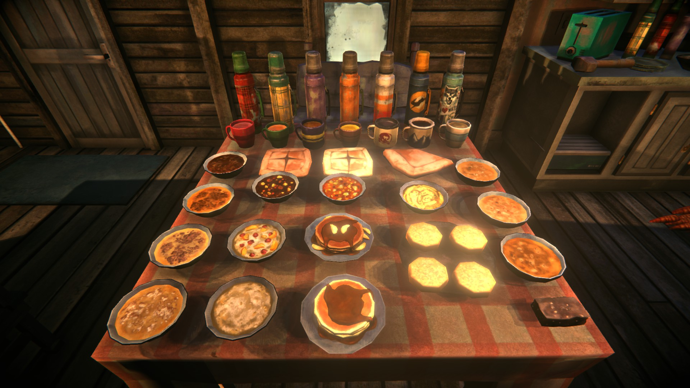

# Cooking

**Categories:** DLC Content, Skills · **Source:** [Fandom](https://thelongdark.fandom.com/wiki/Cooking)

**Contents**

- [How to cook](#how-to-cook)
- [Equipment](#equipment)
- [Firebox cooking slots](#firebox-cooking-slots)
- [Types of food](#types-of-food)
- [Meat](#meat)
- [Fish](#fish)
- [Canned](#canned)
- [Drinks](#drinks)
- [Edible Prepared Plants](#edible-prepared-plants)
- [Frontier Cooking Recipes](#frontier-cooking-recipes)
- [Preparing Recipes](#preparing-recipes)
- [Ingredients](#ingredients)
- [Cooking Pot Recipes](#cooking-pot-recipes)
- [Cooking Skillet Recipes](#cooking-skillet-recipes)
- [No Tool Recipes](#no-tool-recipes)
- [Removing from fire](#removing-from-fire)
- [Skill levels](#skill-levels)
- [Gallery](#gallery)

**Cooking**

_Cooking\_background.png_

**Release:** [Penitent Scholar (v0.346)](./The%20Long%20Dark%20%E2%80%94%20Early%20Access%20Changelog.md#0.346)

**Date:** 23 June 2016

_Cooking.png_

**Cooking** is a Survival [Skill](./Skills.md) that is used to prepare or craft [Food and Drink](./Food%20And%20Drink.md). Cooking offers several benefits, including increasing the condition of raw food and reducing the risk of [Food Poisoning](./Food%20Poisoning.md). There are many different types of food in _[The Long Dark](./The%20Long%20Dark.md)_, each providing different amounts of calories and special buffs and debuffs only available by using this Skill. Cooking also has a larger variety of training options than any other Skill, due to the number of food types and drinks that can be cooked.

## How to cook

_old menu_ Cooking is one of the easiest skills to train in _The Long Dark_, as players can increase their skill by cooking any food or drink item. There are dozens of options for fish, meat, harvestable plants, tradeable cooking ingredients and a vast number of dishes and drinks that the player can craft; each of these options grants cooking experience, making Cooking as a skill the easiest to level up in the game. For players who own the [Tales from the Far Territory](./Tales%20from%20the%20Far%20Territory.md) DLC especially, the update "Frontier Comforts" added an entire cooking system with new dishes, recipe cards that can be collected throughout Great Bear and new ingredients all around the island..

Players can cook food and drinks on any [Fire](./Fire.md) using the one-to-six possible cooking slots depending on the type of fire. There is no difference between cooking over a [Campfire](./Fire.md#Campfire) and [contained fire](./Fire.md#Contained_fires) (Campfire, Rim Grill, Pot Belly, Fire Barrel, etc.).

Players can then select the food item, drink or cooking container from the radial menu or inventory and place it next to the fire in a designated cooking slot. When using a cooking tool, the player can "use" the placed [can](./Can.md), [cooking pot](./Cooking%20Pot.md) or [skillet](./Cooking%20Skillet.md) to select which food or drink to cook.

## Equipment

Players need a Fire before they can start cooking, and certain pieces of equipment can be used to assist with cooking.

| Image | Equipment | Benefit |
| --- | --- | --- |
| \[Missing image: Fire\_icon.png\] _Fire\_icon.png_ | [Fire](./Fire.md#Types_of_fires) | - Used to cook any [canned food](#canned) and meat. - The Can, Cooking Pot and Cooking Skillet can be used on it to prepare dishes. - Includes player-made campfires and contained fires made in existing fireboxes. |
|  _Anywhere\_icon.png_ | No Tool | - Used exclusively to cook [Bannock](./Bannock.md) and [Acorn Bannock](./Acorn%20Bannock.md) without a [Cooking Skillet](./Cooking%20Skillet.md) - Alternative method of heating food/drink in inventory on an active Cooking Slot |
|  _Recycled\_Can\_icon.png_ | [Recycled Can](./Recycled%20Can.md) | - Used to cook canned foods. - Can melt and boil up to 0.5 liters of [water](./Water%20%28Unsafe%29.md) at a time. - Used to craft or heat up any drink in the game. - Used to boil [Prepared Acorns](./Prepared%20Acorns.md). |
|  _Cooking\_Pot\_icon.png_ | [Cooking Pot](./Cooking%20Pot.md) | - Used to cook Cooking Pot Recipes. - Used to cook canned foods. - Used to cook any meat or fish in the game. - Can melt and boil up to 2.0 litres of water at a time. - Cooking times reduced by 20%. - Food takes 50% longer to burn. |
|  _Cooking\_Skillet\_icon.png_ | [Cooking Skillet](./Cooking%20Skillet.md) | - Used to cook Skillet Recipes. - Used to cook canned foods. - Used to cook any meat or fish in the game. - Can melt and boil up to 1.0 litres of water at a time. - Cooking times reduced by 20%. - Food takes 50% longer to burn. |

## Firebox cooking slots

_Placing teas and canned goods near an active fire will warm/cook them, without sacrificing a cooking slot._ Different fireplaces provide different amounts of cooking slots, allowing for more or less efficient usage of fuel/places to cook food and water. It's important to note that canned goods and drinks can be placed from the inventory or radial menu in the direct vicinity of a fire and can be heated/cooked without sacrificing a cooking slot.

Image

Name

Cooking Slots

_Ammunition\_Forge.png_

[Ammunition Forge](./Ammunition%20Forge.md)

0

_Pot\_belly\_stove.png_

[Pot Belly Stove](./Pot%20Belly%20Stove.md)

1

_Forge.png_

[Furnace](./Furnace.md)

1

_McLeod\_Ultra-Efficiency\_Whale\_Oil\_Heater\_icon.png_

[McLeod Ultra-Efficiency Whale Oil Heater](./McLeod%20Ultra-Efficiency%20Whale%20Oil%20Heater.md)

1

_Prototype\_Train\_Interior.jpg_

[Prototype Train](./Prototype%20Train.md) (Engine cooking slot)

1

_Fire\_radial\_icon.png_

[Campfire](./Campfire.md)

2

_Fire\_barrel.png_

[Fire Barrel](./Fire%20Barrel.md)

2

_Fire\_place.png_

[Fireplace](./Fireplace.md)

2

_Screen\_ab2c5b97-8817-4398-a5b1-fb4b96024b93\_hi.png_

[Rim Grill](./Rim%20Grill.md)

2

_Wood\_stove.png_

[Wood Stove](./Wood%20Stove.md)

2

_Stove.png_

[Stove](./Stove.md)

6

## Types of food

### Meat

Players can obtain raw meat from [Harvesting](./Harvesting.md) animal carcasses. See the Energy density column below to maximize use of your calorie meter.

Image

Name

Cooking time (min/kg)[¹](#fn1)

Energy density (kcal/kg)

Notes

_Rabbit\_(Cooked)\_icon.png_

[Rabbit (Cooked)](./Rabbit%20%28Cooked%29.md)

38

450 kcal / kg / _(205 kcal / lb)_

Obtained by cooking raw rabbit meat [harvested](./Harvesting.md) from a [Rabbit Carcass](./Rabbit%20Carcass.md)

_Venison\_(Cooked)\_icon.png_

[Venison (Cooked)](./Venison%20%28Cooked%29.md)

57

800 kcal / kg / _(364 kcal / lb)_

Obtained by cooking raw venison harvested from a [Deer](./Deer.md) carcass

_Wolf\_Meat\_(Cooked)\_icon.png_

[Wolf Meat (Cooked)](./Wolf%20Meat%20%28Cooked%29.md)

69

700 kcal / kg / _(318 kcal / lb)_

Obtained by cooking raw wolf meat harvested from a [Wolf](./Wolf.md) or [Timberwolf](./Timberwolf.md) carcass

_Bear\_Meat\_(Cooked)\_icon.png_

[Bear Meat (Cooked)](./Bear%20Meat%20%28Cooked%29.md)

82

900 kcal / kg / _(409 kcal / lb)_

Obtained by cooking raw black bear meat harvested from a black [Bear](./Bear.md) carcass

_Moose\_Meat\_(Cooked)\_icon.png_

[Moose Meat (Cooked)](./Moose%20Meat%20%28Cooked%29.md)

82

900 kcal / kg / _(409 kcal / lb)_

Obtained by cooking raw moose meat harvested from a [Moose](./Moose.md) carcass

_Ptarmigan\_(Cooked)\_icon.png_

[Ptarmigan (Cooked)](./Ptarmigan%20%28Cooked%29.md)

38

450 kcal / kg / _(205 kcal / lb)_

Obtained by cooking ptarmigan meat harvested from a [Ptarmigan Carcass](./Ptarmigan%20Carcass.md).

_Cougar\_Meat\_(Cooked)\_icon.png_

[Cougar Meat (Cooked)](./Cougar%20Meat%20%28Cooked%29.md)

75

800 kcal / kg / _(364 kcal / lb)_

Obtained by cooking raw cougar meat harvested from a [Cougar](./Cougar.md) carcass

### Fish

Players can obtain raw fish from sufficiently deep bodies of Salt or Fresh water by [Ice Fishing](./Ice%20Fishing.md). Cooking fish also produces a small amount of [Lantern Fuel](./Lantern%20Fuel.md). See the Energy density column below to maximize use of your calorie meter.

Image

Name

Cooking time (min/kg) [²](#fn2)

Energy density

Notes

_Lake\_Whitefish\_(Cooked)\_icon.png_

[Lake Whitefish (Cooked)](./Lake%20Whitefish%20%28Cooked%29.md)

21

383.33 kcal / kg / _(174 kcal / lb)_

Obtained by cooking raw [Lake Whitefish](./Lake%20Whitefish%20%28Raw%29.md) fished from a freshwater location.

_Rainbow\_Trout\_(Cooked)\_icon.png_

[Rainbow Trout (Cooked)](./Rainbow%20Trout%20%28Cooked%29.md)

19

383.33 kcal / kg / _(174 kcal / lb)_

Obtained by cooking raw [Rainbow Trout](./Rainbow%20Trout%20%28Raw%29.md) fished from a saltwater location.

_Coho\_Salmon\_(Cooked)\_icon.png_

[Coho Salmon (Cooked)](./Coho%20Salmon%20%28Cooked%29.md)

12

445.95 kcal / kg / _(203 kcal / lb)_

Obtained by cooking raw [Coho Salmon](./Coho%20Salmon%20%28Raw%29.md) fished from a saltwater location.

_Smallmouth\_Bass\_(Cooked)\_icon.png_

[Smallmouth Bass (Cooked)](./Smallmouth%20Bass%20%28Cooked%29.md)

15

454.55 kcal / kg / _(207 kcal / lb)_

Obtained by cooking raw [Smallmouth Bass](./Smallmouth%20Bass%20%28Raw%29.md) fished from a freshwater location.

_Burbot\_(Cooked)\_icon.png_

[Burbot (Cooked)](./Burbot%20%28Cooked%29.md)

12

487.71 kcal / kg / _(222 kcal / lb)_

Obtained by cooking raw [Burbot](./Burbot%20%28Raw%29.md) fished from a freshwater location.

_Rockfish\_(Cooked)\_icon.png_

[Rockfish (Cooked)](./Rockfish%20%28Cooked%29.md)

11

449.31 kcal / kg / _(204 kcal / lb)_

Obtained by cooking raw [Rockfish](./Rockfish%20%28Raw%29.md) fished from a saltwater location.

_Red\_Irish\_Lord\_(Cooked)\_icon.png_

[Red Irish Lord (Cooked)](./Red%20Irish%20Lord%20%28Cooked%29.md)

16

451.32 kcal / kg / _(205 kcal / lb)_

Obtained by cooking raw [Red Irish Lord](./Red%20Irish%20Lord%20%28Raw%29.md) fished from a saltwater location.

_Goldeye\_(Cooked)\_icon.png_

[Goldeye (Cooked)](./Goldeye%20%28Cooked%29.md)

17

452.24 kcal / kg / _(206 kcal / lb)_

Obtained by cooking raw [Goldeye](./Goldeye%20%28Raw%29.md) fished from a freshwater location.

### Canned

Players can obtain canned goods by scavenging throughout their playthrough. Canned goods requires a [Can Opener](./Can%20Opener.md), [Hunting Knife](./Hunting%20Knife.md), or [Hatchet](./Hatchet.md) to be opened to retain the full contents. If the player does not have any of these tools, they can also smash the can open, but this results in losing between 10% and 30% of the contents to spillage if the player's Cooking level is less than 3. Smashing cans will not yield a Recycled Can once the contents are eaten, regardless of skill level. The cooking time for canned goods is 15 minutes when cooked directly on a Fire, but is 24 when placed next to one. Any canned foods not listed here cannot be cooked.

Image

Name

Energy density

Notes

_Canned\_Pineapple\_icon.png_

[Canned Pineapple](./Canned%20Pineapple.md)

737.5 kcal / kg / _(335 kcal / lb)_

Consuming while Hot also provides the Warming Up buff to the player.

_Canned\_Corn\_icon.png_

[Canned Corn](./Canned%20Corn.md)

983.3 kcal / kg / _(447 kcal / lb)_

Consuming while Hot also provides the Warming Up buff to the player.

_Pinnacle\_Peaches\_icon.png_

[Pinnacle Peaches](./Pinnacle%20Peaches.md)

900 kcal / kg / _(409 kcal / lb)_

Consuming while Hot also provides the Warming Up buff to the player.

_Tomato\_Soup\_icon.png_

[Tomato Soup](./Tomato%20Soup.md)

1200 kcal / kg / _(545 kcal / lb)_

Consuming while Hot also provides the Warming Up buff to the player.

_Pork\_and\_Beans\_icon.png_

[Pork and Beans](./Pork%20and%20Beans.md)

2400 kcal / kg / _(1,091 kcal / lb)_

Consuming while Hot also provides the Warming Up buff to the player.

### Drinks

Players can obtain hot drinks from brewing a [Tin of Coffee](./Tin%20of%20Coffee.md), [Herbal Tea](./Herbal%20Tea.md), [Acorn Coffee](./Cup%20of%20Acorn%20Coffee.md) or by preparing plants found across the island with 0.25 litres of potable water ([Rose Hip Tea](./Rose%20Hip%20Tea.md), [Birch Bark Tea](./Birch%20Bark%20Tea.md), etc.). Drinks cooked in a Recycled Can directly on a Fire take 12 minutes to cook; reheating takes 33% less time (8 minutes in a recycled can); they may also be cooked in a Cooking Pot or Cooking Skillet. Each drink weighs 0.1 kg and has 100 kcal and, when consumed Hot, provides a [Warming Up](./Warming%20Up.md) bonus to the player.

Image

Name

Bonus/Affliction

Ingredient (+0.25L water)

Ingredient weight

Materials weight

_Birch\_Bark\_Tea\_icon.png_

[Birch Bark Tea](./Birch%20Bark%20Tea.md)

Bonus [Restore Condition](./Restore%20Condition.md)

[Prepared Birch Bark](./Prepared%20Birch%20Bark.md)

0.05 kg / _(0.11 lb)_

0.10 kg / _(0.22 lb)_

_Burdock\_Tea\_icon.png_

[Burdock Tea](./Burdock%20Tea.md)

Cures [Food Poisoning](./Food%20Poisoning.md), [Infection](./Infection.md), [Dysentery](./Dysentery.md) and [Internal Parasites](./Intestinal%20Parasites.md).

[Prepared Burdock](./Prepared%20Burdock.md)

0.15 kg / _(0.33 lb)_

N/A

_Cup\_of\_Acorn\_Coffee\_icon.png_

[Cup of Acorn Coffee](./Cup%20of%20Acorn%20Coffee.md)

Bonus [Fatigue Reduced](./Fatigue%20Reduced.md)

[Acorn Grounds](./Acorn%20Grounds.md)

0.20 kg / _(0.44 lb)_

N/A

_Cup\_of\_Coffee\_icon.png_

[Cup of Coffee](./Cup%20of%20Coffee.md)

Bonus [Fatigue Reduced](./Fatigue%20Reduced.md)

[Tin of Coffee](./Tin%20of%20Coffee.md)

0.01 kg / _(0.022 lb)_

N/A

_Cup\_of\_Herbal\_Tea\_icon.png_

[Cup of Herbal Tea](./Cup%20of%20Herbal%20Tea.md)

Bonus [Improved Rest](./Improved%20Rest.md)

[Herbal Tea](./Herbal%20Tea.md)

0.01 kg / _(0.022 lb)_

N/A

_Reishi\_Tea\_icon.png_

[Reishi Tea](./Reishi%20Tea.md)

Cures [Food Poisoning](./Food%20Poisoning.md), [Infection](./Infection.md), [Dysentery](./Dysentery.md) and [Internal Parasites](./Intestinal%20Parasites.md).

[Prepared Reishi Mushrooms](./Prepared%20Reishi%20Mushrooms.md)

0.05 kg / _(0.11 lb)_

0.10 kg / _(0.22 lb)_

_Rose\_Hip\_Tea\_icon.png_

[Rose Hip Tea](./Rose%20Hip%20Tea.md)

Cures the [Pain](./Pain.md) [Affliction](./Afflictions.md).

[Prepared Rose Hips](./Prepared%20Rose%20Hips.md)

0.05 kg / _(0.11 lb)_

0.24 kg / _(0.528 lb)_

### Edible Prepared Plants

Some plants can be cooked and eaten as is. Acorns are a unique food that can be found near [Oak Trees](./Oak%20Tree.md) and must be shelled before cooking. Potatoes can be used in recipes or cooked.

Image

Name

Energy density

Ingredient (+0.25L water)

Ingredient weight

Materials weight

_Acorns\_(Cooked)\_icon.png_

[Acorns (Cooked)](./Acorns%20%28Cooked%29.md)

80 kcal

[Prepared Acorns](./Prepared%20Acorns.md)

0.05 kg / _(0.11 lb)_

N/A

_Acorns\_(Cooked\_-\_Large\_Portion)\_icon.png_

[Acorns (Cooked - Large Portion)](./Acorns%20%28Cooked%20-%20Large%20Portion%29.md)

400 kcal

[Prepared Acorns (Large Portion)](./Prepared%20Acorns%20%28Large%20Portion%29.md)

0.20 kg / _(0.44 lb)_

N/A

_Cooked\_Potato\_icon.png_

[Cooked Potato](./Cooked%20Potato.md)

250 kcal

[Potato](./Potato.md) (does not need water to cook)

0.20 kg / _(0.44 lb)_

0.15 kg / _(0.33 lb)_

## Frontier Cooking Recipes

| Column 1 | Column 2 | Column 3 |
| --- | --- | --- |
|  _Ptarmigan\_icon.png_ | **DLC-Exclusive content.** This content requires the [Tales from the Far Territory](./Tales%20from%20the%20Far%20Territory.md) addon to be installed before it can be seen or used in regular gameplay. |    > “**Recipes and new ingredients open a range of possibilities for food preparations that can offer different gameplay effects.**” > > — Official marketing description Enhanced Cooking Recipes were added in the Part 3: Frontier Comforts update, available for players who purchase the [Tales from the Far Territory](./Tales%20from%20the%20Far%20Territory.md) Expansion. Cooking Recipes have a different classification from normal cooking: - They require multiple ingredients to create rather than simply cooking one item, and tend to take longer to prepare than normal foods, but can be worth the effort to create as they can provide unique benefits that can increase/decrease Afflictions. - Enhanced Recipes require additional time to be "prepared" rather than simple placing them in a container and cooking them. - Unlike regular cooking, Enhanced Cooking requires fresh ingredients, I.E. non-Ruined food items, to prepare recipes. - Some recipes require the player to reach a certain Cooking skill level before the player is allowed to make them. There are currently 24 recipes in total, separated into 3 categories via container used to prepare them. A full list can be found in the unique Recipe Book menu of the [Survival Menu](./Survival%20Menu.md) (Cooking Pot icon). - 16 base Recipes are available from the start. - 13 Unique Recipes can be found on [Recipe Cards](./Recipe%20Cards.md) that are spread out all over Great Bear and must be collected by the player first before they appear in the Cooking Recipe menu. Once the Recipe Card is obtained, it can be identified in the Cooking Recipe menu via awhite star. These recipes require the most ingredients to make and the highest Cooking Skill Levels, but they offer the greatest Affliction boosts. Unique Recipe Cards can be tracked in the Collectibles menu of the [Journal](./Journal.md). |

### Preparing Recipes

All Recipes require the player to "prepare" the ingredients before they are placed in a container. This is different from cooking non-recipe foods, as the player would normally place them in a container and immediately begin cooking.

- Only fresh Ingredients can be used; Ruined 0% Condition items cannot be cooked with, unlike cooking 0% meat/canned goods. The menu will say you have the materials but will refuse to let you use them if they are Ruined (this can be bugged and the game will occasionally let you use them anyway).
- Keep in mind that once the player commits to cooking a recipe in a container, 11-20 minutes always passes (a "preparing" message appears, accompanied by chopping, scrapping and cooking sound effects while time acceleration occurs. This can be cancelled at any time.) before said item appears in the container and starts cooking (time resumes normally after the "preparing" stage).
  - This can potentially result in the fire going out while preparing, requiring it to be relit again and the "preparing" section started again. Always place extra fuel in the fire when creating recipes.
  - Once a Recipe is finished being prepared, an uncooked version of it will appear on the fire (Cooking Experience is gained from preparing successfully).
- If an unfinished/uncooked Recipe is removed from the fire container before it is finished cooking, a warning will appear asking if the player wishes to discard the item. Removing the item in this state will permanently remove it from the game world, wasting cooking ingredients.

### Ingredients

Ingredients are used solely for recipes and most cannot be consumed on their own (except for Carrots). You can find these Ingredients as regular loot all around the island or you can trade for them with the Trader; in the late-game, most places have been looted by the player and most Ingredients have reached 0% Condition, making Trading an almost mandatory step if a player wants to keep engaging with the Cooking system at this stage.

Image

Name

Weight

_Carrot\_icon.png_

[Carrot](./Carrot.md)

0.10 kg

_Cooking\_Oil\_icon.png_

[Cooking Oil](./Cooking%20Oil.md)

0.75 kg

_Old\_Mill\_Flour\_icon.png_

[Old Mill Flour](./Old%20Mill%20Flour.md)

1.50 kg

_Potato\_icon.png_

[Potato](./Potato.md)

0.20 kg

_Running\_River\_Oats\_icon.png_

[Running River Oats](./Running%20River%20Oats.md)

0.80 kg

_Salt\_icon.png_

[Salt](./Salt.md)

0.25 kg

_Salt\_(Bag)\_icon.png_

[Salt (Bag)](./Salt%20%28Bag%29.md)

10.00 kg

### Cooking Pot Recipes

6 Recipes require a [Cooking Pot](./Cooking%20Pot.md) to be used, and all but the unique Recipes are available to Survivors from the start.

| Image | Recipe Name | Ingredients | Calorie Density | Additional Effect | Weight | Cooking Times | Cooking Level |
| --- | --- | --- | --- | --- | --- | --- | --- |
|  _Broth\_icon.png_ | [Broth](./Broth.md) (4) | - 1.00 kg [Ptarmigan (Raw)](./Ptarmigan%20%28Raw%29.md) - 1.50 L [Water (Potable)](./Water%20%28Potable%29.md) - 0.01 kg [Salt](./Salt.md) | - 170 Calories - 5 Hydration | None | 0.10 kg | 56 min | 1 |
|  | [Camber Flight Porridge](./Camber%20Flight%20Porridge.md) | - 0.05 kg [Maple Syrup](./Maple%20Syrup.md) - 4 [Rose Hips](./Rose%20Hip.md) - 0.50 kg [Pinnacle Peaches](./Pinnacle%20Peaches.md) - 0.20 L [Water (Potable)](./Water%20%28Potable%29.md) - 0.10 kg [Running River Oats](./Running%20River%20Oats.md) | - 1000 Calories | - Increase Max Condition (10% max, 3 hours) - Decrease Headache (1 hour) | 0.30 kg | 22 min | 4 |
|  _Cooking\_Oil\_icon.png_ | [Cooking Oil](./Cooking%20Oil.md) | - 1.00 kg [Animal Fat](./Animal%20Fat.md) | - None | - None | 0.75 kg | 24 min | 1 |
|  | [Last Resort Soup](./Last%20Resort%20Soup.md) | - 2 [Potato](./Potato.md) - 0.40 L [Broth](./Broth.md) - 0.01 kg [Salt](./Salt.md) | - 800 Calories - 6 Hydration | - Increase Max Condition (10% max, 3 hours) - Makes you more tired (Fatigue metre -15%) | 0.10 kg | 40 minutes | 1 |
|  | [Pemmican Bar](./Pemmican%20Bar.md) (4) | - 0.50 kg [Cured Meat](./Cured%20Meat.md) - 15 [Rose Hip](./Rose%20Hip.md) - 0.50 kg [Animal Fat](./Animal%20Fat.md) - 0.05 kg [Salt](./Salt.md) | - 450 Calories | - Increased Stamina (15% for 3 hours) - Increased Carry Weight (+3 kg for 3 hours) - Makes you less tired (Fatigue metre +15%) | 0.25 kg | 40 minutes | 5 |
|  _Porridge\_icon.png_ | [Porridge](./Porridge.md) | - 0.25 L [Water (Potable)](./Water%20%28Potable%29.md) - 0.10 kg [Running River Oats](./Running%20River%20Oats.md) | - 350 Calories | None | 0.20 kg | 20 min | 1 |
|  | [Porter's Soup](./Porter%27s%20Soup.md) | - 2 [Carrot](./Carrot.md) - 6 [Cat Tail Stalk](./Cat%20Tail%20Stalk.md) - 0.50 kg [Ptarmigan (Raw)](./Ptarmigan%20%28Raw%29.md) - 0.40 L [Broth](./Broth.md) - 0.01 kg [Salt](./Salt.md) | - 1200 Calories - 6 Hydration | - Increase Max Condition (10% max, 3 hours) - Increase Carry Weight (3kg, 3 hours) - Makes you more tired (Fatigue metre -15%) | 0.10 | 40 min | 4 |
|  _Ptarmigan\_Stew\_icon.png_ | [Ptarmigan Stew](./Ptarmigan%20Stew.md) | - 0.50 kg [Ptarmigan (Raw)](./Ptarmigan%20%28Raw%29.md) - 0.20 L [Broth](./Broth.md) - 0.05 kg [Old Mill Flour](./Old%20Mill%20Flour.md) | - 750 Calories - 3 Hydration | - Improves Rest (3 hours) - Makes you more tired (Fatigue metre -15%) | 0.35 kg | 1 hr 52 min | 1 |
|  _Rabbit\_Stew\_icon.png_ | [Rabbit Stew](./Rabbit%20Stew.md) | - 0.50 kg [Rabbit (Raw)](./Rabbit%20%28Raw%29.md) - 0.20 L [Broth](./Broth.md) - 0.05 kg [Old Mill Flour](./Old%20Mill%20Flour.md) | - 750 Calories - 3 Hydration | - Improves Rest (3 hours) - Makes you more tired (Fatigue metre -15%) | 0.35 kg | 1 hr 52 min | 1 |
|  | [Ranger Stew](./Ranger%20Stew.md) | - 0.50 kg [Venison (Raw)](./Venison%20%28Raw%29.md) - 0.50 kg [Rabbit (Raw)](./Rabbit%20%28Raw%29.md) - 1 [Potato](./Potato.md) - 0.20 kg [Carrot](./Carrot.md) - 0.40 L [Broth](./Broth.md) - 0.05 kg [Old Mill Flour](./Old%20Mill%20Flour.md) | - 1600 Calories - -3 Hydration | - Increase Max Condition (10% max, 3 hours) - Increase Condition (10% Immediate) - Makes you more tired (Fatigue metre -15%) - Improved Rest (3 hours) | 0.35 kg | 1 hr 52 min | 4 |
|  | [Thomson Family Stew](./Thomson%20Family%20Stew.md) | - 0.30 kg [Canned Corn](./Canned%20Corn.md) - 0.40 kg [Carrot](./Carrot.md) - 2 [Potato](./Potato.md) - 2 [Reishi Mushroom](./Reishi%20Mushroom.md) - 0.40 L [Broth](./Broth.md) - 0.05 kg [Old Mill Flour](./Old%20Mill%20Flour.md) | - 900 Calories - 3 Hydration | - Increased Stamina (15% for 3 hours) - +15% Maximum Stamina Increase (for 3 hours) - 3 hours of [Improved Rest](./Improved%20Rest.md) - Makes you more tired (Fatigue metre -15%) | 0.35 kg | 1 hr 52 min | 4 |
|  _Trout\_Stew\_icon.png_ | [Trout Stew](./Trout%20Stew.md) | - 0.50 kg [Rainbow Trout (Raw)](./Rainbow%20Trout%20%28Raw%29.md) - 0.20 L [Broth](./Broth.md) - 0.05 kg [Old Mill Flour](./Old%20Mill%20Flour.md) | - 750 Calories - 3 Hydration | - Improves Rest (3 hours) - Makes you more tired (Fatigue metre -15%) | 0.35 kg | 1 hr 52 min | 1 |
|  | [Vagabond Soup](./Vagabond%20Soup.md) | - 0.50 kg [Rabbit (Raw)](./Rabbit%20%28Raw%29.md) - 0.40 L [Broth](./Broth.md) - 0.01 [Salt](./Salt.md) | - 550 Calories - 6 Hydration | - Increase Max Condition (10% max, 3 hours) - Makes you more tired (Fatigue metre -15%) | 0.10 | 40 min | 1 |
|  _Venison\_Stew\_icon.png_ | [Venison Stew](./Venison%20Stew.md) | - 0.50 kg [Venison (Raw)](./Venison%20%28Raw%29.md) - 0.20 L [Broth](./Broth.md) - 0.05 kg [Old Mill Flour](./Old%20Mill%20Flour.md) | - 900 Calories - 3 Hydration | - Improves Rest (3 hours) - Makes you more tired (Fatigue metre -15%) | 0.35 kg | 1 hr 52 min | 1 |

### Cooking Skillet Recipes

These Recipes require a [Cooking Skillet](./Cooking%20Skillet.md) and the player to be at Cooking Skill Level 2 or 3.

| Image | Recipe Name | Ingredients | Calorie Density | Additional Effect | Weight | Cooking Times | Cooking Level |
| --- | --- | --- | --- | --- | --- | --- | --- |
|  _Acorn\_Bannock\_icon.png_ | [Acorn Bannock](./Acorn%20Bannock.md) (2) | - 1 [Acorn Grounds](./Acorn%20Grounds.md) - 0.15 L [Water (Potable)](./Water%20%28Potable%29.md) - 0.05 L [Cooking Oil](./Cooking%20Oil.md) | - 250 Calories - -3 Hydration | None | 0.10 kg | 40 min | 2 |
|  _Acorn\_Pancakes\_icon.png_ | [Acorn Pancakes](./Acorn%20Pancakes.md) | - 1 [Acorn Grounds](./Acorn%20Grounds.md) - 0.05 kg [Maple Syrup](./Maple%20Syrup.md) - 0.10 L [Water (Potable)](./Water%20%28Potable%29.md) - 0.05 L [Cooking Oil](./Cooking%20Oil.md) | - 750 Calories - -3 Hydration | None | 0.10 kg | 12 min | 2 |
|  _Bannock\_icon.png_ | [Bannock](./Bannock.md) (2) | - 0.15 L [Water (Potable)](./Water%20%28Potable%29.md) - 0.05 L [Cooking Oil](./Cooking%20Oil.md) - 0.20 kg [Old Mill Flour](./Old%20Mill%20Flour.md) | - 200 Calories - -3 Hydration | None | 0.10 kg | 40 min | 2 |
|  | [Breyerhouse Pie](./Breyerhouse%20Pie.md) | - 0.50 kg [Ptarmigan (Raw)](./Ptarmigan%20%28Raw%29.md) - 0.50 kg [Rabbit (Raw)](./Rabbit%20%28Raw%29.md) - 0.50 kg [Venison (Raw)](./Venison%20%28Raw%29.md) - 0.15 L [Water (Potable)](./Water%20%28Potable%29.md) - 0.05 L [Cooking Oil](./Cooking%20Oil.md) - 0.20 kg [Old Mill Flour](./Old%20Mill%20Flour.md) | - 1700 Calories - -3 Hydration | - Increase Max Condition (10% max, 3 hours) - Makes you less tired (Fatigue metre +15%) - Decrease Cabin Fever - Decrease Stamina (-15%, 1 hour) | 0.20 kg | 1 hr 20 min | 5 |
|  | [Coastal Fishcakes](./Coastal%20Fishcakes.md) (4) | - 0.50 kg [Rainbow Trout (Raw)](./Rainbow%20Trout%20%28Raw%29.md) - 2 [Potato](./Potato.md) - 0.15 L [Water (Potable)](./Water%20%28Potable%29.md) - 0.05 L [Cooking Oil](./Cooking%20Oil.md) - 0.01 [Salt](./Salt.md) | - 250 Calories - 6 Hydration | - Increase Stamina (15%, 3 hours) - Increase Carry Weight (3kg, 3 hours) - Decrease [Cabin Fever](./Cabin%20Fever.md) (this buff is bugged and won't actually decrease Cabin Fever) | 0.21 kg | 36 min | 5 |
|  _Cooking\_Oil\_icon.png_ | [Cooking Oil](./Cooking%20Oil.md) | - 1.00 kg [Animal Fat](./Animal%20Fat.md) | - None | - None | 0.75 kg | 24 min | 1 |
|  | [Dockworker's Pie](./Dockworker%27s%20Pie.md) | - 2 [Potato](./Potato.md) - 0.50 kg [Coho Salmon (Raw)](./Coho%20Salmon%20%28Raw%29.md) - 0.50 kg [Rockfish (Raw)](./Rockfish%20%28Raw%29.md) - 0.10 L [Water (Potable)](./Water%20%28Potable%29.md) - 0.05 L [Cooking Oil](./Cooking%20Oil.md) - 0.01 kg [Salt](./Salt.md) | - 1500 Calories | - Increase Max Condition (10% max, 3 hours) - Increase Condition (25% Immediate) - Decrease Cabin Fever (this buff is bugged and won't do anything) - Decrease Stamina (-15%, 1 hour) | 0.20 kg | 1 hr 20 min | 5 |
|  | [Lily's Pancakes](./Lily%27s%20Pancakes.md) | - 1 [Acorn Grounds](./Acorn%20Grounds.md) - 0.05 kg [Maple Syrup](./Maple%20Syrup.md) - 0.50 kg [Pinnacle Peaches](./Pinnacle%20Peaches.md) - 0.10 L [Water (Potable)](./Water%20%28Potable%29.md) - 0.05 L [Cooking Oil](./Cooking%20Oil.md) | - 1000 Calories | - Increase Max Condition (10% max, 3 hours) - Increase Headache (1 hour) | 0.15 kg | 14 min | 4 |
|  _Pancakes\_icon.png_ | [Pancakes](./Pancakes.md) | - 0.05 kg [Maple Syrup](./Maple%20Syrup.md) - 0.15 L [Water (Potable)](./Water%20%28Potable%29.md) - 0.05 L [Cooking Oil](./Cooking%20Oil.md) - 0.12 kg [Old Mill Flour](./Old%20Mill%20Flour.md) | - 500 Calories - -3 Hydration | None | 0.15 kg | 12 min | 2 |
|  _Peach\_Pie\_icon.png_ | [Peach Pie](./Peach%20Pie.md) (3) | - 0.50 kg [Pinnacle Peaches](./Pinnacle%20Peaches.md) - 0.10 L [Water (Potable)](./Water%20%28Potable%29.md) - 0.05 L [Cooking Oil](./Cooking%20Oil.md) - 0.20 kg [Old Mill Flour](./Old%20Mill%20Flour.md) | - 250 Calories | - Makes you less tired (Fatigue metre +15%) - Increase Headache (1 hour) | 0.30 kg | 1 hr 20 min | 3 |
|  | [Pemmican Bar](./Pemmican%20Bar.md) (4) | - 0.50 kg [Cured Meat](./Cured%20Meat.md) - 15 [Rose Hip](./Rose%20Hip.md) - 0.50 kg [Animal Fat](./Animal%20Fat.md) - 0.05 kg [Salt](./Salt.md) | - 250 Calories | - Increased Stamina (15% for 3 hours) - Increased Carry Weight (+3 kg for 3 hours) - Makes you less tired (Fatigue metre +15%) | 0.25 kg | 40 minutes | 5 |
|  | [Prepper's Pie](./Prepper%27s%20Pie.md) | - 1 [Acorn Grounds](./Acorn%20Grounds.md) - 4 [Reishi Mushroom](./Reishi%20Mushroom.md) - 2 [Burdock Root](./Burdock%20Root.md) - 0.10 L [Water (Potable)](./Water%20%28Potable%29.md) - 0.05 L [Cooking Oil](./Cooking%20Oil.md) - 0.01 kg [Salt](./Salt.md) | - 900 Calories | - Increased Stamina (15% for 3 hours) - Decreased Carry Weight (-3 kg for 1 hour) - Increased Condition (+25% immediate) - Increased Cabin Fever | 0.20 kg | 1 hr 20 min | 5 |
|  _Ptarmigan\_Pie\_icon.png_ | [Ptarmigan Pie](./Ptarmigan%20Pie.md) (3) | - 0.50 kg [Ptarmigan (Raw)](./Ptarmigan%20%28Raw%29.md) - 0.15 L [Water (Potable)](./Water%20%28Potable%29.md) - 0.05 L [Cooking Oil](./Cooking%20Oil.md) - 0.20 kg [Old Mill Flour](./Old%20Mill%20Flour.md) | - 250 Calories - 6 Hydration | - Increase Max Carry Weight (3kg, 3 hours) | 0.30 kg | 1 hr 20 min | 3 |
|  _Rabbit\_Pie\_icon.png_ | [Rabbit Pie](./Rabbit%20Pie.md) (3) | - 0.50 kg [Rabbit (Raw)](./Rabbit%20%28Raw%29.md) - 0.15 L [Water (Potable)](./Water%20%28Potable%29.md) - 0.05 L [Cooking Oil](./Cooking%20Oil.md) - 0.20 kg [Old Mill Flour](./Old%20Mill%20Flour.md) | - 250 Calories - 6 Hydration | - Increase Max Carry Weight (3kg, 3 hours) | 0.30 kg | 1 hr 20 min | 3 |
|  _Rose\_Hip\_Pie\_icon.png_ | [Rose Hip Pie](./Rose%20Hip%20Pie.md) (3) | - 8 [Rose Hip](./Rose%20Hip.md) - 0.10 L [Water (Potable)](./Water%20%28Potable%29.md) - 0.05 L [Cooking Oil](./Cooking%20Oil.md) - 0.20 kg [Old Mill Flour](./Old%20Mill%20Flour.md) | - 225 Calories - 10 Hydration | - Makes you less tired (Fatigue metre +15%) - Increase Headache (1 hour) | 0.30 kg | 1 hr 20 min | 3 |
|  | [Stalker's Pie](./Stalker%27s%20Pie.md) | - 0.50 Kg [Bear Meat (Raw)](./Bear%20Meat%20%28Raw%29.md) - 0.50 Kg [Wolf Meat (Raw)](./Wolf%20Meat%20%28Raw%29.md) - 1 [Acorn Grounds](./Acorn%20Grounds.md) - 0.15 L [Water (Potable)](./Water%20%28Potable%29.md) - 0.05 L [Cooking Oil](./Cooking%20Oil.md) - 0.01 kg [Salt](./Salt.md) | - 1600 Calories - -3 Hydration | - Increased Stamina (15% for 3 hours) - Decreased Carry Weight (-3 kg for 1 hour) - Improved Rest (6 hours) - Increased Cabin Fever | 0.20 kg | 1 hr 20 min | 5 |
|  _Venison\_Pie\_icon.png_ | [Venison Pie](./Venison%20Pie.md) (3) | - 0.50 kg [Venison (Raw)](./Venison%20%28Raw%29.md) - 0.15 L [Water (Potable)](./Water%20%28Potable%29.md) - 0.05 L [Cooking Oil](./Cooking%20Oil.md) - 0.20 kg [Old Mill Flour](./Old%20Mill%20Flour.md) | - 325 Calories - 6 Hydration | - Increase Max Carry Weight (3kg, 3 hours) | 0.30 kg | 1 hr 20 min | 3 |

### No Tool Recipes

These Recipes can be made at an open cooking slot at an active fire without a tool, and the player to be at Cooking Skill Level 2. Cooking Bannocks is of course faster when done with a Cooking Skillet, as cooking times decrease with a container and higher Cooking Skill.

| Image | Recipe Name | Ingredients | Calorie Density | Additional Effect | Weight | Cooking Times | Cooking Level |
| --- | --- | --- | --- | --- | --- | --- | --- |
|  _Acorn\_Bannock\_icon.png_ | [Acorn Bannock](./Acorn%20Bannock.md) (2) | - 1 [Acorn Grounds](./Acorn%20Grounds.md) - 0.15 L [Water (Potable)](./Water%20%28Potable%29.md) - 0.05 L [Cooking Oil](./Cooking%20Oil.md) | - 250 Calories - -3 Hydration | None | 0.10 kg | 40 min | 2 |
|  _Bannock\_icon.png_ | [Bannock](./Bannock.md) (2) | - 0.15 L [Water (Potable)](./Water%20%28Potable%29.md) - 0.05 L [Cooking Oil](./Cooking%20Oil.md) - 0.20 kg [Old Mill Flour](./Old%20Mill%20Flour.md) | - 200 Calories - -3 Hydration | None | 0.10 kg | 40 min | 2 |

_Recipes level 1-3._

_Recipes level 4-5._

## Removing from fire

If a food item is picked up before cooking is complete, it will still be raw, and will require the full cooking process to start over. Food items can be moved (by right-clicking) between cooking spots without losing the progress. A fire that briefly goes out pauses the cooking process; if the fire is quickly relit, cooking will resume without an additional time penalty.

Food left on an active Fire after it finishes cooking will burn into inedible food after a set amount of time. Burnt food items are unusable and will disappear when picked up. Recycled Cans, Cooking Pots and Skillets will degrade by 5% if food is burnt. Food cooked in a Cooking Pot or Skillet will take 50% longer to burn compared to food cooked directly by the fire or in a recycled can.

## Skill levels

Players can gain Cooking skill experience by:

- Cooking any food, drink, or recipe mentioned above and then removing them from the fire before they burn (1 skill point)
  - This excludes melting and boiling water, or warming up food that has already been cooked.
- Cooking certain canned foods for the first time (1 skill point).
- Preparing a recipe successfully (1 skill point).
- A limited increase can be obtained from the [Research Book](./Research%20Book.md) _[Wilderness Kitchen](./Wilderness%20Kitchen.md)_, which allows players to increase their cooking by 10 skill points with 5 hours of research (or 20 skill points with the Book Smarts [Feat](./Feats.md) and a 20% reduction in Research time with the Settled Mind Feat).

Skill increases by 1 point per item cooked (or prepared) - regardless of its weight or for how long it cooked. _(E.g., cooking a 100 mg morsel of Rabbit in a Cooking Pot for 3 minutes results in the same increase as cooking 1 kg of Moose Meat on a bare campfire stone for 1.5 hours!)_

Once players have reached a new skill level, they unlock the effects described in the table below: &lt;table-progress-tracking table-id="4" unique-column-index="1"&gt;

| Level | Skill points needed | Points to next level | Effects | Flavor text |
| --- | --- | --- | --- | --- |
| 1 | 0 | 25 | - Basic cooking skill | If you were still enjoying civilization's warm embrace, you might be able to cook a hotdog over a fire without burning it. |
| 2 | 25 | 50 | - +10% calories from any cooked food item | You're getting better at cooking with camp tools. You don't burn things so much, including yourself. |
| 3 | 75 | 75 | - +15% calories from any cooked food item / - No calorie loss when smashing open cans / - Cooking times reduced by 10% | You're a pretty good cook. You've figured out some good ways to improvise around the lack of modern utensils and appliances. |
| 4 | 150 | 200 | - +20% calories from any cooked food item / - No calorie loss when smashing open cans / - Cooking times reduced by 20% / - Ready times increased by 20% | You can make anything feel like a meal. You have perfect timing and you don't waste anything. |
| 5 | 350 | Max level | - +25% calories from any cooked food item / - No calorie loss when smashing open cans / - Cooking times reduced by 30% / - Ready times increased by 20% / - Never get [Parasites](./Afflictions.md#Intestinal_Parasites) or [Food Poisoning](./Afflictions.md#Food_poisoning) (Note: Cooked and packaged food only. Raw meat/fish still carries risk. This is retroactive, so meat/fish cooked before level 5 is safe.) | You're an amazing cook. If people still had dinner parties, you'd be the talk of them. You know how to prepare anything, and your food never makes you sick. |

&lt;/table-progress-tracking&gt;

## Gallery

_All Cooking recipes prepared over a table_

_Ditto_

## Notes

---

1. When cooked directly on a [fire](./Fire.md). Times scale to weight cooked _(i.e., 0.5 kilograms cooks in half the time that 1.0 kilograms does)._[↩︎](#fnref1)
2. When cooked directly on a [fire](./Fire.md). Times scale to weight cooked _(i.e., 0.5 kilograms cooks in half the time that 1.0 kilograms does)._[↩︎](#fnref2)
