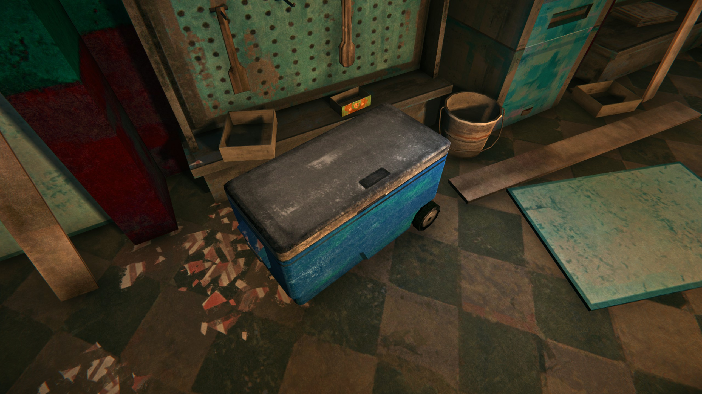

# Cooler

**Cooler**

| Property | Details |
| --- | --- |
|  |  / *Cooler.jpg* |
| Update | [0.00](./The%20Long%20Dark%20%E2%80%94%20Changelog.md#0.00) |
| Story item | Yes |
| **Container** |  |
| Capacity | 20.00 kg(44 lbs) |

A **Cooler** is a storage container often found in cabins and stores. They have a blue body, 2 black wheels, and a grey lid. They often contain food and drink items inside when searched. **Lua execution error in Module:Navbox function navbox**
