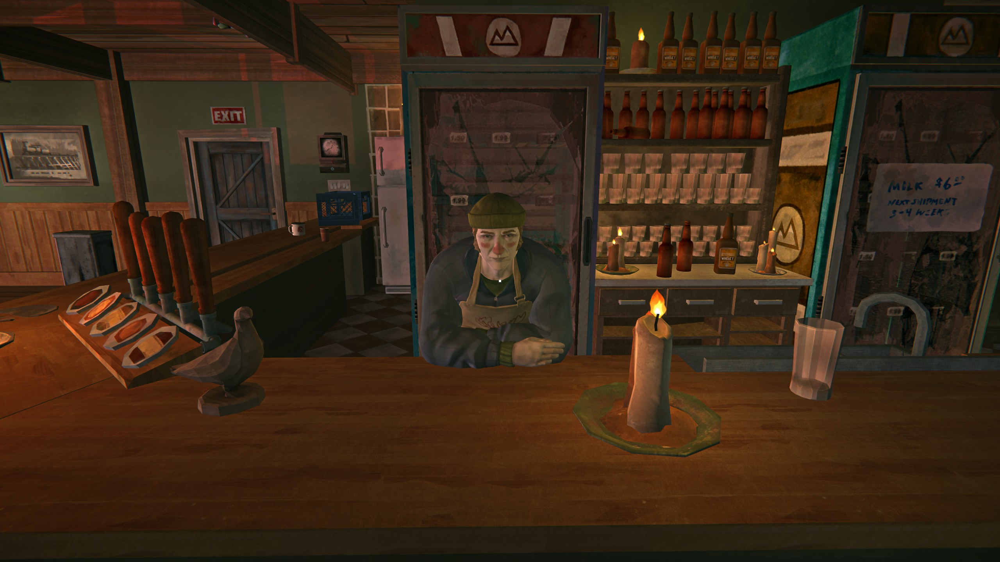
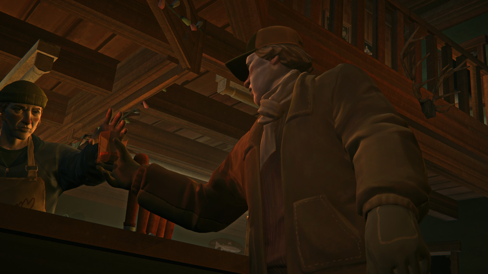
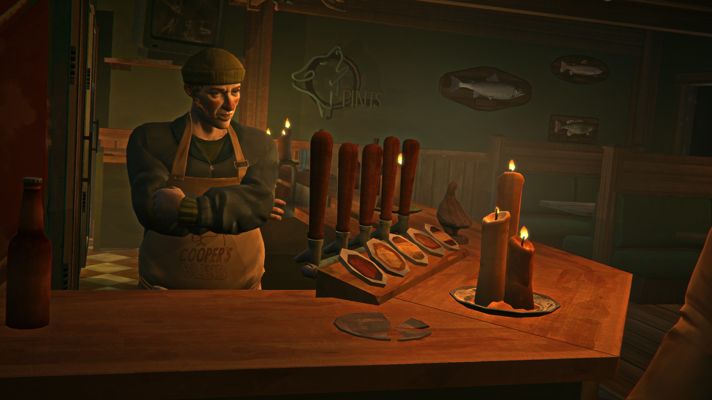

# Cooper

**Source:** [Fandom](https://thelongdark.fandom.com/wiki/Cooper)

**Contents**

- [Appearance](#appearance)
- [History](#history)
- [Episode 5](#episode-5)
- [Perseverance](#perseverance)
- [A Cry For Help](#a-cry-for-help)
- [Gallery](#gallery)

**Cooper**

[Coopr](../assets/Coopr.jpg)

**Release:** [2.52](./The%20Long%20Dark%20%E2%80%94%20Changelog.md#2.52)

**Date:** 6 October 2021

**Wintermute:** [Episode 5](./Episode%205%20-%20The%20Light%20At%20The%20End%20Of%20All%20Things.md)

**Location(s):** [Perseverance Mills](./Perseverance%20Mills.md)

**Biographical Information**

**Status:** Alive

**Physical Information**

**Sex:** Male

**Game Information**

**Voiced by:** Shawn Youngchief

**Spoiler Warning:****This page may contain spoilers from the [story](./Wintermute.md) of The Long Dark.**

> “**Welcome to Cooper's! Haven't seen you around here before.**”
>
> — Cooper greeting Astrid

**Cooper** is a minor character that appears in [Episode 5](./Episode%205%20-%20The%20Light%20At%20The%20End%20Of%20All%20Things.md) of [Wintermute](./Wintermute.md) in [_The Long Dark_](./The%20Long%20Dark.md).

<!-- #Appearance -->
​

<!-- #appearance -->
## Appearance

Cooper wears a green toque and an apron sporting the Cooper's Blind logo. He wears a green inner shirt and a blue outer jacket.

<!-- #History -->
​

<!-- #history -->
## History

A resident of [Perseverance Mills](./Perseverance%20Mills.md), Cooper is the barkeep and owner of [Cooper's Blind](./Cooper%27s%20Blind.md). Not much is known about his past, but he presents himself as an easy going fellow that wishes to keep the Bar Patrons warm and fed during the town's quarantine; as well as give out booze to the thirsty whenever they ask.

<!-- #Perseverance -->
​

<!-- #perseverance -->
### [Perseverance](./Perseverance.md)

> “**Every day, another "refugee" from the cold, or three, showing up and camping out here at the bar... \[\] I'm happy to be able to help. As long as there's wood for the fireplace and booze for the patrons, that is.**”
>
> — Cooper speaking about the Bar Patrons

[Astrid Greenwood](./Astrid%20Greenwood.md) is instructed by [Jane Yang](./Jane%20Yang.md) to look for the local town doctor, and visits Cooper's Blind. Inside, she meets Cooper standing by the bar and makes conversation with him. Cooper gives Astrid the [Brass Key](./Brass%20Key.md) to [Dr Larsen's Clinic](./Medical%20Clinic.md).

<!-- #a_cry_for_help -->
​

<!-- #A_Cry_For_Help -->
​

<!-- #A_cry_for_help -->
​

<!-- #a-cry-for-help -->
### [A Cry For Help](./A%20Cry%20For%20Help.md)

> “**She looks cold. Give her a whiskey!**”
>
> — Cooper offering to help warm Astrid up

Cooper reappears still holed up inside Cooper's Blind. He offers Astrid a whiskey to warm her up since she has been out in the cold for so long after sundown, which she accepts. Cooper then listens to Astrid's pleas for the townsfolk to evacuate Perseverance Mills before Jane Yang appears to attempt to calm the doctor down and prevent her from alarming the other residents of the town. [Mathis](./Mathis.md) appears shortly thereafter and his gang of [Convicts](./Convicts.md) take over the town.

Cooper does not make any other appearance after this point, but is presumed to have been taken hostage by the Convicts inside his bar. He is also not seen at the end of the episode, but it can be inferred that he escaped the town and is now residing in the bunker underneath the [Suzuki Radio Telescope](./Suzuki%20Radio%20Telescope.md), along with the other town survivors.

<!-- #Gallery -->
​

<!-- #gallery -->
## Gallery

