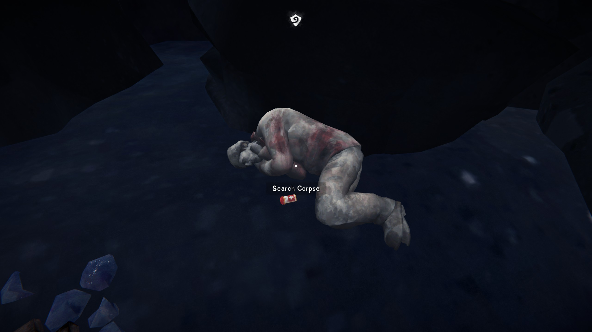
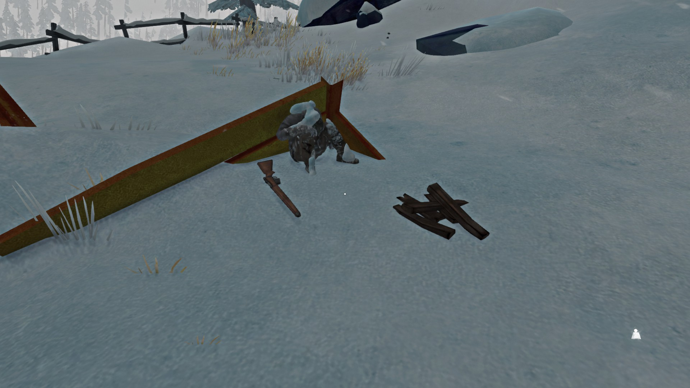
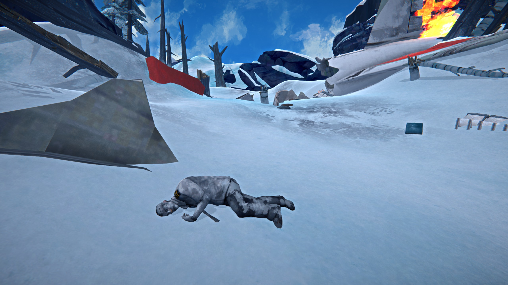
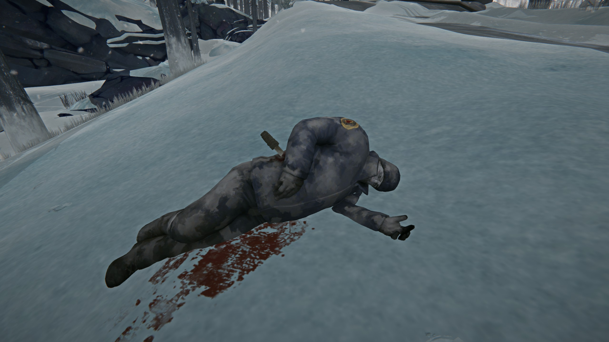

# Corpse

**Categories:** Interactable Objects · **Source:** [Fandom](https://thelongdark.fandom.com/wiki/Corpse)

**Corpse**

[Frozen Corpse](../assets/Frozen_Corpse.jpg)

**Story item:** Yes

**Container**

**Capacity:** 10.00 kg(22 lbs)

A **Corpse** (sometimes labeled as just [Frozen Corpse](./Frozen%20Corpse.md)) are the remains of seemingly recently deceased people. Corpses differ slightly from a Frozen Corpse as they have less snow covered on their bodies, but their skin is a dark purple/black color from severe frostbite. They are usually found outdoors, although some can be found indoors, in caves, or crushed under structures or other landmarks.

Corpses can be searched for modest loot. Tools or weapons can often be found nearby. Sometimes, corpses will spawn with items in-hand. [Crow Feathers](./Crow%20Feather.md) also can spawn near corpses, and [Crows](./Crow.md) can be spotted circling above some spawned corpses.

The causes of death and identities of frozen corpses are almost universally a mystery, although the Hinterland Forums community has given some of these corpses [unofficial backstories](https://hinterlandforums.com/forums/topic/38131-tsd-the-sitting-dead/). The bodies also do not defrost, regardless of surrounding temperature, and they are essentially useless and inert once looted (although the can technically serve as storage containers, albeit macabre ones).

Occasionally in [Wintermute](./Wintermute.md), a [Dead Prison Guard](./Dead%20Prison%20Guard.md) or dead Convict can be found.

## Gallery

_A corpse inside a [Hunting Blind](./Hunter%27s%20Blinds.md) with a [hatchet](./Hatchet.md)_

_A corpse at the [Destroyed Lookout](./Destroyed%20Lookout.md) with a [rifle](./Hunting%20Rifle.md) lying nearby_

_[Dead Prison Guard](./Dead%20Prison%20Guard.md)_

_One of many dead [Convicts](./Convicts.md) in Wintermute_

_Several executed prison guards and civilians outside of [Blackrock Prison](./Blackrock%20Prison.md) in [Episode 4](./Episode%204%20-%20Fury%2C%20Then%20Silence.md)_

_A corpse in [Ash Canyon](./Ash%20Canyon.md)_

