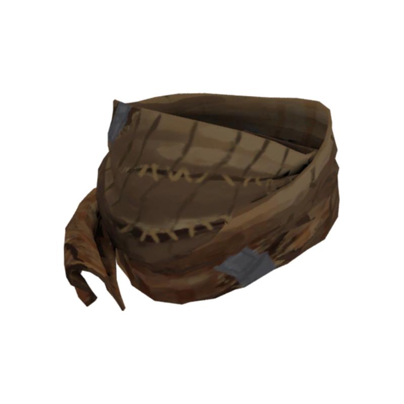

# Cotton Scarf

**Categories:** Clothing, Pages with update history · **Source:** [Fandom](https://thelongdark.fandom.com/wiki/Cotton_Scarf)

**Cotton Scarf**

[Cotton Scarf icon](../assets/Cotton_Scarf_icon.png)

**General**

**Item Type:** Clothing

**Clothing Slot:** Head

**Statistics**

**Weight:** [Weight icon](../assets/Weight_icon.png)0.10 kg(0.22 lbs)

**Warmth bonus:** [Temp icon](../assets/Temp_icon.png)0.5 °C(0.9 °F)

**Windproof bonus:** [Windproofness icon](../assets/Windproofness_icon.png)0 °C(0 °F)

**Waterproof bonus:** [Waterproofness icon](../assets/Waterproofness_icon.png)5%

**Protection:** [Protection icon](../assets/Protection_icon.png)0%

**Mobility:** [Mobility icon](../assets/Mobility_icon.png)0%

**Harvest:** 1 × [Cloth](./Cloth.md) 10 minutes

**Repair:** 1 × [Cloth](./Cloth.md) 30 minutes 60% condition

> “**Thin cotton scarf designed more for looks than utility. Will keep the wind off your neck.**”
>
> — In-game description

**Cotton Scarf** is a type of headgear in _[The Long Dark](./The%20Long%20Dark.md)_.

## Overview

It is one of the worst pieces of headgear in the game, with similar stats to the [Baseball Cap](./Baseball%20Cap.md); an additional 5% waterpoofness is the only difference between the two (Despite the description, there is no windproof bonus). Like the Baseball Cap, however, wearing the cotton scarf is slightly better than foregoing headgear altogether, as it will at least provide a tiny amount of benefit and prevent [Frostbite](./Frostbite.md) to the covered area.

## Update history

- UPDATE **19 December 2016 ([Update](./The%20Long%20Dark%20%E2%80%94%20Early%20Access%20Changelog.md#0.386)):**
  - Added to game
