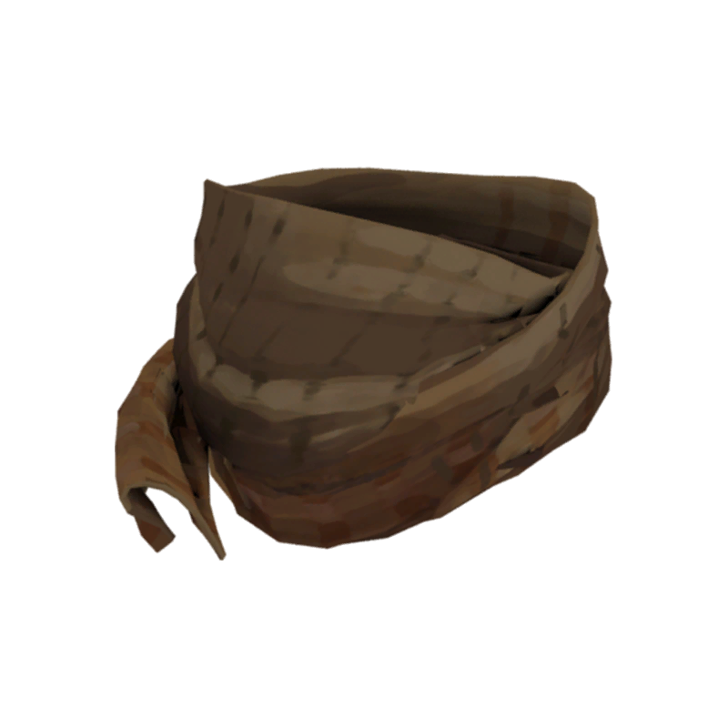

# Cotton Scarf

<table class="infobox">
<caption>Cotton Scarf</caption>
<colgroup>
<col style="width: 50%" />
<col style="width: 50%" />
</colgroup>
<tbody>
<tr>
<td colspan="2"><figure>

<figcaption>Cotton_Scarf_icon.png</figcaption>
</figure></td>
</tr>
<tr>
<td colspan="2" class="section">
<strong>General</strong>
</td>
</tr>
<tr>
<td>
Item Type
</td>
<td>
Clothing|-
</td>
</tr>
<tr>
<td>
Clothing Slot
</td>
<td>
Head
</td>
</tr>
<tr>
<td colspan="2" class="section">
<strong>Statistics</strong>
</td>
</tr>
<tr>
<td>
Weight
</td>
<td>
0.10 kg(0.22 lbs)
</td>
</tr>
<tr>
<td>
Warmth bonus
</td>
<td>
0.5 °C(0.9 °F)
</td>
</tr>
<tr>
<td>
Windproof bonus
</td>
<td>
0 °C(0 °F)
</td>
</tr>
<tr>
<td>
Waterproof bonus
</td>
<td>
5%
</td>
</tr>
<tr>
<td>
Protection
</td>
<td>
0%
</td>
</tr>
<tr>
<td>
Mobility
</td>
<td>
0%
</td>
</tr>
<tr>
<td>
Harvest
</td>
<td>
1 × <a href="./Cloth.md" class="wikilink" title="Cloth">Cloth</a> 
10 minutes
</td>
</tr>
<tr>
<td>
Repair
</td>
<td>
1 × <a href="./Cloth.md" class="wikilink" title="Cloth">Cloth</a> 
30 minutes 
60% condition
</td>
</tr>
</tbody>
</table>

<table>
<colgroup>
<col style="width: 33%" />
<col style="width: 33%" />
<col style="width: 33%" />
</colgroup>
<tbody>
<tr>
<td style="vertical-align: top; font-size: 3em; color: #5d5980; padding-right: 10px">
“
</td>
<td>
Thin cotton scarf designed more for looks than utility. Will keep the wind off your neck.

&#10;

In-game description

</td>
<td style="vertical-align: bottom; font-size: 3em; color: #5d5980; padding-left: 10px">
”
</td>
</tr>
</tbody>
</table>

**Cotton Scarf** is a type of headgear in *<a href="./The%20Long%20Dark.md" class="wikilink" title="The Long Dark">The Long Dark</a>*.

## Overview

It is one of the worst pieces of headgear in the game, with similar stats to the <a href="./Baseball%20Cap.md" class="wikilink" title="Baseball Cap">Baseball Cap</a>; an additional 5% waterpoofness is the only difference between the two (Despite the description, there is no windproof bonus). Like the Baseball Cap, however, wearing the cotton scarf is slightly better than foregoing headgear altogether, as it will at least provide a tiny amount of benefit and prevent <a href="./Frostbite.md" class="wikilink" title="Frostbite">Frostbite</a> to the covered area.

<table class="gallery">
<colgroup>
<col style="width: 50%" />
<col style="width: 50%" />
</colgroup>
<tbody>
<tr>
<td><figure>

<figcaption>Model icon</figcaption>
</figure></td>
<td><figure>

<figcaption>Model icon damaged</figcaption>
</figure></td>
</tr>
</tbody>
</table>

## Update history

- UPDATE **19 December 2016 (<a href="./The%20Long%20Dark%20%E2%80%94%20Early%20Access%20Changelog.md#0.386" class="wikilink" title="Update">Update</a>):**
  - Added to game

**Lua execution error in Module:Navbox function navbox** <a href="ru:%D0%A8%D0%B0%D1%80%D1%84_%D0%B8%D0%B7_%D1%85%D0%BB%D0%BE%D0%BF%D0%BA%D0%B0" class="wikilink" title="ru:Шарф из хлопка">ru:Шарф из хлопка</a>

