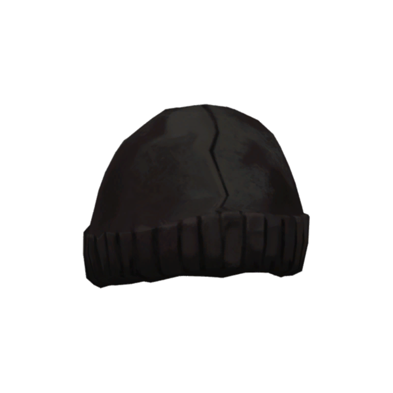

# Cotton Toque

<table class="infobox">
<caption>Cotton Toque</caption>
<colgroup>
<col style="width: 50%" />
<col style="width: 50%" />
</colgroup>
<tbody>
<tr>
<td colspan="2"><figure>

<figcaption>Cotton_Toque_icon.png</figcaption>
</figure></td>
</tr>
<tr>
<td colspan="2" class="section">
<strong>General</strong>
</td>
</tr>
<tr>
<td>
Item Type
</td>
<td>
Clothing|-
</td>
</tr>
<tr>
<td>
Renewable
</td>
<td>
Yes (<a href="./Beachcombing.md" class="wikilink" title="Beachcombing">Beachcombing</a>)
</td>
</tr>
<tr>
<td>
Clothing Slot
</td>
<td>
Head
</td>
</tr>
<tr>
<td colspan="2" class="section">
<strong>Statistics</strong>
</td>
</tr>
<tr>
<td>
Weight
</td>
<td>
0.10 kg(0.22 lbs)
</td>
</tr>
<tr>
<td>
Warmth bonus
</td>
<td>
1.0 °C(1.8 °F)
</td>
</tr>
<tr>
<td>
Windproof bonus
</td>
<td>
0.5 °C(0.9 °F)
</td>
</tr>
<tr>
<td>
Waterproof bonus
</td>
<td>
10%
</td>
</tr>
<tr>
<td>
Protection
</td>
<td>
1%
</td>
</tr>
<tr>
<td>
Mobility
</td>
<td>
0%
</td>
</tr>
<tr>
<td>
Harvest
</td>
<td>
1 × <a href="./Cloth.md" class="wikilink" title="Cloth">Cloth</a> 
10 minutes
</td>
</tr>
<tr>
<td>
Repair
</td>
<td>
1 × <a href="./Cloth.md" class="wikilink" title="Cloth">Cloth</a> 
30 minutes 
40% condition
</td>
</tr>
</tbody>
</table>

<table>
<colgroup>
<col style="width: 33%" />
<col style="width: 33%" />
<col style="width: 33%" />
</colgroup>
<tbody>
<tr>
<td style="vertical-align: top; font-size: 3em; color: #5d5980; padding-right: 10px">
“
</td>
<td>
Simple knitted cotton hat. Not as warm as wool, but better than nothing.

&#10;

In-game description

</td>
<td style="vertical-align: bottom; font-size: 3em; color: #5d5980; padding-left: 10px">
”
</td>
</tr>
</tbody>
</table>

The **Cotton Toque** is a type of headgear in *<a href="./The%20Long%20Dark.md" class="wikilink" title="The Long Dark">The Long Dark</a>*.

## Overview

Very high warmth to weight ratio. The lesser version of the <a href="./Wool%20Toque.md" class="wikilink" title="Wool Toque">Wool Toque</a>, is not very waterproof.

It is slightly inferior to the <a href="./Wool%20Scarf.md" class="wikilink" title="Wool Scarf">Wool Scarf</a> in terms of waterproofing, with otherwise identical stats, although it decays more than twice as fast.

## Gallery

<table class="gallery">
<colgroup>
<col style="width: 33%" />
<col style="width: 33%" />
<col style="width: 33%" />
</colgroup>
<tbody>
<tr>
<td><figure>

<figcaption>Old model.</figcaption>
</figure></td>
<td><figure>

<figcaption>Clothing model</figcaption>
</figure></td>
<td><figure>

<figcaption>Clothing model damaged</figcaption>
</figure></td>
</tr>
</tbody>
</table>

## Update history

- UPDATE **19 December 2016 (<a href="./The%20Long%20Dark%20%E2%80%94%20Early%20Access%20Changelog.md#0.386" class="wikilink" title="Update">Update</a>):**
  - Renamed from *Basic Wool Hat* to *Cotton Toque*.

**Lua execution error in Module:Navbox function navbox** <a href="ru:%D0%A8%D0%B0%D0%BF%D0%BA%D0%B0_%D0%B8%D0%B7_%D1%85%D0%BB%D0%BE%D0%BF%D0%BA%D0%B0" class="wikilink" title="ru:Шапка из хлопка">ru:Шапка из хлопка</a>

