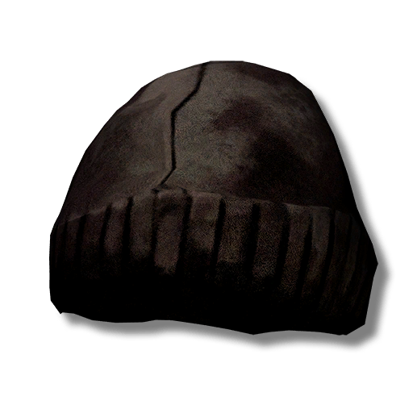
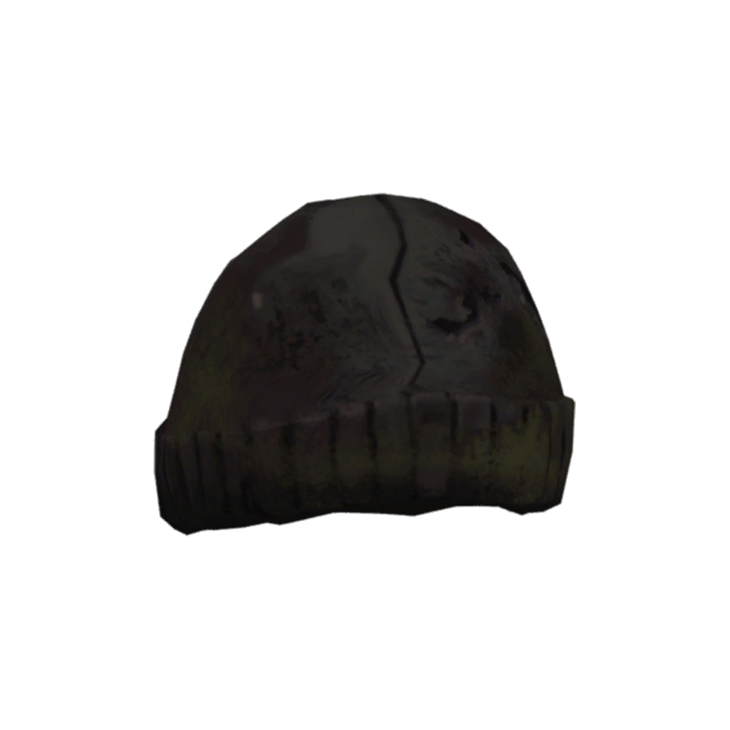

# Cotton Toque

**Categories:** Clothing, Pages with update history · **Source:** [Fandom](https://thelongdark.fandom.com/wiki/Cotton_Toque)

**Cotton Toque**

_Cotton\_Toque\_icon.png_

**General**

**Item Type:** Clothing

**Renewable:** Yes ([Beachcombing](./Beachcombing.md))

**Clothing Slot:** Head

**Statistics**

**Weight:** 0.10 kg(0.22 lbs)

**Warmth bonus:** 1.0 °C(1.8 °F)

**Windproof bonus:** 0.5 °C(0.9 °F)

**Waterproof bonus:** 10%

**Protection:** 1%

**Mobility:** 0%

**Harvest:** 1 × [Cloth](./Cloth.md) / 10 minutes

**Repair:** 1 × [Cloth](./Cloth.md) / 30 minutes / 40% condition

> “**Simple knitted cotton hat. Not as warm as wool, but better than nothing.**”
>
> — In-game description

The **Cotton Toque** is a type of headgear in _[The Long Dark](./The%20Long%20Dark.md)_.

## Overview

Very high warmth to weight ratio. The lesser version of the [Wool Toque](./Wool%20Toque.md), is not very waterproof.

It is slightly inferior to the [Wool Scarf](./Wool%20Scarf.md) in terms of waterproofing, with otherwise identical stats, although it decays more than twice as fast.

## Gallery

_Old model._

_Clothing model_

_Clothing model damaged_

## Update history

- UPDATE **19 December 2016 ([Update](./The%20Long%20Dark%20%E2%80%94%20Early%20Access%20Changelog.md#0.386)):**
  - Renamed from _Basic Wool Hat_ to _Cotton Toque_.
