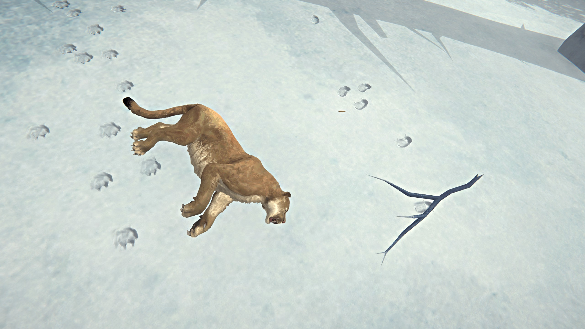

# Cougar Carcass

**Categories:** DLC Content, Interactable Objects · **Source:** [Fandom](https://thelongdark.fandom.com/wiki/Cougar_Carcass)

**Cougar Carcass**

_Cougar\_Carcass.jpg_

**General**

**Item Type:** Item

**Wintermute:** No

_Ptarmigan\_icon.png_

**DLC-Exclusive content.** / This content requires the [Tales from the Far Territory](./Tales%20from%20the%20Far%20Territory.md) addon to be installed before it can be seen or used in regular gameplay.

## Notes

---

1. If carcass is harvested[↩︎](#fnref1)
2. If carcass is quartered.[↩︎](#fnref2)
