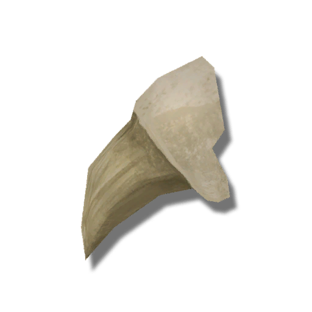

# Cougar Carcass

<table class="infobox">
<caption>Cougar Carcass</caption>
<colgroup>
<col style="width: 50%" />
<col style="width: 50%" />
</colgroup>
<tbody>
<tr>
<td colspan="2"><figure>
[Missing image: Cougar_Carcass.jpg]
<figcaption>Cougar_Carcass.jpg</figcaption>
</figure></td>
</tr>
<tr>
<td colspan="2" class="section">
<strong>General</strong>
</td>
</tr>
<tr>
<td>
Item Type
</td>
<td>
Item
</td>
</tr>
<tr>
<td>
Wintermute
</td>
<td>
No
</td>
</tr>
</tbody>
</table>

<table>
<colgroup>
<col style="width: 33%" />
<col style="width: 33%" />
<col style="width: 33%" />
</colgroup>
<tbody>
<tr>
<td width="40px"><figure>
[Missing image: Ptarmigan_icon.png]
<figcaption>Ptarmigan_icon.png</figcaption>
</figure></td>
<td>
<strong>DLC-Exclusive content.</strong> 

This content requires the <a href="./Tales%20from%20the%20Far%20Territory.md" class="wikilink" title="Tales from the Far Territory">Tales from the Far Territory</a> addon to be installed before it can be seen or used in regular gameplay.

</td>
<td>
|} A <strong>Cougar Carcass</strong> is a harvestable "object" found after <a href="./Hunting.md" class="wikilink" title="Hunting">Hunting</a> a <a href="./Cougar.md" class="wikilink" title="Cougar">Cougar</a>. A Cougar Carcass always produces 3 <a href="./Crow%20Feather.md" class="wikilink" title="Crow Feathers">Crow Feathers</a> from passing <a href="./Crow.md" class="wikilink" title="Crows">Crows</a>.

<h2 id="Drops">Drops</h2>

A Cougar is a fierce and dangerous foe to hunt, but killing one will produce a Cougar Carcass, which can be harvested to obtain the following items:

<table>
<colgroup>
<col style="width: 25%" />
<col style="width: 25%" />
<col style="width: 25%" />
<col style="width: 25%" />
</colgroup>
<thead>
<tr>
<th></th>
<th>
Item
</th>
<th>
Quantity
</th>
<th>
Rarity
</th>
</tr>
</thead>
<tbody>
<tr>
<td><figure>

<figcaption>Cougar_Meat_(Raw)_icon.png</figcaption>
</figure></td>
<td>
<a href="./Cougar%20Meat%20%28Raw%29.md" class="wikilink" title="Cougar Meat (Raw)">Cougar Meat (Raw)</a>
</td>
<td>
4
</td>
<td>
Always<a href="#fn1" class="footnote-ref" id="fnref1" role="doc-noteref">1</a>
</td>
</tr>
<tr>
<td><figure>

<figcaption>Cougar_Quarter_icon.png</figcaption>
</figure></td>
<td>
<a href="./Cougar%20Quarter.md" class="wikilink" title="Cougar Quarter">Cougar Quarter</a>
</td>
<td>
2
</td>
<td>
Always<a href="#fn2" class="footnote-ref" id="fnref2" role="doc-noteref">2</a>
</td>
</tr>
<tr>
<td><figure>

<figcaption>Fresh_Cougar_Hide_icon.png</figcaption>
</figure></td>
<td>
<a href="./Fresh%20Cougar%20Hide.md" class="wikilink" title="Fresh Cougar Hide">Fresh Cougar Hide</a>
</td>
<td>
1
</td>
<td>
Always
</td>
</tr>
<tr>
<td><figure>

<figcaption>Fresh_Gut_icon.png</figcaption>
</figure></td>
<td>
<a href="./Fresh%20Gut.md" class="wikilink" title="Fresh Gut">Fresh Gut</a>
</td>
<td>
2
</td>
<td>
Always
</td>
</tr>
</tbody>
</table>

The Cougar Claw is harvested automatically when Harvesting Cougar Hide/Quartering animal. There is no option to harvest one or the other separately while examining a Cougar Carcass.

<table>
<colgroup>
<col style="width: 25%" />
<col style="width: 25%" />
<col style="width: 25%" />
<col style="width: 25%" />
</colgroup>
<thead>
<tr>
<th></th>
<th>
Item
</th>
<th>
Quantity
</th>
<th>
Rarity
</th>
</tr>
</thead>
<tbody>
<tr>
<td><figure>

<figcaption>Cougar_Claw_icon.png</figcaption>
</figure></td>
<td>
<a href="./Cougar%20Claw.md" class="wikilink" title="Cougar Claw">Cougar Claw</a>
</td>
<td>
1
</td>
<td>
Always
</td>
</tr>
</tbody>
</table>

Killing Cougars grants unique rewards: Cougar Hide (for crafting <a href="./Cougar%20Hide%20Wrap.md" class="wikilink" title="Cougar Hide Wrap">Cougar Hide Wrap</a>) and Cougar Claw (for crafting <a href="./Cougar%20Claw%20Knife.md" class="wikilink" title="Cougar Claw Knife">Cougar Claw Knife</a>), as well as Cougar Meat.

<h2 id="Preplaced_Locations">Preplaced Locations</h2>

Cougar Carcasses are never found preplaced in the world, and are only produced after killing a Cougar.

<h2 id="Gallery">Gallery</h2>

<strong>Lua execution error in Module:Navbox function navbox</strong> <a href="ru:%D0%A2%D1%83%D1%88%D0%B0_%D0%BF%D1%83%D0%BC%D1%8B" class="wikilink" title="ru:Туша пумы">ru:Туша пумы</a>
</td>
</tr>
</tbody>
</table>
<section id="footnotes" class="footnotes footnotes-end-of-document" role="doc-endnotes">

<ol>
<li id="fn1">If carcass is harvested<a href="#fnref1" class="footnote-back" role="doc-backlink">↩︎</a></li>
<li id="fn2">If carcass is quartered.<a href="#fnref2" class="footnote-back" role="doc-backlink">↩︎</a></li>
</ol>
</section>

## Notes

