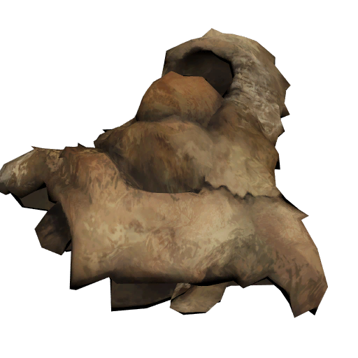
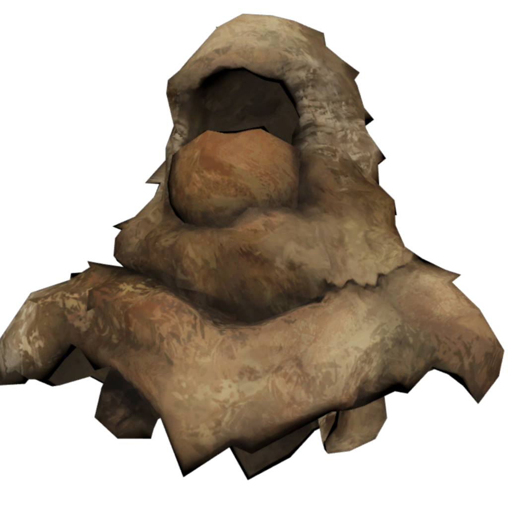

# Cougar Hide Wrap

<table class="infobox">
<caption>Cougar Hide Wrap</caption>
<colgroup>
<col style="width: 50%" />
<col style="width: 50%" />
</colgroup>
<tbody>
<tr>
<td colspan="2"><figure>

<figcaption>Cougar_Hide_Wrap_icon.png</figcaption>
</figure></td>
</tr>
<tr>
<td colspan="2" class="section">
<strong>General</strong>
</td>
</tr>
<tr>
<td>
Item Type
</td>
<td>
Clothing|-
</td>
</tr>
<tr>
<td>
Clothing Slot
</td>
<td>
Head
</td>
</tr>
<tr>
<td colspan="2" class="section">
<strong>Statistics</strong>
</td>
</tr>
<tr>
<td>
Weight
</td>
<td>
1.00 kg(2.2 lbs)
</td>
</tr>
<tr>
<td>
Warmth bonus
</td>
<td>
4.0 °C(7.2 °F)
</td>
</tr>
<tr>
<td>
Windproof bonus
</td>
<td>
4.0 °C(7.2 °F)
</td>
</tr>
<tr>
<td>
Waterproof bonus
</td>
<td>
40%
</td>
</tr>
<tr>
<td>
Protection
</td>
<td>
6%
</td>
</tr>
<tr>
<td>
Mobility
</td>
<td>
0%
</td>
</tr>
<tr>
<td>
Harvest
</td>
<td>
1 × <a href="./Cured%20Cougar%20Hide.md" class="wikilink" title="Cured Cougar Hide">Cured Cougar Hide</a> 
90 minutes
</td>
</tr>
<tr>
<td>
Repair
</td>
<td>
1 × <a href="./Cured%20Cougar%20Hide.md" class="wikilink" title="Cured Cougar Hide">Cured Cougar Hide</a>, 
1 × <a href="./Cured%20Gut.md" class="wikilink" title="Cured Gut">Cured Gut</a> 
240 minutes 
70% condition
</td>
</tr>
</tbody>
</table>

<table>
<colgroup>
<col style="width: 33%" />
<col style="width: 33%" />
<col style="width: 33%" />
</colgroup>
<tbody>
<tr>
<td width="40px"><figure>
[Missing image: Ptarmigan_icon.png]
<figcaption>Ptarmigan_icon.png</figcaption>
</figure></td>
<td>
<strong>DLC-Exclusive content.</strong> 

This content requires the <a href="./Tales%20from%20the%20Far%20Territory.md" class="wikilink" title="Tales from the Far Territory">Tales from the Far Territory</a> addon to be installed before it can be seen or used in regular gameplay.

</td>
<td>
|}

<table>
<colgroup>
<col style="width: 33%" />
<col style="width: 33%" />
<col style="width: 33%" />
</colgroup>
<tbody>
<tr>
<td style="vertical-align: top; font-size: 3em; color: #5d5980; padding-right: 10px">
“
</td>
<td>
A superior Wrap crafted from the warm, protective hide of a Cougar.

&#10;

In-game description

</td>
<td style="vertical-align: bottom; font-size: 3em; color: #5d5980; padding-left: 10px">
”
</td>
</tr>
</tbody>
</table>

A <strong>Cougar Hide Wrap</strong> is a craftable <a href="./Clothing.md" class="wikilink" title="Clothing">Clothing</a> worn on the outer layer of the head.

<h2 id="Overview">Overview</h2>

Cougar Hide Wraps are crafted using <a href="./Cured%20Cougar%20Hide.md" class="wikilink" title="Cured Cougar Hide">Cured Cougar Hide</a>. Only 1 Cougar Hide Wrap can be worn at a time, specifically in the outer head slot.

It is the warmest head item in the game by a wide margin, beating the <a href="./Wolfskin%20Hat.md" class="wikilink" title="Wolfskin Hat">Wolfskin Hat</a> (the warmest hat in the game) by 1 degree in Warmth bonus and 2 degrees in windproofing, and tied for the heaviest (again with the Wolfskin Hat) at 1.00kg. Additionally the Cougar Hide Wrap is slightly more waterproof, protective, and decays slower than other headgear.

A Cougar Hide Wrap can be harvested and re-crafted to restore its condition, recycling a Cured Cougar Hide at the cost of time and other resources (similar to a <a href="./Moose-Hide%20Cloak.md" class="wikilink" title="Moose-Hide Cloak">Moose-Hide Cloak</a>).

<table class="gallery">
<colgroup>
<col style="width: 50%" />
<col style="width: 50%" />
</colgroup>
<tbody>
<tr>
<td><figure>

<figcaption>Clothing model</figcaption>
</figure></td>
<td><figure>

<figcaption>Clothing model damaged</figcaption>
</figure></td>
</tr>
</tbody>
</table>
<h2 id="Crafting">Crafting</h2>

Acquiring a <a href="./Fresh%20Cougar%20Hide.md" class="wikilink" title="Fresh Cougar Hide">Fresh Cougar Hide</a> to cure and craft the wrap may prove challenging since it involves facing against one of Great Bear Island's deadliest predators.

<table class="infobox">
<caption>Cougar Hide Wrap</caption>
<tbody>
<tr>
<td colspan="2">
-
</td>
</tr>
<tr>
<td colspan="2">
-
</td>
</tr>
<tr>
<td colspan="2">
1400 minutes (23 hour 20 minutes)
</td>
</tr>
<tr>
<td colspan="2" class="section">
<strong>Requirements</strong>
</td>
</tr>
<tr>
<td>
Facility
</td>
<td>
<strong>Template:iconlink</strong>
</td>
</tr>
<tr>
<td>
Tool
</td>
<td>
<strong>Template:iconlink</strong>
</td>
</tr>
<tr>
<td colspan="2" class="section">
<strong>Materials</strong>
</td>
</tr>
<tr>
<td colspan="2" class="section">
<strong>Template:iconlink plain</strong>
</td>
</tr>
<tr>
<td>
Item
</td>
<td>
<a href="./Cured%20Cougar%20Hide.md" class="wikilink" title="Cured Cougar Hide">Cured Cougar Hide</a>
</td>
</tr>
<tr>
<td>
Quantity
</td>
<td>
1
</td>
</tr>
<tr>
<td colspan="2" class="section">
<strong>Template:iconlink plain</strong>
</td>
</tr>
<tr>
<td colspan="2">
<a href="./Cured%20Gut.md" class="wikilink" title="Cured Gut">Cured Gut</a>
</td>
</tr>
<tr>
<td colspan="2">
2
</td>
</tr>
</tbody>
</table>
<h2 id="Update_history">Update history</h2>

<ul>
<li>UPDATE <strong>24 June 2024 (<a href="./The%20Long%20Dark%20%E2%80%94%20Changelog.md#2.28" class="wikilink" title="Update">Update</a>):</strong>
<ul>
<li>Added to game.</li>
</ul></li>
<li>UPDATE <strong>2 December 2024 (<a href="./The%20Long%20Dark%20%E2%80%94%20Changelog.md#2.33" class="wikilink" title="Update">Update</a>):</strong>
<ul>
<li>Buffed the stats of the Wrap with the release of the new Cougar. (Warmth and Windproofness changed from 3.0 to 4.0, protection from 5% to 6%)</li>
</ul></li>
</ul>

<strong>Lua execution error in Module:Navbox function navbox</strong> <a href="ru:%D0%9D%D0%B0%D0%BA%D0%B8%D0%B4%D0%BA%D0%B0_%D0%B8%D0%B7_%D1%88%D0%BA%D1%83%D1%80%D1%8B_%D0%BF%D1%83%D0%BC%D1%8B" class="wikilink" title="ru:Накидка из шкуры пумы">ru:Накидка из шкуры пумы</a>
</td>
</tr>
</tbody>
</table>

