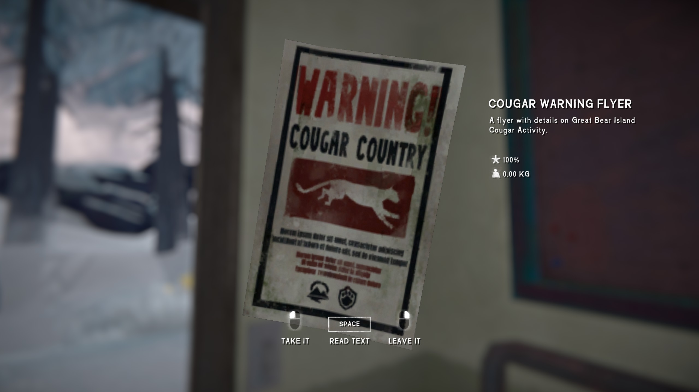

# Cougar Warning Flyer \(2\)

**Categories:** Collectibles · **Source:** [Fandom](https://thelongdark.fandom.com/wiki/Cougar_Warning_Flyer_%282%29)

**Cougar Warning Flyer (2)**

_Cougar\_Warning\_Flyer\_icon.png_

**Properties**

**Item type:** [Collectibles](./Collectibles.md)\|-

**Stackable:** No

**Examine:** A flyer with details on Great Bear Island Cougar Activity.

**Values**

**Weight:** 0.00 kg (0 lbs)

**Actions**

**Backpack:** Examine

**On ground:** Take It, Leave It

**Cougar Warning Flyer** is a [Collectible](./Collectibles.md) found in [Survival Mode](./Survival%20Mode.md). it is found inside the office building at [Milton Park](./Milton%20Park.md) near the front door in [Mountain Town](./Mountain%20Town.md). It speaks about the dangers of [Cougars](./Cougar.md).

## Transcript

_The following text is transcribed from **Cougar Warning Flyer**_

**WARNING

COUGAR COUNTRY

- Beware possible encounters or attack

- Never approach Cougars

- Hike in groups whenever possible**

_The Flyer before it is picked up._

## Update history
