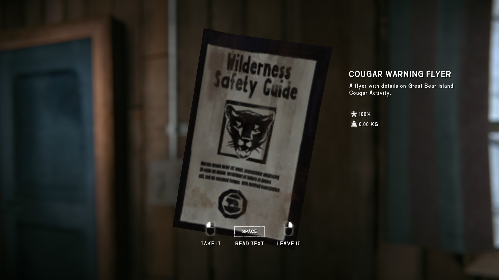

# Cougar Warning Flyer

**Categories:** Collectibles · **Source:** [Fandom](https://thelongdark.fandom.com/wiki/Cougar_Warning_Flyer)

**Cougar Warning Flyer**

[Cougar Warning Flyer icon](../assets/Cougar_Warning_Flyer_icon.png)

**Properties**

**Item type:** [Collectibles](./Collectibles.md)

**Stackable:** No

**Examine:** A flyer with details on Great Bear Island Cougar Activity.

**Values**

**Weight:** 0.00 kg (0 lbs)

**Actions**

**Backpack:** Examine

**On ground:** Take It, Leave It

**Cougar Warning Flyer** is a [Collectible](./Collectibles.md) found in [Survival Mode](./Survival%20Mode.md). it is found inside the [Camp Office](./Camp%20Office.md) near the front door.

<!-- #Transcript -->
​

<!-- #transcript -->
## Transcript

_The following text is transcribed from **Cougar Warning Flyer**_

WILDERNESS SAFTEY GUIDE

- You may hear a Cougar before your (sic) see it

- Watch for fresh kills - a Cougar may be near

- Leave its territory to reduce risk of attack

<!-- #update_history -->
​

<!-- #Update_history -->
​

<!-- #Update_History -->
​

<!-- #update-history -->
## Update history

[ru:Листовка "Осторожно, пумы!"](https://ru.wikipedia.org/wiki/%D0%9B%D0%B8%D1%81%D1%82%D0%BE%D0%B2%D0%BA%D0%B0_%22%D0%9E%D1%81%D1%82%D0%BE%D1%80%D0%BE%D0%B6%D0%BD%D0%BE,_%D0%BF%D1%83%D0%BC%D1%8B!%22)
