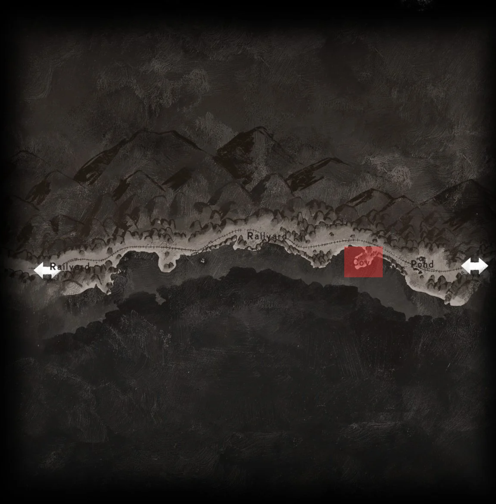

# Cove \(Track Section 3\)

**Categories:** DLC Content, Locations, Locations in Anna Island -- Track Section 3, Outdoor locations · **Source:** [Fandom](https://thelongdark.fandom.com/wiki/Cove_%28Track_Section_3%29)

_Seal\_icon.png_

**DLC-Exclusive content.** / This content requires the [Iron Road](./Iron%20Road.md) addon to be installed before it can be seen or used in regular gameplay.

\[\[File: /  / _Entrance_ /  / _Cabin_

250px\]\]

_Entrance_

_Cabin_

**Location**

_Cove\_Track\_3\_Location.png_

Region

[Anna Island -- Track Section 3](./Anna%20Island%20--%20Track%20Section%203.md)

Location

**Description:** A natural tunnel that leads to a Cabin.

**General**
