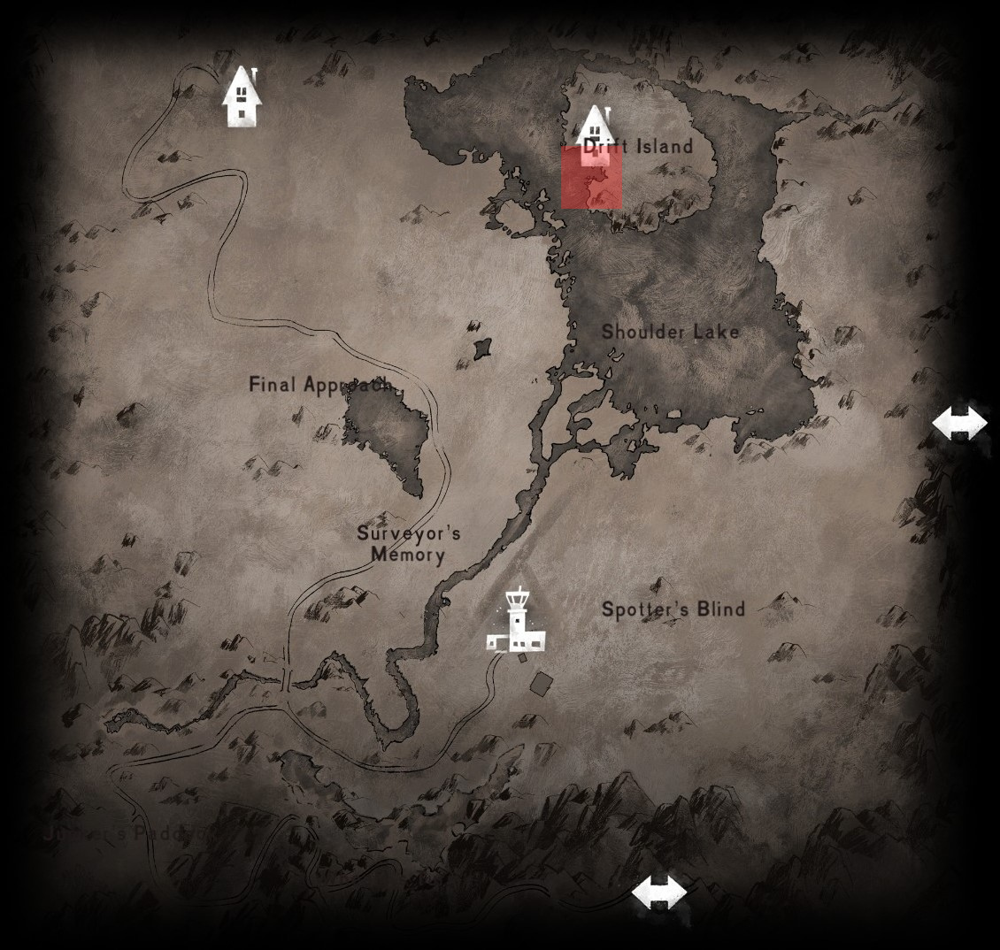

# Cove

**Cove**

| Property | Details |
| --- | --- |
|  |  / *Cove.png* |
| **Location** |  |
|  |  / *Cove\_Location.png* |
| Region | [Forsaken Airfield](./Forsaken%20Airfield.md)\|- |
| Description | A cove along the lakeshore, surrounded by cliffs, with stairs leading up. |
| **General** |  |
| Type | Landmark\|- |
