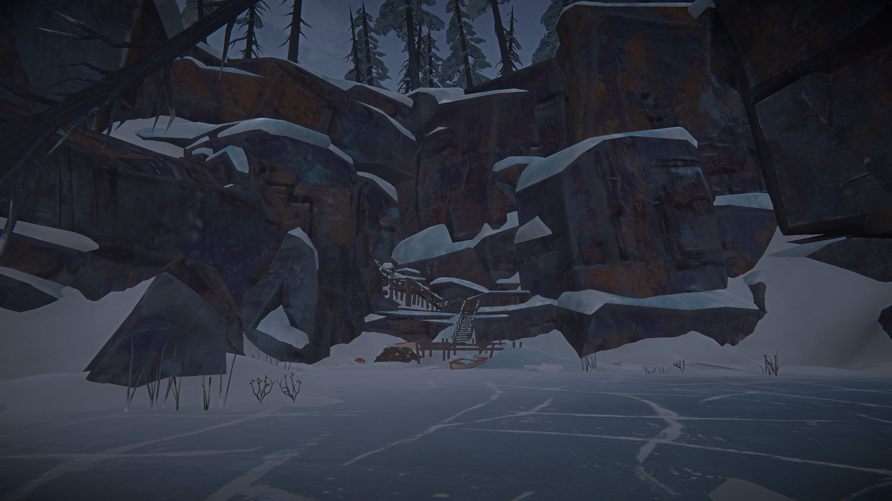

# Cove

<table class="infobox">
<caption>Cove</caption>
<colgroup>
<col style="width: 50%" />
<col style="width: 50%" />
</colgroup>
<tbody>
<tr>
<td colspan="2"><figure>

<figcaption>Cove.png</figcaption>
</figure></td>
</tr>
<tr>
<td colspan="2" class="section">
<strong>Location</strong>
</td>
</tr>
<tr>
<td colspan="2"><figure>
[Missing image: Cove_Location.png]
<figcaption>Cove_Location.png</figcaption>
</figure></td>
</tr>
<tr>
<td>
Region
</td>
<td>
<a href="./Forsaken%20Airfield.md" class="wikilink" title="Forsaken Airfield">Forsaken Airfield</a>|-
</td>
</tr>
<tr>
<td>
Description
</td>
<td>
A cove along the lakeshore, surrounded by cliffs, with stairs leading up.
</td>
</tr>
<tr>
<td colspan="2" class="section">
<strong>General</strong>
</td>
</tr>
<tr>
<td>
Type
</td>
<td>
Landmark|-
</td>
</tr>
</tbody>
</table>

