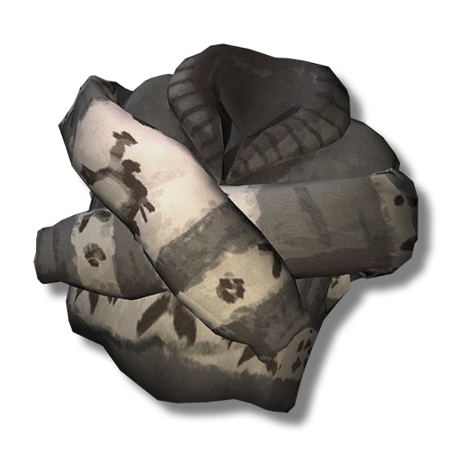
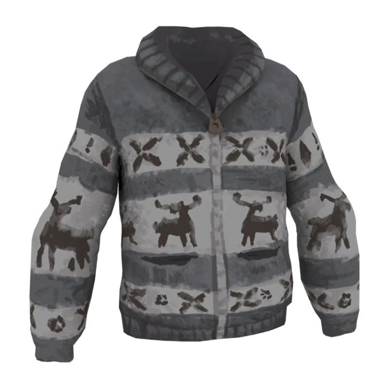

# Cowichan Sweater

\
{\| \|+ XSENT:infobox:Cowichan Sweater \|- \| colspan="2" \|  \|- \| colspan="2" \| **General** \|- ! Item Type \| Clothing\|- ! Wintermute \| Yes\|- ! Clothing Slot \| Inner torso \|- \| colspan="2" \| **Statistics** \|- ! Weight \| 1.00 kg(2.2 lbs) \|- ! Warmth bonus \| 2.5 °C(4.5 °F) \|- ! Windproof bonus \| 2.0 °C(3.6 °F) \|- ! Waterproof bonus \| 50% \|- ! Protection \| 5% \|- ! Mobility \| -2% \|- ! Harvest \| 1 × <a href="./Cloth.md" class="wikilink" title="Cloth">Cloth</a>\
45 minutes \|- ! Repair \| 1 × <a href="./Cloth.md" class="wikilink" title="Cloth">Cloth</a>\
60 minutes\
30% condition \|}

<table>
<colgroup>
<col style="width: 33%" />
<col style="width: 33%" />
<col style="width: 33%" />
</colgroup>
<tbody>
<tr>
<td style="vertical-align: top; font-size: 3em; color: #5d5980; padding-right: 10px">
“
</td>
<td>
The warmest sweater around. Inspired by the traditional sweater conceived by the Cowichan First Nation on Vancouver Island, <a href="./The%20Collapse.md" class="wikilink" title="Canada">Canada</a>. Treat it like an old friend.

&#10;

In-game description

</td>
<td style="vertical-align: bottom; font-size: 3em; color: #5d5980; padding-left: 10px">
”
</td>
</tr>
</tbody>
</table>

The **Cowichan Sweater** is a type of <a href="./Clothing.md" class="wikilink" title="clothing">clothing</a> in *<a href="./The%20Long%20Dark.md" class="wikilink" title="The Long Dark">The Long Dark</a>*.

It is the warmest and heaviest of all sweaters and is quite a rare find. It is not available on <a href="./Interloper.md" class="wikilink" title="Interloper">Interloper</a> difficulty.

A Cowichan Sweater is **guaranteed** to spawn inside a <a href="./Mementos.md" class="wikilink" title="memento">memento</a> box in <a href="./Bleak%20Inlet.md" class="wikilink" title="Bleak inlet">Bleak inlet</a>.

The sweater can sometimes be found in:

- <a href="./Echo%20One%20Radio%20Tower.md" class="wikilink" title="Echo One Radio Tower">Echo One Radio Tower</a> and <a href="./Cabin.md" class="wikilink" title="Cabin">Cabin</a> in <a href="./Bleak%20Inlet.md" class="wikilink" title="Bleak Inlet">Bleak Inlet</a>
- <a href="./Hunting%20Lodge.md" class="wikilink" title="Hunting Lodge">Hunting Lodge</a> in <a href="./Broken%20Railroad.md" class="wikilink" title="Broken Railroad">Broken Railroad</a>
- <a href="./Logging%20Camp.md" class="wikilink" title="Logging Camp">Logging Camp</a> in <a href="./Mystery%20Lake%20%28region%29.md" class="wikilink" title="Mystery Lake">Mystery Lake</a>
- <a href="./Signal%20Hill.md" class="wikilink" title="Signal Hill">Signal Hill</a> and <a href="./Misty%20Falls%20Cave.md" class="wikilink" title="Misty Falls Cave">Misty Falls Cave</a> in <a href="./Pleasant%20Valley.md" class="wikilink" title="Pleasant Valley">Pleasant Valley</a>
- <a href="./Gold%20Mine.md" class="wikilink" title="Gold Mine">Gold Mine</a> in <a href="./Ash%20Canyon.md" class="wikilink" title="Ash Canyon">Ash Canyon</a>
- <a href="./Prepper%20Cache.md" class="wikilink" title="Prepper caches">Prepper caches</a>
- Rarely in an open cardboard box in the main bedroom of <a href="./Paradise%20Meadows%20Farm.md" class="wikilink" title="Paradise Meadows Farmhouse">Paradise Meadows Farmhouse</a> in <a href="./Mountain%20Town.md" class="wikilink" title="Mountain Town">Mountain Town</a>
- Rarely in the <a href="./Corpse.md" class="wikilink" title="corpse">corpse</a> in the underside of the <a href="./Tail%20Section.md" class="wikilink" title="Tail Section">Tail Section</a> in <a href="./Timberwolf%20Mountain.md" class="wikilink" title="Timberwolf Mountain">Timberwolf Mountain</a>.
- The safe inside <a href="./Hibernia%20Processing.md" class="wikilink" title="Hibernia Processing">Hibernia Processing</a>.
- <a href="./Justy%27s%20Hovel.md" class="wikilink" title="Justy&#39;s Hovel">Justy's Hovel</a> in <a href="./Forsaken%20Airfield.md" class="wikilink" title="Forsaken Airfield">Forsaken Airfield</a> (<a href="./Tales%20from%20the%20Far%20Territory.md" class="wikilink" title="Tales from the Far Territory">Tales from the Far Territory</a> DLC)
- Sometimes in the <a href="./Safe.md" class="wikilink" title="safe">safe</a> inside <a href="./Milton%20Credit%20Union.md" class="wikilink" title="Milton Credit Union">Milton Credit Union</a>.
- Inside the trunk of one of the cars outside the <a href="./Quonset%20Garage.md" class="wikilink" title="Quonset Garage">Quonset Garage</a> in <a href="./Coastal%20Highway.md" class="wikilink" title="Coastal Highway">Coastal Highway</a>.
- <a href="./Station%20Bunkhouse.md" class="wikilink" title="Station Bunkhouse">Station Bunkhouse</a> and the safe in <a href="./Weather%20Station.md" class="wikilink" title="Weather Station">Weather Station</a> in <a href="./Sundered%20Pass.md" class="wikilink" title="Sundered Pass">Sundered Pass</a>

## Gallery

<table class="gallery">
<colgroup>
<col style="width: 33%" />
<col style="width: 33%" />
<col style="width: 33%" />
</colgroup>
<tbody>
<tr>
<td><figure>

<figcaption>Old model.</figcaption>
</figure></td>
<td><figure>

<figcaption>Clothing model</figcaption>
</figure></td>
<td><figure>

<figcaption>Clothing model damaged</figcaption>
</figure></td>
</tr>
</tbody>
</table>

## Update history

- UPDATE **19 December 2016 (<a href="./The%20Long%20Dark%20%E2%80%94%20Early%20Access%20Changelog.md#0.386" class="wikilink" title="Update">Update</a>):**
  - Added to game

**Lua execution error in Module:Navbox function navbox** <a href="ru:%D0%AD%D1%82%D0%BD%D0%B8%D1%87%D0%B5%D1%81%D0%BA%D0%B8%D0%B9_%D1%81%D0%B2%D0%B8%D1%82%D0%B5%D1%80" class="wikilink" title="ru:Этнический свитер">ru:Этнический свитер</a>

