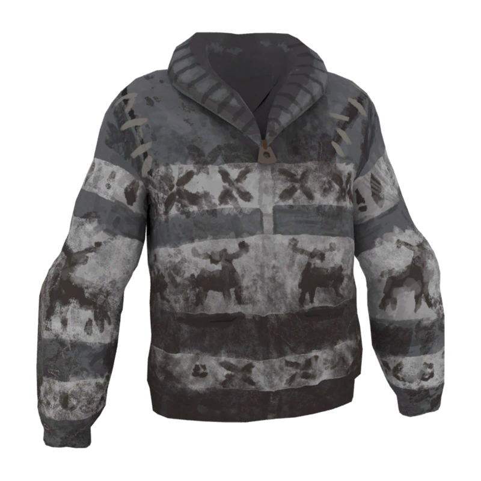

# Cowichan Sweater

**Categories:** Clothing, Pages with update history, Story items · **Source:** [Fandom](https://thelongdark.fandom.com/wiki/Cowichan_Sweater)

**Cowichan Sweater**

| Property | Details |
| --- | --- |
|  | [Cowichan Sweater icon](../assets/Cowichan_Sweater_icon.png) |
| **General** |  |
| Item Type | Clothing |
| Wintermute | Yes |
| Clothing Slot | Inner torso |
| **Statistics** |  |
| Weight | [Weight icon](../assets/Weight_icon.png)1.00 kg(2.2 lbs) |
| Warmth bonus | [Temp icon](../assets/Temp_icon.png)2.5 °C(4.5 °F) |
| Windproof bonus | [Windproofness icon](../assets/Windproofness_icon.png)2.0 °C(3.6 °F) |
| Waterproof bonus | [Waterproofness icon](../assets/Waterproofness_icon.png)50% |
| Protection | [Protection icon](../assets/Protection_icon.png)5% |
| Mobility | [Mobility icon](../assets/Mobility_icon.png)-2% |
| Harvest | 1 × [Cloth](./Cloth.md) / 45 minutes |
| Repair | 1 × [Cloth](./Cloth.md) / 60 minutes / 30% condition |

> “**The warmest sweater around. Inspired by the traditional sweater conceived by the Cowichan First Nation on Vancouver Island, [Canada](./The%20Collapse.md). Treat it like an old friend.**”
>
> — In-game description

The **Cowichan Sweater** is a type of [clothing](./Clothing.md) in _[The Long Dark](./The%20Long%20Dark.md)_.

It is the warmest and heaviest of all sweaters and is quite a rare find. It is not available on [Interloper](./Interloper.md) difficulty.

A Cowichan Sweater is **guaranteed** to spawn inside a [memento](./Mementos.md) box in [Bleak inlet](./Bleak%20Inlet.md).

The sweater can sometimes be found in:

- [Echo One Radio Tower](./Echo%20One%20Radio%20Tower.md) and [Cabin](./Cabin.md) in [Bleak Inlet](./Bleak%20Inlet.md)
- [Hunting Lodge](./Hunting%20Lodge.md) in [Broken Railroad](./Broken%20Railroad.md)
- [Logging Camp](./Logging%20Camp.md) in [Mystery Lake](./Mystery%20Lake%20%28region%29.md)
- [Signal Hill](./Signal%20Hill.md) and [Misty Falls Cave](./Misty%20Falls%20Cave.md) in [Pleasant Valley](./Pleasant%20Valley.md)
- [Gold Mine](./Gold%20Mine.md) in [Ash Canyon](./Ash%20Canyon.md)
- [Prepper caches](./Prepper%20Cache.md)
- Rarely in an open cardboard box in the main bedroom of [Paradise Meadows Farmhouse](./Paradise%20Meadows%20Farm.md) in [Mountain Town](./Mountain%20Town.md)
- Rarely in the [corpse](./Corpse.md) in the underside of the [Tail Section](./Tail%20Section.md) in [Timberwolf Mountain](./Timberwolf%20Mountain.md).
- The safe inside [Hibernia Processing](./Hibernia%20Processing.md).
- [Justy's Hovel](./Justy%27s%20Hovel.md) in [Forsaken Airfield](./Forsaken%20Airfield.md) ([Tales from the Far Territory](./Tales%20from%20the%20Far%20Territory.md) DLC)
- Sometimes in the [safe](./Safe.md) inside [Milton Credit Union](./Milton%20Credit%20Union.md).
- Inside the trunk of one of the cars outside the [Quonset Garage](./Quonset%20Garage.md) in [Coastal Highway](./Coastal%20Highway.md).
- [Station Bunkhouse](./Station%20Bunkhouse.md) and the safe in [Weather Station](./Weather%20Station.md) in [Sundered Pass](./Sundered%20Pass.md)

## Gallery

## Update history

- UPDATE **19 December 2016 ([Update](./The%20Long%20Dark%20%E2%80%94%20Early%20Access%20Changelog.md#0-386-resolute-outfitter-update)):**
  - Added to game
