# Crafting

**Source:** [Fandom](https://thelongdark.fandom.com/wiki/Crafting)

**Contents**

- [Overview](#overview)
- [Blueprint Availability](#blueprint-availability)
- [List of Blueprints](#list-of-blueprints)
- [Anywhere](#anywhere)
- [Active Fire](#active-fire)
- [Work Bench](#work-bench)
- [Forge](#forge)
- [Ammunition Work Bench](#ammunition-work-bench)
- [Ammunition Forge](#ammunition-forge)
- [Furniture Workbench](#furniture-workbench)

_Crafting\_Menu.png_

_For cooking recipes crafted at cooking stations, see [Cooking#Frontier Cooking Recipes](./Cooking.md#Frontier_Cooking_Recipes)._

## Overview

**Crafting** is a menu in _[The Long Dark](./The%20Long%20Dark.md)_ found within the [Survival Menu](./Survival%20Menu.md). It can be accessed by the default hotkey "K" or from the hammer and anvil icon at the top of the game menu.

On the left of the screen are tabs that allow you to view blueprints by category. By default it will show **All** blueprints, but they can be filtered to only show:

- [Fire Starting](./Fire.md)
- [First Aid](./First%20Aid.md)
- [Clothing](./Clothing.md)
- Tools
- [Decorations](./Decorations.md)

Below the blueprints are 6 submenus allowing you to filter for specific creation methods for items. By default it will show **All** blueprint creation methods but can be changed to only show items that can be crafted at:

- Anywhere (shows only items that can be crafted anywhere)
- [Work Bench](./Work%20Bench.md)
- [Forge](./Forge.md)
- [Ammunition Work Bench](./Ammunition%20Work%20Bench.md)
- [Active Fire](./Fire.md)
- [Furniture Workbench](./Furniture%20Workbench.md)

## Blueprint Availability

Some items in [Wintermute](./Wintermute.md) Episodes require finding their blueprints in order to craft, and are usually unlocked when progressing through the story and completing side missions. Other Blueprints are not available in Wintermute at all.

Survival Mode has all blueprints unlocked from the start except for the [Noisemaker](./Noisemaker.md) blueprint, which is unlocked when one is found in game.

## List of Blueprints

Crafting duration times varies widely depending some factors:

- Some items can be crafted faster at a Work Bench by using [Simple Tools](./Simple%20Tools.md) or [Quality Tools](./Quality%20Tools.md).
- Using a more refined version of a tool i.e. [Hunting Knife](./Hunting%20Knife.md)/[Sewing Kit](./Sewing%20Kit.md) vs [Improvised Knife](./Improvised%20Knife.md)/[Fishing Tackle](./Fishing%20Tackle.md) will get crafting done much faster - providing up to a 50% time discount.

### Anywhere

| Recipe | Materials | Time | Tools Needed |
| --- | --- | --- | --- |
|  [Acorn Grounds](./Acorn%20Grounds.md) | 4x [Acorns (Cooked)](./Acorns%20%28Cooked%29.md) | 15 Min |  [Heavy Hammer](./Heavy%20Hammer.md) |
|  [Acorn Grounds](./Acorn%20Grounds.md) | 1x [Acorns (Cooked - Large Portion)](./Acorns%20%28Cooked%20-%20Large%20Portion%29.md) | 15 Min |  [Heavy Hammer](./Heavy%20Hammer.md) |
|  [Prepared Acorns](./Prepared%20Acorns.md) | 1x [Acorns](./Acorns.md) | 10 Min | None |
|  [Prepared Acorns (Large Portion)](./Prepared%20Acorns%20%28Large%20Portion%29.md) | 4x [Prepared Acorns](./Prepared%20Acorns.md) | 1 Min | None |
| 2x [Bandage](./Bandage.md) | 1x [Cloth](./Cloth.md) | 10 Min | None |
|  [Carved Bear Figurine](./Carved%20Bear%20Figurine.md) | 1x  [Cedar Firewood](./Cedar%20Firewood.md) | 4 Hours |  [Woodworking Tools](./Woodworking%20Tools.md) |
|  [Carved Cougar Figurine](./Carved%20Cougar%20Figurine.md) | 1x  [Cedar Firewood](./Cedar%20Firewood.md) | 4 Hours |  [Woodworking Tools](./Woodworking%20Tools.md) |
| 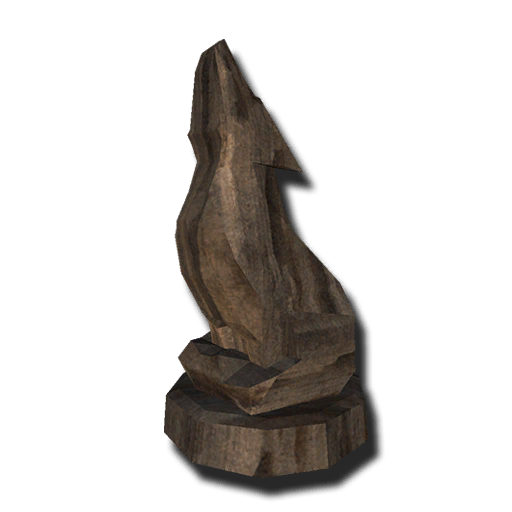 [Carved Wolf Figurine](./Carved%20Wolf%20Figurine.md) | 1x  [Cedar Firewood](./Cedar%20Firewood.md) | 4 Hours |  [Woodworking Tools](./Woodworking%20Tools.md) |
| 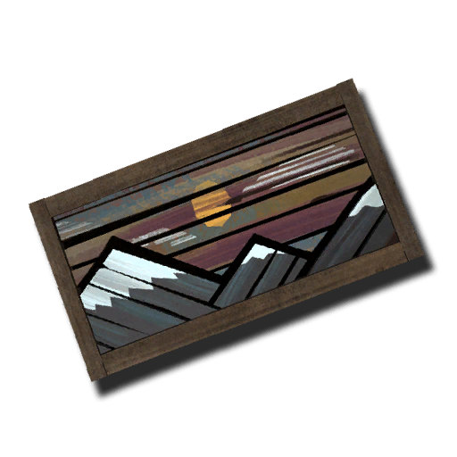 [Decorative Art](./Decorative%20Art.md) | - 2x  [Fir Firewood](./Fir%20Firewood.md) / - 1x  [Cedar Firewood](./Cedar%20Firewood.md) / - 1x  [Reclaimed Wood](./Reclaimed%20Wood.md) | 5 Hours |  [Woodworking Tools](./Woodworking%20Tools.md) |
|  [Decorative Art](./Decorative%20Art.md) | - 2x  [Fir Firewood](./Fir%20Firewood.md) / - 1x  [Cedar Firewood](./Cedar%20Firewood.md) / - 1x  [Reclaimed Wood](./Reclaimed%20Wood.md) | 5 Hours |  [Woodworking Tools](./Woodworking%20Tools.md) |
|  [Decorative End Table](./Decorative%20End%20Table.md) | 6x  [Cedar Firewood](./Cedar%20Firewood.md) | 5 Hours |  [Woodworking Tools](./Woodworking%20Tools.md) |
|  [Fishing Tackle](./Fishing%20Tackle.md) | - 1x [Hook](./Hook.md) / - 1x [Line](./Line.md) | 10 Min | None |
| 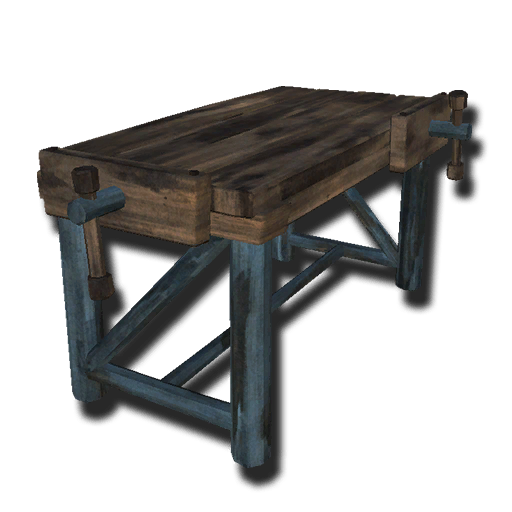 [Furniture Workbench](./Furniture%20Workbench.md) | 10x  [Cedar Firewood](./Cedar%20Firewood.md) | 4 Hours |  [Woodworking Tools](./Woodworking%20Tools.md) |
|  [Improvised Down Bedroll](./Improvised%20Down%20Bedroll.md) | - 1x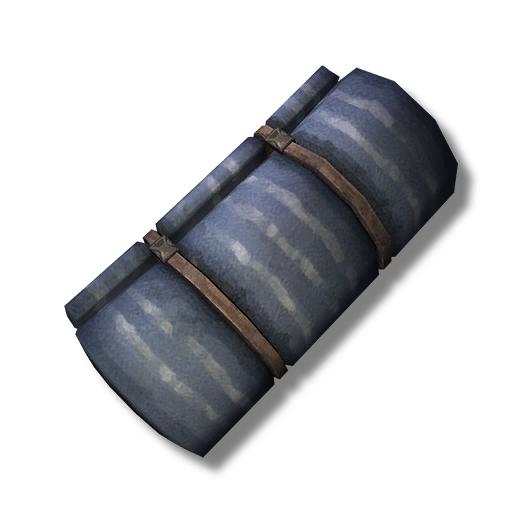 [Bedroll](./Bedroll.md) / - 3x [Cloth](./Cloth.md) / - 10x [Ptarmigan Down](./Ptarmigan%20Down.md) | 3 to 6 Hours | -  [Sewing Kit](./Sewing%20Kit.md) / -  [Fishing Tackle](./Fishing%20Tackle.md) |
|  [Improvised Hand Wraps](./Improvised%20Hand%20Wraps.md) | 4x [Cloth](./Cloth.md) | 37 - 1 Hour | -  [Sewing Kit](./Sewing%20Kit.md) / -  [Fishing Tackle](./Fishing%20Tackle.md) |
|  [Improvised Head Wrap](./Improvised%20Head%20Wrap.md) | 2x [Cloth](./Cloth.md) | 30 to 48 Min | -  [Sewing Kit](./Sewing%20Kit.md) / -  [Fishing Tackle](./Fishing%20Tackle.md) |
|  [Improvised Insulation](./Improvised%20Insulation.md) | - 4x [Cloth](./Cloth.md) / - 5x [Ptarmigan Down](./Ptarmigan%20Down.md) | 1.16-1 Hour | -  [Sewing Kit](./Sewing%20Kit.md) / -  [Fishing Tackle](./Fishing%20Tackle.md) |
|  [Old Man's Beard Wound Dressing](./Old%20Man%27s%20Beard%20Wound%20Dressing.md) | 3x [Old Man's Beard Lichen](./Old%20Man%27s%20Beard%20Lichen.md) | 15 Min | None |
|  [Prepared Birch Bark](./Prepared%20Birch%20Bark.md) | 2x [Birch Bark](./Birch%20Bark.md) | 5 Min | None |
|  [Prepared Burdock](./Prepared%20Burdock.md) | 1x [Burdock Root](./Burdock%20Root.md) | 15 Min | None |
|  [Prepared Reishi Mushrooms](./Prepared%20Reishi%20Mushrooms.md) | 2x [Reishi Mushroom](./Reishi%20Mushroom.md) | 15 Min | None |
|  [Prepared Rose Hips](./Prepared%20Rose%20Hips.md) | 24x [Rose Hip](./Rose%20Hip.md) | 15 Min | None |
| 2x [Tinder Plug](./Tinder%20Plug.md) | 1x [Newsprint](./Newsprint.md) | 10 Min | None |
| 4x [Tinder Plug](./Tinder%20Plug.md) | 1x [Newsprint Roll](./Newsprint%20Roll.md) | 10 Min | None |
| 2x [Tinder Plug](./Tinder%20Plug.md) | 1x [Stack of Papers](./Stack%20of%20Papers.md) | 10 Min | None |
| 2x [Tinder Plug](./Tinder%20Plug.md) | 1x [Stick](./Stick.md) | 5 Min | None |
|  [Torch](./Torch.md) | - 3x [Stick](./Stick.md) / - 1x [Cloth](./Cloth.md) / - 0.10Lx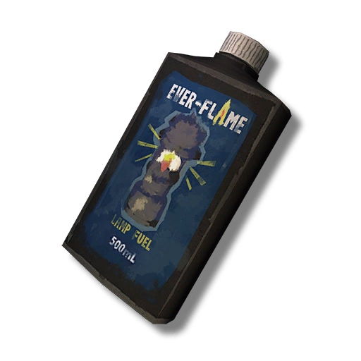 [Lantern Fuel](./Lantern%20Fuel.md) | 15 Min | None |

### [Active Fire](./Fire.md)

| Recipe | Ingredients | Time | Tools Needed |
| --- | --- | --- | --- |
| 3x [Fire Hardened Arrow](./Fire%20Hardened%20Arrow.md) | - 5x [Stick](./Stick.md) / - 5x [Crow Feather](./Crow%20Feather.md) | 22 to 45 Min | -  [Hunting Knife](./Hunting%20Knife.md) / -  [Improvised Knife](./Improvised%20Knife.md) / -  [Cougar Claw Knife](./Cougar%20Claw%20Knife.md) / -  [Hatchet](./Hatchet.md) / -  [Improvised Hatchet](./Improvised%20Hatchet.md) |

### [Work Bench](./Work%20Bench.md)

| Recipe | Materials | Time | Tools Needed |
| --- | --- | --- | --- |
| 3x [Arrow Shaft](./Arrow%20Shaft.md) | 1x [Cured Birch Sapling](./Cured%20Birch%20Sapling.md) | 30 to 60 Min | -  [Hunting Knife](./Hunting%20Knife.md) / -  [Improvised Knife](./Improvised%20Knife.md) / -  [Cougar Claw Knife](./Cougar%20Claw%20Knife.md) / -  [Survival Knife](./Survival%20Knife.md) / -  [Hatchet](./Hatchet.md) / -  [Improvised Hatchet](./Improvised%20Hatchet.md) |
|  [Bear Hide Rug](./Bear%20Hide%20Rug.md) | - 1x [Cured Deer Hide](./Cured%20Deer%20Hide.md) / - 1x [Cured Black Bear Hide](./Cured%20Black%20Bear%20Hide.md) / - 2x [Cured Gut](./Cured%20Gut.md) | 8 Hours | 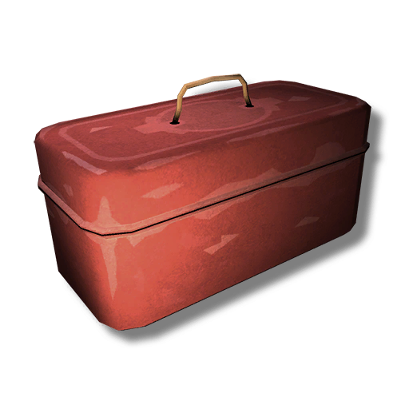 [Quality Tools](./Quality%20Tools.md) |
|  [Bear Skin Bedroll](./Bear%20Skin%20Bedroll.md) | - 2x [Cured Black Bear Hide](./Cured%20Black%20Bear%20Hide.md) / - 5x [Cloth](./Cloth.md) / - 6x [Cured Gut](./Cured%20Gut.md) | 17 Hours 30 Min to 35 Hours | -  [Hunting Knife](./Hunting%20Knife.md) / -  [Improvised Knife](./Improvised%20Knife.md) / -  [Cougar Claw Knife](./Cougar%20Claw%20Knife.md) / -  [Survival Knife](./Survival%20Knife.md) / -  [Hatchet](./Hatchet.md) / -  [Improvised Hatchet](./Improvised%20Hatchet.md) |
|  [Bearskin Coat](./Bearskin%20Coat.md) | - 2x [Cured Black Bear Hide](./Cured%20Black%20Bear%20Hide.md) / - 4x [Cured Gut](./Cured%20Gut.md) | 30 to 60 Hours | -  [Hunting Knife](./Hunting%20Knife.md) / -  [Improvised Knife](./Improvised%20Knife.md) / -  [Cougar Claw Knife](./Cougar%20Claw%20Knife.md) / -  [Survival Knife](./Survival%20Knife.md) / -  [Hatchet](./Hatchet.md) / -  [Improvised Hatchet](./Improvised%20Hatchet.md) |
|  [Bushcraft Bow](./Bushcraft%20Bow.md) (requires [Bushcraft Bow Blueprint Card](./Bushcraft%20Bow%20Blueprint%20Card.md)) | - 2x [Green Birch Sapling](./Green%20Birch%20Sapling.md) / - 2x [Cured Gut](./Cured%20Gut.md) | 5 hours | -  [Hunting Knife](./Hunting%20Knife.md) / -  [Improvised Knife](./Improvised%20Knife.md) / -  [Cougar Claw Knife](./Cougar%20Claw%20Knife.md) / -  [Survival Knife](./Survival%20Knife.md) / -  [Hatchet](./Hatchet.md) / -  [Improvised Hatchet](./Improvised%20Hatchet.md) |
|  [Cougar Hide Wrap](./Cougar%20Hide%20Wrap.md) (Blueprint doesn't appear on [Pilgrim](./Pilgrim.md)) | - 1x [Cured Cougar Hide](./Cured%20Cougar%20Hide.md) / - 2x [Cured Gut](./Cured%20Gut.md) | 11 Hours 40 Min to 18 Hours 40 Min | -  [Sewing Kit](./Sewing%20Kit.md) / -  [Fishing Tackle](./Fishing%20Tackle.md) |
|  [Deerskin Boots](./Deerskin%20Boots.md) | - 2x [Cured Deer Hide](./Cured%20Deer%20Hide.md) / - 4x [Cured Gut](./Cured%20Gut.md) | 12 Hours 30 Min to 20 Hours | -  [Sewing Kit](./Sewing%20Kit.md) / -  [Fishing Tackle](./Fishing%20Tackle.md) |
|  [Deerskin Pants](./Deerskin%20Pants.md) | - 3x [Cured Deer Hide](./Cured%20Deer%20Hide.md) / - 4x [Cured Gut](./Cured%20Gut.md) | 12 Hours 30 Min to 20 Hours | -  [Sewing Kit](./Sewing%20Kit.md) / -  [Fishing Tackle](./Fishing%20Tackle.md) |
|  [Fishing Lure (Acorns)](./Fishing%20Lure%20%28Acorns%29.md) | - 1x [Scrap Metal](./Scrap%20Metal.md) / - 1x [Crow Feather](./Crow%20Feather.md) / - 1x [Acorns](./Acorns.md) | 25-50 Minutes | - _ [Simple Tools](./Simple%20Tools.md)_ / - _ [Quality Tools](./Quality%20Tools.md)_ |
|  [Fishing Lure (Revolver Shell Casing)](./Fishing%20Lure%20%28Revolver%20Shell%20Casing%29.md) | - 1x [Scrap Metal](./Scrap%20Metal.md) / - 1x [Crow Feather](./Crow%20Feather.md) / - 1x [Revolver Shell Casing](./Revolver%20Shell%20Casing.md) | 25-50 Minutes | - _ [Simple Tools](./Simple%20Tools.md)_ / - _ [Quality Tools](./Quality%20Tools.md)_ |
|  [Fishing Lure (Wire Bundle)](./Fishing%20Lure%20%28Wire%20Bundle%29.md) | - 1x [Scrap Metal](./Scrap%20Metal.md) / - 1x [Crow Feather](./Crow%20Feather.md) / - 1x [Wires](./Wires.md) | 25-50 Minutes | - _ [Simple Tools](./Simple%20Tools.md)_ / - _ [Quality Tools](./Quality%20Tools.md)_ |
|  [Fishing Tip-Up](./Fishing%20Tip-Up.md) | - 2x [Stick](./Stick.md) / - 1x [Cloth](./Cloth.md) / - 1x [Scrap Metal](./Scrap%20Metal.md) / - 1x [Fishing Tackle](./Fishing%20Tackle.md) | 20-40 Min | - _ [Simple Tools](./Simple%20Tools.md)_ / - _ [Quality Tools](./Quality%20Tools.md)_ |
| 3x [Hook](./Hook.md) | 1x [Scrap Metal](./Scrap%20Metal.md) | 10-20 Min | - _ [Simple Tools](./Simple%20Tools.md)_ / - _ [Quality Tools](./Quality%20Tools.md)_ |
|  [Improvised Crampons](./Improvised%20Crampons.md) | - 4x [Scrap Metal](./Scrap%20Metal.md) / - 2x [Cured Leather](./Cured%20Leather.md) | 2-4 Hours | - _ [Simple Tools](./Simple%20Tools.md)_ / - _ [Quality Tools](./Quality%20Tools.md)_ |
| 2x [Line](./Line.md) | 1x [Cured Gut](./Cured%20Gut.md) | 15 Min | None |
|  [Moose-Hide Cloak](./Moose-Hide%20Cloak.md) | - 1x [Cured Moose Hide](./Cured%20Moose%20Hide.md) / - 4x [Cured Gut](./Cured%20Gut.md) | 16 Hours 40 Min to 33 Hours 20 Min | -  [Hunting Knife](./Hunting%20Knife.md) / -  [Improvised Knife](./Improvised%20Knife.md) / -  [Cougar Claw Knife](./Cougar%20Claw%20Knife.md) / -  [Survival Knife](./Survival%20Knife.md) / -  [Hatchet](./Hatchet.md) / -  [Improvised Hatchet](./Improvised%20Hatchet.md) |
|  [Moose-Hide Satchel](./Moose-Hide%20Satchel.md) | - 1x [Cured Moose Hide](./Cured%20Moose%20Hide.md) / - 2x [Cured Gut](./Cured%20Gut.md) | 10 to 16 Hours | -  [Sewing Kit](./Sewing%20Kit.md) / -  [Fishing Tackle](./Fishing%20Tackle.md) |
|  [Rabbitskin Hat](./Rabbitskin%20Hat.md) | - 3x [Cured Rabbit Pelt](./Cured%20Rabbit%20Pelt.md) / - 1x [Cured Gut](./Cured%20Gut.md) | 3 Hours 30 Min to 5 Hours 36 Min | -  [Sewing Kit](./Sewing%20Kit.md) / -  [Fishing Tackle](./Fishing%20Tackle.md) |
| 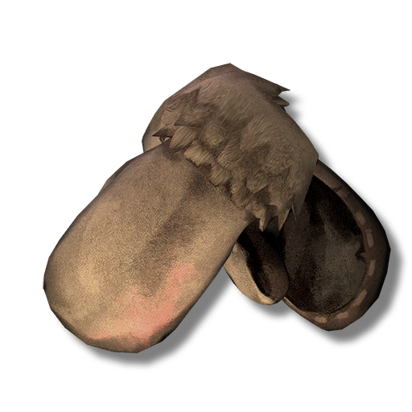 [Rabbitskin Mitts](./Rabbitskin%20Mitts.md) | - 4x [Cured Rabbit Pelt](./Cured%20Rabbit%20Pelt.md) / - 2x [Cured Gut](./Cured%20Gut.md) | 5 to 8 Hours | -  [Sewing Kit](./Sewing%20Kit.md) / -  [Fishing Tackle](./Fishing%20Tackle.md) |
|  [Simple Arrow](./Simple%20Arrow.md) | - 1x [Arrowhead](./Arrowhead.md) / - 1x [Arrow Shaft](./Arrow%20Shaft.md) / - 3x [Crow Feather](./Crow%20Feather.md) | 45 to 90 Min | - _ [Simple Tools](./Simple%20Tools.md)_ / - _ [Quality Tools](./Quality%20Tools.md)_ |
| 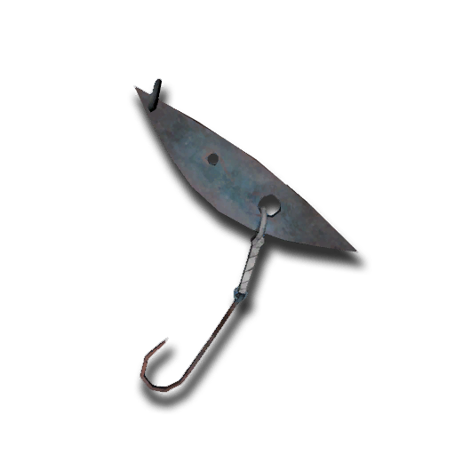 [Simple Fishing Lure](./Simple%20Fishing%20Lure.md) | 1x [Scrap Metal](./Scrap%20Metal.md) | 15-30 Min | - _ [Simple Tools](./Simple%20Tools.md)_ / - _ [Quality Tools](./Quality%20Tools.md)_ |
|  [Snare](./Snare.md) | - 1x [Cured Gut](./Cured%20Gut.md) / - 1x [Reclaimed Wood](./Reclaimed%20Wood.md) | 15-30 Min | - _ [Simple Tools](./Simple%20Tools.md)_ / - _ [Quality Tools](./Quality%20Tools.md)_ |
|  [Survival Bow](./Survival%20Bow.md) | - 1x [Cured Maple Sapling](./Cured%20Maple%20Sapling.md) / - 2x [Cured Gut](./Cured%20Gut.md) | 5 to 10 Hours | -  [Hunting Knife](./Hunting%20Knife.md) / -  [Improvised Knife](./Improvised%20Knife.md) / -  [Cougar Claw Knife](./Cougar%20Claw%20Knife.md) / -  [Survival Knife](./Survival%20Knife.md) / -  [Hatchet](./Hatchet.md) / -  [Improvised Hatchet](./Improvised%20Hatchet.md) |
|  [Travois](./Travois.md) | - 1x [Cured Deer Hide](./Cured%20Deer%20Hide.md) / - 2x [Cured Gut](./Cured%20Gut.md) / - 4x [Cured Maple Sapling](./Cured%20Maple%20Sapling.md) | 3 to 6 Hours | -  [Hunting Knife](./Hunting%20Knife.md) / -  [Improvised Knife](./Improvised%20Knife.md) / -  [Cougar Claw Knife](./Cougar%20Claw%20Knife.md) / -  [Survival Knife](./Survival%20Knife.md) / -  [Hatchet](./Hatchet.md) / -  [Improvised Hatchet](./Improvised%20Hatchet.md) |
|  [Wolfskin Coat](./Wolfskin%20Coat.md) | - 4x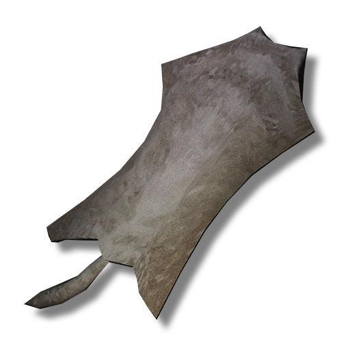 [Cured Wolf Pelt](./Cured%20Wolf%20Pelt.md) / - 4x [Cured Gut](./Cured%20Gut.md) | 25 to 50 Hours | -  [Hunting Knife](./Hunting%20Knife.md) / -  [Improvised Knife](./Improvised%20Knife.md) / -  [Cougar Claw Knife](./Cougar%20Claw%20Knife.md) / -  [Survival Knife](./Survival%20Knife.md) / -  [Hatchet](./Hatchet.md) / -  [Improvised Hatchet](./Improvised%20Hatchet.md) |
| 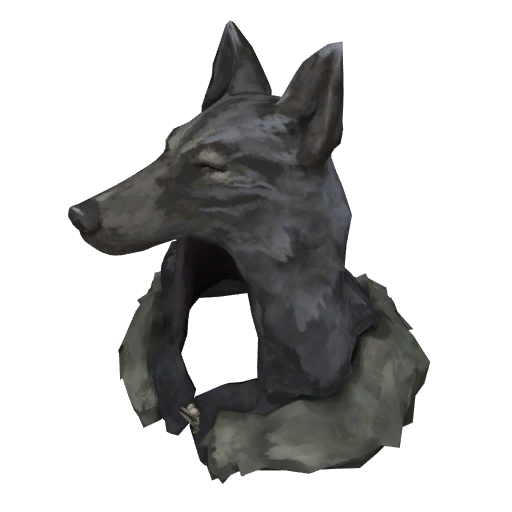 [Wolfskin Hat](./Wolfskin%20Hat.md) (requires [Wolfskin Hat Blueprint Card](./Wolfskin%20Hat%20Blueprint%20Card.md)) | - 1x [Cured Wolf Pelt](./Cured%20Wolf%20Pelt.md) / - 2x [Cured Gut](./Cured%20Gut.md) | 17 hours | -  [Hunting Knife](./Hunting%20Knife.md) / -  [Improvised Knife](./Improvised%20Knife.md) / -  [Cougar Claw Knife](./Cougar%20Claw%20Knife.md) / -  [Survival Knife](./Survival%20Knife.md) / -  [Hatchet](./Hatchet.md) / -  [Improvised Hatchet](./Improvised%20Hatchet.md) |
|  [Wolfskin Pants](./Wolfskin%20Pants.md) (requires [Wolfskin Pants Blueprint Card](./Wolfskin%20Pants%20Blueprint%20Card.md)) | - 4x [Cured Wolf Pelt](./Cured%20Wolf%20Pelt.md) / - 3x [Cured Gut](./Cured%20Gut.md) | 29 hours | -  [Hunting Knife](./Hunting%20Knife.md) / -  [Improvised Knife](./Improvised%20Knife.md) / -  [Cougar Claw Knife](./Cougar%20Claw%20Knife.md) / -  [Survival Knife](./Survival%20Knife.md) / -  [Hatchet](./Hatchet.md) / -  [Improvised Hatchet](./Improvised%20Hatchet.md) |
|  [Noisemaker](./Noisemaker.md) (Wintermute [EP4](./Episode%204%20-%20Fury%2C%20Then%20Silence.md) only) | - 1x [Recycled Can](./Recycled%20Can.md) / - 1x [Cloth](./Cloth.md) / - 0.10kg x [Can of Gunpowder](./Can%20of%20Gunpowder.md) | 30 Min | None |

### [Forge](./Forge.md)

| Recipe | Materials | Time | Tools Needed |
| --- | --- | --- | --- |
| 2x  [Arrowhead](./Arrowhead.md) | 1x  [Scrap Metal](./Scrap%20Metal.md) | 1 Hour |  [Heavy Hammer](./Heavy%20Hammer.md) |
|  [Cougar Claw Knife](./Cougar%20Claw%20Knife.md) | 1x  [Cougar Claw](./Cougar%20Claw.md) 3x  [Scrap Metal](./Scrap%20Metal.md) / 1x  [Cured Leather](./Cured%20Leather.md) | 3 Hours 40 Min |  [Heavy Hammer](./Heavy%20Hammer.md) |
|  [Improvised Hatchet](./Improvised%20Hatchet.md) | 5x  [Scrap Metal](./Scrap%20Metal.md) 1x  [Cloth](./Cloth.md) | 4 Hours |  [Heavy Hammer](./Heavy%20Hammer.md) |
|  [Improvised Knife](./Improvised%20Knife.md) | 3x  [Scrap Metal](./Scrap%20Metal.md) 1x  [Cloth](./Cloth.md) | 3 Hours |  [Heavy Hammer](./Heavy%20Hammer.md) |
|  [Spear Head](./Spear%20Head.md) (Wintermute [EP2](./Episode%202%20-%20Luminance%20Fugue.md) Only) | 2x  [Scrap Metal](./Scrap%20Metal.md) | 1 Hour 30 Min |  [Heavy Hammer](./Heavy%20Hammer.md) |

### [Ammunition Work Bench](./Ammunition%20Work%20Bench.md)

| Recipe | Materials | Time |
| --- | --- | --- |
|  [Can of Gunpowder](./Can%20of%20Gunpowder.md) | - 1x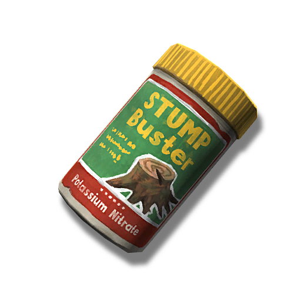 [Stump Remover](./Stump%20Remover.md) / - 1x [Dusting Sulfur](./Dusting%20Sulfur.md) / - 2x [Charcoal](./Charcoal.md) | 30 Min |
|  [Revolver Ammunition](./Revolver%20Ammunition.md) | - 1x [Bullet](./Bullet.md) / - 1x [Revolver Shell Casing](./Revolver%20Shell%20Casing.md) / - 0.01kg x [Can of Gunpowder](./Can%20of%20Gunpowder.md) | 5 Min |
| 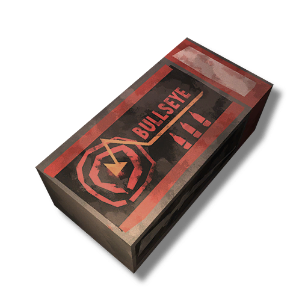 [Rifle Ammunition](./Rifle%20Ammunition.md) | - 1x [Bullet](./Bullet.md) / - 1x [Rifle Shell Casing](./Rifle%20Shell%20Casing.md) / - 0.01kg x [Can of Gunpowder](./Can%20of%20Gunpowder.md) | 5 Min |
|  [Noisemaker](./Noisemaker.md) ([Survival Mode](./Survival%20Mode.md) only) | - 1x [Recycled Can](./Recycled%20Can.md) / - 1x [Cloth](./Cloth.md) / - 0.10kg x [Can of Gunpowder](./Can%20of%20Gunpowder.md) | 30 Min |

### [Ammunition Forge](./Ammunition%20Forge.md)

| Recipe | Materials | Time |
| --- | --- | --- |
| 6x [Bullet](./Bullet.md) | 1x  [Scrap Lead](./Scrap%20Lead.md) | 1 Hour |

### [Furniture Workbench](./Furniture%20Workbench.md)

| Recipe | Ingredients | Time | Tools Needed |
| --- | --- | --- | --- |
|  [Square Table](./Square%20Table.md) | 8x  [Fir Firewood](./Fir%20Firewood.md) | 7 Hours | [Furniture Workbench](./Furniture%20Workbench.md) |
|  [Round Table](./Round%20Table.md) | 12x  [Fir Firewood](./Fir%20Firewood.md) | 9 Hours | [Furniture Workbench](./Furniture%20Workbench.md) |
|  [Rustic Table](./Rustic%20Table.md) | 10x  [Fir Firewood](./Fir%20Firewood.md) | 8 Hours | [Furniture Workbench](./Furniture%20Workbench.md) |
| 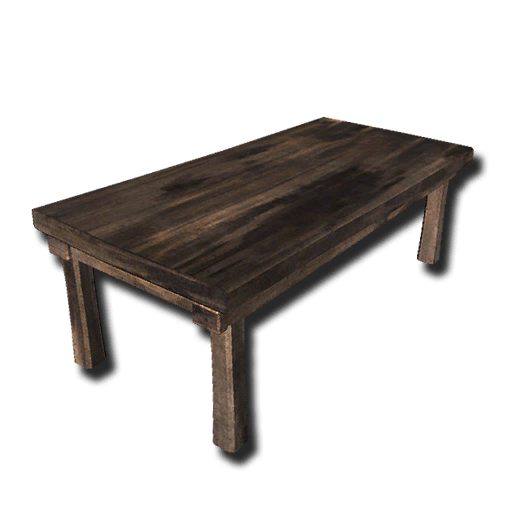 [Coffee Table](./Coffee%20Table.md) | 6x  [Fir Firewood](./Fir%20Firewood.md) | 4 Hours | [Furniture Workbench](./Furniture%20Workbench.md) |
|  [Rustic End Table](./Rustic%20End%20Table.md) | 6x  [Cedar Firewood](./Cedar%20Firewood.md) 2x  [Reclaimed Wood](./Reclaimed%20Wood.md) | 6 Hours | [Furniture Workbench](./Furniture%20Workbench.md) |
|  [Rustic Chair](./Rustic%20Chair.md) | 4x  [Cedar Firewood](./Cedar%20Firewood.md) 2x  [Reclaimed Wood](./Reclaimed%20Wood.md) | 4 Hours | [Furniture Workbench](./Furniture%20Workbench.md) |
|  [Rustic Stool](./Rustic%20Stool.md) | 4x  [Fir Firewood](./Fir%20Firewood.md) | 2 Hours | [Furniture Workbench](./Furniture%20Workbench.md) |
|  [Rustic Bench](./Rustic%20Bench.md) | 10x  [Cedar Firewood](./Cedar%20Firewood.md) 2x  [Reclaimed Wood](./Reclaimed%20Wood.md) | 8 Hours | [Furniture Workbench](./Furniture%20Workbench.md) |
|  [Dresser](./Dresser.md) | 10x  [Cedar Firewood](./Cedar%20Firewood.md) 4x  [Reclaimed Wood](./Reclaimed%20Wood.md) | 8 Hours | [Furniture Workbench](./Furniture%20Workbench.md) |
|  [Wide Dresser](./Wide%20Dresser.md) | 16x  [Fir Firewood](./Fir%20Firewood.md) 6x  [Reclaimed Wood](./Reclaimed%20Wood.md) | 11 Hours | [Furniture Workbench](./Furniture%20Workbench.md) |
| 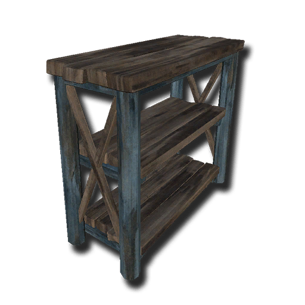 [Rustic Shelf](./Rustic%20Shelf.md) | 8x  [Cedar Firewood](./Cedar%20Firewood.md) | 6 Hours | [Furniture Workbench](./Furniture%20Workbench.md) |
|  [Tall Rustic Shelf](./Tall%20Rustic%20Shelf.md) | 10x  [Cedar Firewood](./Cedar%20Firewood.md) | 8 Hours | [Furniture Workbench](./Furniture%20Workbench.md) |
|  [Display Shelf](./Display%20Shelf.md) | 12x  [Fir Firewood](./Fir%20Firewood.md) 4x  [Reclaimed Wood](./Reclaimed%20Wood.md) | 10 Hours | [Furniture Workbench](./Furniture%20Workbench.md) |
|  [Rustic Closet](./Rustic%20Closet.md) | 18x  [Fir Firewood](./Fir%20Firewood.md) 3x  [Reclaimed Wood](./Reclaimed%20Wood.md) / 2x  [Scrap Metal](./Scrap%20Metal.md) | 9 Hours | [Furniture Workbench](./Furniture%20Workbench.md) |
|  [Tall Rustic Closet](./Tall%20Rustic%20Closet.md) | 24x  [Fir Firewood](./Fir%20Firewood.md) 4x  [Reclaimed Wood](./Reclaimed%20Wood.md) / 2x  [Scrap Metal](./Scrap%20Metal.md) | 10 Hours | [Furniture Workbench](./Furniture%20Workbench.md) |
|  [Rustic Cupboard](./Rustic%20Cupboard.md) | 10x  [Fir Firewood](./Fir%20Firewood.md) 2x  [Reclaimed Wood](./Reclaimed%20Wood.md) / 1x  [Scrap Metal](./Scrap%20Metal.md) | 8 Hours | [Furniture Workbench](./Furniture%20Workbench.md) |
|  [Rustic Storage Box](./Rustic%20Storage%20Box.md) | 8x  [Cedar Firewood](./Cedar%20Firewood.md) | 6 Hours | [Furniture Workbench](./Furniture%20Workbench.md) |
| 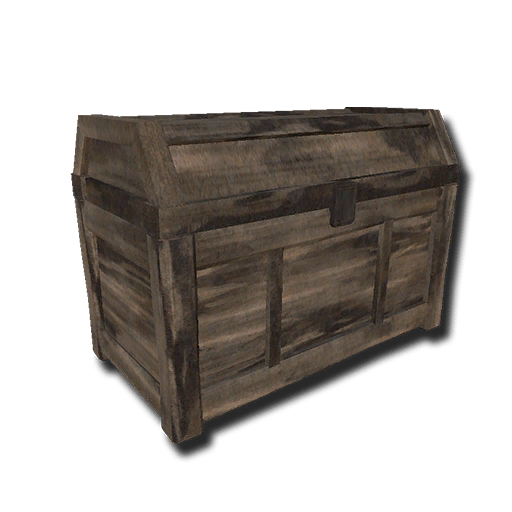 [Rustic Storage Trunk](./Rustic%20Storage%20Trunk.md) | 9x  [Fir Firewood](./Fir%20Firewood.md) | 4 Hours | [Furniture Workbench](./Furniture%20Workbench.md) |
|  [Mounted Coho Salmon](./Mounted%20Coho%20Salmon.md) | 1x  [Fir Firewood](./Fir%20Firewood.md) 1x  [Coho Salmon (Raw)](./Coho%20Salmon%20%28Raw%29.md) | 4 Hours | [Furniture Workbench](./Furniture%20Workbench.md) |
|  [Mounted Burbot](./Mounted%20Burbot.md) | 1x  [Fir Firewood](./Fir%20Firewood.md) 1x  [Burbot (Raw)](./Burbot%20%28Raw%29.md) | 4 Hours | [Furniture Workbench](./Furniture%20Workbench.md) |
|  [Mounted Rockfish](./Mounted%20Rockfish.md) | 1x  [Fir Firewood](./Fir%20Firewood.md) 1x  [Rockfish (Raw)](./Rockfish%20%28Raw%29.md) | 4 Hours | [Furniture Workbench](./Furniture%20Workbench.md) |
|  [Mounted Goldeye](./Mounted%20Goldeye.md) | 1x  [Fir Firewood](./Fir%20Firewood.md) 1x  [Goldeye (Raw)](./Goldeye%20%28Raw%29.md) | 4 Hours | [Furniture Workbench](./Furniture%20Workbench.md) |
|  [Mounted Rainbow Trout](./Mounted%20Rainbow%20Trout.md) | 1x  [Fir Firewood](./Fir%20Firewood.md) 1x  [Rainbow Trout (Raw)](./Rainbow%20Trout%20%28Raw%29.md) | 4 Hours | [Furniture Workbench](./Furniture%20Workbench.md) |
| 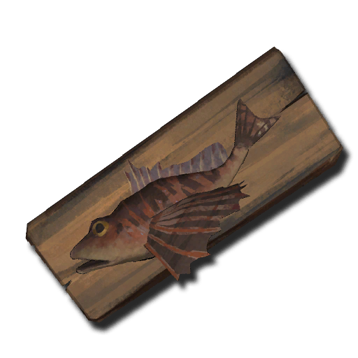 [Mounted Red Irish Lord](./Mounted%20Red%20Irish%20Lord.md) | 1x  [Fir Firewood](./Fir%20Firewood.md) 1x  [Red Irish Lord (Raw)](./Red%20Irish%20Lord%20%28Raw%29.md) | 4 Hours | [Furniture Workbench](./Furniture%20Workbench.md) |
|  [Mounted Smallmouth Bass](./Mounted%20Smallmouth%20Bass.md) | 1x  [Fir Firewood](./Fir%20Firewood.md) 1x  [Smallmouth Bass (Raw)](./Smallmouth%20Bass%20%28Raw%29.md) | 4 Hours | [Furniture Workbench](./Furniture%20Workbench.md) |
|  [Mounted Lake Whitefish](./Mounted%20Lake%20Whitefish.md) | 1x  [Fir Firewood](./Fir%20Firewood.md) 1x  [Lake Whitefish (Raw)](./Lake%20Whitefish%20%28Raw%29.md) | 4 Hours | [Furniture Workbench](./Furniture%20Workbench.md) |
|  [Wide Display Shelf](./Wide%20Display%20Shelf.md) | 18x  [Fir Firewood](./Fir%20Firewood.md) 4x  [Reclaimed Wood](./Reclaimed%20Wood.md) | 11 Hours | [Furniture Workbench](./Furniture%20Workbench.md) |
| 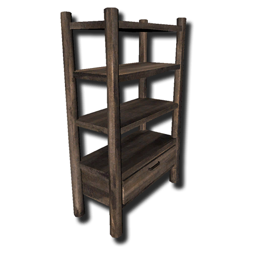 [Rustic Display Shelf](./Rustic%20Display%20Shelf.md) | 10x  [Fir Firewood](./Fir%20Firewood.md) 2x  [Reclaimed Wood](./Reclaimed%20Wood.md) | 9 Hours | [Furniture Workbench](./Furniture%20Workbench.md) |
|  [Rustic Bed](./Rustic%20Bed.md) | 10x  [Cedar Firewood](./Cedar%20Firewood.md) 12x  [Cloth](./Cloth.md) / 2x [Cured Gut](./Cured%20Gut.md) | 12 Hours | [Furniture Workbench](./Furniture%20Workbench.md) |
|  [Work Bench](./Work%20Bench.md) | 15x  [Cedar Firewood](./Cedar%20Firewood.md) 1x  [Workbench Vice](./Workbench%20Vice.md) | 18 Hours | [Furniture Workbench](./Furniture%20Workbench.md) |
|  [Framed Photo](./Framed%20Photo.md) | 1x  [Fir Firewood](./Fir%20Firewood.md) 1x  [Camera](./Camera.md) Photo | 2 Hours | [Furniture Workbench](./Furniture%20Workbench.md) |
|  [Meat Curing Box](./Meat%20Curing%20Box.md) | 10x  [Fir Firewood](./Fir%20Firewood.md) 8.00kg x 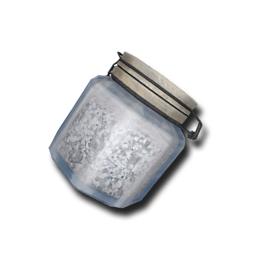 [Salt](./Salt.md) | 6 Hours | [Furniture Workbench](./Furniture%20Workbench.md) |
|  [Framed Hockey Jersey](./Framed%20Hockey%20Jersey.md) | 2x  [Fir Firewood](./Fir%20Firewood.md) 1x  [Scrap Metal](./Scrap%20Metal.md) / 1x  [Hockey Jersey](./Hockey%20Jersey.md) | 4 Hours | [Furniture Workbench](./Furniture%20Workbench.md) |
|  [Quilted Bed](./Quilted%20Bed.md) | 12x  [Fir Firewood](./Fir%20Firewood.md) 10x  [Cloth](./Cloth.md) / 6x [Cured Gut](./Cured%20Gut.md) / 16x  [Ptarmigan Down](./Ptarmigan%20Down.md) | 20 Hours | [Furniture Workbench](./Furniture%20Workbench.md) |
|  [Hide Couch](./Hide%20Couch.md) | 15x  [Fir Firewood](./Fir%20Firewood.md) 4x  [Cured Deer Hide](./Cured%20Deer%20Hide.md) / 16x  [Ptarmigan Down](./Ptarmigan%20Down.md) / 5x [Cured Gut](./Cured%20Gut.md) | 16 Hours | [Furniture Workbench](./Furniture%20Workbench.md) |
|  [Hide Chair ](./Hide%20Chair.md) | 8x  [Fir Firewood](./Fir%20Firewood.md) 2x  [Cured Deer Hide](./Cured%20Deer%20Hide.md) / 8x  [Ptarmigan Down](./Ptarmigan%20Down.md) / 3x [Cured Gut](./Cured%20Gut.md) | 13 Hours | [Furniture Workbench](./Furniture%20Workbench.md) |
| 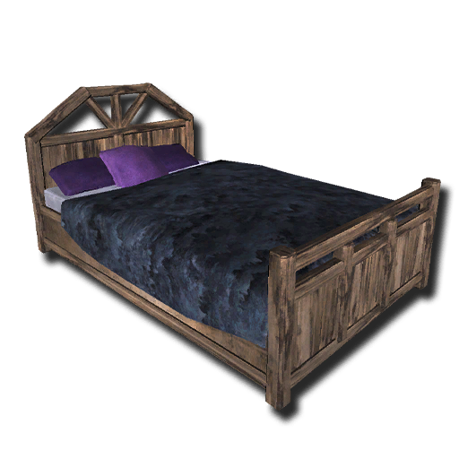 [Bear Hide Bed](./Bear%20Hide%20Bed.md) | 18x  [Fir Firewood](./Fir%20Firewood.md) 4x [Cured Gut](./Cured%20Gut.md) / 1x  [Cured Black Bear Hide](./Cured%20Black%20Bear%20Hide.md) / 16x  [Ptarmigan Down](./Ptarmigan%20Down.md) | 24 Hours | [Furniture Workbench](./Furniture%20Workbench.md) |
