# Crafting

**Contents**

- [Overview](#Overview)
- [Blueprint Availability](#Blueprint_Availability)
- [List of Blueprints](#List_of_Blueprints)
- [Anywhere](#Anywhere)
- [Active Fire](#Active_Fire)
- [Work Bench](#Work_Bench)
- [Forge](#Forge)
- [Ammunition Work Bench](#Ammunition_Work_Bench)
- [Ammunition Forge](#Ammunition_Forge)
- [Furniture Workbench](#Furniture_Workbench)

<figure>
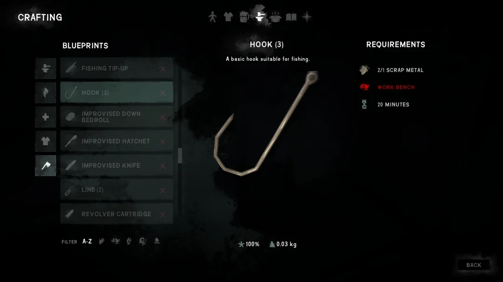
<figcaption>Crafting_Menu.png</figcaption>
</figure>

  
*For cooking recipes crafted at cooking stations, see <a href="./Cooking.md#Frontier_Cooking_Recipes" class="wikilink" title="Cooking#Frontier Cooking Recipes">Cooking#Frontier Cooking Recipes</a>.*

## Overview

**Crafting** is a menu in *<a href="./The%20Long%20Dark.md" class="wikilink" title="The Long Dark">The Long Dark</a>* found within the <a href="./Survival%20Menu.md" class="wikilink" title="Survival Menu">Survival Menu</a>. It can be accessed by the default hotkey "K" or from the hammer and anvil icon at the top of the game menu.

On the left of the screen are tabs that allow you to view blueprints by category. By default it will show **All** blueprints, but they can be filtered to only show:

- <a href="./Fire.md" class="wikilink" title="Fire Starting">Fire Starting</a>
- <a href="./First%20Aid.md" class="wikilink" title="First Aid">First Aid</a>
- <a href="./Clothing.md" class="wikilink" title="Clothing">Clothing</a>
- Tools
- <a href="./Decorations.md" class="wikilink" title="Decorations">Decorations</a>

Below the blueprints are 6 submenus allowing you to filter for specific creation methods for items. By default it will show **All** blueprint creation methods but can be changed to only show items that can be crafted at:

- Anywhere (shows only items that can be crafted anywhere)
- <a href="./Work%20Bench.md" class="wikilink" title="Work Bench">Work Bench</a>
- <a href="./Forge.md" class="wikilink" title="Forge">Forge</a>
- <a href="./Ammunition%20Work%20Bench.md" class="wikilink" title="Ammunition Work Bench">Ammunition Work Bench</a>
- <a href="./Fire.md" class="wikilink" title="Active Fire">Active Fire</a>
- <a href="./Furniture%20Workbench.md" class="wikilink" title="Furniture Workbench">Furniture Workbench</a>

## Blueprint Availability

Some items in <a href="./Wintermute.md" class="wikilink" title="Wintermute">Wintermute</a> Episodes require finding their blueprints in order to craft, and are usually unlocked when progressing through the story and completing side missions. Other Blueprints are not available in Wintermute at all.

Survival Mode has all blueprints unlocked from the start except for the <a href="./Noisemaker.md" class="wikilink" title="Noisemaker">Noisemaker</a> blueprint, which is unlocked when one is found in game.

## List of Blueprints

Crafting duration times varies widely depending some factors:

- Some items can be crafted faster at a Work Bench by using <a href="./Simple%20Tools.md" class="wikilink" title="Simple Tools">Simple Tools</a> or <a href="./Quality%20Tools.md" class="wikilink" title="Quality Tools">Quality Tools</a>.
- Using a more refined version of a tool i.e. <a href="./Hunting%20Knife.md" class="wikilink" title="Hunting Knife">Hunting Knife</a>/<a href="./Sewing%20Kit.md" class="wikilink" title="Sewing Kit">Sewing Kit</a> vs <a href="./Improvised%20Knife.md" class="wikilink" title="Improvised Knife">Improvised Knife</a>/<a href="./Fishing%20Tackle.md" class="wikilink" title="Fishing Tackle">Fishing Tackle</a> will get crafting done much faster - providing up to a 50% time discount.

### Anywhere

<table>
<colgroup>
<col style="width: 25%" />
<col style="width: 25%" />
<col style="width: 25%" />
<col style="width: 25%" />
</colgroup>
<thead>
<tr>
<th>
Recipe
</th>
<th>
Materials
</th>
<th>
Time
</th>
<th>
Tools Needed
</th>
</tr>
</thead>
<tbody>
<tr>
<td>
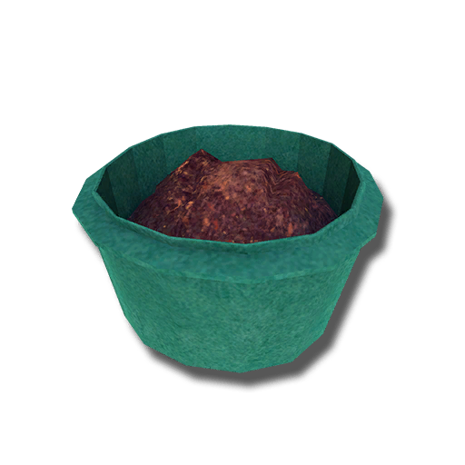 <a href="./Acorn%20Grounds.md" class="wikilink" title="Acorn Grounds">Acorn Grounds</a>
</td>
<td>
4x <a href="./Acorns%20%28Cooked%29.md" class="wikilink" title="Acorns (Cooked)">Acorns (Cooked)</a>
</td>
<td>
15 Min
</td>
<td>
 <a href="./Heavy%20Hammer.md" class="wikilink" title="Heavy Hammer">Heavy Hammer</a>
</td>
</tr>
<tr>
<td>
 <a href="./Acorn%20Grounds.md" class="wikilink" title="Acorn Grounds">Acorn Grounds</a>
</td>
<td>
1x <a href="./Acorns%20%28Cooked%20-%20Large%20Portion%29.md" class="wikilink" title="Acorns (Cooked - Large Portion)">Acorns (Cooked - Large Portion)</a>
</td>
<td>
15 Min
</td>
<td>
 <a href="./Heavy%20Hammer.md" class="wikilink" title="Heavy Hammer">Heavy Hammer</a>
</td>
</tr>
<tr>
<td>
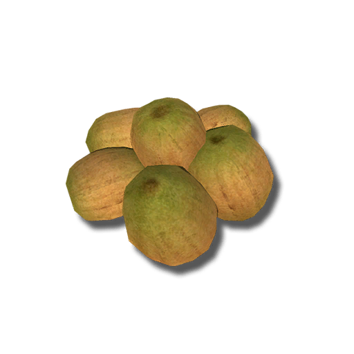 <a href="./Prepared%20Acorns.md" class="wikilink" title="Prepared Acorns">Prepared Acorns</a>
</td>
<td>
1x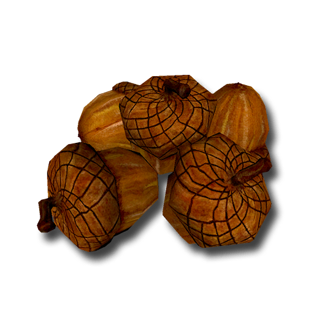 <a href="./Acorns.md" class="wikilink" title="Acorns">Acorns</a>
</td>
<td>
10 Min
</td>
<td>
None
</td>
</tr>
<tr>
<td>
 <a href="./Prepared%20Acorns%20%28Large%20Portion%29.md" class="wikilink" title="Prepared Acorns (Large Portion)">Prepared Acorns (Large Portion)</a>
</td>
<td>
4x <a href="./Prepared%20Acorns.md" class="wikilink" title="Prepared Acorns">Prepared Acorns</a>
</td>
<td>
1 Min
</td>
<td>
None
</td>
</tr>
<tr>
<td>
2x <a href="./Bandage.md" class="wikilink" title="Bandage">Bandage</a>
</td>
<td>
1x <a href="./Cloth.md" class="wikilink" title="Cloth">Cloth</a>
</td>
<td>
10 Min
</td>
<td>
None
</td>
</tr>
<tr>
<td>
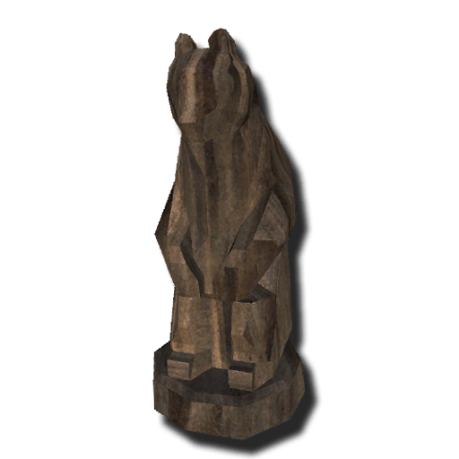 <a href="./Carved%20Bear%20Figurine.md" class="wikilink" title="Carved Bear Figurine">Carved Bear Figurine</a>
</td>
<td>
1x  <a href="./Cedar%20Firewood.md" class="wikilink" title="Cedar Firewood">Cedar Firewood</a>
</td>
<td>
4 Hours
</td>
<td>
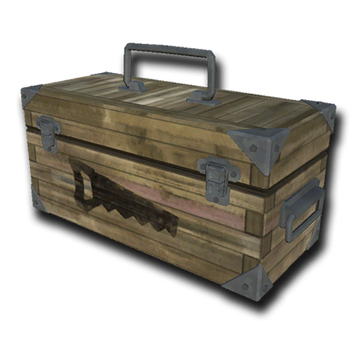 <a href="./Woodworking%20Tools.md" class="wikilink" title="Woodworking Tools">Woodworking Tools</a>
</td>
</tr>
<tr>
<td>
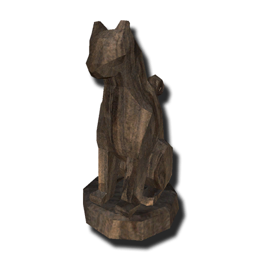 <a href="./Carved%20Cougar%20Figurine.md" class="wikilink" title="Carved Cougar Figurine">Carved Cougar Figurine</a>
</td>
<td>
1x  <a href="./Cedar%20Firewood.md" class="wikilink" title="Cedar Firewood">Cedar Firewood</a>
</td>
<td>
4 Hours
</td>
<td>
 <a href="./Woodworking%20Tools.md" class="wikilink" title="Woodworking Tools">Woodworking Tools</a>
</td>
</tr>
<tr>
<td>
 <a href="./Carved%20Wolf%20Figurine.md" class="wikilink" title="Carved Wolf Figurine">Carved Wolf Figurine</a>
</td>
<td>
1x  <a href="./Cedar%20Firewood.md" class="wikilink" title="Cedar Firewood">Cedar Firewood</a>
</td>
<td>
4 Hours
</td>
<td>
 <a href="./Woodworking%20Tools.md" class="wikilink" title="Woodworking Tools">Woodworking Tools</a>
</td>
</tr>
<tr>
<td>
 <a href="./Decorative%20Art.md" class="wikilink" title="Decorative Art">Decorative Art</a>
</td>
<td><ul>
<li>2x  <a href="./Fir%20Firewood.md" class="wikilink" title="Fir Firewood">Fir Firewood</a></li>
<li>1x  <a href="./Cedar%20Firewood.md" class="wikilink" title="Cedar Firewood">Cedar Firewood</a></li>
<li>1x 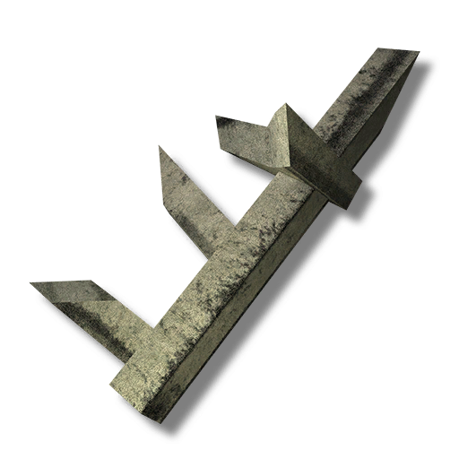 <a href="./Reclaimed%20Wood.md" class="wikilink" title="Reclaimed Wood">Reclaimed Wood</a></li>
</ul></td>
<td>
5 Hours
</td>
<td>
 <a href="./Woodworking%20Tools.md" class="wikilink" title="Woodworking Tools">Woodworking Tools</a>
</td>
</tr>
<tr>
<td>
 <a href="./Decorative%20Art.md" class="wikilink" title="Decorative Art">Decorative Art</a>
</td>
<td><ul>
<li>2x  <a href="./Fir%20Firewood.md" class="wikilink" title="Fir Firewood">Fir Firewood</a></li>
<li>1x  <a href="./Cedar%20Firewood.md" class="wikilink" title="Cedar Firewood">Cedar Firewood</a></li>
<li>1x  <a href="./Reclaimed%20Wood.md" class="wikilink" title="Reclaimed Wood">Reclaimed Wood</a></li>
</ul></td>
<td>
5 Hours
</td>
<td>
 <a href="./Woodworking%20Tools.md" class="wikilink" title="Woodworking Tools">Woodworking Tools</a>
</td>
</tr>
<tr>
<td>
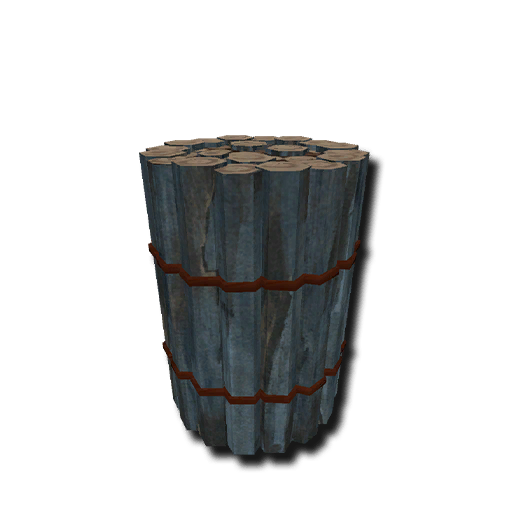 <a href="./Decorative%20End%20Table.md" class="wikilink" title="Decorative End Table">Decorative End Table</a>
</td>
<td>
6x  <a href="./Cedar%20Firewood.md" class="wikilink" title="Cedar Firewood">Cedar Firewood</a>
</td>
<td>
5 Hours
</td>
<td>
 <a href="./Woodworking%20Tools.md" class="wikilink" title="Woodworking Tools">Woodworking Tools</a>
</td>
</tr>
<tr>
<td>
 <a href="./Fishing%20Tackle.md" class="wikilink" title="Fishing Tackle">Fishing Tackle</a>
</td>
<td><ul>
<li>1x <a href="./Hook.md" class="wikilink" title="Hook">Hook</a></li>
<li>1x <a href="./Line.md" class="wikilink" title="Line">Line</a></li>
</ul></td>
<td>
10 Min
</td>
<td>
None
</td>
</tr>
<tr>
<td>
 <a href="./Furniture%20Workbench.md" class="wikilink" title="Furniture Workbench">Furniture Workbench</a>
</td>
<td>
10x  <a href="./Cedar%20Firewood.md" class="wikilink" title="Cedar Firewood">Cedar Firewood</a>
</td>
<td>
4 Hours
</td>
<td>
 <a href="./Woodworking%20Tools.md" class="wikilink" title="Woodworking Tools">Woodworking Tools</a>
</td>
</tr>
<tr>
<td>
 <a href="./Improvised%20Down%20Bedroll.md" class="wikilink" title="Improvised Down Bedroll">Improvised Down Bedroll</a>
</td>
<td><ul>
<li>1x <a href="./Bedroll.md" class="wikilink" title="Bedroll">Bedroll</a></li>
<li>3x <a href="./Cloth.md" class="wikilink" title="Cloth">Cloth</a></li>
<li>10x <a href="./Ptarmigan%20Down.md" class="wikilink" title="Ptarmigan Down">Ptarmigan Down</a></li>
</ul></td>
<td>
3 to 6 Hours
</td>
<td><ul>
<li> <a href="./Sewing%20Kit.md" class="wikilink" title="Sewing Kit">Sewing Kit</a></li>
<li> <a href="./Fishing%20Tackle.md" class="wikilink" title="Fishing Tackle">Fishing Tackle</a></li>
</ul></td>
</tr>
<tr>
<td>
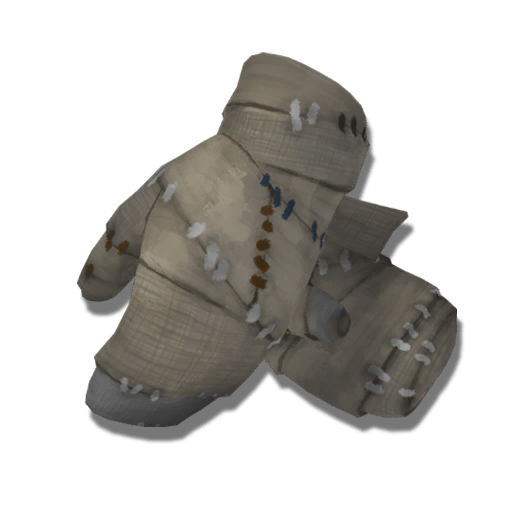 <a href="./Improvised%20Hand%20Wraps.md" class="wikilink" title="Improvised Hand Wraps">Improvised Hand Wraps</a>
</td>
<td>
4x <a href="./Cloth.md" class="wikilink" title="Cloth">Cloth</a>
</td>
<td>
37 - 1 Hour
</td>
<td><ul>
<li> <a href="./Sewing%20Kit.md" class="wikilink" title="Sewing Kit">Sewing Kit</a></li>
<li> <a href="./Fishing%20Tackle.md" class="wikilink" title="Fishing Tackle">Fishing Tackle</a></li>
</ul></td>
</tr>
<tr>
<td>
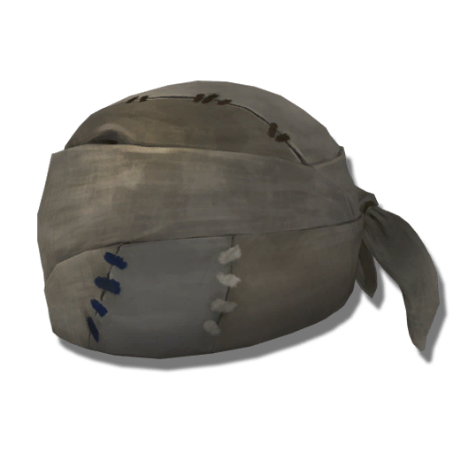 <a href="./Improvised%20Head%20Wrap.md" class="wikilink" title="Improvised Head Wrap">Improvised Head Wrap</a>
</td>
<td>
2x <a href="./Cloth.md" class="wikilink" title="Cloth">Cloth</a>
</td>
<td>
30 to 48 Min
</td>
<td><ul>
<li> <a href="./Sewing%20Kit.md" class="wikilink" title="Sewing Kit">Sewing Kit</a></li>
<li> <a href="./Fishing%20Tackle.md" class="wikilink" title="Fishing Tackle">Fishing Tackle</a></li>
</ul></td>
</tr>
<tr>
<td>
 <a href="./Improvised%20Insulation.md" class="wikilink" title="Improvised Insulation">Improvised Insulation</a>
</td>
<td><ul>
<li>4x <a href="./Cloth.md" class="wikilink" title="Cloth">Cloth</a></li>
<li>5x <a href="./Ptarmigan%20Down.md" class="wikilink" title="Ptarmigan Down">Ptarmigan Down</a></li>
</ul></td>
<td>
1.16-1 Hour
</td>
<td><ul>
<li> <a href="./Sewing%20Kit.md" class="wikilink" title="Sewing Kit">Sewing Kit</a></li>
<li> <a href="./Fishing%20Tackle.md" class="wikilink" title="Fishing Tackle">Fishing Tackle</a></li>
</ul></td>
</tr>
<tr>
<td>
 <a href="./Old%20Man%27s%20Beard%20Wound%20Dressing.md" class="wikilink" title="Old Man&#39;s Beard Wound Dressing">Old Man's Beard Wound Dressing</a>
</td>
<td>
3x <a href="./Old%20Man%27s%20Beard%20Lichen.md" class="wikilink" title="Old Man&#39;s Beard Lichen">Old Man's Beard Lichen</a>
</td>
<td>
15 Min
</td>
<td>
None
</td>
</tr>
<tr>
<td>
 <a href="./Prepared%20Birch%20Bark.md" class="wikilink" title="Prepared Birch Bark">Prepared Birch Bark</a>
</td>
<td>
2x <a href="./Birch%20Bark.md" class="wikilink" title="Birch Bark">Birch Bark</a>
</td>
<td>
5 Min
</td>
<td>
None
</td>
</tr>
<tr>
<td>
 <a href="./Prepared%20Burdock.md" class="wikilink" title="Prepared Burdock">Prepared Burdock</a>
</td>
<td>
1x <a href="./Burdock%20Root.md" class="wikilink" title="Burdock Root">Burdock Root</a>
</td>
<td>
15 Min
</td>
<td>
None
</td>
</tr>
<tr>
<td>
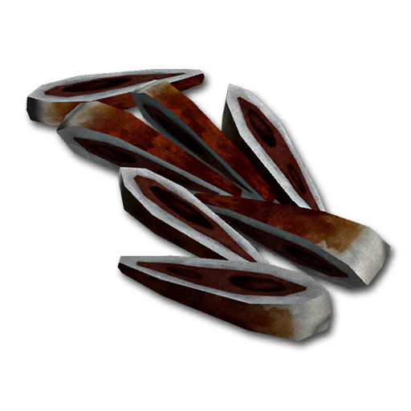 <a href="./Prepared%20Reishi%20Mushrooms.md" class="wikilink" title="Prepared Reishi Mushrooms">Prepared Reishi Mushrooms</a>
</td>
<td>
2x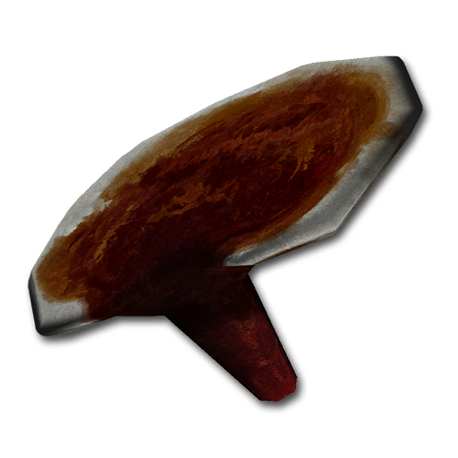 <a href="./Reishi%20Mushroom.md" class="wikilink" title="Reishi Mushroom">Reishi Mushroom</a>
</td>
<td>
15 Min
</td>
<td>
None
</td>
</tr>
<tr>
<td>
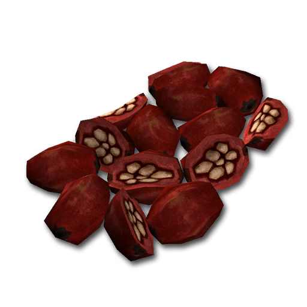 <a href="./Prepared%20Rose%20Hips.md" class="wikilink" title="Prepared Rose Hips">Prepared Rose Hips</a>
</td>
<td>
24x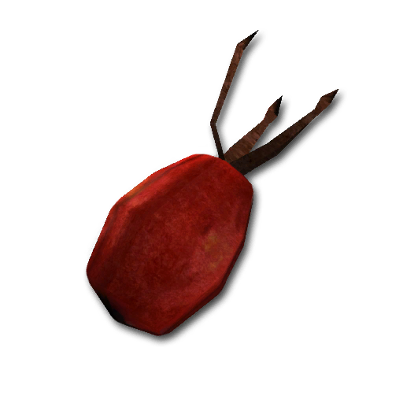 <a href="./Rose%20Hip.md" class="wikilink" title="Rose Hip">Rose Hip</a>
</td>
<td>
15 Min
</td>
<td>
None
</td>
</tr>
<tr>
<td>
2x <a href="./Tinder%20Plug.md" class="wikilink" title="Tinder Plug">Tinder Plug</a>
</td>
<td>
1x <a href="./Newsprint.md" class="wikilink" title="Newsprint">Newsprint</a>
</td>
<td>
10 Min
</td>
<td>
None
</td>
</tr>
<tr>
<td>
4x <a href="./Tinder%20Plug.md" class="wikilink" title="Tinder Plug">Tinder Plug</a>
</td>
<td>
1x <a href="./Newsprint%20Roll.md" class="wikilink" title="Newsprint Roll">Newsprint Roll</a>
</td>
<td>
10 Min
</td>
<td>
None
</td>
</tr>
<tr>
<td>
2x <a href="./Tinder%20Plug.md" class="wikilink" title="Tinder Plug">Tinder Plug</a>
</td>
<td>
1x <a href="./Stack%20of%20Papers.md" class="wikilink" title="Stack of Papers">Stack of Papers</a>
</td>
<td>
10 Min
</td>
<td>
None
</td>
</tr>
<tr>
<td>
2x <a href="./Tinder%20Plug.md" class="wikilink" title="Tinder Plug">Tinder Plug</a>
</td>
<td>
1x <a href="./Stick.md" class="wikilink" title="Stick">Stick</a>
</td>
<td>
5 Min
</td>
<td>
None
</td>
</tr>
<tr>
<td>
 <a href="./Torch.md" class="wikilink" title="Torch">Torch</a>
</td>
<td><ul>
<li>3x <a href="./Stick.md" class="wikilink" title="Stick">Stick</a></li>
<li>1x <a href="./Cloth.md" class="wikilink" title="Cloth">Cloth</a></li>
<li>0.10Lx <a href="./Lantern%20Fuel.md" class="wikilink" title="Lantern Fuel">Lantern Fuel</a></li>
</ul></td>
<td>
15 Min
</td>
<td>
None
</td>
</tr>
</tbody>
</table>

### <a href="./Fire.md" class="wikilink" title="Active Fire">Active Fire</a>

<table>
<colgroup>
<col style="width: 25%" />
<col style="width: 25%" />
<col style="width: 25%" />
<col style="width: 25%" />
</colgroup>
<thead>
<tr>
<th>
Recipe
</th>
<th>
Ingredients
</th>
<th>
Time
</th>
<th>
Tools Needed
</th>
</tr>
</thead>
<tbody>
<tr>
<td>
3x <a href="./Fire%20Hardened%20Arrow.md" class="wikilink" title="Fire Hardened Arrow">Fire Hardened Arrow</a>
</td>
<td><ul>
<li>5x <a href="./Stick.md" class="wikilink" title="Stick">Stick</a></li>
<li>5x <a href="./Crow%20Feather.md" class="wikilink" title="Crow Feather">Crow Feather</a></li>
</ul></td>
<td>
22 to 45 Min
</td>
<td><ul>
<li> <a href="./Hunting%20Knife.md" class="wikilink" title="Hunting Knife">Hunting Knife</a></li>
<li> <a href="./Improvised%20Knife.md" class="wikilink" title="Improvised Knife">Improvised Knife</a></li>
<li> <a href="./Cougar%20Claw%20Knife.md" class="wikilink" title="Cougar Claw Knife">Cougar Claw Knife</a></li>
<li> <a href="./Hatchet.md" class="wikilink" title="Hatchet">Hatchet</a></li>
<li> <a href="./Improvised%20Hatchet.md" class="wikilink" title="Improvised Hatchet">Improvised Hatchet</a></li>
</ul></td>
</tr>
</tbody>
</table>

### <a href="./Work%20Bench.md" class="wikilink" title="Work Bench">Work Bench</a>

<table>
<colgroup>
<col style="width: 25%" />
<col style="width: 25%" />
<col style="width: 25%" />
<col style="width: 25%" />
</colgroup>
<thead>
<tr>
<th>
Recipe
</th>
<th>
Materials
</th>
<th>
Time
</th>
<th>
Tools Needed
</th>
</tr>
</thead>
<tbody>
<tr>
<td>
3x <a href="./Arrow%20Shaft.md" class="wikilink" title="Arrow Shaft">Arrow Shaft</a>
</td>
<td>
1x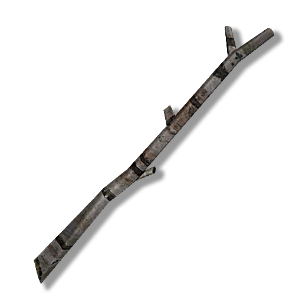 <a href="./Cured%20Birch%20Sapling.md" class="wikilink" title="Cured Birch Sapling">Cured Birch Sapling</a>
</td>
<td>
30 to 60 Min
</td>
<td><ul>
<li> <a href="./Hunting%20Knife.md" class="wikilink" title="Hunting Knife">Hunting Knife</a></li>
<li> <a href="./Improvised%20Knife.md" class="wikilink" title="Improvised Knife">Improvised Knife</a></li>
<li> <a href="./Cougar%20Claw%20Knife.md" class="wikilink" title="Cougar Claw Knife">Cougar Claw Knife</a></li>
<li> <a href="./Survival%20Knife.md" class="wikilink" title="Survival Knife">Survival Knife</a></li>
<li> <a href="./Hatchet.md" class="wikilink" title="Hatchet">Hatchet</a></li>
<li> <a href="./Improvised%20Hatchet.md" class="wikilink" title="Improvised Hatchet">Improvised Hatchet</a></li>
</ul></td>
</tr>
<tr>
<td>
 <a href="./Bear%20Hide%20Rug.md" class="wikilink" title="Bear Hide Rug">Bear Hide Rug</a>
</td>
<td><ul>
<li>1x <a href="./Cured%20Deer%20Hide.md" class="wikilink" title="Cured Deer Hide">Cured Deer Hide</a></li>
<li>1x <a href="./Cured%20Black%20Bear%20Hide.md" class="wikilink" title="Cured Black Bear Hide">Cured Black Bear Hide</a></li>
<li>2x <a href="./Cured%20Gut.md" class="wikilink" title="Cured Gut">Cured Gut</a></li>
</ul></td>
<td>
8 Hours
</td>
<td>
 <a href="./Quality%20Tools.md" class="wikilink" title="Quality Tools">Quality Tools</a>
</td>
</tr>
<tr>
<td>
 <a href="./Bear%20Skin%20Bedroll.md" class="wikilink" title="Bear Skin Bedroll">Bear Skin Bedroll</a>
</td>
<td><ul>
<li>2x <a href="./Cured%20Black%20Bear%20Hide.md" class="wikilink" title="Cured Black Bear Hide">Cured Black Bear Hide</a></li>
<li>5x <a href="./Cloth.md" class="wikilink" title="Cloth">Cloth</a></li>
<li>6x <a href="./Cured%20Gut.md" class="wikilink" title="Cured Gut">Cured Gut</a></li>
</ul></td>
<td>
17 Hours 30 Min to 35 Hours
</td>
<td><ul>
<li> <a href="./Hunting%20Knife.md" class="wikilink" title="Hunting Knife">Hunting Knife</a></li>
<li> <a href="./Improvised%20Knife.md" class="wikilink" title="Improvised Knife">Improvised Knife</a></li>
<li> <a href="./Cougar%20Claw%20Knife.md" class="wikilink" title="Cougar Claw Knife">Cougar Claw Knife</a></li>
<li> <a href="./Survival%20Knife.md" class="wikilink" title="Survival Knife">Survival Knife</a></li>
<li> <a href="./Hatchet.md" class="wikilink" title="Hatchet">Hatchet</a></li>
<li> <a href="./Improvised%20Hatchet.md" class="wikilink" title="Improvised Hatchet">Improvised Hatchet</a></li>
</ul></td>
</tr>
<tr>
<td>
 <a href="./Bearskin%20Coat.md" class="wikilink" title="Bearskin Coat">Bearskin Coat</a>
</td>
<td><ul>
<li>2x <a href="./Cured%20Black%20Bear%20Hide.md" class="wikilink" title="Cured Black Bear Hide">Cured Black Bear Hide</a></li>
<li>4x <a href="./Cured%20Gut.md" class="wikilink" title="Cured Gut">Cured Gut</a></li>
</ul></td>
<td>
30 to 60 Hours
</td>
<td><ul>
<li> <a href="./Hunting%20Knife.md" class="wikilink" title="Hunting Knife">Hunting Knife</a></li>
<li> <a href="./Improvised%20Knife.md" class="wikilink" title="Improvised Knife">Improvised Knife</a></li>
<li> <a href="./Cougar%20Claw%20Knife.md" class="wikilink" title="Cougar Claw Knife">Cougar Claw Knife</a></li>
<li> <a href="./Survival%20Knife.md" class="wikilink" title="Survival Knife">Survival Knife</a></li>
<li> <a href="./Hatchet.md" class="wikilink" title="Hatchet">Hatchet</a></li>
<li> <a href="./Improvised%20Hatchet.md" class="wikilink" title="Improvised Hatchet">Improvised Hatchet</a></li>
</ul></td>
</tr>
<tr>
<td>
 <a href="./Bushcraft%20Bow.md" class="wikilink" title="Bushcraft Bow">Bushcraft Bow</a> (requires <a href="./Bushcraft%20Bow%20Blueprint%20Card.md" class="wikilink" title="Bushcraft Bow Blueprint Card">Bushcraft Bow Blueprint Card</a>)
</td>
<td><ul>
<li>2x <a href="./Green%20Birch%20Sapling.md" class="wikilink" title="Green Birch Sapling">Green Birch Sapling</a></li>
<li>2x <a href="./Cured%20Gut.md" class="wikilink" title="Cured Gut">Cured Gut</a></li>
</ul></td>
<td>
5 hours
</td>
<td><ul>
<li> <a href="./Hunting%20Knife.md" class="wikilink" title="Hunting Knife">Hunting Knife</a></li>
<li> <a href="./Improvised%20Knife.md" class="wikilink" title="Improvised Knife">Improvised Knife</a></li>
<li> <a href="./Cougar%20Claw%20Knife.md" class="wikilink" title="Cougar Claw Knife">Cougar Claw Knife</a></li>
<li> <a href="./Survival%20Knife.md" class="wikilink" title="Survival Knife">Survival Knife</a></li>
<li> <a href="./Hatchet.md" class="wikilink" title="Hatchet">Hatchet</a></li>
<li> <a href="./Improvised%20Hatchet.md" class="wikilink" title="Improvised Hatchet">Improvised Hatchet</a></li>
</ul></td>
</tr>
<tr>
<td>
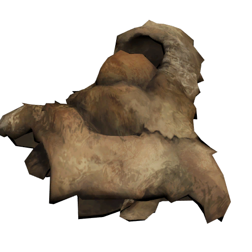 <a href="./Cougar%20Hide%20Wrap.md" class="wikilink" title="Cougar Hide Wrap">Cougar Hide Wrap</a> (Blueprint doesn't appear on <a href="./Pilgrim.md" class="wikilink" title="Pilgrim">Pilgrim</a>)
</td>
<td><ul>
<li>1x <a href="./Cured%20Cougar%20Hide.md" class="wikilink" title="Cured Cougar Hide">Cured Cougar Hide</a></li>
<li>2x <a href="./Cured%20Gut.md" class="wikilink" title="Cured Gut">Cured Gut</a></li>
</ul></td>
<td>
11 Hours 40 Min to 18 Hours 40 Min
</td>
<td><ul>
<li> <a href="./Sewing%20Kit.md" class="wikilink" title="Sewing Kit">Sewing Kit</a></li>
<li> <a href="./Fishing%20Tackle.md" class="wikilink" title="Fishing Tackle">Fishing Tackle</a></li>
</ul></td>
</tr>
<tr>
<td>
 <a href="./Deerskin%20Boots.md" class="wikilink" title="Deerskin Boots">Deerskin Boots</a>
</td>
<td><ul>
<li>2x <a href="./Cured%20Deer%20Hide.md" class="wikilink" title="Cured Deer Hide">Cured Deer Hide</a></li>
<li>4x <a href="./Cured%20Gut.md" class="wikilink" title="Cured Gut">Cured Gut</a></li>
</ul></td>
<td>
12 Hours 30 Min to 20 Hours
</td>
<td><ul>
<li> <a href="./Sewing%20Kit.md" class="wikilink" title="Sewing Kit">Sewing Kit</a></li>
<li> <a href="./Fishing%20Tackle.md" class="wikilink" title="Fishing Tackle">Fishing Tackle</a></li>
</ul></td>
</tr>
<tr>
<td>
 <a href="./Deerskin%20Pants.md" class="wikilink" title="Deerskin Pants">Deerskin Pants</a>
</td>
<td><ul>
<li>3x <a href="./Cured%20Deer%20Hide.md" class="wikilink" title="Cured Deer Hide">Cured Deer Hide</a></li>
<li>4x <a href="./Cured%20Gut.md" class="wikilink" title="Cured Gut">Cured Gut</a></li>
</ul></td>
<td>
12 Hours 30 Min to 20 Hours
</td>
<td><ul>
<li> <a href="./Sewing%20Kit.md" class="wikilink" title="Sewing Kit">Sewing Kit</a></li>
<li> <a href="./Fishing%20Tackle.md" class="wikilink" title="Fishing Tackle">Fishing Tackle</a></li>
</ul></td>
</tr>
<tr>
<td>
 <a href="./Fishing%20Lure%20%28Acorns%29.md" class="wikilink" title="Fishing Lure (Acorns)">Fishing Lure (Acorns)</a>
</td>
<td><ul>
<li>1x <a href="./Scrap%20Metal.md" class="wikilink" title="Scrap Metal">Scrap Metal</a></li>
<li>1x <a href="./Crow%20Feather.md" class="wikilink" title="Crow Feather">Crow Feather</a></li>
<li>1x <a href="./Acorns.md" class="wikilink" title="Acorns">Acorns</a></li>
</ul></td>
<td>
25-50 Minutes
</td>
<td><ul>
<li><em> <a href="./Simple%20Tools.md" class="wikilink" title="Simple Tools">Simple Tools</a></em></li>
<li><em> <a href="./Quality%20Tools.md" class="wikilink" title="Quality Tools">Quality Tools</a></em></li>
</ul></td>
</tr>
<tr>
<td>
 <a href="./Fishing%20Lure%20%28Revolver%20Shell%20Casing%29.md" class="wikilink" title="Fishing Lure (Revolver Shell Casing)">Fishing Lure (Revolver Shell Casing)</a>
</td>
<td><ul>
<li>1x <a href="./Scrap%20Metal.md" class="wikilink" title="Scrap Metal">Scrap Metal</a></li>
<li>1x <a href="./Crow%20Feather.md" class="wikilink" title="Crow Feather">Crow Feather</a></li>
<li>1x <a href="./Revolver%20Shell%20Casing.md" class="wikilink" title="Revolver Shell Casing">Revolver Shell Casing</a></li>
</ul></td>
<td>
25-50 Minutes
</td>
<td><ul>
<li><em> <a href="./Simple%20Tools.md" class="wikilink" title="Simple Tools">Simple Tools</a></em></li>
<li><em> <a href="./Quality%20Tools.md" class="wikilink" title="Quality Tools">Quality Tools</a></em></li>
</ul></td>
</tr>
<tr>
<td>
 <a href="./Fishing%20Lure%20%28Wire%20Bundle%29.md" class="wikilink" title="Fishing Lure (Wire Bundle)">Fishing Lure (Wire Bundle)</a>
</td>
<td><ul>
<li>1x <a href="./Scrap%20Metal.md" class="wikilink" title="Scrap Metal">Scrap Metal</a></li>
<li>1x <a href="./Crow%20Feather.md" class="wikilink" title="Crow Feather">Crow Feather</a></li>
<li>1x <a href="./Wires.md" class="wikilink" title="Wires">Wires</a></li>
</ul></td>
<td>
25-50 Minutes
</td>
<td><ul>
<li><em> <a href="./Simple%20Tools.md" class="wikilink" title="Simple Tools">Simple Tools</a></em></li>
<li><em> <a href="./Quality%20Tools.md" class="wikilink" title="Quality Tools">Quality Tools</a></em></li>
</ul></td>
</tr>
<tr>
<td>
 <a href="./Fishing%20Tip-Up.md" class="wikilink" title="Fishing Tip-Up">Fishing Tip-Up</a>
</td>
<td><ul>
<li>2x <a href="./Stick.md" class="wikilink" title="Stick">Stick</a></li>
<li>1x <a href="./Cloth.md" class="wikilink" title="Cloth">Cloth</a></li>
<li>1x <a href="./Scrap%20Metal.md" class="wikilink" title="Scrap Metal">Scrap Metal</a></li>
<li>1x <a href="./Fishing%20Tackle.md" class="wikilink" title="Fishing Tackle">Fishing Tackle</a></li>
</ul></td>
<td>
20-40 Min
</td>
<td><ul>
<li><em> <a href="./Simple%20Tools.md" class="wikilink" title="Simple Tools">Simple Tools</a></em></li>
<li><em> <a href="./Quality%20Tools.md" class="wikilink" title="Quality Tools">Quality Tools</a></em></li>
</ul></td>
</tr>
<tr>
<td>
3x <a href="./Hook.md" class="wikilink" title="Hook">Hook</a>
</td>
<td>
1x <a href="./Scrap%20Metal.md" class="wikilink" title="Scrap Metal">Scrap Metal</a>
</td>
<td>
10-20 Min
</td>
<td><ul>
<li><em> <a href="./Simple%20Tools.md" class="wikilink" title="Simple Tools">Simple Tools</a></em></li>
<li><em> <a href="./Quality%20Tools.md" class="wikilink" title="Quality Tools">Quality Tools</a></em></li>
</ul></td>
</tr>
<tr>
<td>
 <a href="./Improvised%20Crampons.md" class="wikilink" title="Improvised Crampons">Improvised Crampons</a>
</td>
<td><ul>
<li>4x <a href="./Scrap%20Metal.md" class="wikilink" title="Scrap Metal">Scrap Metal</a></li>
<li>2x <a href="./Cured%20Leather.md" class="wikilink" title="Cured Leather">Cured Leather</a></li>
</ul></td>
<td>
2-4 Hours
</td>
<td><ul>
<li><em> <a href="./Simple%20Tools.md" class="wikilink" title="Simple Tools">Simple Tools</a></em></li>
<li><em> <a href="./Quality%20Tools.md" class="wikilink" title="Quality Tools">Quality Tools</a></em></li>
</ul></td>
</tr>
<tr>
<td>
2x <a href="./Line.md" class="wikilink" title="Line">Line</a>
</td>
<td>
1x <a href="./Cured%20Gut.md" class="wikilink" title="Cured Gut">Cured Gut</a>
</td>
<td>
15 Min
</td>
<td>
None
</td>
</tr>
<tr>
<td>
 <a href="./Moose-Hide%20Cloak.md" class="wikilink" title="Moose-Hide Cloak">Moose-Hide Cloak</a>
</td>
<td><ul>
<li>1x <a href="./Cured%20Moose%20Hide.md" class="wikilink" title="Cured Moose Hide">Cured Moose Hide</a></li>
<li>4x <a href="./Cured%20Gut.md" class="wikilink" title="Cured Gut">Cured Gut</a></li>
</ul></td>
<td>
16 Hours 40 Min to 33 Hours 20 Min
</td>
<td><ul>
<li> <a href="./Hunting%20Knife.md" class="wikilink" title="Hunting Knife">Hunting Knife</a></li>
<li> <a href="./Improvised%20Knife.md" class="wikilink" title="Improvised Knife">Improvised Knife</a></li>
<li> <a href="./Cougar%20Claw%20Knife.md" class="wikilink" title="Cougar Claw Knife">Cougar Claw Knife</a></li>
<li> <a href="./Survival%20Knife.md" class="wikilink" title="Survival Knife">Survival Knife</a></li>
<li> <a href="./Hatchet.md" class="wikilink" title="Hatchet">Hatchet</a></li>
<li> <a href="./Improvised%20Hatchet.md" class="wikilink" title="Improvised Hatchet">Improvised Hatchet</a></li>
</ul></td>
</tr>
<tr>
<td>
 <a href="./Moose-Hide%20Satchel.md" class="wikilink" title="Moose-Hide Satchel">Moose-Hide Satchel</a>
</td>
<td><ul>
<li>1x <a href="./Cured%20Moose%20Hide.md" class="wikilink" title="Cured Moose Hide">Cured Moose Hide</a></li>
<li>2x <a href="./Cured%20Gut.md" class="wikilink" title="Cured Gut">Cured Gut</a></li>
</ul></td>
<td>
10 to 16 Hours
</td>
<td><ul>
<li> <a href="./Sewing%20Kit.md" class="wikilink" title="Sewing Kit">Sewing Kit</a></li>
<li> <a href="./Fishing%20Tackle.md" class="wikilink" title="Fishing Tackle">Fishing Tackle</a></li>
</ul></td>
</tr>
<tr>
<td>
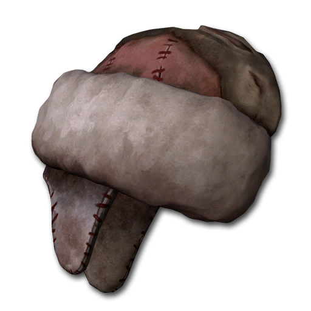 <a href="./Rabbitskin%20Hat.md" class="wikilink" title="Rabbitskin Hat">Rabbitskin Hat</a>
</td>
<td><ul>
<li>3x <a href="./Cured%20Rabbit%20Pelt.md" class="wikilink" title="Cured Rabbit Pelt">Cured Rabbit Pelt</a></li>
<li>1x <a href="./Cured%20Gut.md" class="wikilink" title="Cured Gut">Cured Gut</a></li>
</ul></td>
<td>
3 Hours 30 Min to 5 Hours 36 Min
</td>
<td><ul>
<li> <a href="./Sewing%20Kit.md" class="wikilink" title="Sewing Kit">Sewing Kit</a></li>
<li> <a href="./Fishing%20Tackle.md" class="wikilink" title="Fishing Tackle">Fishing Tackle</a></li>
</ul></td>
</tr>
<tr>
<td>
 <a href="./Rabbitskin%20Mitts.md" class="wikilink" title="Rabbitskin Mitts">Rabbitskin Mitts</a>
</td>
<td><ul>
<li>4x <a href="./Cured%20Rabbit%20Pelt.md" class="wikilink" title="Cured Rabbit Pelt">Cured Rabbit Pelt</a></li>
<li>2x <a href="./Cured%20Gut.md" class="wikilink" title="Cured Gut">Cured Gut</a></li>
</ul></td>
<td>
5 to 8 Hours
</td>
<td><ul>
<li> <a href="./Sewing%20Kit.md" class="wikilink" title="Sewing Kit">Sewing Kit</a></li>
<li> <a href="./Fishing%20Tackle.md" class="wikilink" title="Fishing Tackle">Fishing Tackle</a></li>
</ul></td>
</tr>
<tr>
<td>
 <a href="./Simple%20Arrow.md" class="wikilink" title="Simple Arrow">Simple Arrow</a>
</td>
<td><ul>
<li>1x <a href="./Arrowhead.md" class="wikilink" title="Arrowhead">Arrowhead</a></li>
<li>1x <a href="./Arrow%20Shaft.md" class="wikilink" title="Arrow Shaft">Arrow Shaft</a></li>
<li>3x <a href="./Crow%20Feather.md" class="wikilink" title="Crow Feather">Crow Feather</a></li>
</ul></td>
<td>
45 to 90 Min
</td>
<td><ul>
<li><em> <a href="./Simple%20Tools.md" class="wikilink" title="Simple Tools">Simple Tools</a></em></li>
<li><em> <a href="./Quality%20Tools.md" class="wikilink" title="Quality Tools">Quality Tools</a></em></li>
</ul></td>
</tr>
<tr>
<td>
 <a href="./Simple%20Fishing%20Lure.md" class="wikilink" title="Simple Fishing Lure">Simple Fishing Lure</a>
</td>
<td>
1x <a href="./Scrap%20Metal.md" class="wikilink" title="Scrap Metal">Scrap Metal</a>
</td>
<td>
15-30 Min
</td>
<td><ul>
<li><em> <a href="./Simple%20Tools.md" class="wikilink" title="Simple Tools">Simple Tools</a></em></li>
<li><em> <a href="./Quality%20Tools.md" class="wikilink" title="Quality Tools">Quality Tools</a></em></li>
</ul></td>
</tr>
<tr>
<td>
 <a href="./Snare.md" class="wikilink" title="Snare">Snare</a>
</td>
<td><ul>
<li>1x <a href="./Cured%20Gut.md" class="wikilink" title="Cured Gut">Cured Gut</a></li>
<li>1x <a href="./Reclaimed%20Wood.md" class="wikilink" title="Reclaimed Wood">Reclaimed Wood</a></li>
</ul></td>
<td>
15-30 Min
</td>
<td><ul>
<li><em> <a href="./Simple%20Tools.md" class="wikilink" title="Simple Tools">Simple Tools</a></em></li>
<li><em> <a href="./Quality%20Tools.md" class="wikilink" title="Quality Tools">Quality Tools</a></em></li>
</ul></td>
</tr>
<tr>
<td>
 <a href="./Survival%20Bow.md" class="wikilink" title="Survival Bow">Survival Bow</a>
</td>
<td><ul>
<li>1x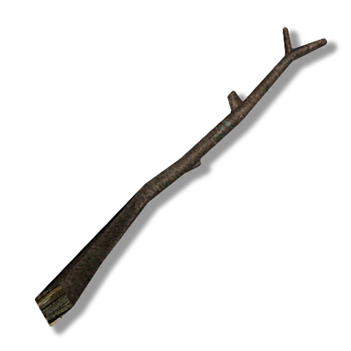 <a href="./Cured%20Maple%20Sapling.md" class="wikilink" title="Cured Maple Sapling">Cured Maple Sapling</a></li>
<li>2x <a href="./Cured%20Gut.md" class="wikilink" title="Cured Gut">Cured Gut</a></li>
</ul></td>
<td>
5 to 10 Hours
</td>
<td><ul>
<li> <a href="./Hunting%20Knife.md" class="wikilink" title="Hunting Knife">Hunting Knife</a></li>
<li> <a href="./Improvised%20Knife.md" class="wikilink" title="Improvised Knife">Improvised Knife</a></li>
<li> <a href="./Cougar%20Claw%20Knife.md" class="wikilink" title="Cougar Claw Knife">Cougar Claw Knife</a></li>
<li> <a href="./Survival%20Knife.md" class="wikilink" title="Survival Knife">Survival Knife</a></li>
<li> <a href="./Hatchet.md" class="wikilink" title="Hatchet">Hatchet</a></li>
<li> <a href="./Improvised%20Hatchet.md" class="wikilink" title="Improvised Hatchet">Improvised Hatchet</a></li>
</ul></td>
</tr>
<tr>
<td>
[Missing image: Travois_icon.png] <a href="./Travois.md" class="wikilink" title="Travois">Travois</a>
</td>
<td><ul>
<li>1x <a href="./Cured%20Deer%20Hide.md" class="wikilink" title="Cured Deer Hide">Cured Deer Hide</a></li>
<li>2x <a href="./Cured%20Gut.md" class="wikilink" title="Cured Gut">Cured Gut</a></li>
<li>4x <a href="./Cured%20Maple%20Sapling.md" class="wikilink" title="Cured Maple Sapling">Cured Maple Sapling</a></li>
</ul></td>
<td>
3 to 6 Hours
</td>
<td><ul>
<li> <a href="./Hunting%20Knife.md" class="wikilink" title="Hunting Knife">Hunting Knife</a></li>
<li> <a href="./Improvised%20Knife.md" class="wikilink" title="Improvised Knife">Improvised Knife</a></li>
<li> <a href="./Cougar%20Claw%20Knife.md" class="wikilink" title="Cougar Claw Knife">Cougar Claw Knife</a></li>
<li> <a href="./Survival%20Knife.md" class="wikilink" title="Survival Knife">Survival Knife</a></li>
<li> <a href="./Hatchet.md" class="wikilink" title="Hatchet">Hatchet</a></li>
<li> <a href="./Improvised%20Hatchet.md" class="wikilink" title="Improvised Hatchet">Improvised Hatchet</a></li>
</ul></td>
</tr>
<tr>
<td>
 <a href="./Wolfskin%20Coat.md" class="wikilink" title="Wolfskin Coat">Wolfskin Coat</a>
</td>
<td><ul>
<li>4x <a href="./Cured%20Wolf%20Pelt.md" class="wikilink" title="Cured Wolf Pelt">Cured Wolf Pelt</a></li>
<li>4x <a href="./Cured%20Gut.md" class="wikilink" title="Cured Gut">Cured Gut</a></li>
</ul></td>
<td>
25 to 50 Hours
</td>
<td><ul>
<li> <a href="./Hunting%20Knife.md" class="wikilink" title="Hunting Knife">Hunting Knife</a></li>
<li> <a href="./Improvised%20Knife.md" class="wikilink" title="Improvised Knife">Improvised Knife</a></li>
<li> <a href="./Cougar%20Claw%20Knife.md" class="wikilink" title="Cougar Claw Knife">Cougar Claw Knife</a></li>
<li> <a href="./Survival%20Knife.md" class="wikilink" title="Survival Knife">Survival Knife</a></li>
<li> <a href="./Hatchet.md" class="wikilink" title="Hatchet">Hatchet</a></li>
<li> <a href="./Improvised%20Hatchet.md" class="wikilink" title="Improvised Hatchet">Improvised Hatchet</a></li>
</ul></td>
</tr>
<tr>
<td>
 <a href="./Wolfskin%20Hat.md" class="wikilink" title="Wolfskin Hat">Wolfskin Hat</a> (requires <a href="./Wolfskin%20Hat%20Blueprint%20Card.md" class="wikilink" title="Wolfskin Hat Blueprint Card">Wolfskin Hat Blueprint Card</a>)
</td>
<td><ul>
<li>1x <a href="./Cured%20Wolf%20Pelt.md" class="wikilink" title="Cured Wolf Pelt">Cured Wolf Pelt</a></li>
<li>2x <a href="./Cured%20Gut.md" class="wikilink" title="Cured Gut">Cured Gut</a></li>
</ul></td>
<td>
17 hours
</td>
<td><ul>
<li> <a href="./Hunting%20Knife.md" class="wikilink" title="Hunting Knife">Hunting Knife</a></li>
<li> <a href="./Improvised%20Knife.md" class="wikilink" title="Improvised Knife">Improvised Knife</a></li>
<li> <a href="./Cougar%20Claw%20Knife.md" class="wikilink" title="Cougar Claw Knife">Cougar Claw Knife</a></li>
<li> <a href="./Survival%20Knife.md" class="wikilink" title="Survival Knife">Survival Knife</a></li>
<li> <a href="./Hatchet.md" class="wikilink" title="Hatchet">Hatchet</a></li>
<li> <a href="./Improvised%20Hatchet.md" class="wikilink" title="Improvised Hatchet">Improvised Hatchet</a></li>
</ul></td>
</tr>
<tr>
<td>
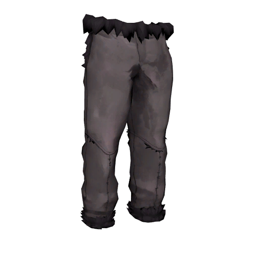 <a href="./Wolfskin%20Pants.md" class="wikilink" title="Wolfskin Pants">Wolfskin Pants</a> (requires <a href="./Wolfskin%20Pants%20Blueprint%20Card.md" class="wikilink" title="Wolfskin Pants Blueprint Card">Wolfskin Pants Blueprint Card</a>)
</td>
<td><ul>
<li>4x <a href="./Cured%20Wolf%20Pelt.md" class="wikilink" title="Cured Wolf Pelt">Cured Wolf Pelt</a></li>
<li>3x <a href="./Cured%20Gut.md" class="wikilink" title="Cured Gut">Cured Gut</a></li>
</ul></td>
<td>
29 hours
</td>
<td><ul>
<li> <a href="./Hunting%20Knife.md" class="wikilink" title="Hunting Knife">Hunting Knife</a></li>
<li> <a href="./Improvised%20Knife.md" class="wikilink" title="Improvised Knife">Improvised Knife</a></li>
<li> <a href="./Cougar%20Claw%20Knife.md" class="wikilink" title="Cougar Claw Knife">Cougar Claw Knife</a></li>
<li> <a href="./Survival%20Knife.md" class="wikilink" title="Survival Knife">Survival Knife</a></li>
<li> <a href="./Hatchet.md" class="wikilink" title="Hatchet">Hatchet</a></li>
<li> <a href="./Improvised%20Hatchet.md" class="wikilink" title="Improvised Hatchet">Improvised Hatchet</a></li>
</ul></td>
</tr>
<tr>
<td>
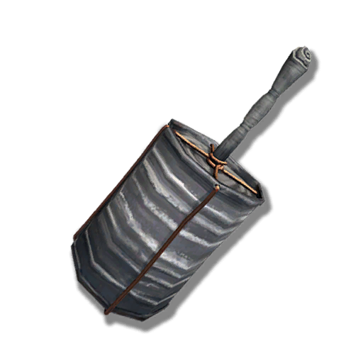 <a href="./Noisemaker.md" class="wikilink" title="Noisemaker">Noisemaker</a> (Wintermute <a href="./Episode%204%20-%20Fury%2C%20Then%20Silence.md" class="wikilink" title="EP4">EP4</a> only)
</td>
<td><ul>
<li>1x <a href="./Recycled%20Can.md" class="wikilink" title="Recycled Can">Recycled Can</a></li>
<li>1x <a href="./Cloth.md" class="wikilink" title="Cloth">Cloth</a></li>
<li>0.10kg x <a href="./Can%20of%20Gunpowder.md" class="wikilink" title="Can of Gunpowder">Can of Gunpowder</a></li>
</ul></td>
<td>
30 Min
</td>
<td>
None
</td>
</tr>
</tbody>
</table>

### <a href="./Forge.md" class="wikilink" title="Forge">Forge</a>

<table>
<colgroup>
<col style="width: 25%" />
<col style="width: 25%" />
<col style="width: 25%" />
<col style="width: 25%" />
</colgroup>
<thead>
<tr>
<th>
Recipe
</th>
<th>
Materials
</th>
<th>
Time
</th>
<th>
Tools Needed
</th>
</tr>
</thead>
<tbody>
<tr>
<td>
2x  <a href="./Arrowhead.md" class="wikilink" title="Arrowhead">Arrowhead</a>
</td>
<td>
1x  <a href="./Scrap%20Metal.md" class="wikilink" title="Scrap Metal">Scrap Metal</a>
</td>
<td>
1 Hour
</td>
<td>
 <a href="./Heavy%20Hammer.md" class="wikilink" title="Heavy Hammer">Heavy Hammer</a>
</td>
</tr>
<tr>
<td>
 <a href="./Cougar%20Claw%20Knife.md" class="wikilink" title="Cougar Claw Knife">Cougar Claw Knife</a>
</td>
<td>
1x  <a href="./Cougar%20Claw.md" class="wikilink" title="Cougar Claw">Cougar Claw</a> 3x  <a href="./Scrap%20Metal.md" class="wikilink" title="Scrap Metal">Scrap Metal</a>

1x  <a href="./Cured%20Leather.md" class="wikilink" title="Cured Leather">Cured Leather</a>
</td>
<td>
3 Hours 40 Min
</td>
<td>
 <a href="./Heavy%20Hammer.md" class="wikilink" title="Heavy Hammer">Heavy Hammer</a>
</td>
</tr>
<tr>
<td>
 <a href="./Improvised%20Hatchet.md" class="wikilink" title="Improvised Hatchet">Improvised Hatchet</a>
</td>
<td>
5x  <a href="./Scrap%20Metal.md" class="wikilink" title="Scrap Metal">Scrap Metal</a> 1x  <a href="./Cloth.md" class="wikilink" title="Cloth">Cloth</a>
</td>
<td>
4 Hours
</td>
<td>
 <a href="./Heavy%20Hammer.md" class="wikilink" title="Heavy Hammer">Heavy Hammer</a>
</td>
</tr>
<tr>
<td>
 <a href="./Improvised%20Knife.md" class="wikilink" title="Improvised Knife">Improvised Knife</a>
</td>
<td>
3x  <a href="./Scrap%20Metal.md" class="wikilink" title="Scrap Metal">Scrap Metal</a> 1x  <a href="./Cloth.md" class="wikilink" title="Cloth">Cloth</a>
</td>
<td>
3 Hours
</td>
<td>
 <a href="./Heavy%20Hammer.md" class="wikilink" title="Heavy Hammer">Heavy Hammer</a>
</td>
</tr>
<tr>
<td>
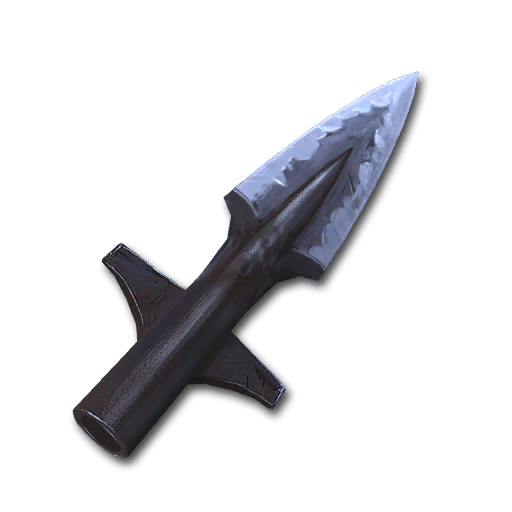 <a href="./Spear%20Head.md" class="wikilink" title="Spear Head">Spear Head</a> (Wintermute <a href="./Episode%202%20-%20Luminance%20Fugue.md" class="wikilink" title="EP2">EP2</a> Only)
</td>
<td>
2x  <a href="./Scrap%20Metal.md" class="wikilink" title="Scrap Metal">Scrap Metal</a>
</td>
<td>
1 Hour 30 Min
</td>
<td>
 <a href="./Heavy%20Hammer.md" class="wikilink" title="Heavy Hammer">Heavy Hammer</a>
</td>
</tr>
</tbody>
</table>

### <a href="./Ammunition%20Work%20Bench.md" class="wikilink" title="Ammunition Work Bench">Ammunition Work Bench</a>

<table>
<colgroup>
<col style="width: 33%" />
<col style="width: 33%" />
<col style="width: 33%" />
</colgroup>
<thead>
<tr>
<th>
Recipe
</th>
<th>
Materials
</th>
<th>
Time
</th>
</tr>
</thead>
<tbody>
<tr>
<td>
 <a href="./Can%20of%20Gunpowder.md" class="wikilink" title="Can of Gunpowder">Can of Gunpowder</a>
</td>
<td><ul>
<li>1x <a href="./Stump%20Remover.md" class="wikilink" title="Stump Remover">Stump Remover</a></li>
<li>1x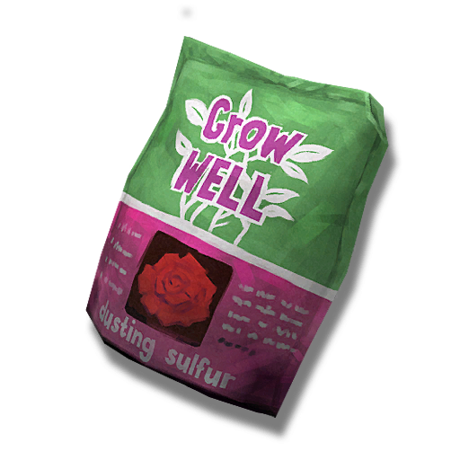 <a href="./Dusting%20Sulfur.md" class="wikilink" title="Dusting Sulfur">Dusting Sulfur</a></li>
<li>2x <a href="./Charcoal.md" class="wikilink" title="Charcoal">Charcoal</a></li>
</ul></td>
<td>
30 Min
</td>
</tr>
<tr>
<td>
 <a href="./Revolver%20Ammunition.md" class="wikilink" title="Revolver Ammunition">Revolver Ammunition</a>
</td>
<td><ul>
<li>1x <a href="./Bullet.md" class="wikilink" title="Bullet">Bullet</a></li>
<li>1x <a href="./Revolver%20Shell%20Casing.md" class="wikilink" title="Revolver Shell Casing">Revolver Shell Casing</a></li>
<li>0.01kg x <a href="./Can%20of%20Gunpowder.md" class="wikilink" title="Can of Gunpowder">Can of Gunpowder</a></li>
</ul></td>
<td>
5 Min
</td>
</tr>
<tr>
<td>
 <a href="./Rifle%20Ammunition.md" class="wikilink" title="Rifle Ammunition">Rifle Ammunition</a>
</td>
<td><ul>
<li>1x <a href="./Bullet.md" class="wikilink" title="Bullet">Bullet</a></li>
<li>1x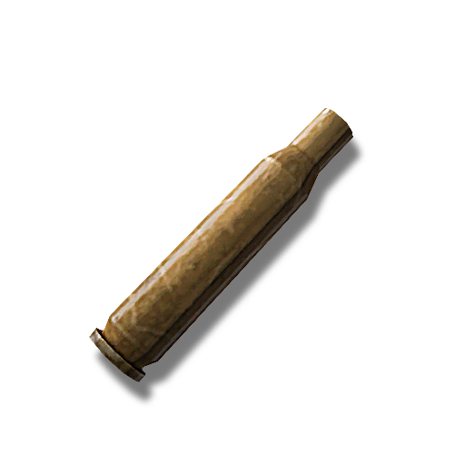 <a href="./Rifle%20Shell%20Casing.md" class="wikilink" title="Rifle Shell Casing">Rifle Shell Casing</a></li>
<li>0.01kg x <a href="./Can%20of%20Gunpowder.md" class="wikilink" title="Can of Gunpowder">Can of Gunpowder</a></li>
</ul></td>
<td>
5 Min
</td>
</tr>
<tr>
<td>
 <a href="./Noisemaker.md" class="wikilink" title="Noisemaker">Noisemaker</a> (<a href="./Survival%20Mode.md" class="wikilink" title="Survival Mode">Survival Mode</a> only)
</td>
<td><ul>
<li>1x <a href="./Recycled%20Can.md" class="wikilink" title="Recycled Can">Recycled Can</a></li>
<li>1x <a href="./Cloth.md" class="wikilink" title="Cloth">Cloth</a></li>
<li>0.10kg x <a href="./Can%20of%20Gunpowder.md" class="wikilink" title="Can of Gunpowder">Can of Gunpowder</a></li>
</ul></td>
<td>
30 Min
</td>
</tr>
</tbody>
</table>

### <a href="./Ammunition%20Forge.md" class="wikilink" title="Ammunition Forge">Ammunition Forge</a>

| Recipe | Materials | Time |
|----|----|----|
| 6x <a href="./Bullet.md" class="wikilink" title="Bullet">Bullet</a> | 1x 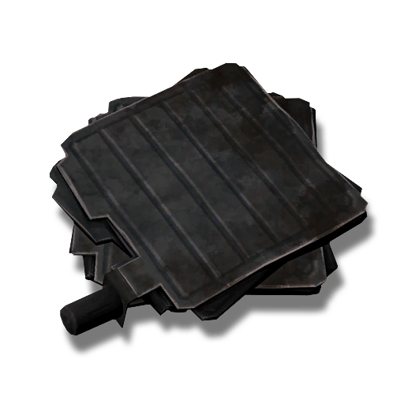 <a href="./Scrap%20Lead.md" class="wikilink" title="Scrap Lead">Scrap Lead</a> | 1 Hour |

### <a href="./Furniture%20Workbench.md" class="wikilink" title="Furniture Workbench">Furniture Workbench</a>

<table>
<colgroup>
<col style="width: 25%" />
<col style="width: 25%" />
<col style="width: 25%" />
<col style="width: 25%" />
</colgroup>
<thead>
<tr>
<th>
Recipe
</th>
<th>
Ingredients
</th>
<th>
Time
</th>
<th>
Tools Needed
</th>
</tr>
</thead>
<tbody>
<tr>
<td>
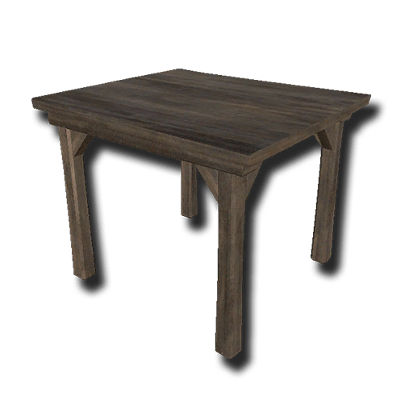 <a href="./Square%20Table.md" class="wikilink" title="Square Table">Square Table</a>
</td>
<td>
8x  <a href="./Fir%20Firewood.md" class="wikilink" title="Fir Firewood">Fir Firewood</a>
</td>
<td>
7 Hours
</td>
<td>
<a href="./Furniture%20Workbench.md" class="wikilink" title="Furniture Workbench">Furniture Workbench</a>
</td>
</tr>
<tr>
<td>
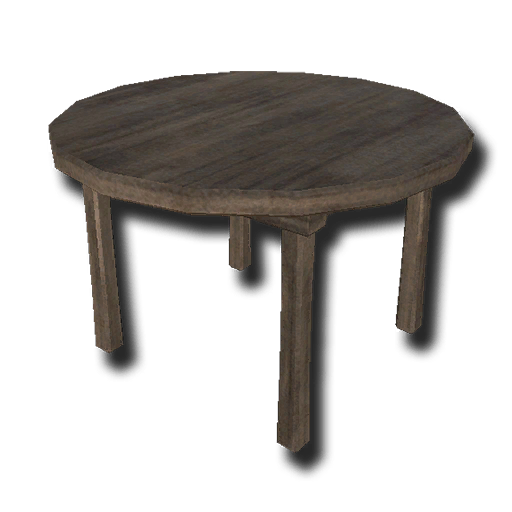 <a href="./Round%20Table.md" class="wikilink" title="Round Table">Round Table</a>
</td>
<td>
12x  <a href="./Fir%20Firewood.md" class="wikilink" title="Fir Firewood">Fir Firewood</a>
</td>
<td>
9 Hours
</td>
<td>
<a href="./Furniture%20Workbench.md" class="wikilink" title="Furniture Workbench">Furniture Workbench</a>
</td>
</tr>
<tr>
<td>
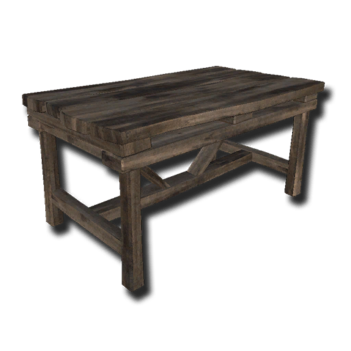 <a href="./Rustic%20Table.md" class="wikilink" title="Rustic Table">Rustic Table</a>
</td>
<td>
10x  <a href="./Fir%20Firewood.md" class="wikilink" title="Fir Firewood">Fir Firewood</a>
</td>
<td>
8 Hours
</td>
<td>
<a href="./Furniture%20Workbench.md" class="wikilink" title="Furniture Workbench">Furniture Workbench</a>
</td>
</tr>
<tr>
<td>
 <a href="./Coffee%20Table.md" class="wikilink" title="Coffee Table">Coffee Table</a>
</td>
<td>
6x  <a href="./Fir%20Firewood.md" class="wikilink" title="Fir Firewood">Fir Firewood</a>
</td>
<td>
4 Hours
</td>
<td>
<a href="./Furniture%20Workbench.md" class="wikilink" title="Furniture Workbench">Furniture Workbench</a>
</td>
</tr>
<tr>
<td>
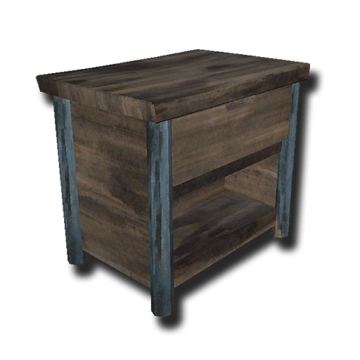 <a href="./Rustic%20End%20Table.md" class="wikilink" title="Rustic End Table">Rustic End Table</a>
</td>
<td>
6x  <a href="./Cedar%20Firewood.md" class="wikilink" title="Cedar Firewood">Cedar Firewood</a> 2x  <a href="./Reclaimed%20Wood.md" class="wikilink" title="Reclaimed Wood">Reclaimed Wood</a>
</td>
<td>
6 Hours
</td>
<td>
<a href="./Furniture%20Workbench.md" class="wikilink" title="Furniture Workbench">Furniture Workbench</a>
</td>
</tr>
<tr>
<td>
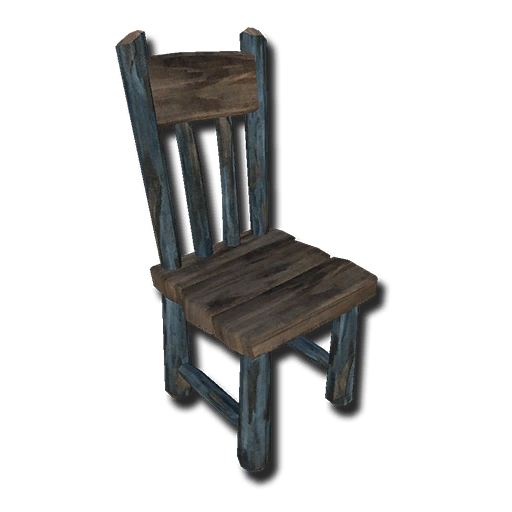 <a href="./Rustic%20Chair.md" class="wikilink" title="Rustic Chair">Rustic Chair</a>
</td>
<td>
4x  <a href="./Cedar%20Firewood.md" class="wikilink" title="Cedar Firewood">Cedar Firewood</a> 2x  <a href="./Reclaimed%20Wood.md" class="wikilink" title="Reclaimed Wood">Reclaimed Wood</a>
</td>
<td>
4 Hours
</td>
<td>
<a href="./Furniture%20Workbench.md" class="wikilink" title="Furniture Workbench">Furniture Workbench</a>
</td>
</tr>
<tr>
<td>
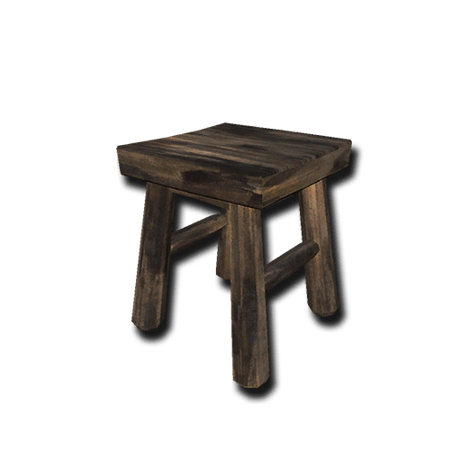 <a href="./Rustic%20Stool.md" class="wikilink" title="Rustic Stool">Rustic Stool</a>
</td>
<td>
4x  <a href="./Fir%20Firewood.md" class="wikilink" title="Fir Firewood">Fir Firewood</a>
</td>
<td>
2 Hours
</td>
<td>
<a href="./Furniture%20Workbench.md" class="wikilink" title="Furniture Workbench">Furniture Workbench</a>
</td>
</tr>
<tr>
<td>
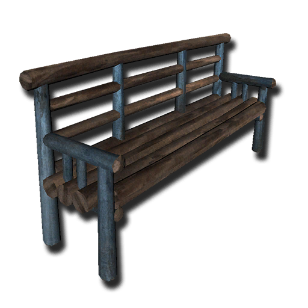 <a href="./Rustic%20Bench.md" class="wikilink" title="Rustic Bench">Rustic Bench</a>
</td>
<td>
10x  <a href="./Cedar%20Firewood.md" class="wikilink" title="Cedar Firewood">Cedar Firewood</a> 2x  <a href="./Reclaimed%20Wood.md" class="wikilink" title="Reclaimed Wood">Reclaimed Wood</a>
</td>
<td>
8 Hours
</td>
<td>
<a href="./Furniture%20Workbench.md" class="wikilink" title="Furniture Workbench">Furniture Workbench</a>
</td>
</tr>
<tr>
<td>
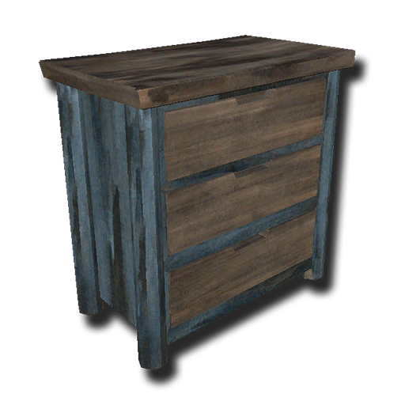 <a href="./Dresser.md" class="wikilink" title="Dresser">Dresser</a>
</td>
<td>
10x  <a href="./Cedar%20Firewood.md" class="wikilink" title="Cedar Firewood">Cedar Firewood</a> 4x  <a href="./Reclaimed%20Wood.md" class="wikilink" title="Reclaimed Wood">Reclaimed Wood</a>
</td>
<td>
8 Hours
</td>
<td>
<a href="./Furniture%20Workbench.md" class="wikilink" title="Furniture Workbench">Furniture Workbench</a>
</td>
</tr>
<tr>
<td>
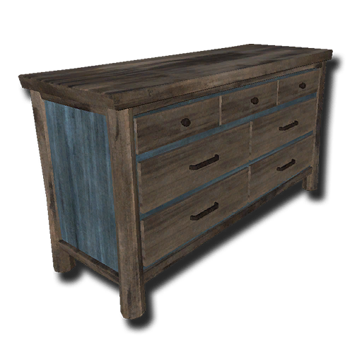 <a href="./Wide%20Dresser.md" class="wikilink" title="Wide Dresser">Wide Dresser</a>
</td>
<td>
16x  <a href="./Fir%20Firewood.md" class="wikilink" title="Fir Firewood">Fir Firewood</a> 6x  <a href="./Reclaimed%20Wood.md" class="wikilink" title="Reclaimed Wood">Reclaimed Wood</a>
</td>
<td>
11 Hours
</td>
<td>
<a href="./Furniture%20Workbench.md" class="wikilink" title="Furniture Workbench">Furniture Workbench</a>
</td>
</tr>
<tr>
<td>
 <a href="./Rustic%20Shelf.md" class="wikilink" title="Rustic Shelf">Rustic Shelf</a>
</td>
<td>
8x  <a href="./Cedar%20Firewood.md" class="wikilink" title="Cedar Firewood">Cedar Firewood</a>
</td>
<td>
6 Hours
</td>
<td>
<a href="./Furniture%20Workbench.md" class="wikilink" title="Furniture Workbench">Furniture Workbench</a>
</td>
</tr>
<tr>
<td>
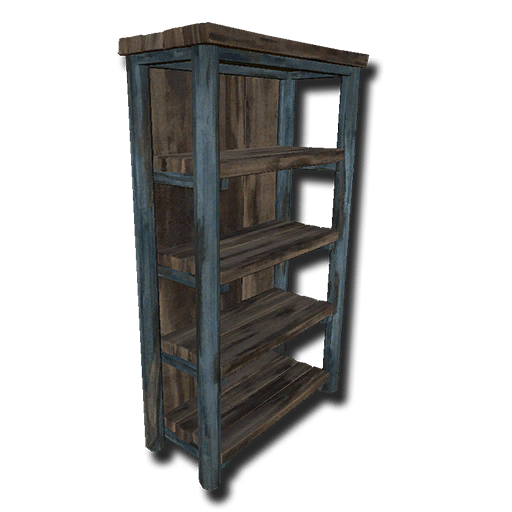 <a href="./Tall%20Rustic%20Shelf.md" class="wikilink" title="Tall Rustic Shelf">Tall Rustic Shelf</a>
</td>
<td>
10x  <a href="./Cedar%20Firewood.md" class="wikilink" title="Cedar Firewood">Cedar Firewood</a>
</td>
<td>
8 Hours
</td>
<td>
<a href="./Furniture%20Workbench.md" class="wikilink" title="Furniture Workbench">Furniture Workbench</a>
</td>
</tr>
<tr>
<td>
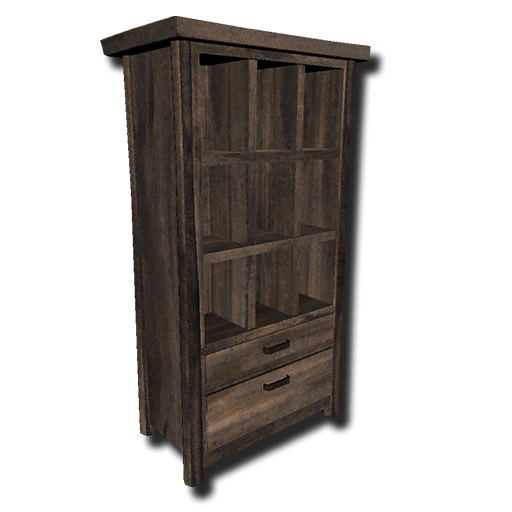 <a href="./Display%20Shelf.md" class="wikilink" title="Display Shelf">Display Shelf</a>
</td>
<td>
12x  <a href="./Fir%20Firewood.md" class="wikilink" title="Fir Firewood">Fir Firewood</a> 4x  <a href="./Reclaimed%20Wood.md" class="wikilink" title="Reclaimed Wood">Reclaimed Wood</a>
</td>
<td>
10 Hours
</td>
<td>
<a href="./Furniture%20Workbench.md" class="wikilink" title="Furniture Workbench">Furniture Workbench</a>
</td>
</tr>
<tr>
<td>
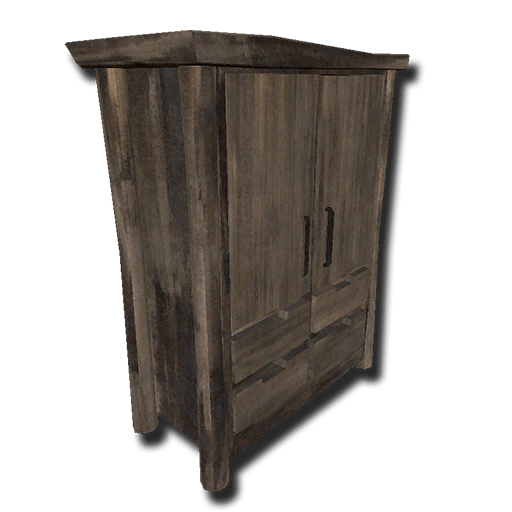 <a href="./Rustic%20Closet.md" class="wikilink" title="Rustic Closet">Rustic Closet</a>
</td>
<td>
18x  <a href="./Fir%20Firewood.md" class="wikilink" title="Fir Firewood">Fir Firewood</a> 3x  <a href="./Reclaimed%20Wood.md" class="wikilink" title="Reclaimed Wood">Reclaimed Wood</a>

2x  <a href="./Scrap%20Metal.md" class="wikilink" title="Scrap Metal">Scrap Metal</a>
</td>
<td>
9 Hours
</td>
<td>
<a href="./Furniture%20Workbench.md" class="wikilink" title="Furniture Workbench">Furniture Workbench</a>
</td>
</tr>
<tr>
<td>
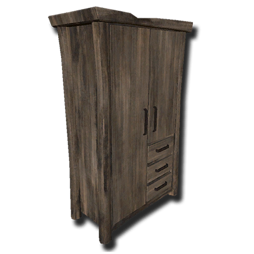 <a href="./Tall%20Rustic%20Closet.md" class="wikilink" title="Tall Rustic Closet">Tall Rustic Closet</a>
</td>
<td>
24x  <a href="./Fir%20Firewood.md" class="wikilink" title="Fir Firewood">Fir Firewood</a> 4x  <a href="./Reclaimed%20Wood.md" class="wikilink" title="Reclaimed Wood">Reclaimed Wood</a>

2x  <a href="./Scrap%20Metal.md" class="wikilink" title="Scrap Metal">Scrap Metal</a>
</td>
<td>
10 Hours
</td>
<td>
<a href="./Furniture%20Workbench.md" class="wikilink" title="Furniture Workbench">Furniture Workbench</a>
</td>
</tr>
<tr>
<td>
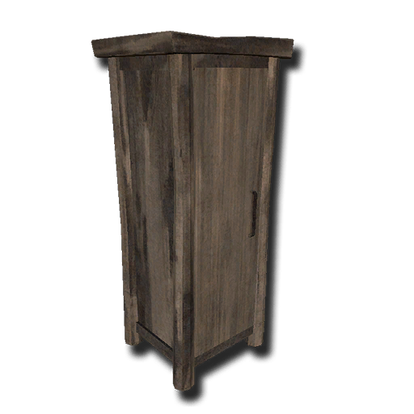 <a href="./Rustic%20Cupboard.md" class="wikilink" title="Rustic Cupboard">Rustic Cupboard</a>
</td>
<td>
10x  <a href="./Fir%20Firewood.md" class="wikilink" title="Fir Firewood">Fir Firewood</a> 2x  <a href="./Reclaimed%20Wood.md" class="wikilink" title="Reclaimed Wood">Reclaimed Wood</a>

1x  <a href="./Scrap%20Metal.md" class="wikilink" title="Scrap Metal">Scrap Metal</a>
</td>
<td>
8 Hours
</td>
<td>
<a href="./Furniture%20Workbench.md" class="wikilink" title="Furniture Workbench">Furniture Workbench</a>
</td>
</tr>
<tr>
<td>
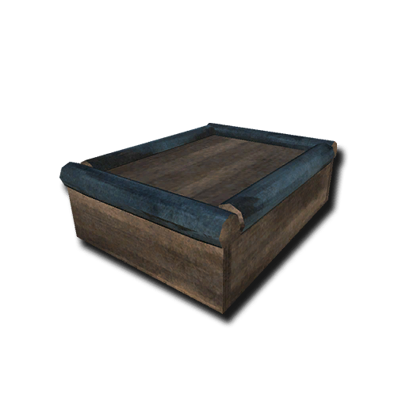 <a href="./Rustic%20Storage%20Box.md" class="wikilink" title="Rustic Storage Box">Rustic Storage Box</a>
</td>
<td>
8x  <a href="./Cedar%20Firewood.md" class="wikilink" title="Cedar Firewood">Cedar Firewood</a>
</td>
<td>
6 Hours
</td>
<td>
<a href="./Furniture%20Workbench.md" class="wikilink" title="Furniture Workbench">Furniture Workbench</a>
</td>
</tr>
<tr>
<td>
 <a href="./Rustic%20Storage%20Trunk.md" class="wikilink" title="Rustic Storage Trunk">Rustic Storage Trunk</a>
</td>
<td>
9x  <a href="./Fir%20Firewood.md" class="wikilink" title="Fir Firewood">Fir Firewood</a>
</td>
<td>
4 Hours
</td>
<td>
<a href="./Furniture%20Workbench.md" class="wikilink" title="Furniture Workbench">Furniture Workbench</a>
</td>
</tr>
<tr>
<td>
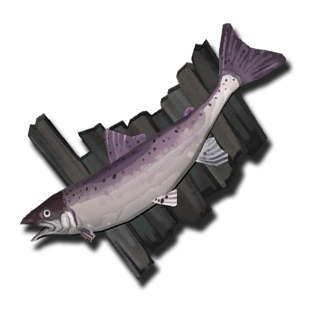 <a href="./Mounted%20Coho%20Salmon.md" class="wikilink" title="Mounted Coho Salmon">Mounted Coho Salmon</a>
</td>
<td>
1x  <a href="./Fir%20Firewood.md" class="wikilink" title="Fir Firewood">Fir Firewood</a> 1x  <a href="./Coho%20Salmon%20%28Raw%29.md" class="wikilink" title="Coho Salmon (Raw)">Coho Salmon (Raw)</a>
</td>
<td>
4 Hours
</td>
<td>
<a href="./Furniture%20Workbench.md" class="wikilink" title="Furniture Workbench">Furniture Workbench</a>
</td>
</tr>
<tr>
<td>
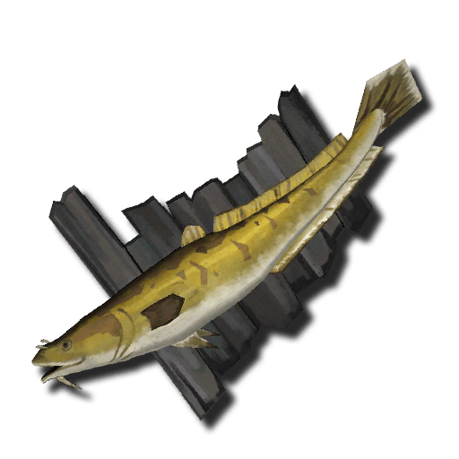 <a href="./Mounted%20Burbot.md" class="wikilink" title="Mounted Burbot">Mounted Burbot</a>
</td>
<td>
1x  <a href="./Fir%20Firewood.md" class="wikilink" title="Fir Firewood">Fir Firewood</a> 1x  <a href="./Burbot%20%28Raw%29.md" class="wikilink" title="Burbot (Raw)">Burbot (Raw)</a>
</td>
<td>
4 Hours
</td>
<td>
<a href="./Furniture%20Workbench.md" class="wikilink" title="Furniture Workbench">Furniture Workbench</a>
</td>
</tr>
<tr>
<td>
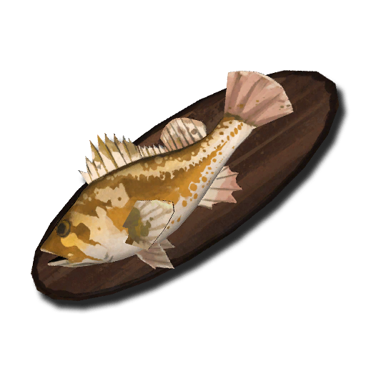 <a href="./Mounted%20Rockfish.md" class="wikilink" title="Mounted Rockfish">Mounted Rockfish</a>
</td>
<td>
1x  <a href="./Fir%20Firewood.md" class="wikilink" title="Fir Firewood">Fir Firewood</a> 1x  <a href="./Rockfish%20%28Raw%29.md" class="wikilink" title="Rockfish (Raw)">Rockfish (Raw)</a>
</td>
<td>
4 Hours
</td>
<td>
<a href="./Furniture%20Workbench.md" class="wikilink" title="Furniture Workbench">Furniture Workbench</a>
</td>
</tr>
<tr>
<td>
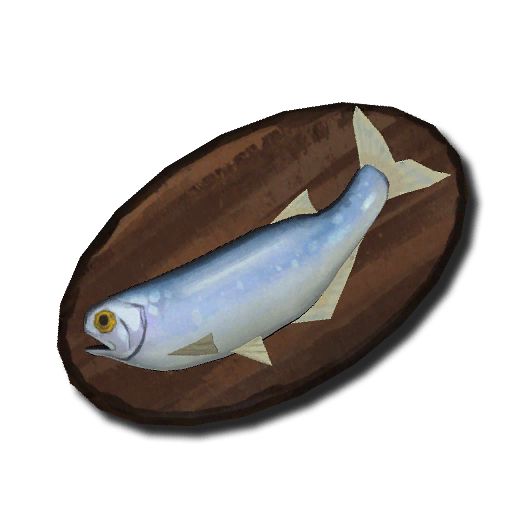 <a href="./Mounted%20Goldeye.md" class="wikilink" title="Mounted Goldeye">Mounted Goldeye</a>
</td>
<td>
1x  <a href="./Fir%20Firewood.md" class="wikilink" title="Fir Firewood">Fir Firewood</a> 1x  <a href="./Goldeye%20%28Raw%29.md" class="wikilink" title="Goldeye (Raw)">Goldeye (Raw)</a>
</td>
<td>
4 Hours
</td>
<td>
<a href="./Furniture%20Workbench.md" class="wikilink" title="Furniture Workbench">Furniture Workbench</a>
</td>
</tr>
<tr>
<td>
 <a href="./Mounted%20Rainbow%20Trout.md" class="wikilink" title="Mounted Rainbow Trout">Mounted Rainbow Trout</a>
</td>
<td>
1x  <a href="./Fir%20Firewood.md" class="wikilink" title="Fir Firewood">Fir Firewood</a> 1x  <a href="./Rainbow%20Trout%20%28Raw%29.md" class="wikilink" title="Rainbow Trout (Raw)">Rainbow Trout (Raw)</a>
</td>
<td>
4 Hours
</td>
<td>
<a href="./Furniture%20Workbench.md" class="wikilink" title="Furniture Workbench">Furniture Workbench</a>
</td>
</tr>
<tr>
<td>
 <a href="./Mounted%20Red%20Irish%20Lord.md" class="wikilink" title="Mounted Red Irish Lord">Mounted Red Irish Lord</a>
</td>
<td>
1x  <a href="./Fir%20Firewood.md" class="wikilink" title="Fir Firewood">Fir Firewood</a> 1x  <a href="./Red%20Irish%20Lord%20%28Raw%29.md" class="wikilink" title="Red Irish Lord (Raw)">Red Irish Lord (Raw)</a>
</td>
<td>
4 Hours
</td>
<td>
<a href="./Furniture%20Workbench.md" class="wikilink" title="Furniture Workbench">Furniture Workbench</a>
</td>
</tr>
<tr>
<td>
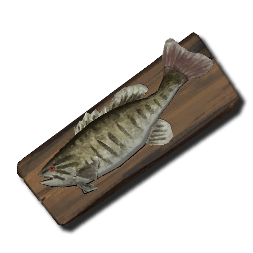 <a href="./Mounted%20Smallmouth%20Bass.md" class="wikilink" title="Mounted Smallmouth Bass">Mounted Smallmouth Bass</a>
</td>
<td>
1x  <a href="./Fir%20Firewood.md" class="wikilink" title="Fir Firewood">Fir Firewood</a> 1x  <a href="./Smallmouth%20Bass%20%28Raw%29.md" class="wikilink" title="Smallmouth Bass (Raw)">Smallmouth Bass (Raw)</a>
</td>
<td>
4 Hours
</td>
<td>
<a href="./Furniture%20Workbench.md" class="wikilink" title="Furniture Workbench">Furniture Workbench</a>
</td>
</tr>
<tr>
<td>
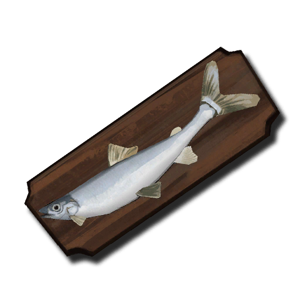 <a href="./Mounted%20Lake%20Whitefish.md" class="wikilink" title="Mounted Lake Whitefish">Mounted Lake Whitefish</a>
</td>
<td>
1x  <a href="./Fir%20Firewood.md" class="wikilink" title="Fir Firewood">Fir Firewood</a> 1x  <a href="./Lake%20Whitefish%20%28Raw%29.md" class="wikilink" title="Lake Whitefish (Raw)">Lake Whitefish (Raw)</a>
</td>
<td>
4 Hours
</td>
<td>
<a href="./Furniture%20Workbench.md" class="wikilink" title="Furniture Workbench">Furniture Workbench</a>
</td>
</tr>
<tr>
<td>
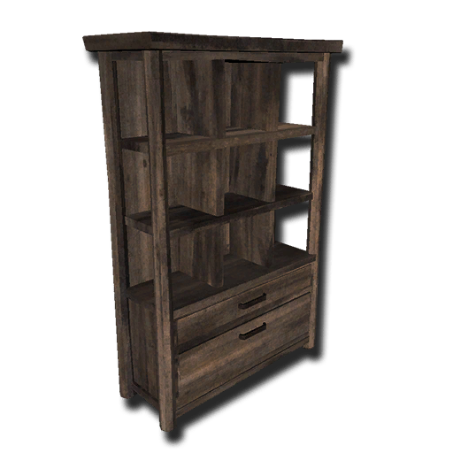 <a href="./Wide%20Display%20Shelf.md" class="wikilink" title="Wide Display Shelf">Wide Display Shelf</a>
</td>
<td>
18x  <a href="./Fir%20Firewood.md" class="wikilink" title="Fir Firewood">Fir Firewood</a> 4x  <a href="./Reclaimed%20Wood.md" class="wikilink" title="Reclaimed Wood">Reclaimed Wood</a>
</td>
<td>
11 Hours
</td>
<td>
<a href="./Furniture%20Workbench.md" class="wikilink" title="Furniture Workbench">Furniture Workbench</a>
</td>
</tr>
<tr>
<td>
 <a href="./Rustic%20Display%20Shelf.md" class="wikilink" title="Rustic Display Shelf">Rustic Display Shelf</a>
</td>
<td>
10x  <a href="./Fir%20Firewood.md" class="wikilink" title="Fir Firewood">Fir Firewood</a> 2x  <a href="./Reclaimed%20Wood.md" class="wikilink" title="Reclaimed Wood">Reclaimed Wood</a>
</td>
<td>
9 Hours
</td>
<td>
<a href="./Furniture%20Workbench.md" class="wikilink" title="Furniture Workbench">Furniture Workbench</a>
</td>
</tr>
<tr>
<td>
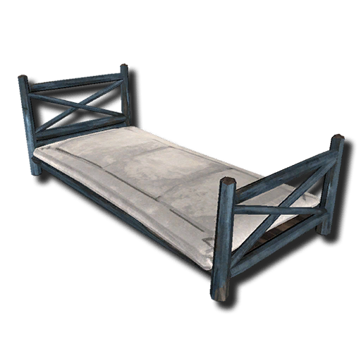 <a href="./Rustic%20Bed.md" class="wikilink" title="Rustic Bed">Rustic Bed</a>
</td>
<td>
10x  <a href="./Cedar%20Firewood.md" class="wikilink" title="Cedar Firewood">Cedar Firewood</a> 12x  <a href="./Cloth.md" class="wikilink" title="Cloth">Cloth</a>

2x <a href="./Cured%20Gut.md" class="wikilink" title="Cured Gut">Cured Gut</a>
</td>
<td>
12 Hours
</td>
<td>
<a href="./Furniture%20Workbench.md" class="wikilink" title="Furniture Workbench">Furniture Workbench</a>
</td>
</tr>
<tr>
<td>
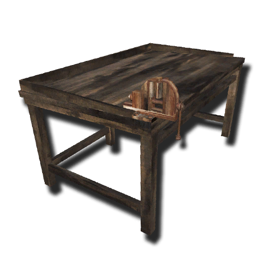 <a href="./Work%20Bench.md" class="wikilink" title="Work Bench">Work Bench</a>
</td>
<td>
15x  <a href="./Cedar%20Firewood.md" class="wikilink" title="Cedar Firewood">Cedar Firewood</a> 1x 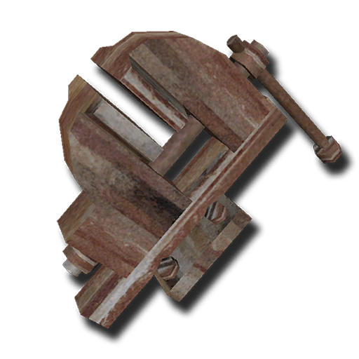 <a href="./Workbench%20Vice.md" class="wikilink" title="Workbench Vice">Workbench Vice</a>
</td>
<td>
18 Hours
</td>
<td>
<a href="./Furniture%20Workbench.md" class="wikilink" title="Furniture Workbench">Furniture Workbench</a>
</td>
</tr>
<tr>
<td>
 <a href="./Framed%20Photo.md" class="wikilink" title="Framed Photo">Framed Photo</a>
</td>
<td>
1x  <a href="./Fir%20Firewood.md" class="wikilink" title="Fir Firewood">Fir Firewood</a> 1x  <a href="./Camera.md" class="wikilink" title="Camera">Camera</a> Photo
</td>
<td>
2 Hours
</td>
<td>
<a href="./Furniture%20Workbench.md" class="wikilink" title="Furniture Workbench">Furniture Workbench</a>
</td>
</tr>
<tr>
<td>
 <a href="./Meat%20Curing%20Box.md" class="wikilink" title="Meat Curing Box">Meat Curing Box</a>
</td>
<td>
10x  <a href="./Fir%20Firewood.md" class="wikilink" title="Fir Firewood">Fir Firewood</a> 8.00kg x  <a href="./Salt.md" class="wikilink" title="Salt">Salt</a>
</td>
<td>
6 Hours
</td>
<td>
<a href="./Furniture%20Workbench.md" class="wikilink" title="Furniture Workbench">Furniture Workbench</a>
</td>
</tr>
<tr>
<td>
 <a href="./Framed%20Hockey%20Jersey.md" class="wikilink" title="Framed Hockey Jersey">Framed Hockey Jersey</a>
</td>
<td>
2x  <a href="./Fir%20Firewood.md" class="wikilink" title="Fir Firewood">Fir Firewood</a> 1x  <a href="./Scrap%20Metal.md" class="wikilink" title="Scrap Metal">Scrap Metal</a>

1x  <a href="./Hockey%20Jersey.md" class="wikilink" title="Hockey Jersey">Hockey Jersey</a>
</td>
<td>
4 Hours
</td>
<td>
<a href="./Furniture%20Workbench.md" class="wikilink" title="Furniture Workbench">Furniture Workbench</a>
</td>
</tr>
<tr>
<td>
 <a href="./Quilted%20Bed.md" class="wikilink" title="Quilted Bed">Quilted Bed</a>
</td>
<td>
12x  <a href="./Fir%20Firewood.md" class="wikilink" title="Fir Firewood">Fir Firewood</a> 10x  <a href="./Cloth.md" class="wikilink" title="Cloth">Cloth</a>

6x <a href="./Cured%20Gut.md" class="wikilink" title="Cured Gut">Cured Gut</a>

16x  <a href="./Ptarmigan%20Down.md" class="wikilink" title="Ptarmigan Down">Ptarmigan Down</a>
</td>
<td>
20 Hours
</td>
<td>
<a href="./Furniture%20Workbench.md" class="wikilink" title="Furniture Workbench">Furniture Workbench</a>
</td>
</tr>
<tr>
<td>
 <a href="./Hide%20Couch.md" class="wikilink" title="Hide Couch">Hide Couch</a>
</td>
<td>
15x  <a href="./Fir%20Firewood.md" class="wikilink" title="Fir Firewood">Fir Firewood</a> 4x  <a href="./Cured%20Deer%20Hide.md" class="wikilink" title="Cured Deer Hide">Cured Deer Hide</a>

16x  <a href="./Ptarmigan%20Down.md" class="wikilink" title="Ptarmigan Down">Ptarmigan Down</a>

5x <a href="./Cured%20Gut.md" class="wikilink" title="Cured Gut">Cured Gut</a>
</td>
<td>
16 Hours
</td>
<td>
<a href="./Furniture%20Workbench.md" class="wikilink" title="Furniture Workbench">Furniture Workbench</a>
</td>
</tr>
<tr>
<td>
 <a href="./Hide%20Chair.md" class="wikilink" title="Hide Chair ">Hide Chair</a>
</td>
<td>
8x  <a href="./Fir%20Firewood.md" class="wikilink" title="Fir Firewood">Fir Firewood</a> 2x  <a href="./Cured%20Deer%20Hide.md" class="wikilink" title="Cured Deer Hide">Cured Deer Hide</a>

8x  <a href="./Ptarmigan%20Down.md" class="wikilink" title="Ptarmigan Down">Ptarmigan Down</a>

3x <a href="./Cured%20Gut.md" class="wikilink" title="Cured Gut">Cured Gut</a>
</td>
<td>
13 Hours
</td>
<td>
<a href="./Furniture%20Workbench.md" class="wikilink" title="Furniture Workbench">Furniture Workbench</a>
</td>
</tr>
<tr>
<td>
 <a href="./Bear%20Hide%20Bed.md" class="wikilink" title="Bear Hide Bed">Bear Hide Bed</a>
</td>
<td>
18x  <a href="./Fir%20Firewood.md" class="wikilink" title="Fir Firewood">Fir Firewood</a> 4x <a href="./Cured%20Gut.md" class="wikilink" title="Cured Gut">Cured Gut</a>

1x  <a href="./Cured%20Black%20Bear%20Hide.md" class="wikilink" title="Cured Black Bear Hide">Cured Black Bear Hide</a>

16x  <a href="./Ptarmigan%20Down.md" class="wikilink" title="Ptarmigan Down">Ptarmigan Down</a>
</td>
<td>
24 Hours
</td>
<td>
<a href="./Furniture%20Workbench.md" class="wikilink" title="Furniture Workbench">Furniture Workbench</a>
</td>
</tr>
</tbody>
</table>

**Lua execution error in Module:Navbox function navbox**

