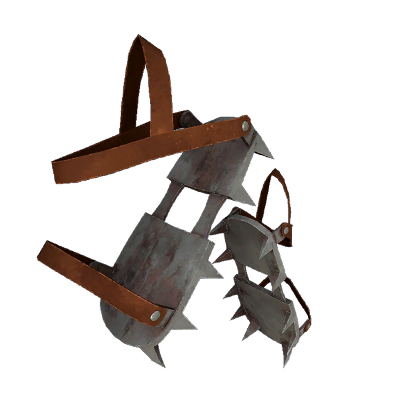

# Crampons

**Contents**

- [Overview](#overview)
- [Location](#location)
- [Repairing](#repairing)
- [Tips](#tips)
- [Trivia](#trivia)
- [Gallery](#gallery)
- [Update history](#update-history)

**Crampons**

| Property | Details |
| --- | --- |
|  |  / *crampons\_icon.png* |
| **General** |  |
| Item Type | Clothing\|- |
| Clothing Slot | Accessory |
| **Statistics** |  |
| Weight | 0.50 kg(1.1 lbs) |
| Warmth bonus | 0 °C(0 °F) |
| Windproof bonus | 0 °C(0 °F) |
| Waterproof bonus | 100% |
| Protection | 3% |
| Mobility | -5% |
| Harvest | Cannot Harvest |
| Repair | 2 × [Scrap Metal](./Scrap%20Metal.md) / 60 minutes / 20% condition |

> “**Traction, for your feet. Rope climbing drains less Stamina, Sprains are less frequent, and you can travel with more confidence over Weak Ice.**”
>
> — In-game description

**Crampons** are a [Clothing](./Clothing.md) accessory in *The Long Dark*.

## Overview

When worn in any accessory slot, Crampons grant the Benefit [Sure Footing](./Sure%20Footing.md), which has several effects:

- Decreases chance of [sprains](./Afflictions.md) by 50% when on slopes.
- Decreases drain rate of [climbing](./Rope%20Climbing.md) stamina by 40% (allowing you to climb further without stopping). (This is a bug, should be 60%)
- While climbing at &lt;25% [Fatigue](./Fatigue.md), gain significantly increased [climbing](./Rope%20Climbing.md) speed compared to not wearing crampons at this fatigue level.
- Increases the (invisible) timer of [Weak Ice](./Weak%20Ice.md) by 1 second (aka 20% more time to move off Weak Ice, before falling in).

Note: Crampons **do not** decrease the amount of Fatigue lost during climbing, and **do not** make you climb faster (unless at &lt;25% fatigue).

Crampons are particularly useful in [regions](./Region.md) with multiple [Mountaineering Rope](./Mountaineering%20Rope.md) climbs, such as [Timberwolf Mountain](./Timberwolf%20Mountain.md), [Ash Canyon](./Ash%20Canyon.md), [Mountain Town](./Mountain%20Town.md), and [Hushed River Valley](./Hushed%20River%20Valley.md), or in areas with Weak Ice such as [Forlorn Muskeg](./Forlorn%20Muskeg.md) or when [Beachcombing](./Beachcombing.md). Shoes/Boots must be worn in order to equip Crampons.

## Location

There are 2 pairs of Crampons that can appear in the game:

- [Ash Canyon](./Ash%20Canyon.md) - A pair is always found next to the [Technical Backpack](./Technical%20Backpack.md) in the [Gold Mine](./Gold%20Mine.md). The trek there is long, cold (-25°C (-13°F)) and with [predators](./Wildlife.md) in maze-like geography.
- [Timberwolf Mountain](./Timberwolf%20Mountain.md) - A pair *has a chance* to spawn in the [Backpack](./Backpack.md) at the middle of the [Tail Section](./Tail%20Section.md), overlooking the cliffside to [Crystal Lake](./Crystal%20Lake.md).

[Improvised Crampons](./Improvised%20Crampons.md) are a more easily acquired--though less effective--alternative that can be crafted at a [Work Bench](./Work%20Bench.md).

## Repairing

Crampons can be repaired with 2 [Scrap Metal](./Scrap%20Metal.md) using [Quality Tools](./Quality%20Tools.md) or [Simple Tools](./Simple%20Tools.md). Repairing Crampons counts towards the [Mending](./Mending.md) skill, rather than the [Repair](./Repair.md) skill.

## Tips

- If the player's footwear (shoes and 2 socks slots) are removed (whether by the player or their footwear is ruined) then their Crampons will automatically be removed, removing the [Sure Footing](./Sure%20Footing.md) affliction.
  - Despite being designed to attach to shoes, the player can wear Crampons on their socks, which should not be possible.
- Wearing Crampons in the outer Accessory slot (right) and another Accessory in the inner (left) will protect that Accessory from damage during wildlife attacks (until the Crampons are destroyed).
- Crampons are very useful for [Beachcombing](./Beachcombing.md), as they increase the fall time by 1 second.
- Like other clothing, Crampons [Decay](./Decay.md) slowly over time, even slower indoors. Decay is persistent across all Regions and is based on in-game date.

## Trivia

- In the [Perilous Constraint](https://thelongdark.fandom.com/wiki/The_Long_Dark/Changelog/Archive_2#1.98_%28Perilous_Constraint_Update%29) update, when attempting to repair the Crampons without the Simple Tools or Quality Tools would give an error message stating a Sewing Kit is required.
- Crampons are the only clothing item with 100% waterproofness.
- Crampons are metal spikes attached to the underside of boots to increase traction on steep or rough terrain, particularly mountain climbing or traversing ice.
  - *The Long Dark* crampons are a "strap-on" style, being an accessory to footwear. Other types include "stepped into" footwear, using vice-like designs to grasp the foot, or specialized boots with integrated crampons (aka "cleats").
- Originally after launch crampons could not be repaired, making their durability finite, until a repair function was later added. (between [Errant Pilgrim (Dec 2019) and Perilous Constraint (Dec 2020)](./The%20Long%20Dark%20%E2%80%94%20Changelog.md)).
- Scrap Metal may be obtained by [Beachcombing](./Beachcombing.md), making the repair of crampons renewable (provided they are not at 0% condition).

## Gallery

| Column 1 |
| --- |
|  / *Clothing model icon* |

## Update history

- UPDATE **9 December 2020 ([Update](./The%20Long%20Dark%20%E2%80%94%20Changelog%20%E2%80%94%20Archive%202.md#1.89)):**
  - Added to game.

**Lua execution error in Module:Navbox function navbox** [ru:Альпинистские\_кошки](ru:%D0%90%D0%BB%D1%8C%D0%BF%D0%B8%D0%BD%D0%B8%D1%81%D1%82%D1%81%D0%BA%D0%B8%D0%B5_%D0%BA%D0%BE%D1%88%D0%BA%D0%B8)
