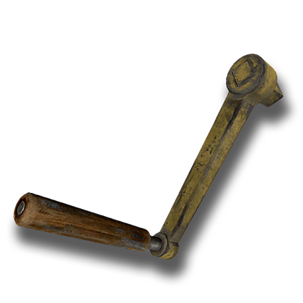

# Crane Key

<table class="infobox">
<caption>Crane Key</caption>
<colgroup>
<col style="width: 50%" />
<col style="width: 50%" />
</colgroup>
<tbody>
<tr>
<td colspan="2"><figure>

<figcaption>Crane_Key_icon.png</figcaption>
</figure></td>
</tr>
<tr>
<td>
Release
</td>
<td>
<a href="./The%20Long%20Dark%20%E2%80%94%20Changelog.md#2.52" class="wikilink" title="31 March 2026">31 March 2026</a>
</td>
</tr>
<tr>
<td>
Wintermute
</td>
<td>
<a href="./Episode%205%20-%20The%20Light%20At%20The%20End%20Of%20All%20Things.md" class="wikilink" title="Episode 5: The Light At The End Of All Things">Episode 5: The Light At The End Of All Things</a>
</td>
</tr>
<tr>
<td colspan="2" class="section">
<strong>Properties</strong>
</td>
</tr>
<tr>
<td>
Item type
</td>
<td>
<a href="./Collectibles.md" class="wikilink" title="Collectibles">Collectibles</a>|-
</td>
</tr>
<tr>
<td>
Stackable
</td>
<td>
No
</td>
</tr>
<tr>
<td>
Examine
</td>
<td>
Key for a Mine Platform Crank. Use for turning a large gear of some kind.
</td>
</tr>
<tr>
<td colspan="2" class="section">
<strong>Values</strong>
</td>
</tr>
<tr>
<td>
Weight
</td>
<td>
0.00 kg (0 lbs)
</td>
</tr>
<tr>
<td colspan="2" class="section">
<strong>Actions</strong>
</td>
</tr>
<tr>
<td>
Backpack
</td>
<td>
Examine
</td>
</tr>
<tr>
<td>
On ground
</td>
<td>
Take It, Read Text, Leave It
</td>
</tr>
</tbody>
</table>

**Crane Key** is a <a href="./Collectibles.md" class="wikilink" title="Collectibles">Collectibles</a> found in <a href="./Episode%205%20-%20The%20Light%20At%20The%20End%20Of%20All%20Things.md" class="wikilink" title="Episode 5">Episode 5</a> of the <a href="./Wintermute.md" class="wikilink" title="Wintermute">Wintermute</a> story. It is found inside the mine in <a href="./Blackrock%20Foothills.md" class="wikilink" title="Blackrock Foothills">Blackrock Foothills</a> during the main mission <a href="./The%20Cold%2C%20Broken%20Road.md" class="wikilink" title="The Cold, Broken Road">The Cold, Broken Road</a>. It is used to manually control a small crane holding a platform, bridging a broken railroad section so that <a href="./Jace.md" class="wikilink" title="Jace">Jace</a> can cross.

It takes on a similar appearance as the <a href="./Elevator%20Crank.md" class="wikilink" title="Elevator Crank">Elevator Crank</a>.

## Update history

\* UPDATE **31 March 2026 (<a href="./The%20Long%20Dark%20%E2%80%94%20Changelog.md#2.52" class="wikilink" title="Update">Update</a>):**

- - Added to game.

**Lua execution error in Module:Navbox function navbox**

