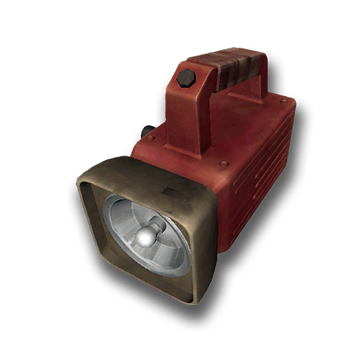

# Crank Light

**Categories:** Pages with update history, Tools, Wintermute · **Source:** [Fandom](https://thelongdark.fandom.com/wiki/Crank_Light)

| Column 1 | Column 2 | Column 3 |
| --- | --- | --- |

|  / _Crank\_Light\_icon.png_ |  |  |
| Wintermute | [Episode 5: The Light At The End Of All Things](./Episode%205%20-%20The%20Light%20At%20The%20End%20Of%20All%20Things.md) |  |
| **Properties** |  |  |
| Item type | [Tools](./Tools.md)\|- |  |
| Stackable | No |  |
| Examine | An emergency light source. Repeatedly crank the the (sic) handle to charge the built-in battery. |  |
| **Values** |  |  |
| Weight | 1.00 kg (2.2 lbs) |  |
| **Actions** |  |  |
| Backpack | Turn on. Turn off. Crank handle |  |
