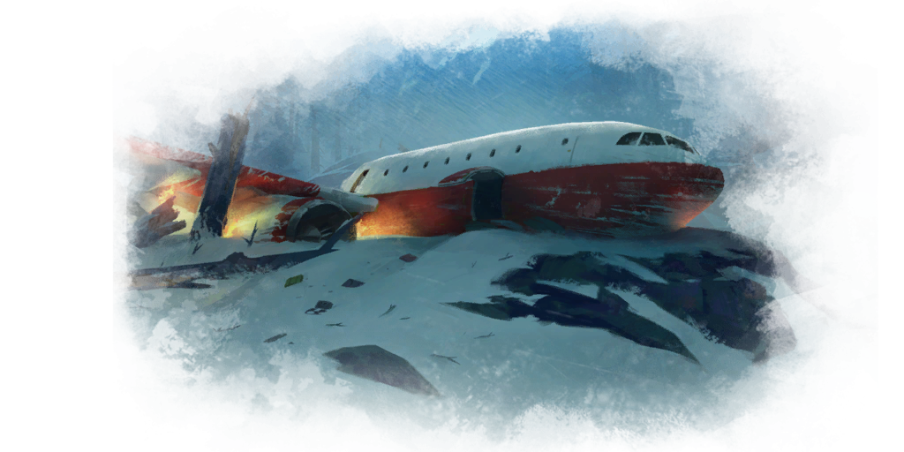

# Crash Site \(Pleasant Valley\)

<table class="infobox">
<caption>Crash Site (Pleasant Valley)</caption>
<colgroup>
<col style="width: 50%" />
<col style="width: 50%" />
</colgroup>
<tbody>
<tr>
<td colspan="2"><figure>
[Missing image: SS-PV-crash-04.jpg]
<figcaption>SS-PV-crash-04.jpg</figcaption>
</figure></td>
</tr>
<tr>
<td colspan="2" class="section">
<strong>Location</strong>
</td>
</tr>
<tr>
<td colspan="2"><figure>
[Missing image: Crash_Site_Pleasant_Valley_Location.png]
<figcaption>Crash_Site_Pleasant_Valley_Location.png</figcaption>
</figure></td>
</tr>
<tr>
<td>
Region
</td>
<td>
<a href="./Pleasant%20Valley.md" class="wikilink" title="Pleasant Valley">Pleasant Valley</a>|-
</td>
</tr>
<tr>
<td>
Description
</td>
<td>
A crashed passenger airliner
</td>
</tr>
<tr>
<td colspan="2" class="section">
<strong>General</strong>
</td>
</tr>
<tr>
<td>
Type
</td>
<td>
Landmark|-
</td>
</tr>
</tbody>
</table>

The **Crash Site** is a crashed airliner brought down by the <a href="./First%20Flare.md" class="wikilink" title="First Flare">First Flare</a> in <a href="./Pleasant%20Valley.md" class="wikilink" title="Pleasant Valley">Pleasant Valley</a>, not far from <a href="./Burned%20Ridge%20Cave.md" class="wikilink" title="Burned Ridge Cave">Burned Ridge Cave</a>. This location, lacking an official name, was added to <a href="./Wintermute.md" class="wikilink" title="Wintermute">Wintermute</a> and <a href="./Survival%20Mode.md" class="wikilink" title="Survival Mode">Survival Mode</a> in game version 1.6 with the release of <a href="./Episode%203%20-%20Crossroads%20Elegy.md" class="wikilink" title="Episode 3">Episode 3</a>.

The plane itself is marked as North Star Charters Flight 7030.

## Survival mode

The scattered debris of the passenger airliner is mostly centered around Skeeters' Ridge. The back section of the plane cabin is accessible by one of the plane passenger doors. The site can also be reached by a path on the opposite of the debris field.

The area is well known for having many <a href="./Suitcase.md" class="wikilink" title="Suitcases">Suitcases</a>, which often contain large amounts of low, mid, and occasionally high-tier Clothing. Closer to the airplane's broken fuselage, there are often many pop cans, and <a href="./Airline%20Food%20-%20Chicken.md" class="wikilink" title="packages of">packages of</a> <a href="./Airline%20Food%20-%20Vegetarian.md" class="wikilink" title="airline food">airline food</a>. There are also many <a href="./Frozen%20Corpse.md" class="wikilink" title="frozen corpses">frozen corpses</a> scattered amongst the suitcases and wreckage. Overall, the area can provide a lot of useful supplies for new survivors.

Unlike the crate-filled <a href="./Tail%20Section.md" class="wikilink" title="Tail Section">Tail Section</a> that broke off on the summit of <a href="./Timberwolf%20Mountain.md" class="wikilink" title="Timberwolf Mountain">Timberwolf Mountain</a> or the small private plane crash site in <a href="./Mountain%20Town.md" class="wikilink" title="Mountain Town">Mountain Town</a>, the death toll of this aurora-induced tragedy is apparent. There are no survivors outside of Story mode, and many of the passengers bodies can be found within the crash site area.

## Gallery

<table class="gallery">
<colgroup>
<col style="width: 25%" />
<col style="width: 25%" />
<col style="width: 25%" />
<col style="width: 25%" />
</colgroup>
<tbody>
<tr>
<td><figure>
[Missing image: SS-PV-crash-04.jpg]
<figcaption>SS-PV-crash-04.jpg</figcaption>
</figure></td>
<td><figure>
[Missing image: North_Charters_Crash.jpg]
<figcaption>The crashed Northern Charter plane in Episode 3</figcaption>
</figure></td>
<td><figure>
[Missing image: SS-PV-crash-03.jpg]
<figcaption>SS-PV-crash-03.jpg</figcaption>
</figure></td>
<td><figure>
[Missing image: SS-PV-crash-02.jpg]
<figcaption>SS-PV-crash-02.jpg</figcaption>
</figure></td>
</tr>
<tr>
<td><figure>
[Missing image: SS-PV-crash-01.jpg]
<figcaption>SS-PV-crash-01.jpg</figcaption>
</figure></td>
<td><figure>
[Missing image: SS-PV-crash-06.jpg]
<figcaption>SS-PV-crash-06.jpg</figcaption>
</figure></td>
<td><figure>
[Missing image: SS-PV-crash-05.jpg]
<figcaption>SS-PV-crash-05.jpg</figcaption>
</figure></td>
<td><figure>

<figcaption>Missions_story_ep3_Fallen_Star.png</figcaption>
</figure></td>
</tr>
</tbody>
</table>

**Lua execution error in Module:Navbox function navbox**

