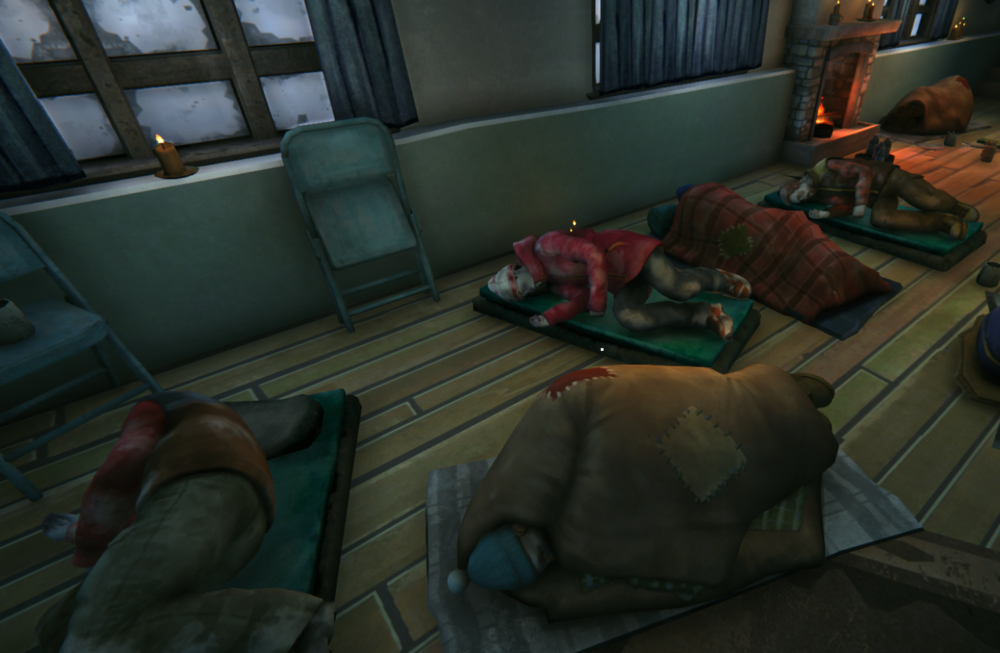
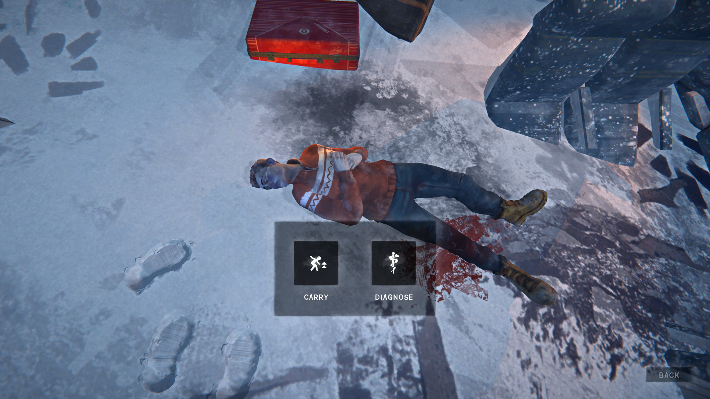

# Crash Survivor

**Contents**

- [Basic Details](#basic-details)
- [Gameplay Features](#gameplay-features)
- [Diagnosing](#diagnosing)
- [List of Passengers](#list-of-passengers)
- [Trivia](#trivia)

{| style="margin:auto" | style="vertical-align:top; font-size:3em; color:#5d5980; padding-right:10px" |“ | **Then yesterday, the crash survivors started showing up....Best thing we can do is keep these people warm and fed and....then we'll see what the Lord has in store.**

Father Thomas

| style="vertical-align:bottom; font-size:3em; color:#5d5980; padding-left:10px" |” |} **Crash Survivors **are a group of passengers who survived an airline crash in the [Pleasant Valley](./Pleasant%20Valley.md) region. They are only found in [Episode 3: Crossroads Elegy](./Episode%203%20-%20Crossroads%20Elegy.md) in [Wintermute](./Wintermute.md).

## Basic Details

Many survivors managed to find their way toe the [Community Hall](./Community%20Hall.md) on their own, but are not doing very well. [Astrid Greenwood](./Astrid%20Greenwood.md) is tasked with diagnosing and caring for them when she first arrives, with [Father Thomas](./Father%20Thomas.md) watching over them to make sure they recover.

Four other Crash Survivors are found outside of the Community Hall during the episode who must be rescued and delivered safely to the Hall to progress the story.

- The first, Gwen, is found at the ruined airliner itself. The other three are found on the map after Astrid has brought Gwen to the community center.
- Logan is found near the [Heartbreak Bridge](./Heartbreak%20Bridge.md)
- Wade is found near [Pleasant Valley Farmstead](./Pleasant%20Valley%20Farmstead.md), close to the bridge on the end of the property furthest from the main road.
- Ava is found near [Lonely Homestead](./Lonely%20Homestead.md).

## Gameplay Features

When Astrid Greenwood finds these survivors, she needs to carry them back to the Community hall and place them on an empty bed. Once they are there, she cannot interact with them further.

When Astrid is carrying a survivor, Astrid cannot sprint, her walking speed is reduced to a crawl, she cannot use weapons, and she cannot interact with items or [Vehicles](./Vehicle.md) (although she can open building doors and bunker hatches). A small icon next to the Sprint Bar similar to the [Burdened](./Burdened.md) Affliction icon will appear as long as Astrid is carrying a Survivor. Placing a Crash Survivor down will remove these debuffs.

Survivors have their own [Warmth](./Warmth.md) and [Thirst](./Thirst.md) bar that steadily depletes, as well as a [Condition](./Condition.md) bar. Astrid may treat these survivors by interacting with them and choosing the "Diagnose" option. Survivors may only drink [Potable Water](./Water%20%28Potable%29.md), and like Astrid or [Will Mackenzie](./Will%20Mackenzie.md), will drink until their thirst is quenched or the water runs out. Warmth is addressed by bringing them indoors or placing them by a fire. One can place them on beds and bedrolls providing the warmth bonus accompanying the bed/bedroll. It is not possible to give any clothing to a survivor. A Survivor's Condition bar will steadily recover just as a player's will so long as their Needs are satisfied.

Survivors may be attacked by a [Timberwolf](./Timberwolf.md). A wolf will approach the survivor, stop, and then bite them on the ground. This will cause them to lose 25% Condition, and Astrid will need to treat their bleeding with a [Bandage](./Bandage.md). A [Bear](./Bear.md) will ignore a crash survivor, and if Astrid is attacked by one while holding a survivor, the survivor will simply fall to the ground and not be injured.

## Diagnosing

*The 2 options for interacting with a lost Crash Survivor.* Crash Survivors can be diagnosed with the following Afflictions and the following treatments:

-  [Concussion](./Concussion.md) - No treatment
-  [Hypothermia Risk](./Hypothermia%20Risk.md) - Warm survivor
-  [Hypothermia](./Hypothermia.md) - Warm survivor
-  [Blood Loss](./Blood%20Loss.md) - Use [Bandage](./Bandage.md)
-  [Dehydration Risk](./Dehydration%20Risk.md) - Drink [Water (Potable)](./Water%20%28Potable%29.md)
-  [Dehydrated](./Dehydrated.md) - Drink [Water (Potable)](./Water%20%28Potable%29.md)
-  [Hyperglycemic Risk](./Hyperglycemic%20Risk.md) - Administer [Insulin](./Insulin.md)

## List of Passengers

The North Star Charters Flight 7030 was carrying the following passengers when it crashed:

- Sam -Alive
- Mande -Alive
- Winston -Alive
- Ruby -Alive
- Jake -Alive
- Sadie -Alive
- Nolan -Alive
- Chloe -Alive
- Dimitri S. -Alive
- Eric -Alive
- Bennett -Alive
- Franklin -Alive
- Gwen/[G. Russel](./ID%20-%20G.%20Russell.md) -Lost but recovered, Alive
- Logan/L. Lee -Lost but recovered, Alive
- Ava/A. Roy -Lost but recovered, Alive
- Wade/ W. Jones -Lost but recovered, Alive
- [D. Belanger](./ID%20-%20D.%20Belanger.md) -Deceased
- [T. Chan](./ID%20-%20T.%20Chan.md) -Deceased
- [S. Gagne](./ID%20-%20S.%20Gagne.md) -Deceased
- [O. Gould](./ID%20-%20O.%20Gould.md) -Deceased
- [F. Leblanc](./ID%20-%20F.%20Leblanc.md) -Deceased
- [A. Lewis](./ID%20-%20A.%20Lewis.md) -Deceased
- [K. Morrison](./ID%20-%20K.%20Morrison.md) -Deceased
- [V. Singh](./ID%20-%20V.%20Singh.md) -Deceased
- [R. Tan](./ID%20-%20R.%20Tan.md) -Deceased
- The pilots and any others who made it to the Community hall and perished. Their remains were stored in the basement.

## Trivia

- The 3 missing Survivors will always be found near a campfire that will burn eternally, keeping them warm and keeping any wolves at bay. This can be a great place to create water, treat the survivors, and warm Astrid up before bringing them to the Community Hall.
- Logan, Ava, and Wade are marked on the map in a large radius. If the player is having trouble finding them, Astrid may shoot a flare from a [Distress Pistol](./Distress%20Pistol.md) while in the radius. The survivor will respond by shooting a flare back.
- Gwen is voiced by Paula Hoffman
- Logan is voiced by Ross Huguet
- Wade is voiced by Adam Trask
- Ava is voiced by Aimee Ayotte

**Lua execution error in Module:Navbox function navbox** [ru:Выжившие в крушении самолета](ru:%D0%92%D1%8B%D0%B6%D0%B8%D0%B2%D1%88%D0%B8%D0%B5_%D0%B2_%D0%BA%D1%80%D1%83%D1%88%D0%B5%D0%BD%D0%B8%D0%B8_%D1%81%D0%B0%D0%BC%D0%BE%D0%BB%D0%B5%D1%82%D0%B0)
