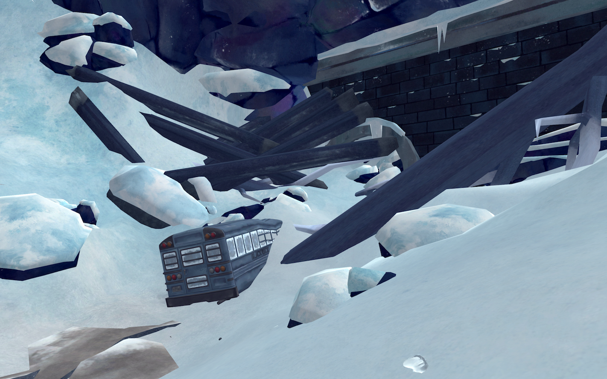
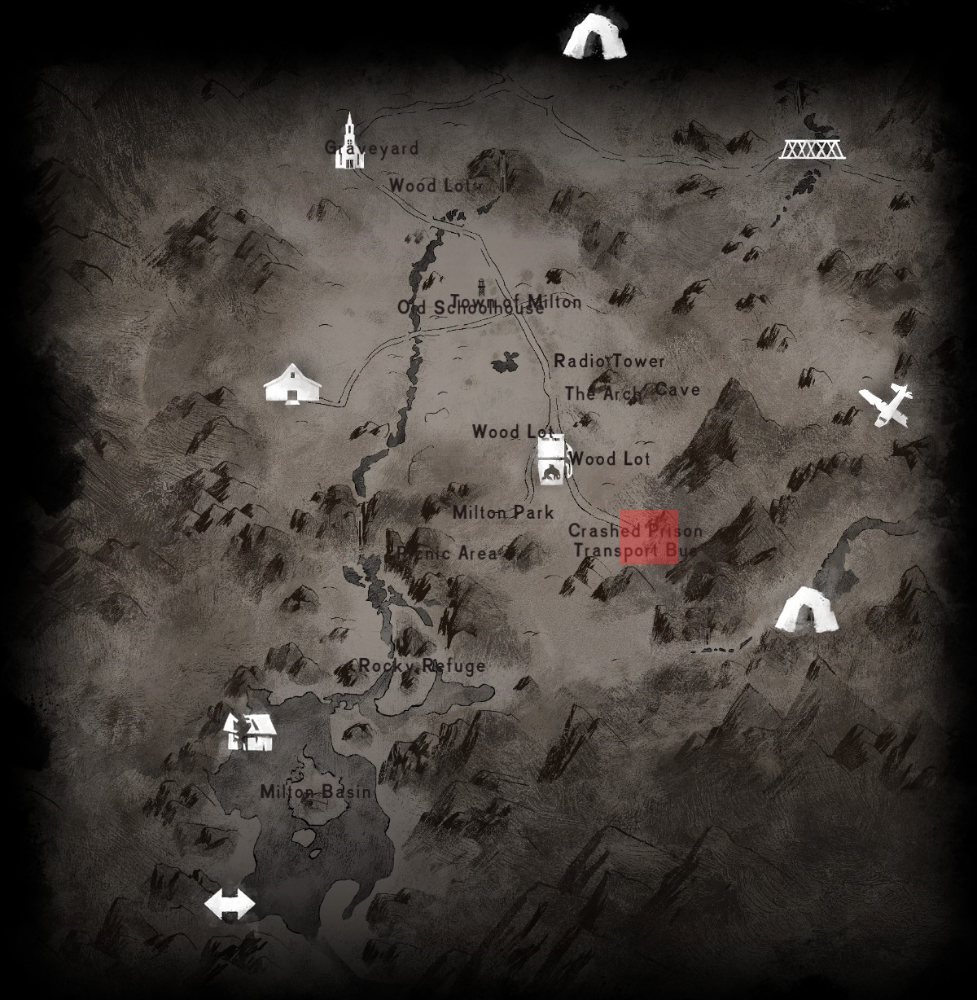
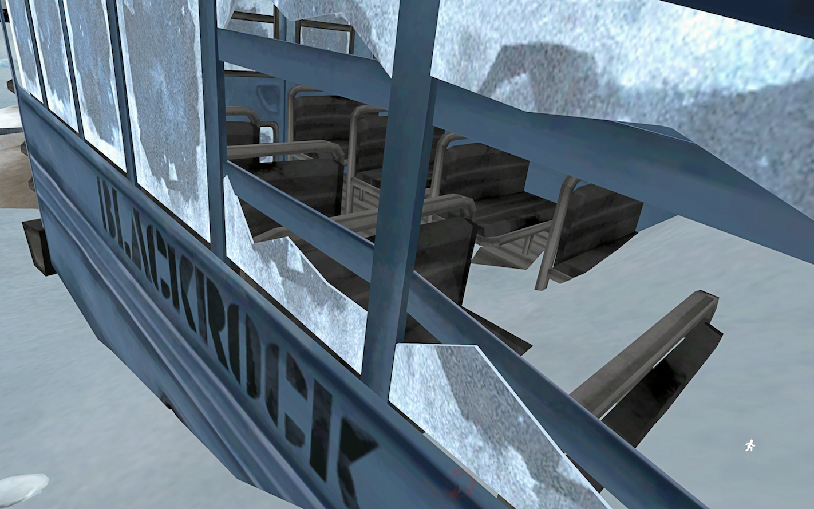

# Crashed Prison Transport Bus

**Categories:** Locations, Locations in Mountain Town, Outdoor locations · **Source:** [Fandom](https://thelongdark.fandom.com/wiki/Crashed_Prison_Transport_Bus)

**Crashed Prison Transport Bus**

\[\[File: /  / _Approach_ /  / _Tunnel Collapse_

250px\|Will approaches the bus\]\]

_Approach_

_Tunnel Collapse_

**Location**

_Crashed\_Prison\_Transport\_Bus\_Location.png_

Region

[Mountain Town](./Mountain%20Town.md)

Location

**Description:** A collapsed tunnel and crashed bus

**General**

**Type:** Outdoors

**Missions:** [Episode 1: Chapter 3](./Episode%201%20-%20Do%20Not%20Go%20Gentle.md#Chapter_3)

**Spoiler Warning:****This page may contain spoilers from the [story](./Wintermute.md) of The Long Dark.**

> “__Hey...you think they put me on that bus for my good behaviour? That's the bus to Blackrock. __”
>
> — [Hobbs](./Hobbs.md)

{| style="margin:auto" | style="vertical-align:top; font-size:3em; color:#5d5980; padding-right:10px" |“ | **Blackrock's bus drivers have what many consider to be the cushiest and safest job at the Penitentiary.**

[Load Screen](./Load%20Screen.md) Description

| style="vertical-align:bottom; font-size:3em; color:#5d5980; padding-left:10px" |” |} The **Crashed Prison Transport Bus** is a location in the [Mountain Town](./Mountain%20Town.md) region, located to the south of [Milton](./Milton.md), past the [Orca Gas Station](./Orca%20Gas%20Station.md).

## Overview

The bus, which was carrying the [Convicts](./Convicts.md), inmates to [Blackrock Federal Penitentiary](./Blackrock%20Prison.md) prior to the [First Flare](./First%20Flare.md), is half-buried in snow and rubble from the collapsed tunnel and cannot be entered. The [Frozen Corpse](./Frozen%20Corpse.md) of an inmate can be found nearby and looted. A briefcase can also be found nearby, containing the [Prison Transport Manifest](./Prison%20Transport%20Manifest.md).

## Story Mode

 Although the locale can be encountered at any point while exploring Milton, it must be visited as part of the main [Episode 1](./Episode%201%20-%20Do%20Not%20Go%20Gentle.md) questline. [Grey Mother](./Grey%20Mother.md) sends [Will Mackenzie](./Will%20Mackenzie.md) to investigate the tunnel, where he finds the bus crash and the collapsed tunnel. A cutscene shows Mackenzie noticing the scrap of clothing in the bus door, and then revealing the word _PERSEVERANCE_ written in blood on the floor inside the bus, presumably by [Astrid Greenwood](./Astrid%20Greenwood.md), leading Will to believe that Astrid made her way to the town of [Perseverance Mills](./Perseverance%20Mills.md).

## Trivia

- Before the tunnel collapsed, it was possible to travel directly to [Keeper's Pass South](./Keeper%27s%20Pass%20South.md) and then later to [Long Curve](./Long%20Curve.md) in [Pleasant Valley](./Pleasant%20Valley.md).
  - This is evidenced by Astrid having escaped through the tunnel and having been found by [Molly](./Molly.md) near Long Curve.
- With the release of Episode 4, the above theory has been confirmed, as continuing along the road from [Long Curve](./Long%20Curve.md) towards [Keeper's Pass South](./Keeper%27s%20Pass%20South.md) leads to [Mirthless Fork](./Mirthless%20Fork.md), from which it was originally possible to go either towards Milton or [Blackrock](./Blackrock.md).
  - Due to the collapse of the tunnel, it is currently only possible to travel towards Blackrock from there, and getting to Keeper's Pass South requires a continuous route through [Mystery Lake](./Mystery%20Lake%20%28region%29.md) and [Pleasant Valley](./Pleasant%20Valley.md).
- Some of prisoners names are names of the Hinterland Dev Team:
  - WHITE, S. - Skylar White - Publishing Lead
  - IRVINE, K. - Keilan Irvine - Testing Lead
  - KANG, D. - Dennis Kang - Animation Lead
  - KELLEY, P. - Paul Kelley - Character Artist
  - HARRIS, S. - Simon Harris - Enviro Artist
  - MATHIS, D. - actual in-game character
  - GABAS, E. - Eric Gabas - Environment Lead
  - NG, R. - Ray Ng - Animator
  - LECLERC, Y. - Yannick Leclerc - Animator
  - KOWALSKI, M. - Maciej Kowalski - Technical Artist
  - BAKER, J. - Joel Baker - Programmer
  - DESCUBES, V. - Vincent Descubes - Programmer

_Crashed Prison Transport Bus_

_Can't access inside in Survival_
