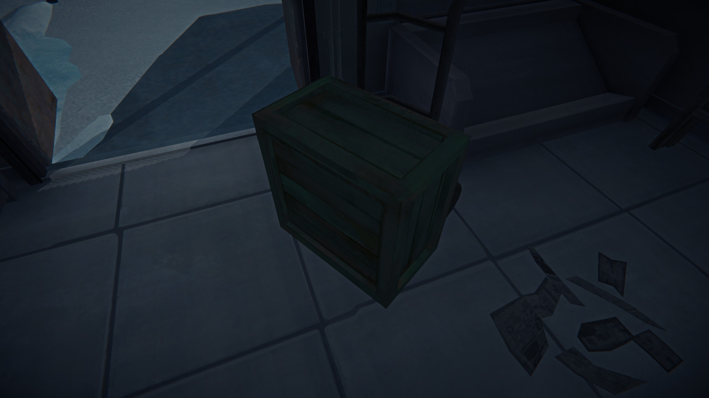

# Crate

**Categories:** Interactable Objects · **Source:** [Fandom](https://thelongdark.fandom.com/wiki/Crate)

**Contents**

- [Crates containing loot](#crates-containing-loot)
- [Large Green Crate](#large-green-crate)
- [Medium and Small Green Crate](#medium-and-small-green-crate)
- [Small Wooden Crate](#small-wooden-crate)
- [Wooden Coal Crate](#wooden-coal-crate)

**Crate**

**General**

Item Type

Item

Wintermute

No

**Statistics**

Harvest

6 × [Reclaimed Wood](./Reclaimed%20Wood.md) (large)  
 4 × [Reclaimed Wood](./Reclaimed%20Wood.md) (medium)  
 2 x [Reclaimed Wood](./Reclaimed%20Wood.md) (small)

The crate is a wooden container which is used to store items. When a crate is broken down, it yields Reclaimed Wood and whatever contents may be inside. Crates are an excellent starter item, if any are found. Crates can be harvested with bare hands, with a hatchet, or with a heavy hammer.

## Crates containing loot

Crates near can sometimes hide items inside that can be obtained from harvesting the crate, such as [Accelerant](./Accelerant.md) and [MRE](./Military-Grade%20MRE.md).

Examples of locations where crates are known to contain loot:

- [Broken Railroad](./Broken%20Railroad.md)
  - [Maintenance Yard](./Maintenance%20Yard.md)
- [Forlorn Muskeg](./Forlorn%20Muskeg.md)
  - [Old Spence Family Homestead](./Old%20Spence%20Family%20Homestead.md)
- [Mountain Town](./Mountain%20Town.md)
  - The crates near [Mackenzie's Crashed Plane](./Mackenzie%27s%20Crashed%20Plane.md)
- [Timberwolf Mountain](./Timberwolf%20Mountain.md)
  - [Tail Section](./Tail%20Section.md)

## Large Green Crate

| Reclaimed Wood | Time | Calories | Condition of Tool |
| --- | --- | --- | --- |
| 6 | 1 hour 30 minutes | 270 | 0% by Hand |
| 6 | 45 minutes | 135 | -2% Hatchet |
| 6 | 58 minutes | 176 | -3% Improvised Hatchet |
| 6 | 1 hour 8 minutes | 202 | -0.5% Heavy Hammer |

## Medium and Small Green Crate

| Reclaimed Wood | Time | Calories | Condition of Tool |
| --- | --- | --- | --- |
| 4 | 60 minutes | 180 | 0% by Hand |
| 4 | 30 minutes | 90 | -2% Hatchet |
| 4 | 39 mintues | 117 | -3% Improvised Hatchet |
| 4 | 45 minutes | 135 | -0.5% Heavy Hammer |

## Small Wooden Crate

| Reclaimed Wood | Time | Calories | Condition of Tool |
| --- | --- | --- | --- |
| 1 | 15 minutes | 45 | 0% by Hand |
| 1 | 8 minutes | 22 | -2% Hatchet |
| 1 | 10 minutes | 29 | -3% Improvised Hatchet |
| 1 | 11 minutes | 34 | -0.5% Heavy Hammer |

## Wooden Coal Crate

| Reclaimed Wood | Time | Calories | Condition of Tool |
| --- | --- | --- | --- |
| 2 |  |  | 0% by Hand |
| 2 |  |  | -2% Hatchet |
| 2 |  |  | -3% Improvised Hatchet |
| 2 |  |  | -0.5% Heavy Hammer |
