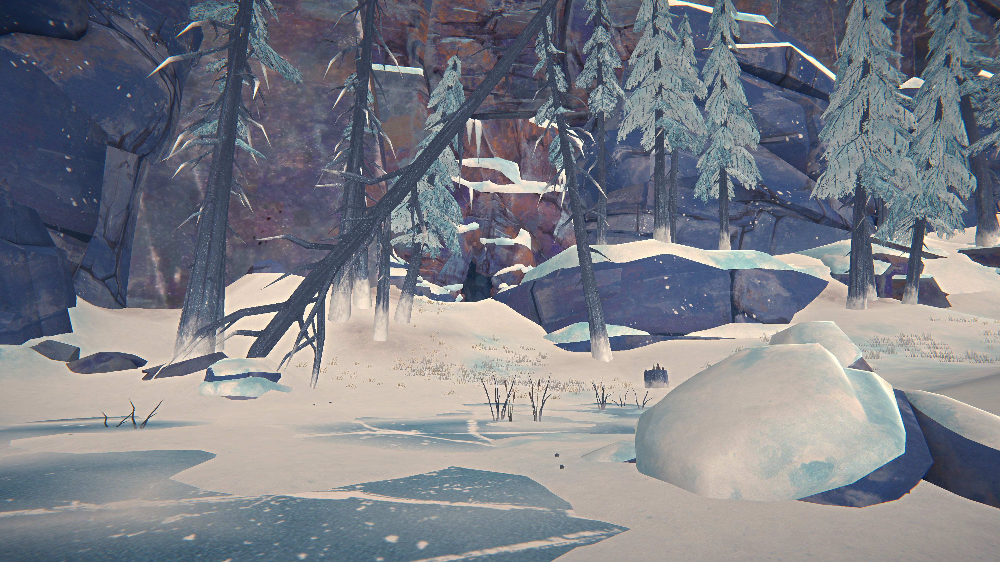
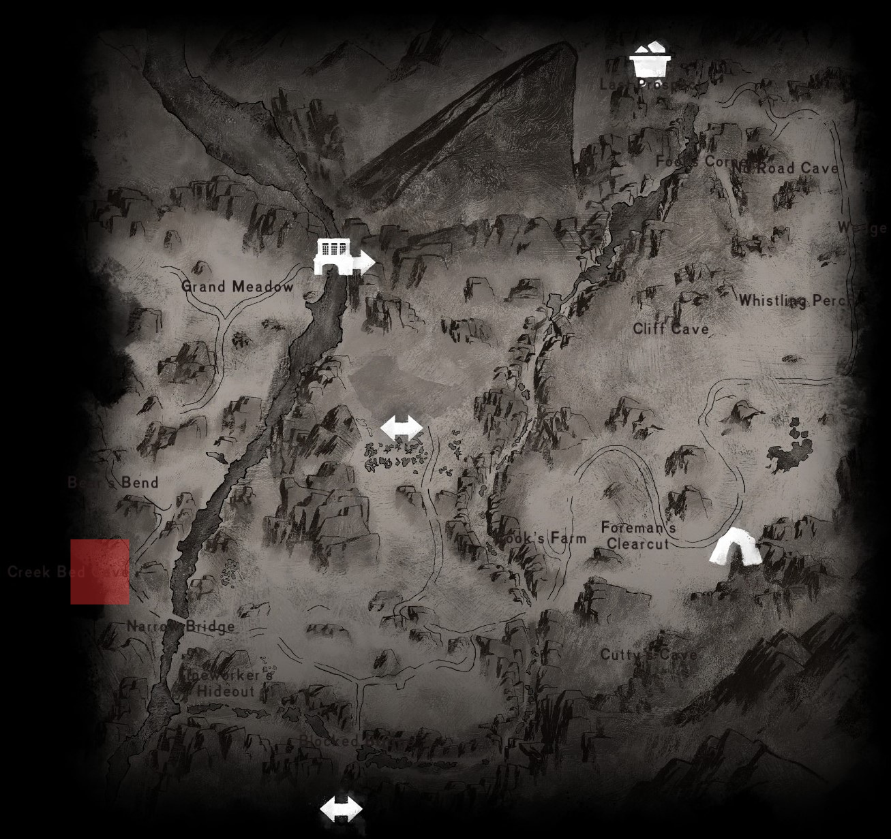

# Creek Bed Cave

**Creek Bed Cave**

| Property | Details |
| --- | --- |
|  |  / *Creek\_Bed\_Cave.jpg* |
| **Location** |  |
|  |  / *Creek\_Bed\_Cave\_Location.png* |
| Region |  |
| Location | West of Narrow Bridge, in the region's boundary rock wall |
| **General** |  |
| Type | Cave\|- |
|  | Provides some shelter\|} / **Creek Bed Cave** is a small cave located in [Blackrock](./Blackrock.md), near the region's southwestern-most point. / ## Overview / There is a small tuffet in the cave, allowing [sleep](./Sleep.md) without a bedroll. Various plants grow near the cave, and rabbits are often to be seen on the frozen creek in front. Deer may also spawn just outside the cave, and there is ample foraging in the wilderness surrounding the cave. Additionally, this is one of the few areas of Blackrock that doesn't have many predators, making it a possible location for a [Safe House](./Safehouse.md). / Nearby locations include [Narrow Bridge](./Narrow%20Bridge.md) to the east, and a path leads north towards a series of ledges that allow passage over the blocked road at [Bear's Bend](./Bear%27s%20Bend.md). / ## Gallery / \|  / *Creek Bed Cave entrance* \|  / *View from Creek Bed Cave at sunrise* \| / \| --- \| --- \| / **Lua execution error in Module:Navbox function navbox** [ru:Пещера у русла ручья](ru:%D0%9F%D0%B5%D1%89%D0%B5%D1%80%D0%B0_%D1%83_%D1%80%D1%83%D1%81%D0%BB%D0%B0_%D1%80%D1%83%D1%87%D1%8C%D1%8F) |
|  / *Creek Bed Cave entrance* |  / *View from Creek Bed Cave at sunrise* |
