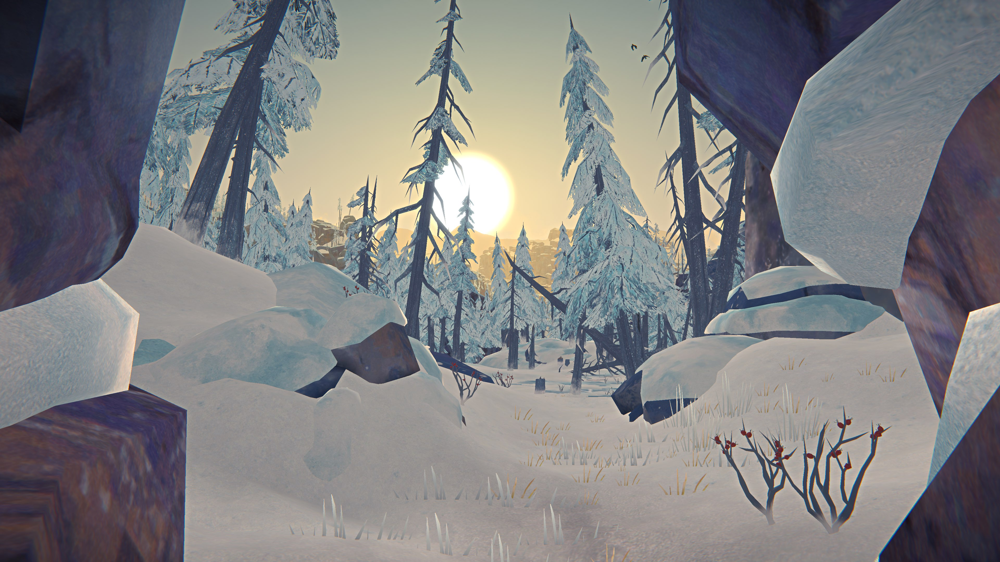

# Creek Bed Cave

**Categories:** Blackrock, Caves, Locations, Locations in Blackrock, Sheltered locations · **Source:** [Fandom](https://thelongdark.fandom.com/wiki/Creek_Bed_Cave)

**Creek Bed Cave**

_Creek\_Bed\_Cave.jpg_

**Location**

_Creek\_Bed\_Cave\_Location.png_

Region

**Location:** West of Narrow Bridge, in the region's boundary rock wall

**General**

**Type:** Cave

_Creek Bed Cave entrance_

_View from Creek Bed Cave at sunrise_
