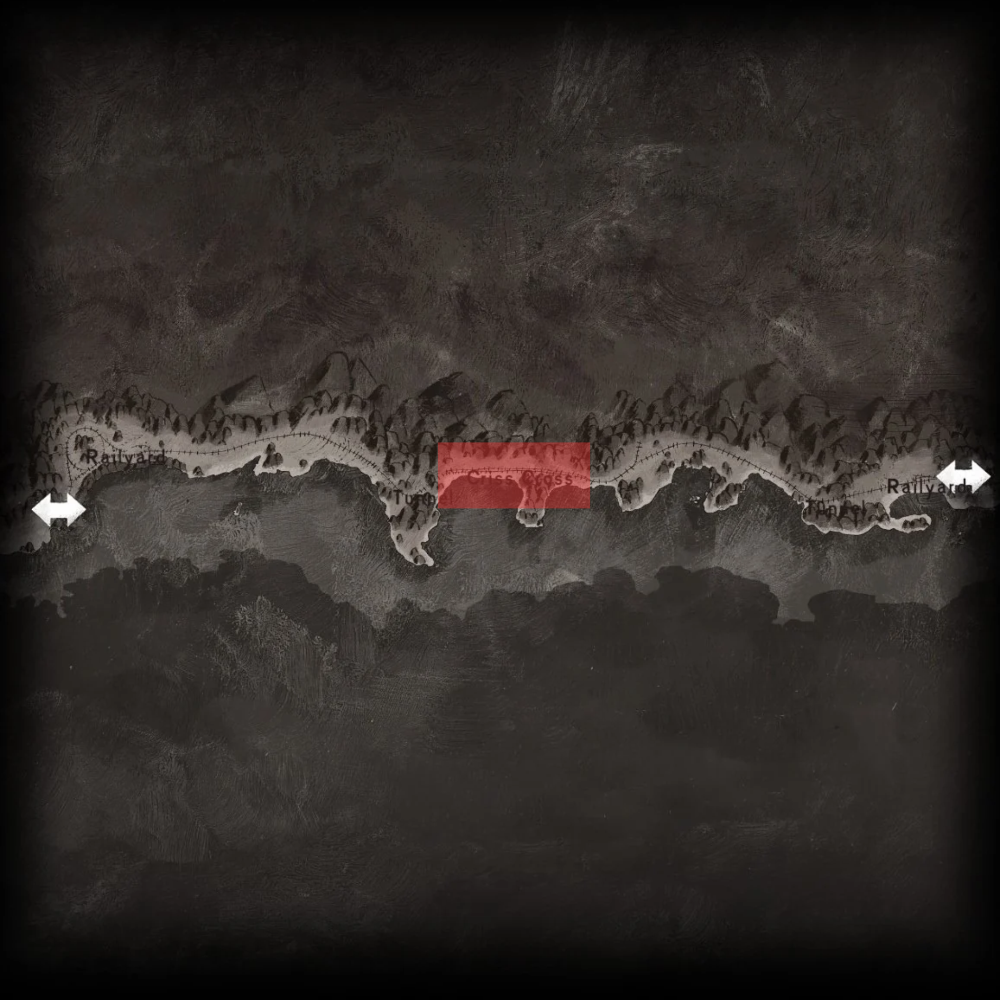

# Criss Cross

**Categories:** DLC Content, Locations, Locations in Anna Island -- Track Section 2, Outdoor locations · **Source:** [Fandom](https://thelongdark.fandom.com/wiki/Criss_Cross)

_Seal\_icon.png_

**DLC-Exclusive content.** / This content requires the [Iron Road](./Iron%20Road.md) addon to be installed before it can be seen or used in regular gameplay.

 / **Criss Cross** /  / _Criss\_Cross.jpg_ / **Location** /  / _Criss\_Cross\_Location.png_ / **Region:** [Anna Island -- Track Section 2](./Anna%20Island%20--%20Track%20Section%202.md)\\|- / **Description:** 2 sets of train tracks with track switchers / **General** / Has no shelter\ **Criss Cross** is a location in [Anna Island -- Track Section 2](./Anna%20Island%20--%20Track%20Section%202.md).

## Overview
