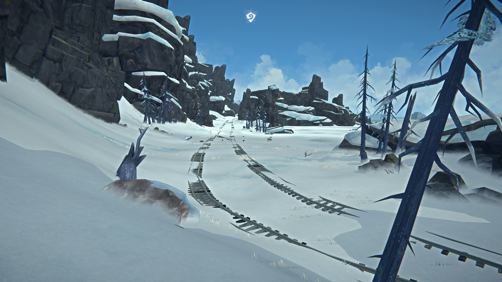

# Criss Cross

| Column 1 | Column 2 | Column 3 |
| --- | --- | --- |
|  / *Seal\_icon.png* | **DLC-Exclusive content.** / This content requires the [Iron Road](./Iron%20Road.md) addon to be installed before it can be seen or used in regular gameplay. | \|} / **Criss Cross** / \| Property \| Details \| / \| --- \| --- \| / \|  \|  / *Criss\_Cross.jpg* \| / \| **Location** \|  \| / \|  \|  / *Criss\_Cross\_Location.png* \| / \| Region \| [Anna Island -- Track Section 2](./Anna%20Island%20--%20Track%20Section%202.md)\\|- \| / \| Description \| 2 sets of train tracks with track switchers \| / \| **General** \|  \| / \|  \| Has no shelter\\|} **Criss Cross** is a location in [Anna Island -- Track Section 2](./Anna%20Island%20--%20Track%20Section%202.md). / ## Overview / Located in the middle of the map, Criss Cross is a set of 2 parallel tracks with 4 train switch paths. Some Damaged Rails can be found on the side closest to the mountains than can be repaired or avoided.**Lua execution error in Module:Navbox function navbox** \| |
|  / *Criss\_Cross.jpg* |  |  |
| **Location** |  |  |
|  / *Criss\_Cross\_Location.png* |  |  |
| Region | [Anna Island -- Track Section 2](./Anna%20Island%20--%20Track%20Section%202.md)\|- |  |
| Description | 2 sets of train tracks with track switchers |  |
| **General** |  |  |
|  | Has no shelter\|} **Criss Cross** is a location in [Anna Island -- Track Section 2](./Anna%20Island%20--%20Track%20Section%202.md). / ## Overview / Located in the middle of the map, Criss Cross is a set of 2 parallel tracks with 4 train switch paths. Some Damaged Rails can be found on the side closest to the mountains than can be repaired or avoided.**Lua execution error in Module:Navbox function navbox** |  |
