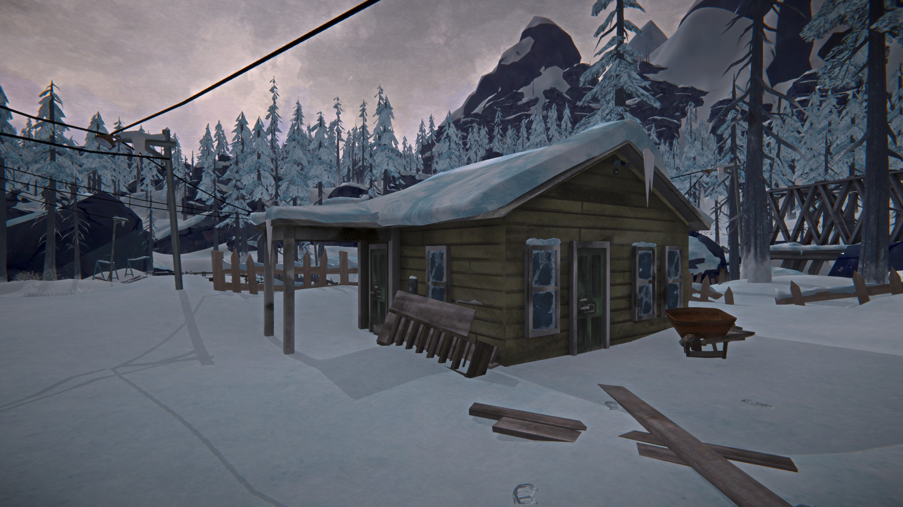
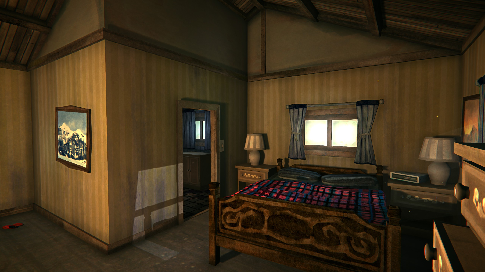
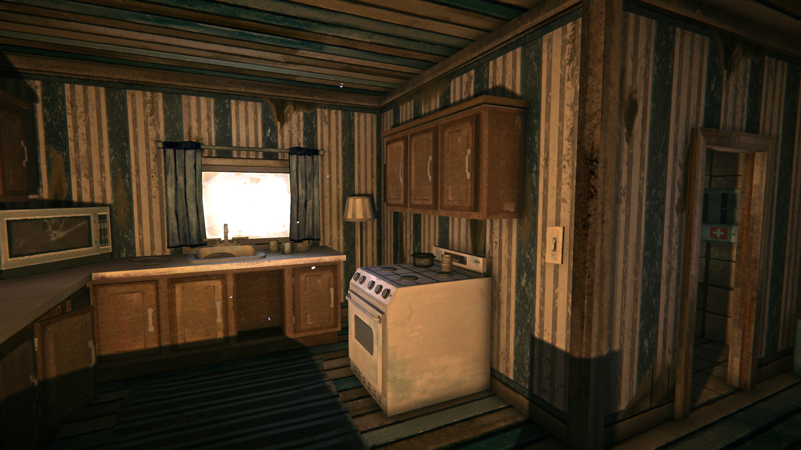
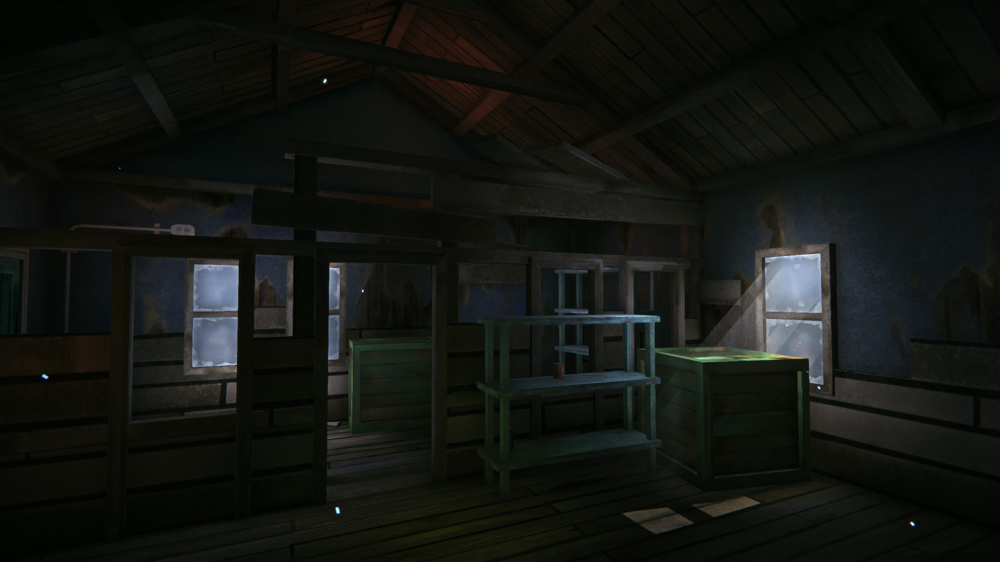

# Crossroads House

**Contents**

- [Overview](#overview)
- [1 Story House](#1-story-house)
- [2 Story House](#2-story-house)
- [Shed](#shed)

**Crossroads House**

| Property | Details |
| --- | --- |
| \[\[File: / \|  / *1 story* \|  / *Shed* \| / \| --- \| --- \| | 250px\]\] |
|  / *1 story* |  / *Shed* |
| **Location** |  |
| Region | [Pleasant Valley](./Pleasant%20Valley.md)\|- / Location |
| **General** |  |
| Type | Residential\|- / Firebox |
|  / *bed\_icon.png* | Has a bed |
|  | Has an interior\|} A **Crossroads House**is a type of house or shed found throughout the [Thomson's Crossing](./Thomson%27s%20Crossing.md) town in the [Pleasant Valley](./Pleasant%20Valley.md) region. Many of these buildings have the same layout as the [Coastal House](./Coastal%20House.md) and [Milton House](./Milton%20House.md). / ## Overview / Some of the buildings in the town are boarded up or destroyed. The homes closest to the [Community Hall](./Community%20Hall.md) are in relatively good shape, but the ones across the bridge on the road to the [Cinder Hills Coal Mine](./Cinder%20Hills%20Coal%20Mine.md) tend to be boarded up and seized by the bank or ruined, but occasionally the house across the bridge is intact. The name "Crossroads House" comes from the former name of [Thomson's Crossing](./Thomson%27s%20Crossing.md), Rural Crossroads. / 4 buildings around the townsite can become Crossroads Houses: / - 3 across the main town / - 1 across the bridge near the hills / Crossroads Houses appear as 3 types of buildings: / ### 1 Story House / \| Column 1 \| Column 2 \| Column 3 \| / \| --- \| --- \| --- \| / \|  / *Crossroads\_House\_1.jpg* \|  / *Kitchen* \|  / *Bedroom and Bathroom* \| / This type of building has only 1 floor, with 1 door leading to the kitchen. They are composed of: / - A kitchen with a [Pot Belly Stove](./Pot%20Belly%20Stove.md), [Fridge](./Fridge.md), [Freezer](./Freezer.md), [Oven](./Oven.md), and [Drawers](./Drawer.md) / - A bedroom with a [Bed](./Bed.md) and Clothing Drawers / - A bathroom next to the bedroom / The layout for this building has 2 different layouts, but tends to be filled with large amounts of food and [Cooking Pots](./Cooking%20Pot.md). / ### 2 Story House / \| Column 1 \| Column 2 \| Column 3 \| / \| --- \| --- \| --- \| / \|  / *Front hallway* \|  / *Kitchen and bathroom* \|  / *Upstairs bedroom* \| / These homes are much smaller buildings with a single door leading to the front hallway. They have a stairwell that leads the bedroom, with the ground floor containing a kitchen and nearby bathroom. / ### Shed / \|  / *Shed* \|  / *Inside* \| / \| --- \| --- \| / A few buildings are small tool sheds, with 2 doors for entering. They tend to contain a [Metal Shelf](./Metal%20Shelf.md) often holding a [Metal Container](./Metal%20Container.md) or other tools, [Crates](./Crate.md), [Planks](./Planks.md), and [Reclaimed Wood](./Reclaimed%20Wood.md). **Lua execution error in Module:Navbox function navbox** |
|  / *Crossroads\_House\_1.jpg* |  / *Kitchen* /  / *Bedroom and Bathroom* |
|  / *Front hallway* |  / *Kitchen and bathroom* /  / *Upstairs bedroom* |
|  / *Shed* |  / *Inside* |
