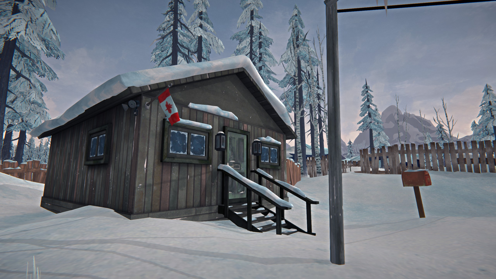
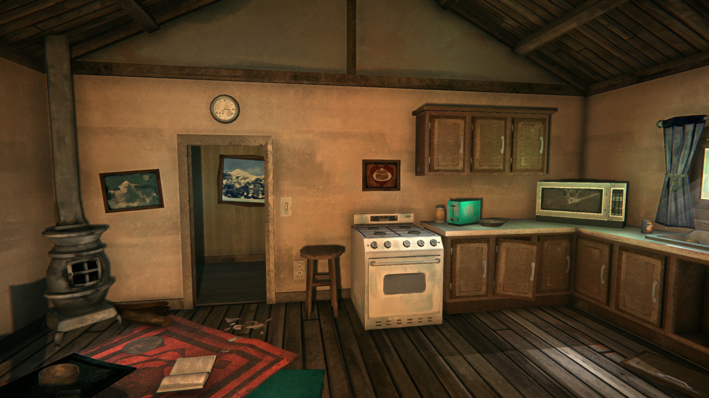
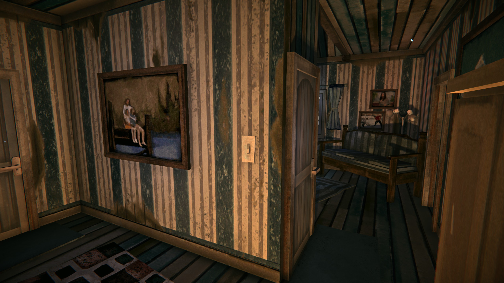
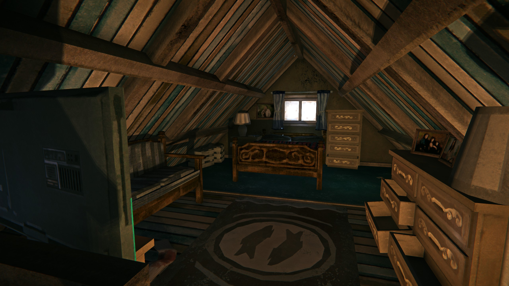

# Crossroads House

**Categories:** Indoor locations, Locations, Locations in Pleasant Valley, Residential locations · **Source:** [Fandom](https://thelongdark.fandom.com/wiki/Crossroads_House)

**Contents**

- [Overview](#overview)
- [1 Story House](#1-story-house)
- [2 Story House](#2-story-house)
- [Shed](#shed)

**Crossroads House**

\[\[File: /  / _1 story_ /  / _Shed_

250px\]\]

_1 story_

_Shed_

**Location**

Region

[Pleasant Valley](./Pleasant%20Valley.md)\|-

Location

**General**

Type

Residential\|-

Firebox

_bed\_icon.png_

Has a bed

_Crossroads\_House\_1.jpg_

_Kitchen_

_Bedroom and Bathroom_

_Front hallway_

_Kitchen and bathroom_

_Upstairs bedroom_

_Shed_

_Inside_
