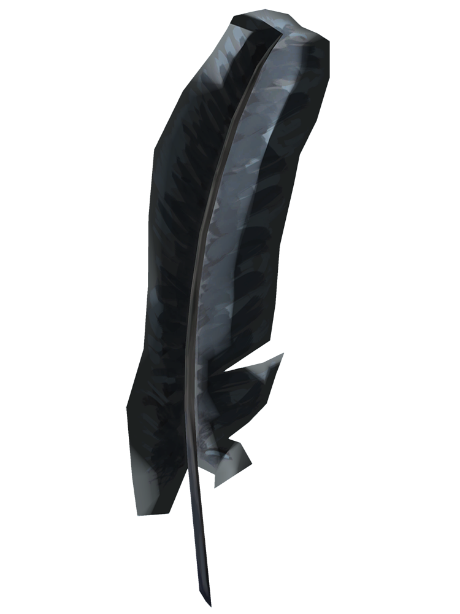

# Crow Feather

**Categories:** Materials · **Source:** [Fandom](https://thelongdark.fandom.com/wiki/Crow_Feather)

**Contents**

- [Overview](#overview)
- [Products](#products)
- [Gallery](#gallery)
- [Game history](#game-history)

**Crow Feather**

_Crow\_Feather\_icon.png_

**General**

**Item Type:** Material\|-

**Renewable:** Yes

**Statistics**

**Weight:** 0.01 kg(0.02 lbs)

**Calories:**  calories

Harvest

Repair

> “**A feather from a Crow. Add it to an Arrow Shaft to make a useable, stabilized arrow.**”
>
> — In-game description

The **crow feather** is a material item in _[The Long Dark](./The%20Long%20Dark.md)._

## Overview

Feathers are used to create [arrows](./Simple%20Arrow.md) and [fire hardened arrows](./Fire%20Hardened%20Arrow.md).

They are dropped by [crows](./Crow.md), and are usually found near animal carcasses (except for small game like [ptarmigans](./Ptarmigan.md) and [rabbits](./Rabbit.md)) and human [corpses](./Frozen%20Corpse.md). Feathers usually respawn after a few days. They also tend to respawn after a blizzard, which causes crows to disappear and subsequently reappear afterwards. Additionally, as long as large game animal carcasses have something left to harvest, they will continue attract crows until they decay. Thus they can be used as an easy, if temporary source of feathers. Freshly hunted game will generate roughly 2 feathers per hour, even while being harvested/quartered.

As a feather touches the ground, it makes a small sound that can be heard if nearby.

## Products

## Gallery

_Old model._

## Game history

- Crow feathers were introduced on 22 May 2015 in [version 0.233](./The%20Long%20Dark%20%E2%80%94%20Changelog.md#0.233).
