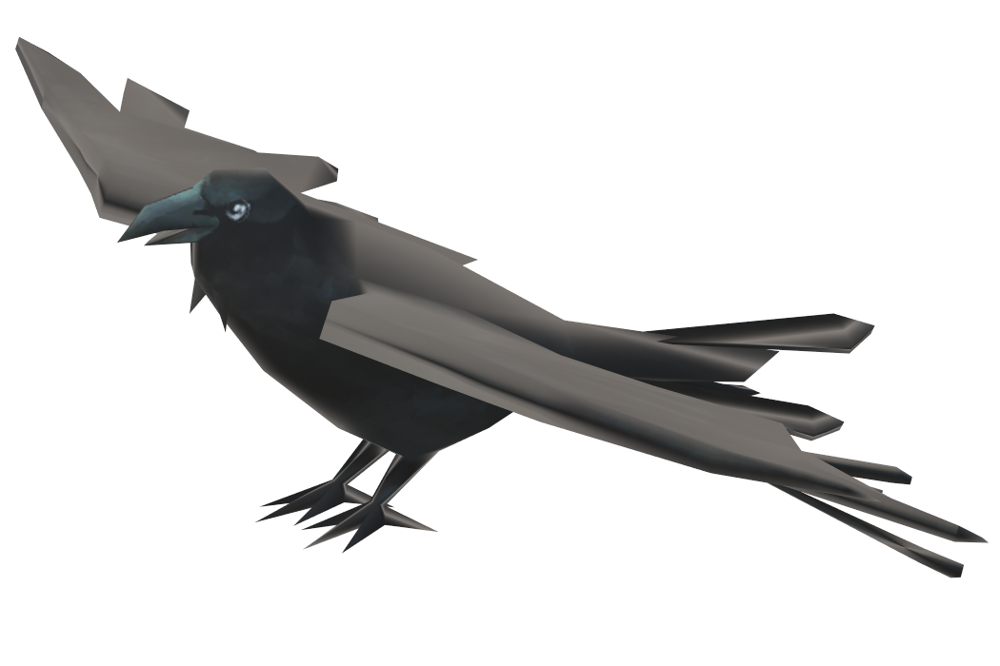
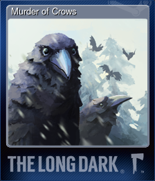

# Crow

**Contents**

- [Overview](#Overview)
- [Drops](#Drops)
- [Behavior](#Behavior)
- [Trivia](#Trivia)
- [Gallery](#Gallery)
- [Update history](#Update_history)

<table class="infobox">
<caption>Crow</caption>
<colgroup>
<col style="width: 50%" />
<col style="width: 50%" />
</colgroup>
<tbody>
<tr>
<td colspan="2"><figure>

<figcaption>Crow.png</figcaption>
</figure></td>
</tr>
<tr>
<td colspan="2" class="section">
<strong>Basic Information</strong>
</td>
</tr>
<tr>
<td>
Release
</td>
<td>
<a href="./The%20Long%20Dark%20%E2%80%94%20Changelog.md#0.01" class="wikilink" title="12 June 2014">12 June 2014</a>
</td>
</tr>
<tr>
<td>
Role
</td>
<td>
Scavenger
</td>
</tr>
<tr>
<td colspan="2" class="section">
<strong>Physical Information</strong>
</td>
</tr>
<tr>
<td>
Color
</td>
<td>
Black
</td>
</tr>
<tr>
<td>
Size
</td>
<td>
Small
</td>
</tr>
<tr>
<td>
Eyes
</td>
<td>
Black
</td>
</tr>
</tbody>
</table>

<table>
<colgroup>
<col style="width: 33%" />
<col style="width: 33%" />
<col style="width: 33%" />
</colgroup>
<tbody>
<tr>
<td style="vertical-align: top; font-size: 3em; color: #5d5980; padding-right: 10px">
“
</td>
<td>
Pay attention to your surroundings and you might glean information that's important for your survival. For example, a murder of Crows circling up ahead might suggest an animal carcass -- or even a human corpse -- might be nearby!

&#10;

"Crows" - Game tutorial tip

</td>
<td style="vertical-align: bottom; font-size: 3em; color: #5d5980; padding-left: 10px">
”
</td>
</tr>
</tbody>
</table>

**Crows** are non-interactable, animated <a href="./Wildlife.md" class="wikilink" title="wildlife">wildlife</a> objects in <a href="./The%20Long%20Dark.md" class="wikilink" title="The Long Dark">The Long Dark</a>.

## Overview

Crows are flying black birds with conspicuously loud cries. They never land and their primary purpose is to draw the player to certain areas of interest. Crows cannot be harmed with projectiles from <a href="./Revolver.md" class="wikilink" title="revolvers">revolvers</a>, <a href="./Hunting%20Rifle.md" class="wikilink" title="hunting rifles">hunting rifles</a>, <a href="./Survival%20Bow.md" class="wikilink" title="bows">bows</a>, and <a href="./Distress%20Pistol.md" class="wikilink" title="flare guns">flare guns</a>, and they cannot be harmed with thrown objects such as <a href="./Flare.md" class="wikilink" title="flares">flares</a>, <a href="./Torch.md" class="wikilink" title="torches">torches</a>, and <a href="./Stone.md" class="wikilink" title="stones">stones</a> (if they are low enough to the ground that is) as they do not technically have collision models/death animations.

## Drops

Periodically, <a href="./Crow%20Feather.md" class="wikilink" title="Crow Feathers">Crow Feathers</a> will fall to the ground underneath circling Crows (1 Feather will fall per crow flying overhead). Once on the ground, the feathers remain until picked up, making these locations valuable as the only source of crow feathers for <a href="./Crafting.md" class="wikilink" title="Crafting">Crafting</a>.

<table>
<colgroup>
<col style="width: 25%" />
<col style="width: 25%" />
<col style="width: 25%" />
<col style="width: 25%" />
</colgroup>
<thead>
<tr>
<th></th>
<th>
Carcass
</th>
<th>
Quantity
</th>
<th>
Rarity
</th>
</tr>
</thead>
<tbody>
<tr>
<td><figure>

<figcaption>Crow_Feather_icon.png</figcaption>
</figure></td>
<td>
<a href="./Rabbit%20Carcass.md" class="wikilink" title="Rabbit Carcass">Rabbit Carcass</a>
</td>
<td>
0
</td>
<td>
Always
</td>
</tr>
<tr>
<td><figure>

<figcaption>Crow_Feather_icon.png</figcaption>
</figure></td>
<td>
<a href="./Ptarmigan%20Carcass.md" class="wikilink" title="Ptarmigan Carcass">Ptarmigan Carcass</a>
</td>
<td>
0
</td>
<td>
Always
</td>
</tr>
<tr>
<td><figure>

<figcaption>Crow_Feather_icon.png</figcaption>
</figure></td>
<td>
<a href="./Frozen%20Corpse.md" class="wikilink" title="Frozen Corpse">Frozen Corpse</a>
</td>
<td>
3-4
</td>
<td>
Always
</td>
</tr>
<tr>
<td><figure>

<figcaption>Crow_Feather_icon.png</figcaption>
</figure></td>
<td>
<a href="./Wolf%20Carcass.md" class="wikilink" title="Wolf Carcass">Wolf Carcass</a>
</td>
<td>
3
</td>
<td>
Always
</td>
</tr>
<tr>
<td><figure>

<figcaption>Crow_Feather_icon.png</figcaption>
</figure></td>
<td>
<a href="./Timberwolf%20Carcass.md" class="wikilink" title="Timberwolf Carcass">Timberwolf Carcass</a>
</td>
<td>
3
</td>
<td>
Always
</td>
</tr>
<tr>
<td><figure>

<figcaption>Crow_Feather_icon.png</figcaption>
</figure></td>
<td>
<a href="./Poisoned%20Wolf%20Carcass.md" class="wikilink" title="Poisoned Wolf Carcass">Poisoned Wolf Carcass</a>
</td>
<td>
3
</td>
<td>
Always
</td>
</tr>
<tr>
<td><figure>

<figcaption>Crow_Feather_icon.png</figcaption>
</figure></td>
<td>
<a href="./Deer%20Carcass.md" class="wikilink" title="Deer Carcass">Deer Carcass</a>
</td>
<td>
4
</td>
<td>
Always
</td>
</tr>
<tr>
<td><figure>

<figcaption>Crow_Feather_icon.png</figcaption>
</figure></td>
<td>
<a href="./Cougar%20Carcass.md" class="wikilink" title="Cougar Carcass">Cougar Carcass</a>
</td>
<td>
4
</td>
<td>
Always
</td>
</tr>
<tr>
<td><figure>

<figcaption>Crow_Feather_icon.png</figcaption>
</figure></td>
<td>
<a href="./Black%20Bear%20Carcass.md" class="wikilink" title="Black Bear Carcass">Black Bear Carcass</a>
</td>
<td>
5
</td>
<td>
Always
</td>
</tr>
<tr>
<td><figure>

<figcaption>Crow_Feather_icon.png</figcaption>
</figure></td>
<td>
<a href="./Moose%20Carcass.md" class="wikilink" title="Moose Carcass">Moose Carcass</a>
</td>
<td>
5
</td>
<td>
Always
</td>
</tr>
<tr>
<td><figure>

<figcaption>Crow_Feather_icon.png</figcaption>
</figure></td>
<td>
<a href="./Ravaged%20Deer%20Remains.md" class="wikilink" title="Ravaged Deer Remains">Ravaged Deer Remains</a>
</td>
<td>
1-2
</td>
<td>
Always
</td>
</tr>
</tbody>
</table>

## Behavior

Crows will appear circling over frozen corpses and animal carcasses during calm weather. Their loud cries are intended to call the player's attention to the area so it will not likely be missed, however, they may be difficult to spot due to trees or terrain obscuring them.

Aggressive crow calls distinct from those made by circling or passing crows can be heard in the vicinity of a <a href="./Bear.md" class="wikilink" title="Bear">Bear</a>, but no crows will actually be visible. This sound may also be heard around dead bears as well, making locating a fresh bear carcass somewhat easier, as they can then be "heard" in addition to being seen.

Crows will disappear when high winds or snow strike and reappear when weather clears. Once a non-human carcass has disappeared after decaying or being fully harvested, the circling crows will disappear with it.

Occasionally a group of crows will be seen flying in "V" formation in a straight path across the map. The timing of their flight has no significance and is purely cosmetic.

## Trivia

- Crows appear to be based off the [American Crow](https://en.wikipedia.org/wiki/American_crow) (***Corvus brachyrhynchos***), a species of Passeriformes found all across North America.
- In various points throughout <a href="./Episode%203%20-%20Crossroads%20Elegy.md" class="wikilink" title="Episode 3: Crossroads Elegy">Episode 3: Crossroads Elegy</a>, a single crow can be spotted perched upon an object (such as a log or stump) in area the player is required to pass through. The crow remain in place but will fly off when approached, and like all crows cannot be harmed. This is the only time a single crow appears by itself, as they typically fly around the map/ fly over dead bodies in groups only.

## Gallery

<table class="gallery">
<colgroup>
<col style="width: 25%" />
<col style="width: 25%" />
<col style="width: 25%" />
<col style="width: 25%" />
</colgroup>
<tbody>
<tr>
<td><figure>

<figcaption>Steam Trading Card</figcaption>
</figure></td>
<td><figure>
[Missing image: Muder_of_Crows_Steam_Card.jpg]
<figcaption>Ditto, full screen</figcaption>
</figure></td>
<td><figure>
[Missing image: Steam_Crow_Badge.png]
<figcaption>Steam Badge</figcaption>
</figure></td>
<td><figure>
[Missing image: Crows.jpg]
<figcaption>Crows circle above a frozen corpse.</figcaption>
</figure></td>
</tr>
<tr>
<td><figure>
[Missing image: Crows_against_the_sun.jpg]
<figcaption>Crows in the sky against the sun, circle above a corpse.</figcaption>
</figure></td>
<td></td>
<td></td>
<td></td>
</tr>
</tbody>
</table>

## Update history

- UPDATE **14 June 2018 (<a href="./The%20Long%20Dark%20%E2%80%94%20Changelog.md#1.33" class="wikilink" title="Update">Update</a>):**
  - \[All\] Fixed Crows spawning below ground.

<!-- -->

- HOTFIX **20 March 2018 (<a href="./The%20Long%20Dark%20%E2%80%94%20Changelog.md#1.27" class="wikilink" title="Update">Update</a>):**
  - \[Wintermute\] Fixed issue where crows would circle locations with no corpses present.
  - \[Both\] Crows will no longer sometimes fly too low and into the ground as the weather changes.

<!-- -->

- HOTFIX **30 April 2016 (<a href="./The%20Long%20Dark%20%E2%80%94%20Early%20Access%20Changelog.md#0.332" class="wikilink" title="Update">Update</a>):**
  - Fixed issue that could cause large numbers of crows and crow feathers to spawn in specific locations.

<!-- -->

- UPDATE **22 May 2015 (<a href="./The%20Long%20Dark%20%E2%80%94%20Early%20Access%20Changelog.md#0.233" class="wikilink" title="Update">Update</a>):**
  - \[Minor\] Crows can now drop Crow Feathers.

<!-- -->

- HOTFIX **3 December 2014 (<a href="./The%20Long%20Dark%20%E2%80%94%20Early%20Access%20Changelog.md#0.170" class="wikilink" title="Update">Update</a>):**
  - Added new Crow model and animations.

<!-- -->

- UPDATE **22 July 2014 (<a href="./The%20Long%20Dark%20%E2%80%94%20Early%20Access%20Changelog.md#0.065" class="wikilink" title="Update">Update</a>):**
  - Added to game.

**Lua execution error in Module:Navbox function navbox**

<a href="ru:%D0%92%D0%BE%D1%80%D0%BE%D0%BD" class="wikilink" title="ru:Ворон">ru:Ворон</a>

