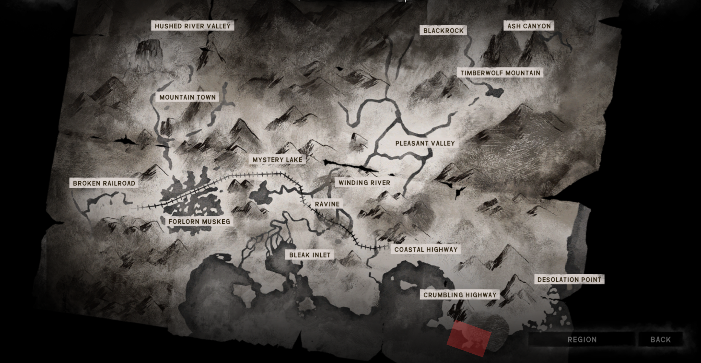
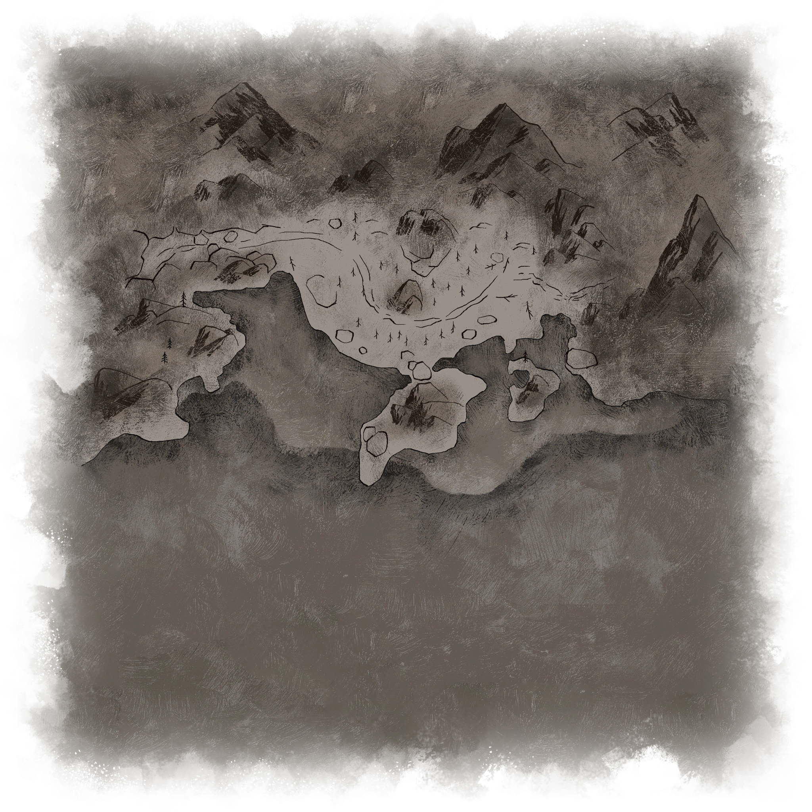
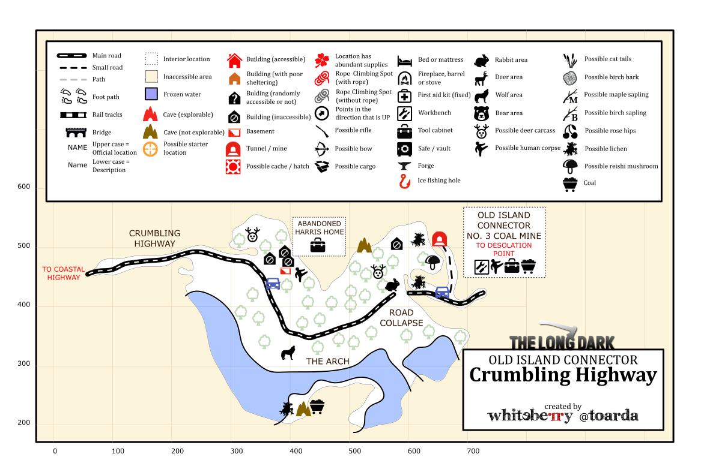
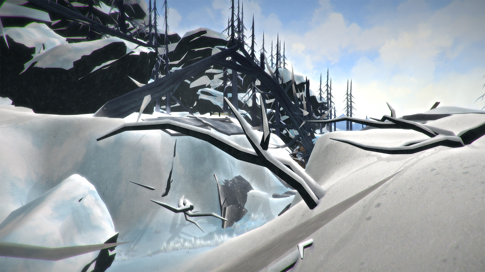
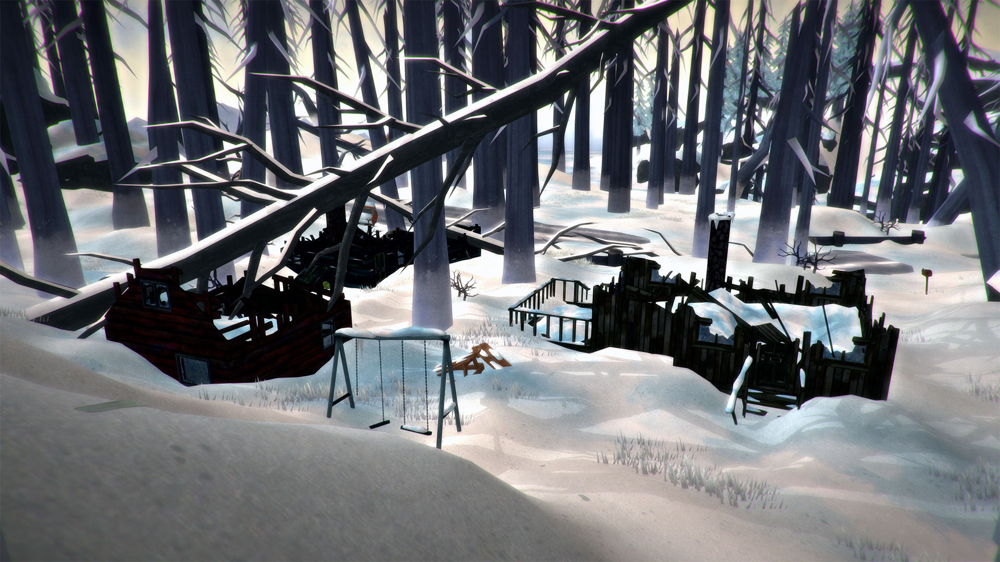
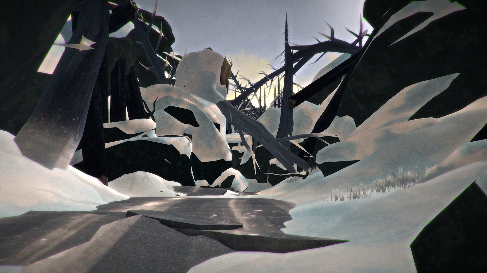

# Crumbling Highway

**Categories:** Transition zones · **Source:** [Fandom](https://thelongdark.fandom.com/wiki/Crumbling_Highway)

**Crumbling Highway**

_RegionAtlas-resources.assets-562\_(3).png_

**Location on [Great Bear Island](./Great%20Bear%20Island.md)**

_Crumbling\_Highway\_Location.png_

_Old\_Island\_Connector\_map.png_

**Details**

**Description:** A transition zone between [Coastal Highway](./Coastal%20Highway.md) and [Desolation Point](./Desolation%20Point.md) featuring the ruins of the [Great Bear Highway](./Great%20Bear%20Highway.md).

**Connecting Regions:** [Coastal Highway](./Coastal%20Highway.md), / [Desolation Point](./Desolation%20Point.md)

**Locations:** 5

**Crumbling Highway** (also known as the **Old Island Connector**) is the 3rd Transition Zone [Region](./Region.md) released for _[The Long Dark](./The%20Long%20Dark.md)_. It connects [Coastal Highway](./Coastal%20Highway.md) and [Desolation Point](./Desolation%20Point.md). It is the smallest outdoor map in the game.

The eastern end of the area sits [No. 3 Coal Mine](./No.%203%20Coal%20Mine.md), which leads to Desolation Point. On the western side of the region lies an entrance to Coastal Highway. A frozen coastline curves along the south side of the road.

There is also a relatively large amount of fuel and medicinal resources scattered about, as well as two vehicles and two shallow caves.

## Wildlife Availability

2 types of animals can be found in the region, [Rabbit](./Rabbit.md) and [Wolves](./Wolf.md).

A couple of wolves patrol this zone in 3 different areas. Because the region is so compact, it can be difficult to bypass predators without taking extra precautions.

One or two [Deer Carcasses](./Deer%20Carcass.md) can sometimes spawn in the region.

## Locations

This transition zone has 5 named locations to discover.

- [Road Collapse](./Road%20Collapse.md)
- [Abandoned Harris Home](./Abandoned%20Harris%20Home.md)
- [The Arch](./The%20Arch%20%28Old%20Island%20Connector%20location%29.md)
- To Coastal Highway (Transition to [Coastal Highway](./Coastal%20Highway.md))
- To No. 3 Coal Mine (Transition to [No. 3 Coal Mine](./No.%203%20Coal%20Mine.md))

There are also 2 unmarked locations in the region.

- [Basement (Crumbling Highway)](./Basement%20%28Crumbling%20Highway%29.md) (unmarked indoor location tracked in the [Journal](./Journal.md))
- 2 [Warm Caves](./Warm%20Cave.md) that can be found near Road Collapse and The Arch.

## Gallery

_A detailed map of Crumbling Highway (all difficulties) v2.35_

_An outdated map of Crumbling Highway v1.93_

_An outdated map of Crumbling Highway_

_Road Collapse._

_An alternative view of Road Collapse._

_Abandoned Harris Home._

_An alternative view of Abandoned Harris Home._

_A view of Crumbling Highway from Coastal Highway entrance._

_An alternative view of Crumbling Highway from Coastal Highway entrance._

_A view of the entrance to Abandoned Mine No.3 (West)._
