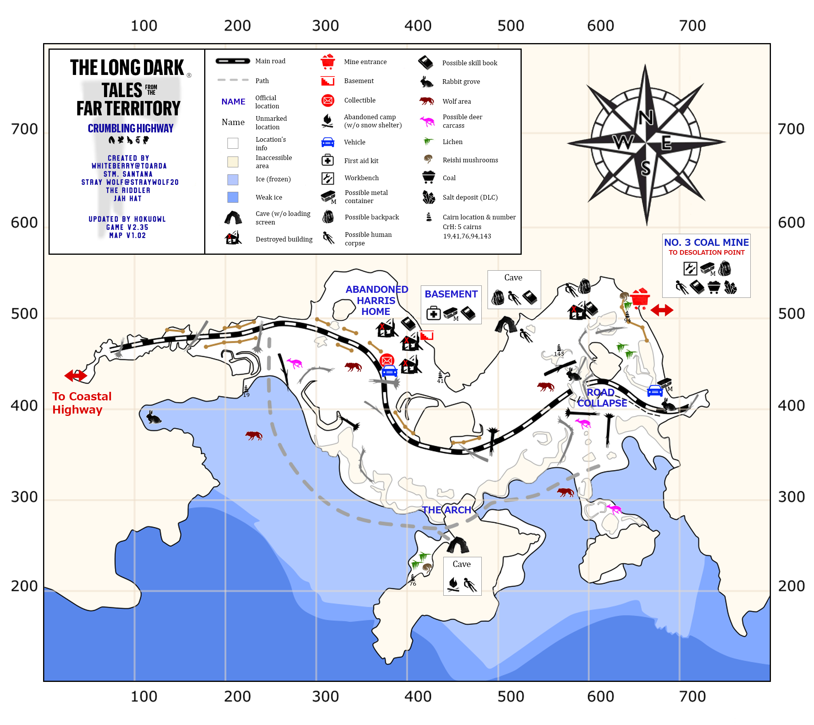
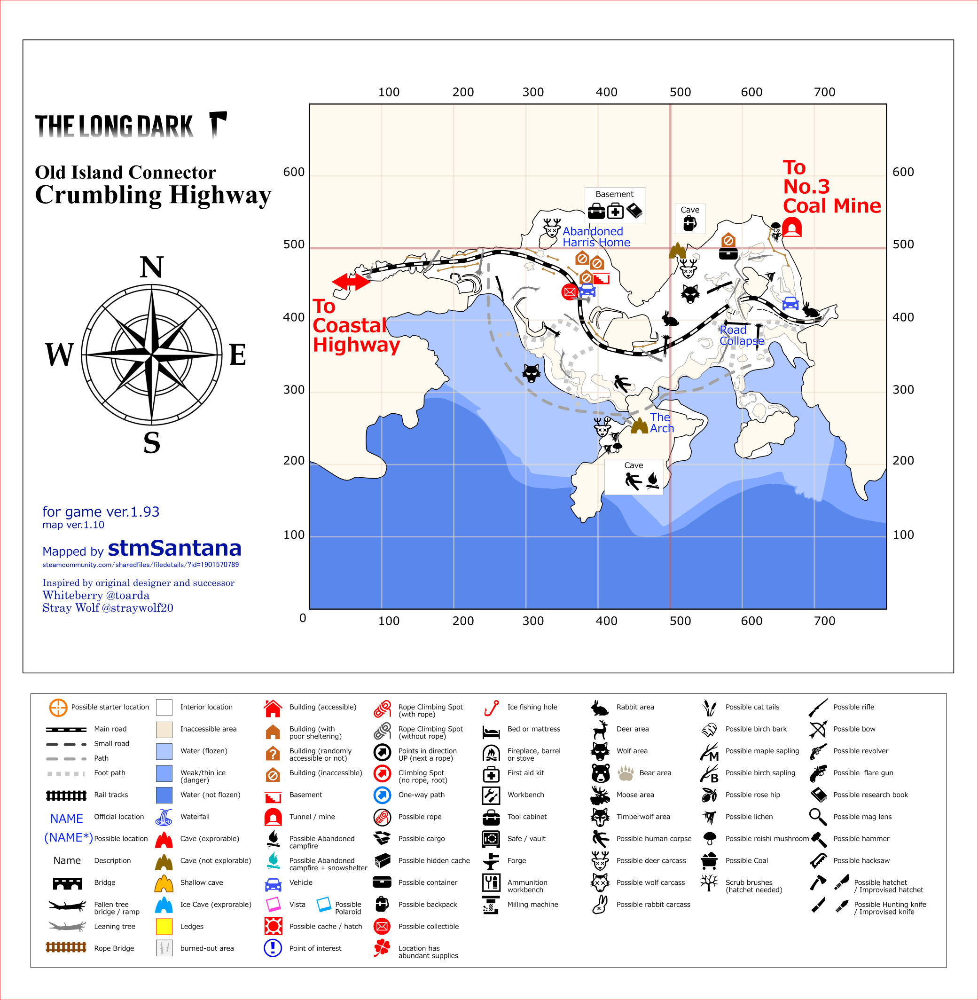
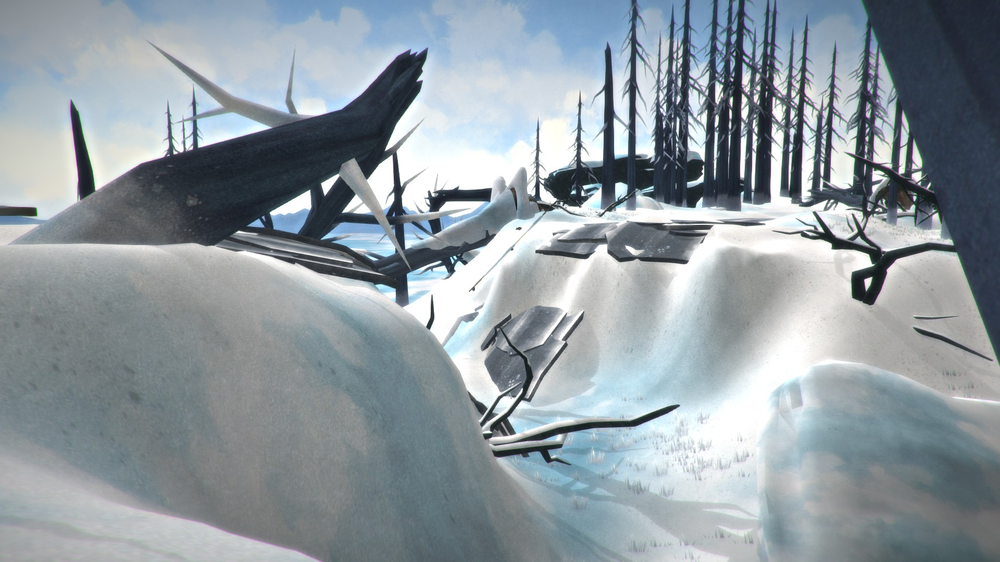
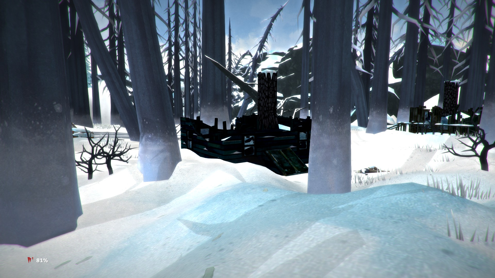
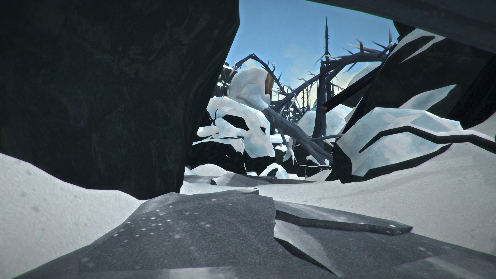

# Crumbling Highway

**Crumbling Highway**

| Property | Details |
| --- | --- |
|  |  / *RegionAtlas-resources.assets-562\_(3).png* |
| **Location on [Great Bear Island](./Great%20Bear%20Island.md)** |  |
|  |  / *Crumbling\_Highway\_Location.png* |
|  |  / *Old\_Island\_Connector\_map.png* |
| **Details** |  |
| Description | A transition zone between [Coastal Highway](./Coastal%20Highway.md) and [Desolation Point](./Desolation%20Point.md) featuring the ruins of the [Great Bear Highway](./Great%20Bear%20Highway.md). |
| Connecting Regions | [Coastal Highway](./Coastal%20Highway.md), / [Desolation Point](./Desolation%20Point.md) |
| Locations | 5 |

**Crumbling Highway** (also known as the **Old Island Connector**) is the 3rd Transition Zone [Region](./Region.md) released for *[The Long Dark](./The%20Long%20Dark.md)*. It connects [Coastal Highway](./Coastal%20Highway.md) and [Desolation Point](./Desolation%20Point.md). It is the smallest outdoor map in the game.

The eastern end of the area sits [No. 3 Coal Mine](./No.%203%20Coal%20Mine.md), which leads to Desolation Point. On the western side of the region lies an entrance to Coastal Highway. A frozen coastline curves along the south side of the road.

There is also a relatively large amount of fuel and medicinal resources scattered about, as well as two vehicles and two shallow caves.

## Wildlife Availability

2 types of animals can be found in the region, [Rabbit](./Rabbit.md) and [Wolves](./Wolf.md).

A couple of wolves patrol this zone in 3 different areas. Because the region is so compact, it can be difficult to bypass predators without taking extra precautions.

One or two [Deer Carcasses](./Deer%20Carcass.md) can sometimes spawn in the region.

## Locations

This transition zone has 5 named locations to discover.

- [Road Collapse](./Road%20Collapse.md)
- [Abandoned Harris Home](./Abandoned%20Harris%20Home.md)
- [The Arch](./The%20Arch%20%28Old%20Island%20Connector%20location%29.md)
- To Coastal Highway (Transition to [Coastal Highway](./Coastal%20Highway.md))
- To No. 3 Coal Mine (Transition to [No. 3 Coal Mine](./No.%203%20Coal%20Mine.md))

There are also 2 unmarked locations in the region.

- [Basement (Crumbling Highway)](./Basement%20%28Crumbling%20Highway%29.md) (unmarked indoor location tracked in the [Journal](./Journal.md))
- 2 [Warm Caves](./Warm%20Cave.md) that can be found near Road Collapse and The Arch.

## Gallery

| Column 1 | Column 2 | Column 3 | Column 4 |
| --- | --- | --- | --- |
|  / *A detailed map of Crumbling Highway (all difficulties) v2.35* |  / *An outdated map of Crumbling Highway v1.93* |  / *An outdated map of Crumbling Highway* |  / *Road Collapse.* |
|  / *An alternative view of Road Collapse.* |  / *Abandoned Harris Home.* |  / *An alternative view of Abandoned Harris Home.* |  / *A view of Crumbling Highway from Coastal Highway entrance.* |
|  / *An alternative view of Crumbling Highway from Coastal Highway entrance.* |  / *A view of the entrance to Abandoned Mine No.3 (West).* |  |  |

**Lua execution error in Module:Navbox function navbox** **Lua execution error in Module:Navbox function navbox**

[es:Autovía derruida](es:Autov%C3%ADa_derruida) [ru:Старый остров между зонами](ru:%D0%A1%D1%82%D0%B0%D1%80%D1%8B%D0%B9_%D0%BE%D1%81%D1%82%D1%80%D0%BE%D0%B2_%D0%BC%D0%B5%D0%B6%D0%B4%D1%83_%D0%B7%D0%BE%D0%BD%D0%B0%D0%BC%D0%B8)
