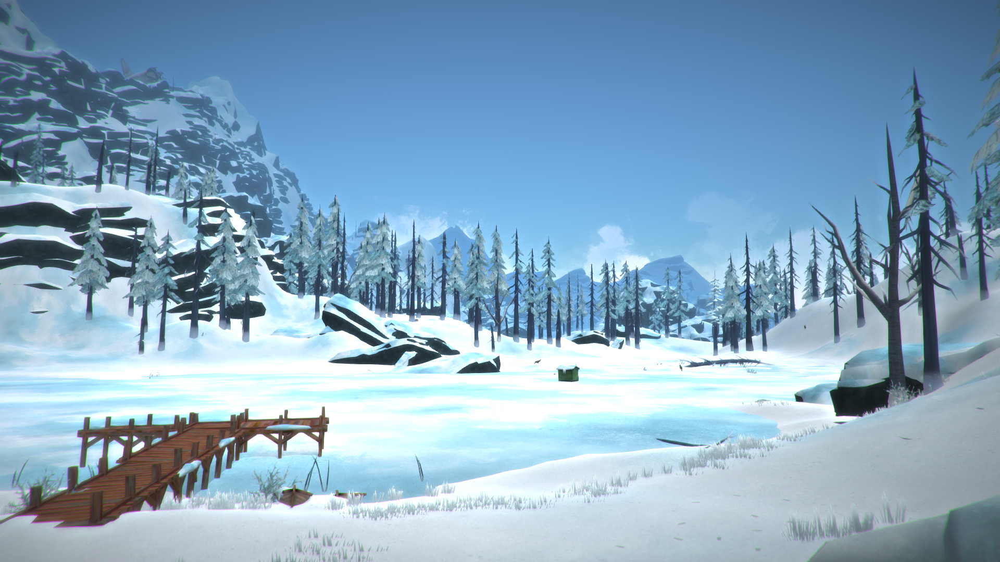
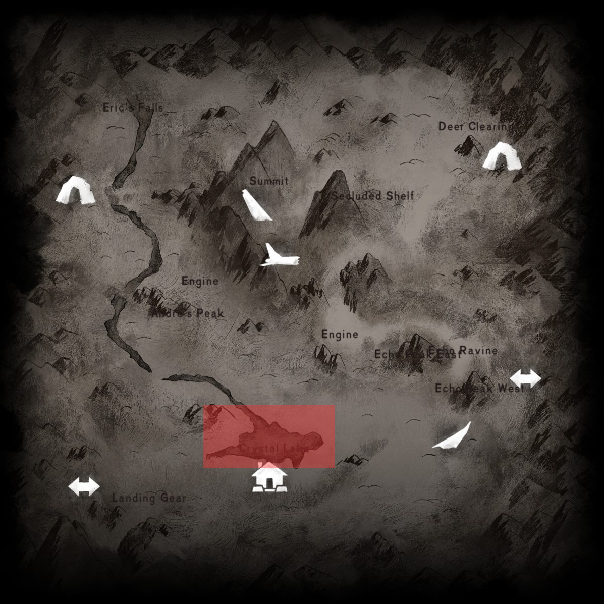

# Crystal Lake

**Crystal Lake**

| Property | Details |
| --- | --- |
|  |  / *Crystal\_Lake.png* |
| **Location** |  |
|  |  / *Crystal\_Lake\_Location.png* |
| Region | [Timberwolf Mountain](./Timberwolf%20Mountain.md)\|- |
| Description | A small freshwater lake |
| **General** |  |
| Type | Outdoors\|- |
