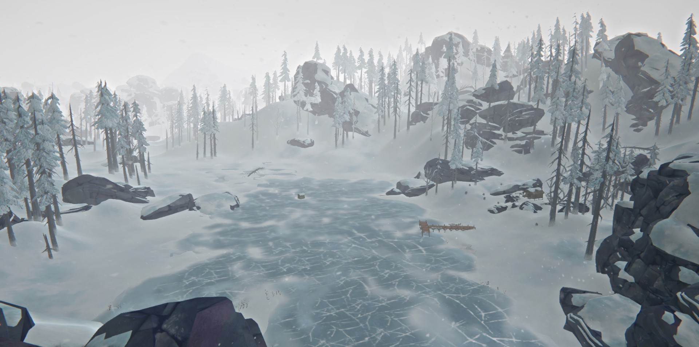
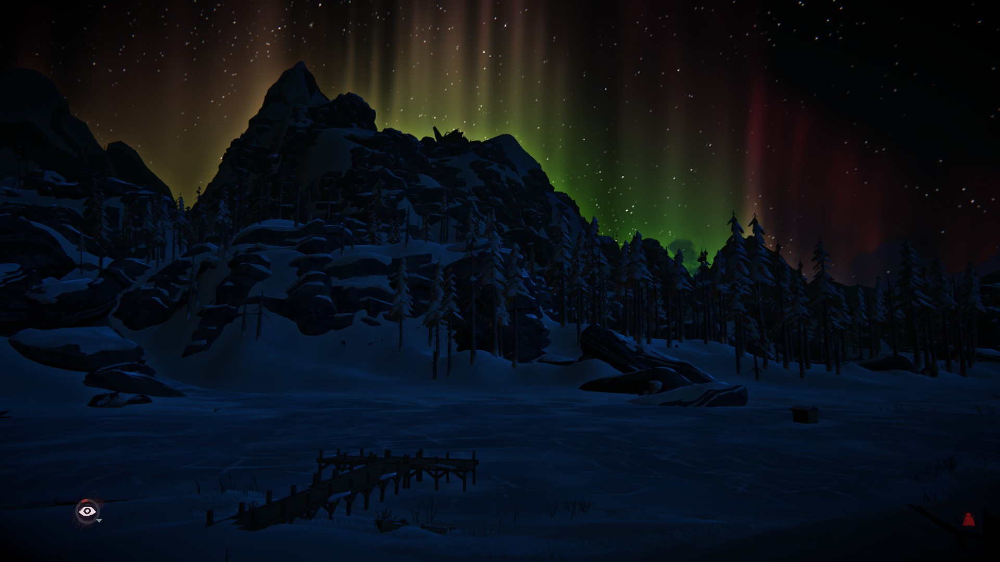
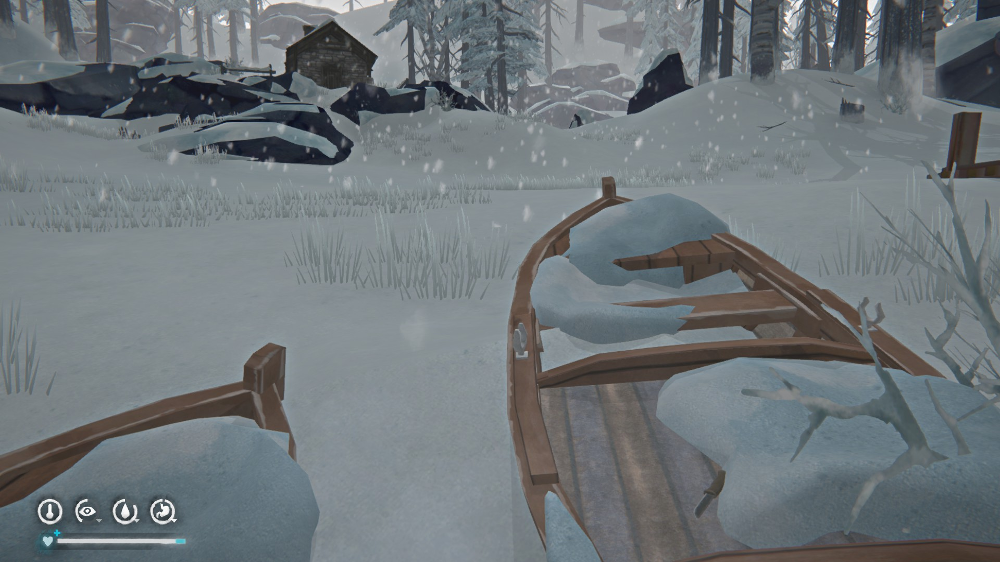
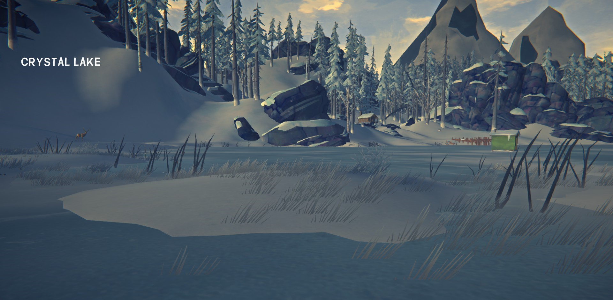

# Crystal Lake

**Categories:** Lakes, Locations, Locations in Timberwolf Mountain, Outdoor locations, Sheltered locations · **Source:** [Fandom](https://thelongdark.fandom.com/wiki/Crystal_Lake)

**Crystal Lake**

| Property | Details |
| --- | --- |
|  | [Crystal Lake](../assets/Crystal_Lake.png) |
| **Location** |  |
|  | [Crystal Lake Location](../assets/Crystal_Lake_Location.png) |
| Region | [Timberwolf Mountain](./Timberwolf%20Mountain.md) |
| Sublocations | [Mountaineer's Hut](./Mountaineer%27s%20Hut.md) |
| Description | A small freshwater lake |
| **General** |  |
| Type | Outdoors |
|  | Provides some shelter |

**Crystal Lake** is small frozen lake located in [Timberwolf Mountain](./Timberwolf%20Mountain.md).

## Overview

[Mountaineer's Hut](./Mountaineer%27s%20Hut.md) lies next to Crystal Lake.

The lake has a dock and a single [Fishing Hut](./Fishing%20Hut.md) with some supplies and an ice fishing hole for [Ice Fishing](./Ice%20Fishing.md). The dock may have a Hatchet stuck in one of the first wooden posts and a [Heavy Hammer](./Heavy%20Hammer.md) in one of the fishing boats.

A large number of [cat tail](./Cat%20Tail.md) plants can be found growing on the banks of the lake. [Rose hips](./Rose%20Hip.md) and [old man's beard lichen](./Old%20Man%27s%20Beard%20Lichen.md) can also be found in the area.

[Deer](./Deer.md) and other [wildlife](./Wildlife.md), including [wolves](./Wolf.md) and a possible [bear](./Bear.md) can frequently be found wandering by the lake if the player's [Scent](./Scent.md) is high from Ice Fishing. _Crystal Lake from above. Mountaineer's Hut is visible on the right side of the picture, along with the dock and the fishing hut is at the center of the lake._

## Gallery

