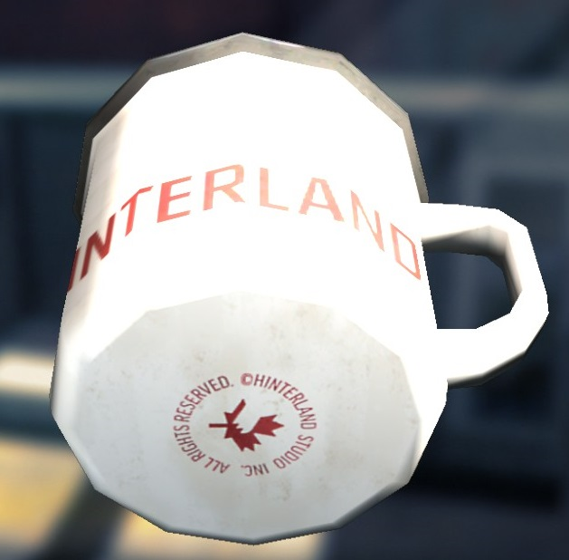
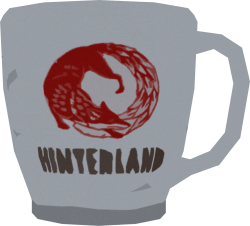
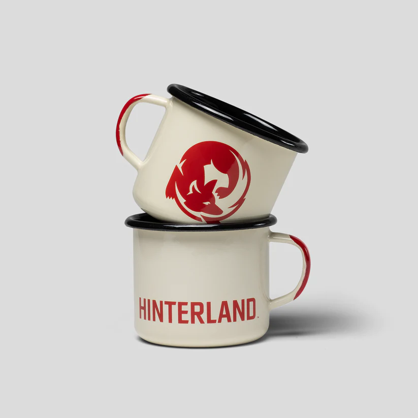

# Cup of Coffee

**Categories:** Food And Drink, Pages with update history · **Source:** [Fandom](https://thelongdark.fandom.com/wiki/Cup_of_Coffee)

**Contents**

- [Creation](#creation)
- [Effects](#effects)
- [Uses](#uses)
- [Trivia](#trivia)
- [Gallery](#gallery)
- [Update history](#update-history)

_For the item used to brew a Cup of Coffee, see [Tin of Coffee](./Tin%20of%20Coffee.md)._

**Cup of Coffee**

_Cup\_of\_Coffee\_icon.png_

**Release:** [17 December 2014](./The%20Long%20Dark%20%E2%80%94%20Changelog.md#0.181)

**Wintermute:** No

**Renewable:** Yes ([Trader](./Trader.md) only)

**Properties**

**Item type:** [Food And Drink](./Food%20And%20Drink.md)

**Stackable:** No

**Examine:** A cup of coffee.

**Values**

**Calories:** 100 kcal

**Hydration:** 30%

**Weight:** 0.10 kg (0.22 lbs)

**Actions**

**Backpack:** Drink, Drop

**Radial:** Drink, Place

**On ground:** Take It, Drink It, Leave It

**Advanced data**

**Item key:** GAMEPLAY\_CoffeeCup

A **Cup of Coffee** is a [Drink](./Food%20And%20Drink.md) which recovers 30% [Hydration](./Thirst.md) and provides 100 calories. Consuming a Cup of Coffee also gives the [Fatigue Reduced](./Fatigue%20Reduced.md) benefit. It is a much stronger version of a [Cup of Acorn Coffee](./Cup%20of%20Acorn%20Coffee.md). They can sometimes be found inside [Microwaves](./Microwave.md).

Survivors can brew a Cup of Coffee at a [fire](./Fire.md) with a [Tin of Coffee](./Tin%20of%20Coffee.md) and [Water (Potable)](./Water%20%28Potable%29.md).

## Creation

**Cup of Coffee**

12.5 minutes

[Water (Potable)](./Water%20%28Potable%29.md)

0.25

**Requirements**

**Item:** [Tin of Coffee](./Tin%20of%20Coffee.md)

**Quantity:** 1

## Effects

A Cup of Coffee can be consumed while either cold or hot. The following effects are applied to the survivor on consumption:

**Cold**

**Hot**

## Uses

Coffee is useful for [Rope Climbing](./Rope%20Climbing.md) by restoring fatigue, since fatigue affects climbing speed and climbing at low fatigue is dangerous. However, climbing is the only action which coffee does not reduce the rate of fatigue drain through Fatigue Reduced.

Another application of coffee is to restore [carry capacity](./Encumbrance.md), which is diminished below 50% Fatigue (slowing movement). One cup of coffee restores 10% of Fatigue. At 0% Fatigue [Condition](./Condition.md) is drained, so drinking coffee would temporarily avoid this damage.

Other items which restore fatigue, such as the [Emergency Stim](./Emergency%20Stim.md) and [Go! Energy Drink](./Go!%20Energy%20Drink.md), are rare. Additionally, these items have other uses, side effects, or may not be obtainable on all difficulty settings. It is advisable to save coffee for more specialized uses and use other hot beverages, such as [Birch Bark Tea](./Birch%20Bark%20Tea.md) or canned food, to obtain [Warming Up](./Warming%20Up.md).

## Trivia

- Cup of Coffee features the logo of Hinterland Games, the developers of _The Long Dark._ The base of the cup bears a copyright mark for Hinterland Studios Inc.
- Hinterland has released a real life Coffee Cup for sale.
- Similar to other teas Cups of Coffee don't degrade.

## Gallery

_Cup of coffee with copyright mark on the base._

_Old model._

_The real world Coffee Cup released by Hinterland_

## Update history

- UPDATE **19 May 2020 ([Update](./The%20Long%20Dark%20%E2%80%94%20Changelog.md#1.76)):**
  - \[Survival\] Cancelling while drinking Coffee will now award the appropriate amount of progress to the “Straight to the Heart” Feat.
- HOTFIX **20 March 2018 ([Update](./The%20Long%20Dark%20%E2%80%94%20Changelog.md#1.27)):**
  - \[Wintermute\] Fixed issue where Water in inventory was incorrectly counted, preventing Coffee and Tea brewing.
- HOTFIX **1 April 2015 ([Update](./The%20Long%20Dark%20%E2%80%94%20Early%20Access%20Changelog.md#0.212)):**
  - \[Bugs fixed\] Fixed exploit of getting full fatigue benefit from a partial cup of coffee.
- UPDATE **17 December 2014 ([Update](./The%20Long%20Dark%20%E2%80%94%20Early%20Access%20Changelog.md#0.181)):**
  - Added to game.
