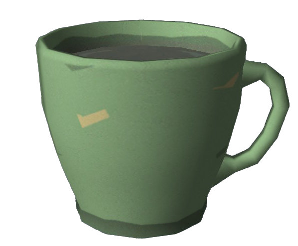
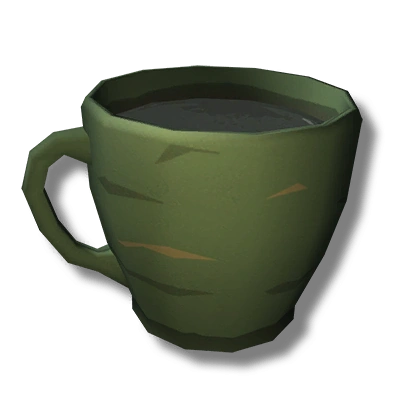

# Cup of Herbal Tea

**Contents**

- [Overview](#Overview)
- [Recipe](#Recipe)
- [Trivia](#Trivia)
- [Gallery](#Gallery)
- [Update history](#Update_history)

<table class="infobox">
<caption>Cup of Herbal Tea</caption>
<colgroup>
<col style="width: 50%" />
<col style="width: 50%" />
</colgroup>
<tbody>
<tr>
<td colspan="2"><figure>

<figcaption>Cup_of_Herbal_Tea_icon.png</figcaption>
</figure></td>
</tr>
<tr>
<td>
Release
</td>
<td>
<a href="./The%20Long%20Dark%20%E2%80%94%20Changelog.md#0.181" class="wikilink" title="17 December 2014">17 December 2014</a>
</td>
</tr>
<tr>
<td>
Wintermute
</td>
<td>
No
</td>
</tr>
<tr>
<td>
Renewable
</td>
<td>
Yes
</td>
</tr>
<tr>
<td colspan="2" class="section">
<strong>Properties</strong>
</td>
</tr>
<tr>
<td>
Item type
</td>
<td>
<a href="./Food%20And%20Drink.md" class="wikilink" title="Food And Drink">Food And Drink</a>|-
</td>
</tr>
<tr>
<td>
Stackable
</td>
<td>
No
</td>
</tr>
<tr>
<td>
Examine
</td>
<td>
A cup of tea.
</td>
</tr>
<tr>
<td colspan="2" class="section">
<strong>Values</strong>
</td>
</tr>
<tr>
<td>
Calories
</td>
<td>
100 kcal
</td>
</tr>
<tr>
<td>
Hydration
</td>
<td>
30%
</td>
</tr>
<tr>
<td>
<a href="./Scurvy.md" class="wikilink" title="Vitamin C">Vitamin C</a>
</td>
<td>
Minor (11%)
</td>
</tr>
<tr>
<td>
Weight
</td>
<td>
0.10 kg (0.22 lbs)
</td>
</tr>
<tr>
<td colspan="2" class="section">
<strong>Advanced data</strong>
</td>
</tr>
<tr>
<td>
Item key
</td>
<td>
GAMEPLAY_GreenTeaCup
</td>
</tr>
</tbody>
</table>

**Cup of Herbal Tea**is a <a href="./Food%20And%20Drink.md" class="wikilink" title="drink">drink</a> item in *The Long Dark.*

## Overview

Cup of Herbal Tea is cooked at a <a href="./Fire.md" class="wikilink" title="Fire">Fire</a> from one Herbal Tea package and 0.25 liters of <a href="./Water%20%28Potable%29.md" class="wikilink" title="Water (Potable)">Water (Potable)</a>. Drinking Herbal Tea restores hydration and a small amount of calories, as well as the benefit "<a href="./Improved%20Rest.md" class="wikilink" title="Improved Rest">Improved Rest</a>" which increases the <a href="./Condition.md" class="wikilink" title="Condition">Condition</a> restored by <a href="./Sleep.md" class="wikilink" title="Sleep">Sleep</a> by an additional 2% (1% for Interloper) per hour, if all four <a href="./Needs.md" class="wikilink" title="needs">needs</a> are met. This benefit lasts for 12 hours once drunk or 6 hours of sleep.

Herbal Tea may be heated at a fire to apply the <a href="./Warming%20Up.md" class="wikilink" title="Warming Up">Warming Up</a> benefit. Cooking Herbal Tea grants skill in <a href="./Skills.md" class="wikilink" title="Cooking Skill">Cooking Skill</a>. Herbal Tea is sometimes found inside of <a href="./Microwave.md" class="wikilink" title="Microwaves">Microwaves</a>.

The benefit of Herbal Tea is similar to that of <a href="./Birch%20Bark%20Tea.md" class="wikilink" title="Birch Bark Tea">Birch Bark Tea</a>, being slightly more powerful but non-renewable and requires rest for the benefit to apply.

## Recipe

<table class="infobox">
<caption>Cup of Herbal Tea</caption>
<tbody>
<tr>
<td colspan="2">
<strong>Template:pic link plain</strong><a href="./Cooking.md" class="wikilink" title="Cooking">Cooking</a>
</td>
</tr>
<tr>
<td colspan="2">
-
</td>
</tr>
<tr>
<td colspan="2">
12.5 minutes
</td>
</tr>
<tr>
<td colspan="2" class="section">
<strong>Requirements</strong>
</td>
</tr>
<tr>
<td>
Facility
</td>
<td>
<strong>Template:iconlink</strong>
</td>
</tr>
<tr>
<td colspan="2" class="section">
<strong>Materials</strong>
</td>
</tr>
<tr>
<td colspan="2" class="section">
<strong>Template:iconlink plain</strong>
</td>
</tr>
<tr>
<td>
Item
</td>
<td>
<a href="./Herbal%20Tea.md" class="wikilink" title="Herbal Tea">Herbal Tea</a>
</td>
</tr>
<tr>
<td>
Quantity
</td>
<td>
1
</td>
</tr>
<tr>
<td colspan="2" class="section">
<strong>Template:iconlink plain</strong>
</td>
</tr>
<tr>
<td colspan="2">
<a href="./Water%20%28Potable%29.md" class="wikilink" title="Water (Potable)">Water (Potable)</a>
</td>
</tr>
<tr>
<td colspan="2">
0.25 L
</td>
</tr>
</tbody>
</table>

## Trivia

- Most Herbal Tea on <a href="./Great%20Bear%20Island.md" class="wikilink" title="Great Bear Island">Great Bear Island</a> can be found inside of <a href="./Cargo%20Container.md" class="wikilink" title="Cargo Container">Cargo Containers</a> in <a href="./Timberwolf%20Mountain.md" class="wikilink" title="Timberwolf Mountain">Timberwolf Mountain</a>, and also rarely in all regions: usually inside cupboards (tins) or inside of microwaves (cups).
- Teas and Coffee are more weight efficient than Water, for the Hydration they grant. (0.1kg of Tea grants 30% Hydration, the same as 0.25kg of water).
- Teas and Coffee never spoil once cooked.
- Teas and Coffee may be heated to grant Warming Up by playing them on a fire's cooking spot, or simply nearby a lit fire.

## Gallery

<table class="gallery">
<colgroup>
<col style="width: 50%" />
<col style="width: 50%" />
</colgroup>
<tbody>
<tr>
<td><figure>

<figcaption>old model</figcaption>
</figure></td>
<td><figure>

<figcaption>Old icon</figcaption>
</figure></td>
</tr>
</tbody>
</table>

## Update history

- HOTFIX **20 March 2018 (<a href="./The%20Long%20Dark%20%E2%80%94%20Changelog.md#1.27" class="wikilink" title="Update">Update</a>):**
  - \[Wintermute\] Fixed issue where Water in inventory was incorrectly counted, preventing Coffee and Tea brewing.
- UPDATE **17 December 2014 (<a href="./The%20Long%20Dark%20%E2%80%94%20Early%20Access%20Changelog.md#0.181" class="wikilink" title="Update">Update</a>):**
  - Added to game.

**Lua execution error in Module:Navbox function navbox** <a href="fr:Cup_of_Herbal_Tea" class="wikilink" title="fr:Cup of Herbal Tea">fr:Cup of Herbal Tea</a> <a href="ru:%D0%A7%D0%B0%D1%88%D0%BA%D0%B0_%D1%82%D1%80%D0%B0%D0%B2%D1%8F%D0%BD%D0%BE%D0%B3%D0%BE_%D1%87%D0%B0%D1%8F" class="wikilink" title="ru:Чашка травяного чая">ru:Чашка травяного чая</a>

