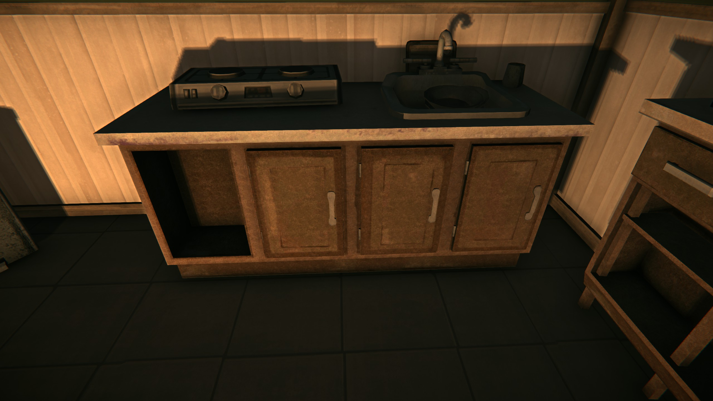

# Cupboard

**Cupboard**

| Property | Details |
| --- | --- |
| \[\[File: / \|  / *Kitchen* \|  / *Fishing Hut* \| / \| --- \| --- \| | 250px\]\] |
|  / *Kitchen* |  / *Fishing Hut* |
| **General** |  |
| Item Type | Item |
| Wintermute | No |

A **Cupboard** is a storage object found in many kitchens and Ice [Fishing Huts](./Fishing%20Hut.md).

15.00 kg storage.

**Lua execution error in Module:Navbox function navbox**
