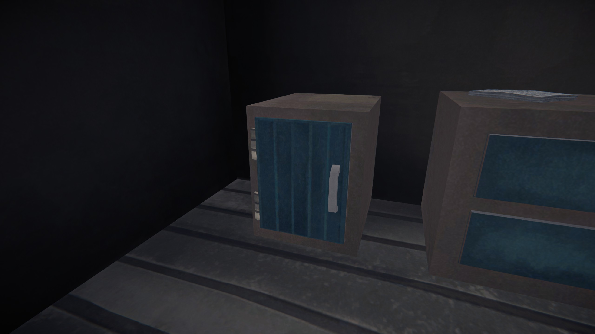

# Cupboard

**Categories:** Interactable Objects · **Source:** [Fandom](https://thelongdark.fandom.com/wiki/Cupboard)

**Cupboard**

\[\[File: /  / _Kitchen_ /  / _Fishing Hut_

250px\]\]

_Kitchen_

_Fishing Hut_

**General**

**Item Type:** Item

**Wintermute:** No

A **Cupboard** is a storage object found in many kitchens and Ice [Fishing Huts](./Fishing%20Hut.md).

15.00 kg storage.
