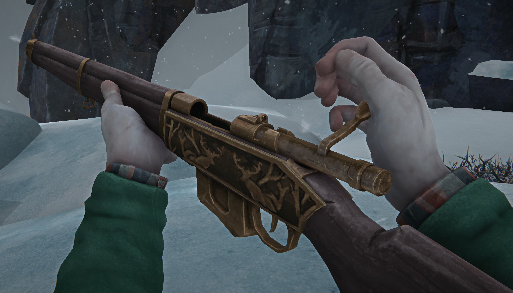
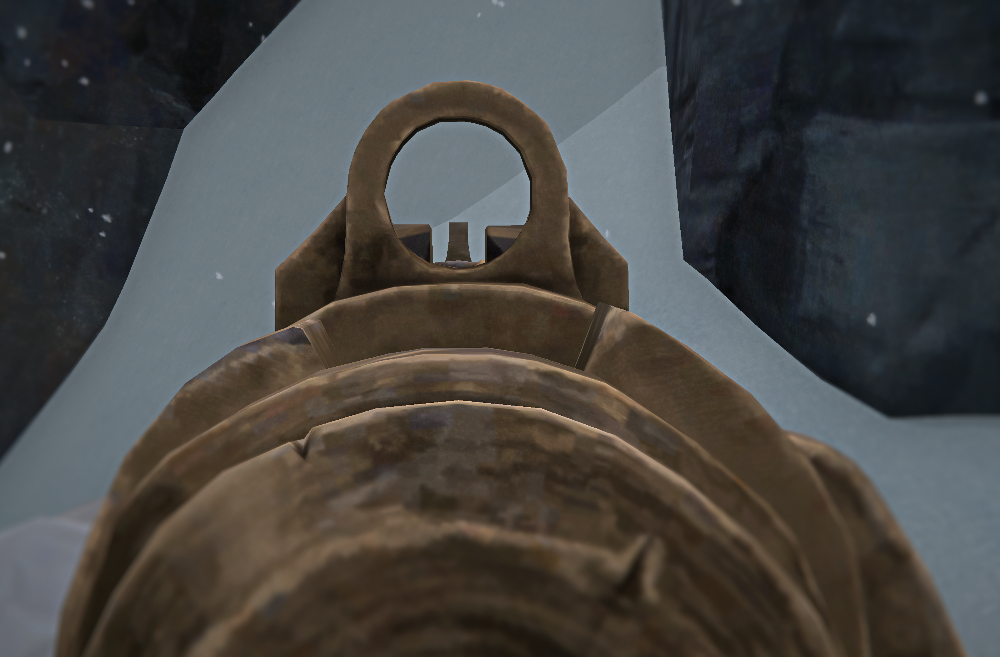

# Curator's Rifle

**Categories:** DLC Content, Pages with update history, Tools · **Source:** [Fandom](https://thelongdark.fandom.com/wiki/Curator's_Rifle)

**Contents**

- [Overview](#overview)
- [Rifle Range](#rifle-range)
- [Locations](#locations)
- [Difference from Hunting Rifle](#difference-from-hunting-rifle)
- [Trivia](#trivia)
- [Gallery](#gallery)
- [Update history](#update-history)

**DLC-Exclusive content.**

This content requires the [Tales from the Far Territory](./Tales%20from%20the%20Far%20Territory.md) addon to be installed before it can be seen or used in regular gameplay.

**Curator's Rifle**

[Curator's Rifle icon](../assets/Curator%27s_Rifle_icon.png)

**Release:** [5 December 2022](./The%20Long%20Dark%20%E2%80%94%20Changelog.md#2.03)

**Wintermute:** No

**Renewable:** No (unique item)

**Properties**

**Item type:** [Tools](./Tools.md)

**Stackable:** No

**Examine:** This .303 extracts a terrible price at distance thanks to its meticulous construction. Missing from the collection of an enigmatic local collector of rare firearms, this weapon is oiled and engraved for purpose. A legacy at work.

**Values**

**Weight:** 4.00 kg (8.8 lbs)

**Actions**

**Backpack:** Use, Actions, Drop

**On ground:** Take It, Equip It, Leave It

**Advanced data**

**Item key:** GEAR\_Rifle\_Curators

**Curator's Rifle** is a unique variant of the [Hunting Rifle](./Hunting%20Rifle.md) in _The Long Dark_, added by the _[Tales from the Far Territory](./Tales%20from%20the%20Far%20Territory.md)_ expansion.

<!-- #Overview -->
​

<!-- #overview -->
## Overview

The Curator's Rifle in addition to looking fancy, offers an increased range of 33.3% over the standard Hunting Rifle [Around 66 meters]. Unlike the other variants this bonus comes with no downside, making it a direct upgrade to the standard Hunting Rifle.

The small range increase makes this variant superior at sniping distant [Bears](./Bear.md) or [Moose](./Moose.md), leaving more time for you to react to a potential charge, though the rifle's tendency to sway and scarcity of rifle ammunition makes this bonus risky to use.

Successful hits on live animals provide experience to the [Rifle Firearm](./Rifle%20Firearm.md) skill.

<!-- #rifle_range -->
​

<!-- #Rifle_Range -->
​

<!-- #Rifle_range -->
​

<!-- #rifle-range -->
## Rifle Range

The range increase is applied to a ray-trace fired from the center of the screen when a shot is fired, normally the standard Hunting Rifle ray-trace range is about 50 meters long, but the Curators Rifle's is just over 66 meters long. Past this range the weapon will be unable to damage any [Wildlife](./Wildlife.md). These are the base ranges when at [Rifle Skill Level 1](./Rifle%20Firearm.md), at level 5 a 40% bonus is applied to these ranges which combined with the Curator's Rifle's 33.3% gives the rifle a potential maximum range of just over 86 meters or a 73.3% additional range over the base 50.

<!-- #Locations -->
​

<!-- #locations -->
## Locations

The Curator's Rifle will spawn a single time per world in various states of repair in a set of randomly selected [Ash Canyon](./Ash%20Canyon.md) locations such as:

- At [High Meadow](./High%20Meadow.md) next to a corpse at the vista location.
- At the [Gold Mine](./Gold%20Mine.md) next to a corpse at the top of the waterfall.
- Next to a corpse on the ledge along the [Gold Mine](./Gold%20Mine.md) path near [Wolf's Jaw Overlook](./Wolf%27s%20Jaw%20Overlook.md).
- Next to a corpse by the tree at [Wolf's Jaw Overlook](./Wolf%27s%20Jaw%20Overlook.md) near the rose hip climb.
- In the cave with the bed at the top of the [Runaway Bridge](./Runaway%20Bridge.md) plateau across the fallen tree.

<!-- #difference_from_hunting_rifle -->
​

<!-- #Difference_from_Hunting_Rifle -->
​

<!-- #Difference_from_hunting_rifle -->
​

<!-- #Difference_From_Hunting_Rifle -->
​

<!-- #difference-from-hunting-rifle -->
## Difference from Hunting Rifle

- Range is 33.3% farther than the Hunting Rifle

<!-- #Trivia -->
​

<!-- #trivia -->
## Trivia

- The rifle's furniture appears to be made out of now old and faded purpleheart wood and has a golden action with deer engravings on the sides, its premium construction materials give it a striking beauty.
- A small detail is that the 5-round stripper-clips used to load the gun are also made of the distinctive gold plating that matches the gold engravings on the rifle.
- The rifles small upside and lack of downside makes it unique compared to the other variants which usually have a downside to compensate for a large bonus.
- The Curator's Rifle's model originally appeared as a [second hunting rifle](./Hunting%20Lodge%20Rifle.md) in [Episode 2: Luminance Fugue](./Episode%202%20-%20Luminance%20Fugue.md) that could be found during the quest [You Fix My Rifle?](./You%20Fix%20My%20Rifle%3F.md). This rifle model was later removed from the [Wintermute](./Wintermute.md) story mode following the Redux update.

<!-- #Gallery -->
​

<!-- #gallery -->
## Gallery

_The [Hunting Lodge Rifle](./Hunting%20Lodge%20Rifle.md) shares the same engravings, without the Purplewood and with silver metal._

<!-- #update_history -->
​

<!-- #Update_history -->
​

<!-- #Update_History -->
​

<!-- #update-history -->
## Update history

- UPDATE **5 December 2022 ([Update](./The%20Long%20Dark%20%E2%80%94%20Changelog.md#2.03)):**
  - Added to game.
