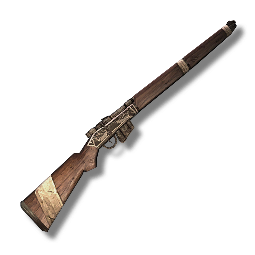

# Curator's Rifle

**Categories:** DLC Content, Pages with update history, Tools · **Source:** [Fandom](https://thelongdark.fandom.com/wiki/Curator's_Rifle)

**Contents**

- [Overview](#overview)
- [Rifle Range](#rifle-range)
- [Locations](#locations)
- [Difference from Hunting Rifle](#difference-from-hunting-rifle)
- [Trivia](#trivia)
- [Gallery](#gallery)
- [Update history](#update-history)

_Ptarmigan\_icon.png_

**DLC-Exclusive content.** / This content requires the [Tales from the Far Territory](./Tales%20from%20the%20Far%20Territory.md) addon to be installed before it can be seen or used in regular gameplay.

_Curator's\_Rifle\_icon.png_

**Release:** [5 December 2022](./The%20Long%20Dark%20%E2%80%94%20Changelog.md#2.03)

**Wintermute:** No

**Renewable:** No (unique item)

**Properties**

**Item type:** [Tools](./Tools.md)\|-

**Stackable:** No

**Examine:** This .303 extracts a terrible price at distance thanks to its meticulous construction. Missing from the collection of an enigmatic local collector of rare firearms, this weapon is oiled and engraved for purpose. / A legacy at work.

**Values**

**Weight:** 4.00 kg (8.8 lbs)

**Actions**

**Backpack:** Use, Actions, Drop

**On ground:** Take It, Equip It, Leave It

**Advanced data**

**Item key:** GEAR\_Rifle\_Curators

_The open bolt of the curators rifle._

_Curators Rifle Ground Model_

_The [Hunting Lodge Rifle](./Hunting%20Lodge%20Rifle.md) shares the same engravings, without the Purplewood and with silver metal._

_Curators Rifle Iron Sights_

_Sometimes the rifle can be found here along the path to the gold mine near the polaroid box and cliff ledge past the rock overhang._
