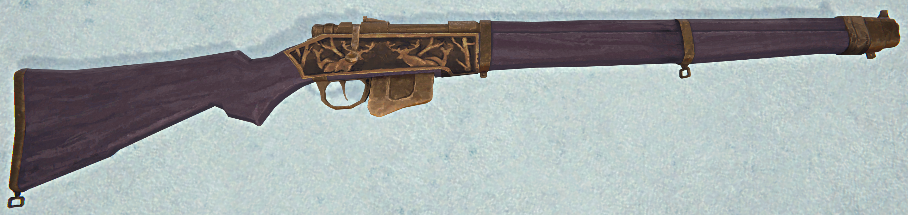

# Curator's Rifle

**Contents**

- [Overview](#Overview)
- [Rifle Range](#Rifle_Range)
- [Locations](#Locations)
- [Difference from Hunting Rifle](#Difference_from_Hunting_Rifle)
- [Trivia](#Trivia)
- [Gallery](#Gallery)
- [Update history](#Update_history)

<table>
<colgroup>
<col style="width: 33%" />
<col style="width: 33%" />
<col style="width: 33%" />
</colgroup>
<tbody>
<tr>
<td width="40px"><figure>
[Missing image: Ptarmigan_icon.png]
<figcaption>Ptarmigan_icon.png</figcaption>
</figure></td>
<td>
<strong>DLC-Exclusive content.</strong> 

This content requires the <a href="./Tales%20from%20the%20Far%20Territory.md" class="wikilink" title="Tales from the Far Territory">Tales from the Far Territory</a> addon to be installed before it can be seen or used in regular gameplay.

</td>
<td>
|}

<table class="infobox">
<caption>Curator's Rifle</caption>
<colgroup>
<col style="width: 50%" />
<col style="width: 50%" />
</colgroup>
<tbody>
<tr>
<td colspan="2"><figure>

<figcaption>Curator's_Rifle_icon.png</figcaption>
</figure></td>
</tr>
<tr>
<td>
Release
</td>
<td>
<a href="./The%20Long%20Dark%20%E2%80%94%20Changelog.md#2.03" class="wikilink" title="5 December 2022">5 December 2022</a>
</td>
</tr>
<tr>
<td>
Wintermute
</td>
<td>
No
</td>
</tr>
<tr>
<td>
Renewable
</td>
<td>
No (unique item)
</td>
</tr>
<tr>
<td colspan="2" class="section">
<strong>Properties</strong>
</td>
</tr>
<tr>
<td>
Item type
</td>
<td>
<a href="./Tools.md" class="wikilink" title="Tools">Tools</a>|-
</td>
</tr>
<tr>
<td>
Stackable
</td>
<td>
No
</td>
</tr>
<tr>
<td>
Examine
</td>
<td>
This .303 extracts a terrible price at distance thanks to its meticulous construction. Missing from the collection of an enigmatic local collector of rare firearms, this weapon is oiled and engraved for purpose. 
 
A legacy at work.
</td>
</tr>
<tr>
<td colspan="2" class="section">
<strong>Values</strong>
</td>
</tr>
<tr>
<td>
Weight
</td>
<td>
4.00 kg (8.8 lbs)
</td>
</tr>
<tr>
<td colspan="2" class="section">
<strong>Actions</strong>
</td>
</tr>
<tr>
<td>
Backpack
</td>
<td>
Use, Actions, Drop
</td>
</tr>
<tr>
<td>
On ground
</td>
<td>
Take It, Equip It, Leave It
</td>
</tr>
<tr>
<td colspan="2" class="section">
<strong>Advanced data</strong>
</td>
</tr>
<tr>
<td>
Item key
</td>
<td>
GEAR_Rifle_Curators
</td>
</tr>
</tbody>
</table>

<strong>Curator's Rifle</strong> is a unique variant of the <a href="./Hunting%20Rifle.md" class="wikilink" title="Hunting Rifle">Hunting Rifle</a> in <em>The Long Dark</em>, added by the <em><a href="./Tales%20from%20the%20Far%20Territory.md" class="wikilink" title="Tales from the Far Territory">Tales from the Far Territory</a></em> expansion.

<h2 id="Overview">Overview</h2>

The Curator's Rifle in addition to looking fancy, offers an increased range of 33.3% over the standard Hunting Rifle [Around 66 meters]. Unlike the other variants this bonus comes with no downside, making it a direct upgrade to the standard Hunting Rifle.

The small range increase makes this variant superior at sniping distant <a href="./Bear.md" class="wikilink" title="Bears">Bears</a> or <a href="./Moose.md" class="wikilink" title="Moose">Moose</a>, leaving more time for you to react to a potential charge, though the rifle's tendency to sway and scarcity of rifle ammunition makes this bonus risky to use.

Successful hits on live animals provide experience to the <a href="./Rifle%20Firearm.md" class="wikilink" title="Rifle Firearm">Rifle Firearm</a> skill.

<h2 id="Rifle_Range">Rifle Range</h2>

The range increase is applied to a ray-trace fired from the center of the screen when a shot is fired, normally the standard Hunting Rifle ray-trace range is about 50 meters long, but the Curators Rifle's is just over 66 meters long. Past this range the weapon will be unable to damage any <a href="./Wildlife.md" class="wikilink" title="Wildlife">Wildlife</a>. These are the base ranges when at <a href="./Rifle%20Firearm.md" class="wikilink" title="Rifle Skill Level 1">Rifle Skill Level 1</a>, at level 5 a 40% bonus is applied to these ranges which combined with the Curator's Rifle's 33.3% gives the rifle a potential maximum range of just over 86 meters or a 73.3% additional range over the base 50.

<h2 id="Locations">Locations</h2>

The Curator's Rifle will spawn a single time per world in various states of repair in a set of randomly selected <a href="./Ash%20Canyon.md" class="wikilink" title="Ash Canyon">Ash Canyon</a> locations such as:

<ul>
<li>At <a href="./High%20Meadow.md" class="wikilink" title="High Meadow">High Meadow</a> next to a corpse at the vista location.</li>
<li>At the <a href="./Gold%20Mine.md" class="wikilink" title="Gold Mine">Gold Mine</a> next to a corpse at the top of the waterfall.</li>
<li>Next to a corpse on the ledge along the <a href="./Gold%20Mine.md" class="wikilink" title="Gold Mine">Gold Mine</a> path near <a href="./Wolf%27s%20Jaw%20Overlook.md" class="wikilink" title="Wolf&#39;s Jaw Overlook">Wolf's Jaw Overlook</a>.</li>
<li>Next to a corpse by the tree at <a href="./Wolf%27s%20Jaw%20Overlook.md" class="wikilink" title="Wolf&#39;s Jaw Overlook">Wolf's Jaw Overlook</a> near the rose hip climb.</li>
<li>In the cave with the bed at the top of the <a href="./Runaway%20Bridge.md" class="wikilink" title="Runaway Bridge">Runaway Bridge</a> plateau across the fallen tree.</li>
</ul>
<h2 id="Difference_from_Hunting_Rifle">Difference from Hunting Rifle</h2>
<ul>
<li>Range is 33.3% farther than the Hunting Rifle</li>
</ul>
<h2 id="Trivia">Trivia</h2>
<ul>
<li>The rifle's furniture appears to be made out of now old and faded purpleheart wood and has a golden action with deer engravings on the sides, its premium construction materials give it a striking beauty.</li>
<li>A small detail is that the 5-round stripper-clips used to load the gun are also made of the distinctive gold plating that matches the gold engravings on the rifle.</li>
<li>The rifles small upside and lack of downside makes it unique compared to the other variants which usually have a downside to compensate for a large bonus.</li>
<li>The Curator's Rifle's model originally appeared as a <a href="./Hunting%20Lodge%20Rifle.md" class="wikilink" title="second hunting rifle">second hunting rifle</a> in <a href="./Episode%202%20-%20Luminance%20Fugue.md" class="wikilink" title="Episode 2: Luminance Fugue">Episode 2: Luminance Fugue</a> that could be found during the quest You Fix My Rifle?. This rifle model was later removed from the <a href="./Wintermute.md" class="wikilink" title="Wintermute">Wintermute</a> story mode following the Redux update.</li>
</ul>
<h2 id="Gallery">Gallery</h2>
<table class="gallery">
<colgroup>
<col style="width: 25%" />
<col style="width: 25%" />
<col style="width: 25%" />
<col style="width: 25%" />
</colgroup>
<tbody>
<tr>
<td><figure>

<figcaption>The open bolt of the curators rifle.</figcaption>
</figure></td>
<td><figure>

<figcaption>Curators Rifle Ground Model</figcaption>
</figure></td>
<td><figure>

<figcaption>The <a href="./Hunting%20Lodge%20Rifle.md" class="wikilink" title="Hunting Lodge Rifle">Hunting Lodge Rifle</a> shares the same engravings, without the Purplewood and with silver metal.</figcaption>
</figure></td>
<td><figure>

<figcaption>Curators Rifle Iron Sights</figcaption>
</figure></td>
</tr>
<tr>
<td><figure>

<figcaption>Sometimes the rifle can be found here along the path to the gold mine near the polaroid box and cliff ledge past the rock overhang.</figcaption>
</figure></td>
<td></td>
<td></td>
<td></td>
</tr>
</tbody>
</table>
<h2 id="Update_history">Update history</h2>

<ul>
<li>UPDATE <strong>5 December 2022 (<a href="./The%20Long%20Dark%20%E2%80%94%20Changelog.md#2.03" class="wikilink" title="Update">Update</a>):</strong>
<ul>
<li>Added to game.</li>
</ul></li>
</ul>

<strong>Lua execution error in Module:Navbox function navbox</strong> <a href="ru:%D0%92%D0%B8%D0%BD%D1%82%D0%BE%D0%B2%D0%BA%D0%B0_%D0%9A%D1%83%D1%80%D0%B0%D1%82%D0%BE%D1%80%D0%B0" class="wikilink" title="ru:Винтовка Куратора">ru:Винтовка Куратора</a>
</td>
</tr>
</tbody>
</table>

