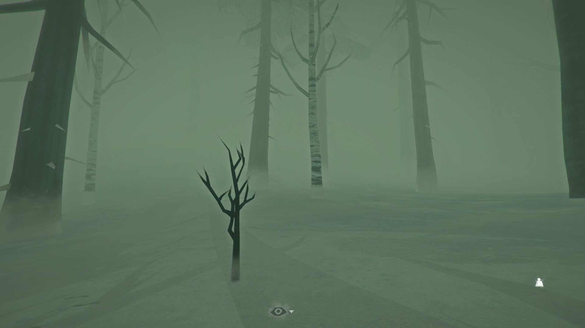
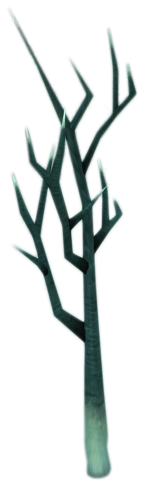

# Cured Birch Sapling

**Cured Birch Sapling**

| Property | Details |
| --- | --- |
|  |  / *Cured\_Birch\_Sapling\_icon.png* |
| Release | [22 May 2015](./The%20Long%20Dark%20%E2%80%94%20Changelog.md#0.233) |
| Wintermute | No |
| Renewable | Yes |
| **Properties** |  |
| Item type | [Materials](./Materials.md)\|- |
| Stackable | No |
| Examine | Small birch sapling that has been cured. Can be used for crafting and repair. |
| **Values** |  |
| Weight | 0.20 kg (0.44 lbs) |
| **Actions** |  |
| Backpack | Take It, Leave It |

**Cured Birch Saplings** are the cured version of a [Green Birch Sapling](./Green%20Birch%20Sapling.md).

Once dried, the Green Birch Sapling will become a Cured Birch Sapling and will appear to be a more dull brown color. The cured sapling can then be used for crafting [Arrow Shafts](./Arrow%20Shaft.md). Both Green and Cured Birch Saplings never [Decay](./Decay.md), and will always be at 100% Condition.

The player can use a [Hunting Knife](./Hunting%20Knife.md) or Hatchet (or their improvised versions) to craft a cured birch sapling into 3 Arrow Shafts at a [Work Bench](./Work%20Bench.md).

## Products

## Gallery

| Column 1 | Column 2 | Column 3 |
| --- | --- | --- |
|  / *A birch sapling near several birch trees old* |  / *A growing birch sapling old* |  / *A birch sapling as it appears on the [map](./Map.md)* |

## Update history

- UPDATE **22 May 2015 ([Update](./The%20Long%20Dark%20%E2%80%94%20Early%20Access%20Changelog.md#0.223)):**
  - Added to game

**Lua execution error in Module:Navbox function navbox** [ru:Сухая молодая береза](ru:%D0%A1%D1%83%D1%85%D0%B0%D1%8F_%D0%BC%D0%BE%D0%BB%D0%BE%D0%B4%D0%B0%D1%8F_%D0%B1%D0%B5%D1%80%D0%B5%D0%B7%D0%B0)
