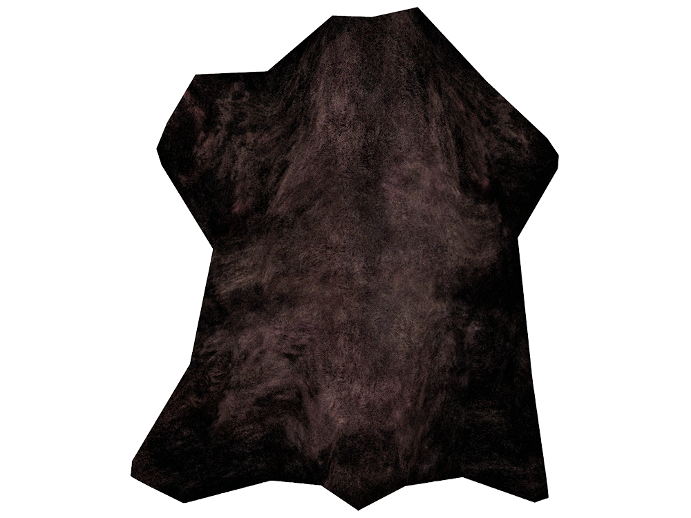

# Cured Black Bear Hide

**Categories:** Materials, Pages with update history · **Source:** [Fandom](https://thelongdark.fandom.com/wiki/Cured_Black_Bear_Hide)

**Contents**

- [Overview](#overview)
- [Gallery](#gallery)
- [Products](#products)
- [Update history](#update-history)

**Cured Black Bear Hide**

**Release:** [22 May 2015](./The%20Long%20Dark%20%E2%80%94%20Changelog.md#0.233)

**Wintermute:** No

**Properties**

**Item type:** [Materials](./Materials.md)

**Stackable:** No

**Examine:** Fur and skin of a Black bear. Can be used for crafting and repair.

**Values**

**Weight:** 1.00 kg (2.2 lbs)

**Advanced data**

**Item key:** GAMEPLAY\_BearHideDried

**Cured Black Bear Hide** is the Cured fur and skin of a [Fresh Black Bear Hide](./Fresh%20Black%20Bear%20Hide.md). It can be used as a [Material](./Materials.md) for crafting or repairing [Bearskin Coat](./Bearskin%20Coat.md) and [Bear Skin Bedroll](./Bear%20Skin%20Bedroll.md).

## Overview

Fresh Black Bear Hide acquired by harvesting a [Bear Carcass](./Black%20Bear%20Carcass.md) and can be cured by leaving them indoors for 12 days (in-game). Cured black bear hides are used for crafting or repairing Bearskin Coats and Bear Skin Bedrolls. Once cured, the hide will take on a darker complexion, and can then be used for crafting.

Black bear hides can be hard and resource-expensive to obtain, since they requiring the shooting of a bear with a [weapon](./Tools.md), as there are no naturally occurring bear carcasses. Each [bear](./Bear.md) carcass will have one hide, along with [meat](./Bear%20Meat%20%28Raw%29.md) and [Fresh Gut](./Fresh%20Gut.md).

One Cured Black Bear Hide can be found in a [Memento Cache](./Mementos.md) inside [Peak Cave](./Peak%20Cave.md), in the [Hushed River Valley](./Hushed%20River%20Valley.md).

## Gallery

## Products

| Item | Skills | Materials |
| --- | --- | --- |
| [Bear Hide Bed](./Bear%20Hide%20Bed.md) | None | - 18 × [Fir Firewood](./Fir%20Firewood.md) - 4 × [Cured Gut](./Cured%20Gut.md) - 1 × [Cured Black Bear Hide](./Cured%20Black%20Bear%20Hide.md) - 16 × [Ptarmigan Down](./Ptarmigan%20Down.md) |
| [Bear Hide Rug](./Bear%20Hide%20Rug.md) | None | - 1 × [Cured Deer Hide](./Cured%20Deer%20Hide.md) - 1 × [Cured Black Bear Hide](./Cured%20Black%20Bear%20Hide.md) - 2 × [Cured Gut](./Cured%20Gut.md) |
| [Bear Skin Bedroll](./Bear%20Skin%20Bedroll.md) | None | - 2 × [Cured Black Bear Hide](./Cured%20Black%20Bear%20Hide.md) - 5 × [Cloth](./Cloth.md) - 6 × [Cured Gut](./Cured%20Gut.md) |
| [Bearskin Coat](./Bearskin%20Coat.md) | None | - 2 × [Cured Black Bear Hide](./Cured%20Black%20Bear%20Hide.md) - 4 × [Cured Gut](./Cured%20Gut.md) |

## Update history

- UPDATE **22 May 2015 ([Update](./The%20Long%20Dark%20%E2%80%94%20Early%20Access%20Changelog.md#0.233)):**
  - Added to game.
