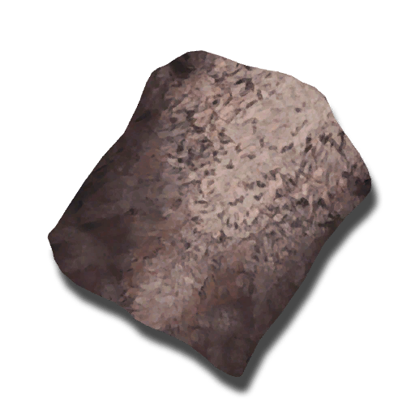

# Cured Cougar Hide

**Cured Cougar Hide**

| Property | Details |
| --- | --- |
|  |  / *Cured\_Cougar\_Hide\_icon.png* |
| Release | [24 June 2024](./The%20Long%20Dark%20%E2%80%94%20Changelog.md#2.28) |
| Wintermute | No |
| **Properties** |  |
| Item type | [Materials](./Materials.md)\|- |
| Stackable | No |
| Examine | Hide from a Cougar. A reminder of the predator's fearsome strength. Can be used for crafting and repair. |
| **Values** |  |
| Weight | 0.75 kg (1.65 lbs) |
| **Advanced data** |  |
| Item key | GAMEPLAY\_CougarHideDried |

| Column 1 | Column 2 | Column 3 |
| --- | --- | --- |
|  / *Ptarmigan\_icon.png* | **DLC-Exclusive content.** / This content requires the [Tales from the Far Territory](./Tales%20from%20the%20Far%20Territory.md) addon to be installed before it can be seen or used in regular gameplay. | \|}A **Cured Cougar Hide** is a [Material](./Materials.md) that can be crafted into a [Cougar Hide Wrap](./Cougar%20Hide%20Wrap.md). / ## Products / \| Column 1 \| / \| --- \| / \|  / *Old Icon* \| / ## Update history / - UPDATE **24 June 2024 ([Update](./The%20Long%20Dark%20%E2%80%94%20Changelog.md#2.28)):** / - Added to game. / **Lua execution error in Module:Navbox function navbox** / [ru:Высушенная шкура пумы](ru:%D0%92%D1%8B%D1%81%D1%83%D1%88%D0%B5%D0%BD%D0%BD%D0%B0%D1%8F_%D1%88%D0%BA%D1%83%D1%80%D0%B0_%D0%BF%D1%83%D0%BC%D1%8B) |
|  / *Old Icon* |  |  |
