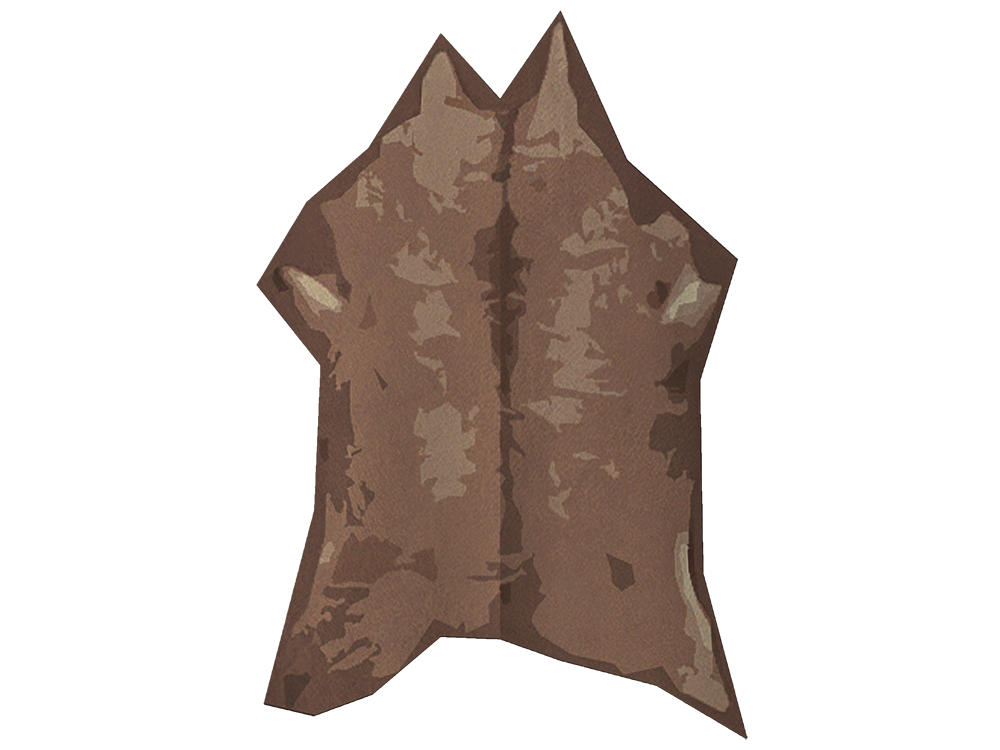

# Cured Deer Hide

**Categories:** Materials, Pages with update history · **Source:** [Fandom](https://thelongdark.fandom.com/wiki/Cured_Deer_Hide)

**Contents**

- [Overview](#overview)
- [Products](#products)
- [Gallery](#gallery)
- [Update history](#update-history)

**Cured Deer Hide**

[Cured Deer Hide icon](../assets/Cured_Deer_Hide_icon.png)

**Release:** [22 May 2015](./The%20Long%20Dark%20%E2%80%94%20Early%20Access%20Changelog.md#0.233)

**Wintermute:** No

**Renewable:** Yes

**Properties**

**Item type:** [Materials](./Materials.md)

**Stackable:** No

**Examine:** Hide from a Deer. Can be used for crafting and repair.

**Values**

**Weight:** 0.50 kg (1.1 lbs)

**Cured Deer Hide** is the dried hide of a [Fresh Deer Hide](./Fresh%20Deer%20Hide.md). It can be used as a [Material](./Materials.md) for crafting or repairing [Deerskin Pants](./Deerskin%20Pants.md) and [Deerskin Boots](./Deerskin%20Boots.md).

<!-- #Overview -->
​

<!-- #overview -->
## Overview

Cured Deer Hide is acquired by leaving [Fresh Deer Hide](./Fresh%20Deer%20Hide.md) indoors for 5 days (in-game). Once cured, the hide will take on a darker complexion, and can then be used for crafting.

<!-- #Products -->
​

<!-- #products -->
## Products

| Item | Skills | Materials |
| --- | --- | --- |
| [Bear Hide Rug](./Bear%20Hide%20Rug.md) | None | - 1 × [Cured Deer Hide](./Cured%20Deer%20Hide.md) - 1 × [Cured Black Bear Hide](./Cured%20Black%20Bear%20Hide.md) - 2 × [Cured Gut](./Cured%20Gut.md) |
| [Deerskin Boots](./Deerskin%20Boots.md) | None | - 2 × [Cured Deer Hide](./Cured%20Deer%20Hide.md) - 4 × [Cured Gut](./Cured%20Gut.md) |
| [Deerskin Pants](./Deerskin%20Pants.md) | None | - 3 × [Cured Deer Hide](./Cured%20Deer%20Hide.md) - 4 × [Cured Gut](./Cured%20Gut.md) |
| [Hide Chair](./Hide%20Chair.md) | None | - 8 × [Fir Firewood](./Fir%20Firewood.md) - 2 × [Cured Deer Hide](./Cured%20Deer%20Hide.md) - 8 × [Ptarmigan Down](./Ptarmigan%20Down.md) - 3 × [Cured Gut](./Cured%20Gut.md) |
| [Hide Couch](./Hide%20Couch.md) | None | - 15 × [Fir Firewood](./Fir%20Firewood.md) - 4 × [Cured Deer Hide](./Cured%20Deer%20Hide.md) - 16 × [Ptarmigan Down](./Ptarmigan%20Down.md) - 5 × [Cured Gut](./Cured%20Gut.md) |
| [Travois](./Travois.md) | None | - 1 × [Cured Deer Hide](./Cured%20Deer%20Hide.md) - 2 × [Cured Gut](./Cured%20Gut.md) - 4 × [Cured Maple Sapling](./Cured%20Maple%20Sapling.md) |

<!-- #Gallery -->
​

<!-- #gallery -->
## Gallery

<!-- #update_history -->
​

<!-- #Update_history -->
​

<!-- #Update_History -->
​

<!-- #update-history -->
## Update history

- UPDATE **30 March 2023 ([Update](./The%20Long%20Dark%20%E2%80%94%20Changelog.md#2.10)):**
  - Gameplay - Updated the Deer Pelt icon to better match the in-game item.
- HOTFIX **17 January 2019 ([Update](./The%20Long%20Dark%20%E2%80%94%20Changelog%20%E2%80%94%20Archive%201.md#1.46)):**
  - [WINTERMUTE] Fixed issue causing Grey Mother to float if a Deer Hide was placed under her chair.
- HOTFIX **21 April 2016 ([Update](./The%20Long%20Dark%20%E2%80%94%20Early%20Access%20Changelog.md#0.325)):**
  - Fixed issue where some containers could be inactive when containing hides.
- UPDATE **22 May 2015 ([Update](./The%20Long%20Dark%20%E2%80%94%20Early%20Access%20Changelog.md#0.233)):**
  - Added to game.
